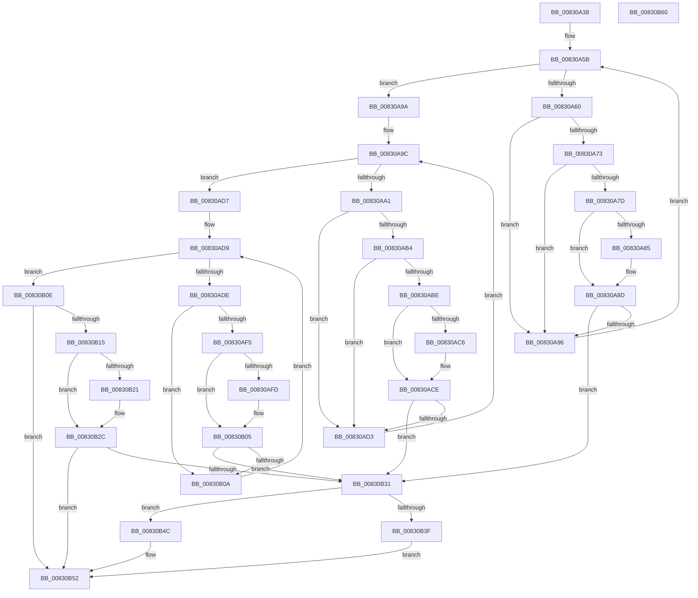

# CmGetInstallerClassMappedPropertyLocales

- RVA: `0x00830A38`–`0x00830B61` (길이 `297` bytes)
- VA: `0x0000000140830A38`
- 실행 섹션: `PAGE`
- PDB 이름 있음: `예`; PDB Function 태그: `아니요`
- unwind 정보 RVA: `0x000D30C4`
- 디코드: `87`개 명령, `297/297` bytes 표시
- 미해석 바이트: `0` (있으면 어셈블리에 `.byte`로 보존)

> 이 문서는 커널 이미지의 기계어와 PDB 기호를 분석해 생성했습니다. 4번과 5번은 함수 원형과 자료형을 바이너리 사용 방식에서 추정한 C 해석이며 원본 소스 복구 결과는 아닙니다.

## 1. Dependencies

- 직접 호출 지점: **0**; 고유 호출 대상: **0**
- 직접 호출자로 확인된 함수: **1**
- RIP 상대 이미지 참조: **3**

### Outgoing calls
- 직접 디코드된 call 명령이 없습니다.

### Direct callers
- [_PnpDispatchInstallerClass](../9D/_PnpDispatchInstallerClass_function_009D3580.md) at `0x009D3699`

### Static image references
- `0x00830A47` → RVA `0x00000000` (`image boundary/outside`; read)
- `0x00830B18` → RVA `0x000143F8` (`.rdata`; read)
- `0x00830B25` → RVA `0x00014400` (`.rdata`; read)

## 2. Other-region calls and transfers

- 다른 실행 섹션으로 향하는 call: **0**
- 별도 외부 분기/꼬리 이동을 확인하지 못했습니다.

## 3. Assembly (complete function range)

```asm
00830A38  48 89 5C 24 08                  mov qword ptr [rsp + 8], rbx
00830A3D  48 89 74 24 10                  mov qword ptr [rsp + 0x10], rsi
00830A42  4C 8B 5C 24 38                  mov r11, qword ptr [rsp + 0x38]
00830A47  48 8D 35 B2 F5 7C FF            lea rsi, [rip - 0x830a4e]
00830A4E  33 DB                           xor ebx, ebx
00830A50  41 BA 16 00 00 C0               mov r10d, 0xc0000016
00830A56  8B D3                           mov edx, ebx
00830A58  41 89 1B                        mov dword ptr [r11], ebx
00830A5B  83 FA 09                        cmp edx, 9
00830A5E  73 3A                           jae 0x140830a9a
00830A60  8B C2                           mov eax, edx
00830A62  48 8D 0C 40                     lea rcx, [rax + rax*2]
00830A66  4C 8B 84 CE 10 C7 B4 00         mov r8, qword ptr [rsi + rcx*8 + 0xb4c710]
00830A6E  4D 85 C0                        test r8, r8
00830A71  74 23                           je 0x140830a96
00830A73  41 8B 40 10                     mov eax, dword ptr [r8 + 0x10]
00830A77  41 39 41 10                     cmp dword ptr [r9 + 0x10], eax
00830A7B  75 19                           jne 0x140830a96
00830A7D  49 8B 09                        mov rcx, qword ptr [r9]
00830A80  49 2B 08                        sub rcx, qword ptr [r8]
00830A83  75 08                           jne 0x140830a8d
00830A85  49 8B 49 08                     mov rcx, qword ptr [r9 + 8]
00830A89  49 2B 48 08                     sub rcx, qword ptr [r8 + 8]
00830A8D  48 85 C9                        test rcx, rcx
00830A90  0F 84 9B 00 00 00               je 0x140830b31
00830A96  FF C2                           inc edx
00830A98  EB C1                           jmp 0x140830a5b
00830A9A  8B D3                           mov edx, ebx
00830A9C  83 FA 0D                        cmp edx, 0xd
00830A9F  73 36                           jae 0x140830ad7
00830AA1  8B C2                           mov eax, edx
00830AA3  48 C1 E0 05                     shl rax, 5
00830AA7  4C 8B 84 30 20 D3 B4 00         mov r8, qword ptr [rax + rsi + 0xb4d320]
00830AAF  4D 85 C0                        test r8, r8
00830AB2  74 1F                           je 0x140830ad3
00830AB4  41 8B 40 10                     mov eax, dword ptr [r8 + 0x10]
00830AB8  41 39 41 10                     cmp dword ptr [r9 + 0x10], eax
00830ABC  75 15                           jne 0x140830ad3
00830ABE  49 8B 09                        mov rcx, qword ptr [r9]
00830AC1  49 2B 08                        sub rcx, qword ptr [r8]
00830AC4  75 08                           jne 0x140830ace
00830AC6  49 8B 49 08                     mov rcx, qword ptr [r9 + 8]
00830ACA  49 2B 48 08                     sub rcx, qword ptr [r8 + 8]
00830ACE  48 85 C9                        test rcx, rcx
00830AD1  74 5E                           je 0x140830b31
00830AD3  FF C2                           inc edx
00830AD5  EB C5                           jmp 0x140830a9c
00830AD7  8B D3                           mov edx, ebx
00830AD9  83 FA 04                        cmp edx, 4
00830ADC  73 30                           jae 0x140830b0e
00830ADE  8B C2                           mov eax, edx
00830AE0  48 03 C0                        add rax, rax
00830AE3  4C 8B 84 C6 40 BA B4 00         mov r8, qword ptr [rsi + rax*8 + 0xb4ba40]
00830AEB  41 8B 40 10                     mov eax, dword ptr [r8 + 0x10]
00830AEF  41 39 41 10                     cmp dword ptr [r9 + 0x10], eax
00830AF3  75 15                           jne 0x140830b0a
00830AF5  49 8B 09                        mov rcx, qword ptr [r9]
00830AF8  49 2B 08                        sub rcx, qword ptr [r8]
00830AFB  75 08                           jne 0x140830b05
00830AFD  49 8B 49 08                     mov rcx, qword ptr [r9 + 8]
00830B01  49 2B 48 08                     sub rcx, qword ptr [r8 + 8]
00830B05  48 85 C9                        test rcx, rcx
00830B08  74 27                           je 0x140830b31
00830B0A  FF C2                           inc edx
00830B0C  EB CB                           jmp 0x140830ad9
00830B0E  41 83 79 10 02                  cmp dword ptr [r9 + 0x10], 2
00830B13  75 3D                           jne 0x140830b52
00830B15  49 8B 01                        mov rax, qword ptr [r9]
00830B18  48 2B 05 D9 38 7E FF            sub rax, qword ptr [rip - 0x81c727]
00830B1F  75 0B                           jne 0x140830b2c
00830B21  49 8B 41 08                     mov rax, qword ptr [r9 + 8]
00830B25  48 2B 05 D4 38 7E FF            sub rax, qword ptr [rip - 0x81c72c]
00830B2C  48 85 C0                        test rax, rax
00830B2F  75 21                           jne 0x140830b52
00830B31  83 7C 24 30 01                  cmp dword ptr [rsp + 0x30], 1
00830B36  41 C7 03 01 00 00 00            mov dword ptr [r11], 1
00830B3D  72 0D                           jb 0x140830b4c
00830B3F  48 8B 44 24 28                  mov rax, qword ptr [rsp + 0x28]
00830B44  44 8B D3                        mov r10d, ebx
00830B47  66 89 18                        mov word ptr [rax], bx
00830B4A  EB 06                           jmp 0x140830b52
00830B4C  41 BA 23 00 00 C0               mov r10d, 0xc0000023
00830B52  48 8B 5C 24 08                  mov rbx, qword ptr [rsp + 8]
00830B57  41 8B C2                        mov eax, r10d
00830B5A  48 8B 74 24 10                  mov rsi, qword ptr [rsp + 0x10]
00830B5F  C3                              ret
00830B60  CC                              int3
```

## 4. C-style interpretation (structured pseudocode)

```c
__int64 __fastcall CmGetInstallerClassMappedPropertyLocales(__int64 a1, __int64 a2, __int64 a3, __int64 a4, __int64 a5, unsigned int a6, __int64 a7)
{
    __int64 result;
    __int64 v_rbx;
    unsigned __int64 v_stack_p10;
    unsigned __int64 v_stack_p8;

    v_stack_p8 = v_rbx;
    v_stack_p10 = v_rsi;
    v_rbx = 0;
    *(unsigned int *)(a7) = 0;
loc_00830A5B:
    if (0 >= 9) goto loc_00830A9A;
    if (*(unsigned __int64 *)(v_rip - 8587854 + 0 + 0 * 2 * 8 + 11847440) == 0) goto loc_00830A96;
    if ((*(unsigned int *)(a4 + 16)) != ((unsigned int)((unsigned int)(*(unsigned int *)(*(unsigned __int64 *)(v_rip - 8587854 + 0 + 0 * 2 * 8 + 11847440) + 16))))) goto loc_00830A96;
    a1 = (*(unsigned __int64 *)(a4)) - (*(unsigned __int64 *)(*(unsigned __int64 *)(v_rip - 8587854 + 0 + 0 * 2 * 8 + 11847440)));
    if (!(condition_is_not_equal)) {
        a1 = *(unsigned __int64 *)(a4 + 8);
        a1 = (a1) - (*(unsigned __int64 *)(*(unsigned __int64 *)(v_rip - 8587854 + 0 + 0 * 2 * 8 + 11847440) + 8));
    }
    if (a1 == 0) goto loc_00830B31;
loc_00830A96:
    a2 = (unsigned int)((0) + 1);
    goto loc_00830A5B;
loc_00830A9A:
loc_00830A9C:
    if (0 >= 13) goto loc_00830AD7;
    result = (0) << (5);
    if (*(unsigned __int64 *)(result + v_rip - 8587854 * 1 + 11850528) == 0) goto loc_00830AD3;
    if ((*(unsigned int *)(a4 + 16)) != ((unsigned int)((unsigned int)(*(unsigned int *)(*(unsigned __int64 *)(result + v_rip - 8587854 * 1 + 11850528) + 16))))) goto loc_00830AD3;
    a1 = (*(unsigned __int64 *)(a4)) - (*(unsigned __int64 *)(*(unsigned __int64 *)(result + v_rip - 8587854 * 1 + 11850528)));
    if (!(condition_is_not_equal)) {
        a1 = *(unsigned __int64 *)(a4 + 8);
        a1 = (a1) - (*(unsigned __int64 *)(*(unsigned __int64 *)(result + v_rip - 8587854 * 1 + 11850528) + 8));
    }
    if (a1 == 0) goto loc_00830B31;
loc_00830AD3:
    a2 = (unsigned int)((0) + 1);
    goto loc_00830A9C;
loc_00830AD7:
loc_00830AD9:
    if (0 >= 4) goto loc_00830B0E;
    result = (0) + (0);
    if ((*(unsigned int *)(a4 + 16)) != ((unsigned int)((unsigned int)(*(unsigned int *)(*(unsigned __int64 *)(v_rip - 8587854 + result * 8 + 11844160) + 16))))) goto loc_00830B0A;
    a1 = (*(unsigned __int64 *)(a4)) - (*(unsigned __int64 *)(*(unsigned __int64 *)(v_rip - 8587854 + result * 8 + 11844160)));
    if (!(condition_is_not_equal)) {
        a1 = *(unsigned __int64 *)(a4 + 8);
        a1 = (a1) - (*(unsigned __int64 *)(*(unsigned __int64 *)(v_rip - 8587854 + result * 8 + 11844160) + 8));
    }
    if (a1 == 0) goto loc_00830B31;
loc_00830B0A:
    a2 = (unsigned int)((0) + 1);
    goto loc_00830AD9;
loc_00830B0E:
    if ((*(unsigned int *)(a4 + 16)) != 2) goto loc_00830B52;
    result = (*(unsigned __int64 *)(a4)) - (*(unsigned __int64 *)(v_rip - 8505127));
    if (!(condition_is_not_equal)) {
        result = *(unsigned __int64 *)(a4 + 8);
        result = (result) - (*(unsigned __int64 *)(v_rip - 8505132));
    }
    if (result != 0) goto loc_00830B52;
loc_00830B31:
    *(unsigned int *)(a7) = 1;
    if (a6 < 1) goto loc_00830B4C;
    *(unsigned __int16 *)(a5) = 0;
    goto loc_00830B52;
loc_00830B4C:
loc_00830B52:
    return (unsigned int)((unsigned int)((unsigned int)(0xC0000023ULL)));
}
```

## 5. (Beta) C Style

```c
int64_t CmGetInstallerClassMappedPropertyLocales(int64_t Arg1, int64_t Arg2, int64_t Arg3, void *Arg4, void *Arg5, uint32_t Arg6, void *Arg7)
{
    uint8_t *arg4 = (uint8_t *)Arg4;
    uint8_t *arg5 = (uint8_t *)Arg5;
    uint8_t *arg7 = (uint8_t *)Arg7;

    int64_t result;
    int64_t local_rbx;
    uint64_t v_stack_p10;
    uint64_t v_stack_p8;

    v_stack_p8 = local_rbx;
    v_stack_p10 = local_rsi;
    local_rbx = 0;
    *(uint32_t *)(arg7) = 0;
loc_00830A5B:
    if (0 >= 9) goto loc_00830A9A;
    if (*(uint64_t *)(v_rip - 0x830A4E + 0x0 + 0x0 * 2 * 8 + 0xB4C710) == 0) goto loc_00830A96;
    if ((*(uint32_t *)(arg4 + 0x10)) != ((uint32_t)((uint32_t)(*(uint32_t *)(*(uint64_t *)(v_rip - 0x830A4E + 0x0 + 0x0 * 2 * 8 + 0xB4C710) + 0x10))))) goto loc_00830A96;
    Arg1 = (*(uint64_t *)(arg4)) - (*(uint64_t *)(*(uint64_t *)(v_rip - 0x830A4E + 0x0 + 0x0 * 2 * 8 + 0xB4C710)));
    if (!(condition_is_not_equal)) {
        Arg1 = *(uint64_t *)(arg4 + 0x8);
        Arg1 = (Arg1) - (*(uint64_t *)(*(uint64_t *)(v_rip - 0x830A4E + 0x0 + 0x0 * 2 * 8 + 0xB4C710) + 0x8));
    }
    if (Arg1 == 0) goto loc_00830B31;
loc_00830A96:
    Arg2 = (uint32_t)((0) + 1);
    goto loc_00830A5B;
loc_00830A9A:
loc_00830A9C:
    if (0 >= 13) goto loc_00830AD7;
    result = (0) << (5);
    if (*(uint64_t *)(result + v_rip - 0x830A4E * 1 + 0xB4D320) == 0) goto loc_00830AD3;
    if ((*(uint32_t *)(arg4 + 0x10)) != ((uint32_t)((uint32_t)(*(uint32_t *)(*(uint64_t *)(result + v_rip - 0x830A4E * 1 + 0xB4D320) + 0x10))))) goto loc_00830AD3;
    Arg1 = (*(uint64_t *)(arg4)) - (*(uint64_t *)(*(uint64_t *)(result + v_rip - 0x830A4E * 1 + 0xB4D320)));
    if (!(condition_is_not_equal)) {
        Arg1 = *(uint64_t *)(arg4 + 0x8);
        Arg1 = (Arg1) - (*(uint64_t *)(*(uint64_t *)(result + v_rip - 0x830A4E * 1 + 0xB4D320) + 0x8));
    }
    if (Arg1 == 0) goto loc_00830B31;
loc_00830AD3:
    Arg2 = (uint32_t)((0) + 1);
    goto loc_00830A9C;
loc_00830AD7:
loc_00830AD9:
    if (0 >= 4) goto loc_00830B0E;
    result = (0) + (0);
    if ((*(uint32_t *)(arg4 + 0x10)) != ((uint32_t)((uint32_t)(*(uint32_t *)(*(uint64_t *)(v_rip - 0x830A4E + result * 8 + 0xB4BA40) + 0x10))))) goto loc_00830B0A;
    Arg1 = (*(uint64_t *)(arg4)) - (*(uint64_t *)(*(uint64_t *)(v_rip - 0x830A4E + result * 8 + 0xB4BA40)));
    if (!(condition_is_not_equal)) {
        Arg1 = *(uint64_t *)(arg4 + 0x8);
        Arg1 = (Arg1) - (*(uint64_t *)(*(uint64_t *)(v_rip - 0x830A4E + result * 8 + 0xB4BA40) + 0x8));
    }
    if (Arg1 == 0) goto loc_00830B31;
loc_00830B0A:
    Arg2 = (uint32_t)((0) + 1);
    goto loc_00830AD9;
loc_00830B0E:
    if ((*(uint32_t *)(arg4 + 0x10)) != 2) goto loc_00830B52;
    result = (*(uint64_t *)(arg4)) - (*(uint64_t *)(v_rip - 0x81C727));
    if (!(condition_is_not_equal)) {
        result = *(uint64_t *)(arg4 + 0x8);
        result = (result) - (*(uint64_t *)(v_rip - 0x81C72C));
    }
    if (result != 0) goto loc_00830B52;
loc_00830B31:
    *(uint32_t *)(arg7) = 1;
    if (Arg6 < 1) goto loc_00830B4C;
    *(uint16_t *)(arg5) = 0;
    goto loc_00830B52;
loc_00830B4C:
loc_00830B52:
    return (uint32_t)((uint32_t)((uint32_t)(0xC0000023ULL)));
}
```

### 관측된 메모리 오프셋

구조체 형식이 확인되지 않은 접근은 인자 기준의 오프셋으로만 기록했습니다.

| 기준 인자 | 오프셋 표현 | 폭 (bit) | 접근 |
|---|---:|---:|---|
| `Arg4` | `+ 0x0` | `64` | `R` |
| `Arg4` | `+ 0x8` | `64` | `R` |
| `Arg4` | `+ 0x10` | `32` | `R` |
| `Arg5` | `+ 0x0` | `16` | `W` |
| `Arg7` | `+ 0x0` | `32` | `W` |

## 6. Execution-region graph

[열기: 2D/3D 그래프와 함수 탐색 컨트롤 패널](../../../control-panel.html?section=page&rva=0x00830A38&view=graph)

- 2D 그래프는 위에서 아래로 흐르고, 3D 그래프는 빈 공간을 드래그해 회전합니다. Shift+드래그는 이동, 휠은 확대·축소, 함수 노드 선택은 대상 보고서 이동입니다.

### Static fallback


