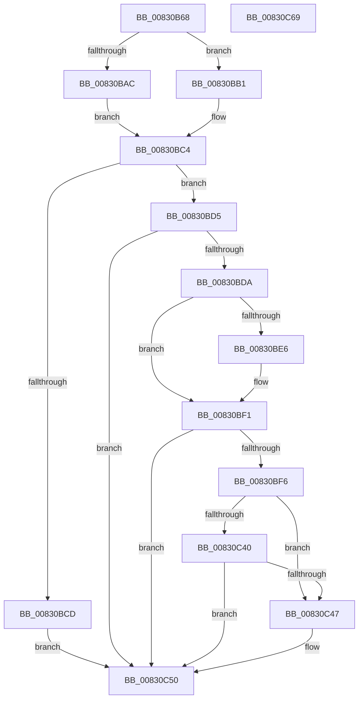

# CmGetInterfaceClassMappedPropertyFromComposite

- RVA: `0x00830B68`–`0x00830C6A` (길이 `258` bytes)
- VA: `0x0000000140830B68`
- 실행 섹션: `PAGE`
- PDB 이름 있음: `예`; PDB Function 태그: `아니요`
- unwind 정보 RVA: `0x000BE9D0`
- 디코드: `67`개 명령, `258/258` bytes 표시
- 미해석 바이트: `0` (있으면 어셈블리에 `.byte`로 보존)

> 이 문서는 커널 이미지의 기계어와 PDB 기호를 분석해 생성했습니다. 4번과 5번은 함수 원형과 자료형을 바이너리 사용 방식에서 추정한 C 해석이며 원본 소스 복구 결과는 아닙니다.

## 1. Dependencies

- 직접 호출 지점: **1**; 고유 호출 대상: **1**
- 직접 호출자로 확인된 함수: **2**
- RIP 상대 이미지 참조: **3**

### Outgoing calls
- `0x00830C34` → [PnpGetObjectProperty](../8E/PnpGetObjectProperty_function_008E2180.md) (function, `0x008E2180`)

### Direct callers
- [CmGetInterfaceClassMappedPropertyKeys](CmGetInterfaceClassMappedPropertyKeys_function_00830C70.md) at `0x00830DC6`
- [sub_00B2C010](../B2/Unknown_function_00B2C010.md) at `0x00B2C07F`

### Static image references
- `0x00830BDD` → RVA `0x00014080` (`.rdata`; read)
- `0x00830BEA` → RVA `0x00014088` (`.rdata`; read)
- `0x00830C10` → RVA `0x00027D28` (`.rdata`; read)

## 2. Other-region calls and transfers

- 다른 실행 섹션으로 향하는 call: **0**
- 별도 외부 분기/꼬리 이동을 확인하지 못했습니다.

## 3. Assembly (complete function range)

```asm
00830B68  48 8B C4                        mov rax, rsp
00830B6B  48 89 58 08                     mov qword ptr [rax + 8], rbx
00830B6F  48 89 68 10                     mov qword ptr [rax + 0x10], rbp
00830B73  48 89 70 18                     mov qword ptr [rax + 0x18], rsi
00830B77  57                              push rdi
00830B78  48 83 EC 60                     sub rsp, 0x60
00830B7C  48 8B BC 24 90 00 00 00         mov rdi, qword ptr [rsp + 0x90]
00830B84  45 33 D2                        xor r10d, r10d
00830B87  48 8B 9C 24 A8 00 00 00         mov rbx, qword ptr [rsp + 0xa8]
00830B8F  49 8B F0                        mov rsi, r8
00830B92  44 21 50 20                     and dword ptr [rax + 0x20], r10d
00830B96  48 8B E9                        mov rbp, rcx
00830B99  4C 8B 9C 24 98 00 00 00         mov r11, qword ptr [rsp + 0x98]
00830BA1  44 21 17                        and dword ptr [rdi], r10d
00830BA4  44 21 13                        and dword ptr [rbx], r10d
00830BA7  4D 85 DB                        test r11, r11
00830BAA  75 05                           jne 0x140830bb1
00830BAC  45 33 C0                        xor r8d, r8d
00830BAF  EB 13                           jmp 0x140830bc4
00830BB1  44 8B 84 24 A0 00 00 00         mov r8d, dword ptr [rsp + 0xa0]
00830BB9  41 8B C0                        mov eax, r8d
00830BBC  F7 D8                           neg eax
00830BBE  48 1B C9                        sbb rcx, rcx
00830BC1  4C 23 D9                        and r11, rcx
00830BC4  41 8B 41 10                     mov eax, dword ptr [r9 + 0x10]
00830BC8  83 F8 02                        cmp eax, 2
00830BCB  73 08                           jae 0x140830bd5
00830BCD  41 BA 30 02 00 C0               mov r10d, 0xc0000230
00830BD3  EB 7B                           jmp 0x140830c50
00830BD5  83 F8 0A                        cmp eax, 0xa
00830BD8  75 76                           jne 0x140830c50
00830BDA  49 8B 01                        mov rax, qword ptr [r9]
00830BDD  48 2B 05 9C 34 7E FF            sub rax, qword ptr [rip - 0x81cb64]
00830BE4  75 0B                           jne 0x140830bf1
00830BE6  49 8B 41 08                     mov rax, qword ptr [r9 + 8]
00830BEA  48 2B 05 97 34 7E FF            sub rax, qword ptr [rip - 0x81cb69]
00830BF1  48 85 C0                        test rax, rax
00830BF4  75 5A                           jne 0x140830c50
00830BF6  44 21 54 24 50                  and dword ptr [rsp + 0x50], r10d
00830BFB  48 8D 84 24 88 00 00 00         lea rax, [rsp + 0x88]
00830C03  48 89 44 24 48                  mov qword ptr [rsp + 0x48], rax
00830C08  4C 8B CE                        mov r9, rsi
00830C0B  44 89 44 24 40                  mov dword ptr [rsp + 0x40], r8d
00830C10  48 8D 05 11 71 7F FF            lea rax, [rip - 0x808eef]
00830C17  4C 89 5C 24 38                  mov qword ptr [rsp + 0x38], r11
00830C1C  41 B8 04 00 00 00               mov r8d, 4
00830C22  48 89 7C 24 30                  mov qword ptr [rsp + 0x30], rdi
00830C27  48 8B CD                        mov rcx, rbp
00830C2A  48 89 44 24 28                  mov qword ptr [rsp + 0x28], rax
00830C2F  4C 21 54 24 20                  and qword ptr [rsp + 0x20], r10
00830C34  E8 47 15 0B 00                  call 0x1408e2180
00830C39  44 8B D0                        mov r10d, eax
00830C3C  85 C0                           test eax, eax
00830C3E  74 07                           je 0x140830c47
00830C40  3D 23 00 00 C0                  cmp eax, 0xc0000023
00830C45  75 09                           jne 0x140830c50
00830C47  8B 8C 24 88 00 00 00            mov ecx, dword ptr [rsp + 0x88]
00830C4E  89 0B                           mov dword ptr [rbx], ecx
00830C50  4C 8D 5C 24 60                  lea r11, [rsp + 0x60]
00830C55  41 8B C2                        mov eax, r10d
00830C58  49 8B 5B 10                     mov rbx, qword ptr [r11 + 0x10]
00830C5C  49 8B 6B 18                     mov rbp, qword ptr [r11 + 0x18]
00830C60  49 8B 73 20                     mov rsi, qword ptr [r11 + 0x20]
00830C64  49 8B E3                        mov rsp, r11
00830C67  5F                              pop rdi
00830C68  C3                              ret
00830C69  CC                              int3
```

## 4. C-style interpretation (structured pseudocode)

```c
__int64 __fastcall CmGetInterfaceClassMappedPropertyFromComposite(__int64 a1, __int64 a2, __int64 a3, __int64 a4, __int64 a5, __int64 a6, unsigned int a7, __int64 a8)
{
    __int64 result;
    __int64 v_r10;
    __int64 v_r11;
    __int64 v_rsp;
    unsigned int v_stack_m18;
    unsigned __int64 v_stack_m20;
    unsigned int v_stack_m28;
    unsigned __int64 v_stack_m30;
    unsigned __int64 v_stack_m38;
    unsigned __int64 v_stack_m40;
    unsigned __int64 v_stack_m48;
    unsigned __int64 v_stack_m8;
    unsigned __int64 v_stack_p20;

    *(unsigned __int64 *)(v_rsp + 8) = v_rbx;
    *(unsigned __int64 *)(v_rsp + 16) = v_rbp;
    *(unsigned __int64 *)(v_rsp + 24) = v_rsi;
    v_rsp = (v_rsp) - (96);
    v_r10 = 0;
    if (a6 != 0) goto loc_00830BB1;
    a3 = 0;
    goto loc_00830BC4;
loc_00830BB1:
    result = (unsigned int)(-((unsigned int)((unsigned int)((unsigned int)(a7)))));
    v_r11 = (a6) & (a1);
loc_00830BC4:
    if (((unsigned int)((unsigned int)(*(unsigned int *)(a4 + 16)))) >= 2) goto loc_00830BD5;
    goto loc_00830C50;
loc_00830BD5:
    if (((unsigned int)((unsigned int)(*(unsigned int *)(a4 + 16)))) != 10) goto loc_00830C50;
    result = (*(unsigned __int64 *)(a4)) - (*(unsigned __int64 *)(v_rip - 8506212));
    if (!(condition_is_not_equal)) {
        result = *(unsigned __int64 *)(a4 + 8);
        result = (result) - (*(unsigned __int64 *)(v_rip - 8506217));
    }
    if (result != 0) goto loc_00830C50;
    v_stack_m20 = v_stack_p20;
    v_stack_m28 = (unsigned int)((unsigned int)(a7));
    v_stack_m30 = v_r11;
    v_stack_m38 = a5;
    v_stack_m40 = v_rip - 8425199;
    result = PnpGetObjectProperty(a1, a2, 4, 0);
    if ((unsigned int)(result) == 0) goto loc_00830C47;
    if (((unsigned int)(result)) == 0xC0000023ULL) {
        a1 = v_stack_p20;
        *(unsigned int *)(a8) = (unsigned int)(a1);
    }
    return (unsigned int)((unsigned int)((unsigned int)((unsigned int)(result))));
}
```

## 5. (Beta) C Style

```c
int64_t CmGetInterfaceClassMappedPropertyFromComposite(int64_t Arg1, int64_t Arg2, int64_t Arg3, void *Arg4, void *Arg5, int64_t Arg6, uint32_t Arg7, void *Arg8)
{
    uint8_t *arg4 = (uint8_t *)Arg4;
    uint8_t *arg5 = (uint8_t *)Arg5;
    uint8_t *arg8 = (uint8_t *)Arg8;

    int64_t result;
    int64_t local_r10;
    int64_t local_r11;
    int64_t local_rsp;
    uint32_t v_stack_m18;
    uint64_t v_stack_m20;
    uint32_t v_stack_m28;
    uint64_t v_stack_m30;
    uint64_t v_stack_m38;
    uint64_t v_stack_m40;
    uint64_t v_stack_m48;
    uint64_t v_stack_m8;
    uint64_t v_stack_p20;

    *(uint64_t *)(local_rsp + 0x8) = local_rbx;
    *(uint64_t *)(local_rsp + 0x10) = local_rbp;
    *(uint64_t *)(local_rsp + 0x18) = local_rsi;
    local_rsp = (local_rsp) - (96);
    local_r10 = 0;
    if (Arg6 != 0) goto loc_00830BB1;
    Arg3 = 0;
    goto loc_00830BC4;
loc_00830BB1:
    result = (uint32_t)(-((uint32_t)((uint32_t)((uint32_t)(Arg7)))));
    local_r11 = (Arg6) & (Arg1);
loc_00830BC4:
    if (((uint32_t)((uint32_t)(*(uint32_t *)(arg4 + 0x10)))) >= 2) goto loc_00830BD5;
    goto loc_00830C50;
loc_00830BD5:
    if (((uint32_t)((uint32_t)(*(uint32_t *)(arg4 + 0x10)))) != 10) goto loc_00830C50;
    result = (*(uint64_t *)(arg4)) - (*(uint64_t *)(v_rip - 0x81CB64));
    if (!(condition_is_not_equal)) {
        result = *(uint64_t *)(arg4 + 0x8);
        result = (result) - (*(uint64_t *)(v_rip - 0x81CB69));
    }
    if (result != 0) goto loc_00830C50;
    v_stack_m20 = v_stack_p20;
    v_stack_m28 = (uint32_t)((uint32_t)(Arg7));
    v_stack_m30 = local_r11;
    v_stack_m38 = Arg5;
    v_stack_m40 = v_rip - 8425199;
    result = PnpGetObjectProperty(Arg1, Arg2, 4, 0);
    if ((uint32_t)(result) == 0) goto loc_00830C47;
    if (((uint32_t)(result)) == 0xC0000023ULL) {
        Arg1 = v_stack_p20;
        *(uint32_t *)(arg8) = (uint32_t)(Arg1);
    }
    return (uint32_t)((uint32_t)((uint32_t)((uint32_t)(result))));
}
```

### 관측된 메모리 오프셋

구조체 형식이 확인되지 않은 접근은 인자 기준의 오프셋으로만 기록했습니다.

| 기준 인자 | 오프셋 표현 | 폭 (bit) | 접근 |
|---|---:|---:|---|
| `Arg4` | `+ 0x0` | `64` | `R` |
| `Arg4` | `+ 0x8` | `64` | `R` |
| `Arg4` | `+ 0x10` | `32` | `R` |
| `Arg5` | `+ 0x0` | `32` | `R/W` |
| `Arg8` | `+ 0x0` | `32` | `R/W` |
| `Arg8` | `+ 0x0` | `32` | `W` |

## 6. Execution-region graph

[열기: 2D/3D 그래프와 함수 탐색 컨트롤 패널](../../../control-panel.html?section=page&rva=0x00830B68&view=graph)

- 2D 그래프는 위에서 아래로 흐르고, 3D 그래프는 빈 공간을 드래그해 회전합니다. Shift+드래그는 이동, 휠은 확대·축소, 함수 노드 선택은 대상 보고서 이동입니다.

### Static fallback


