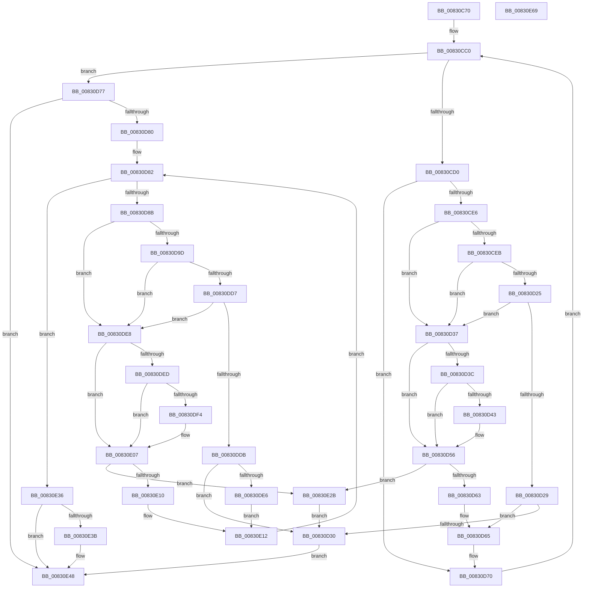

# CmGetInterfaceClassMappedPropertyKeys

- RVA: `0x00830C70`–`0x00830E6A` (길이 `506` bytes)
- VA: `0x0000000140830C70`
- 실행 섹션: `PAGE`
- PDB 이름 있음: `예`; PDB Function 태그: `아니요`
- unwind 정보 RVA: `0x000D2EC8`
- 디코드: `141`개 명령, `506/506` bytes 표시
- 미해석 바이트: `0` (있으면 어셈블리에 `.byte`로 보존)

> 이 문서는 커널 이미지의 기계어와 PDB 기호를 분석해 생성했습니다. 4번과 5번은 함수 원형과 자료형을 바이너리 사용 방식에서 추정한 C 해석이며 원본 소스 복구 결과는 아닙니다.

## 1. Dependencies

- 직접 호출 지점: **2**; 고유 호출 대상: **2**
- 직접 호출자로 확인된 함수: **2**
- RIP 상대 이미지 참조: **1**

### Outgoing calls
- `0x00830D14` → [_CmGetInterfaceClassMappedPropertyFromRegValue](../99/_CmGetInterfaceClassMappedPropertyFromRegValue_function_00993EB8.md) (function, `0x00993EB8`)
- `0x00830DC6` → [CmGetInterfaceClassMappedPropertyFromComposite](CmGetInterfaceClassMappedPropertyFromComposite_function_00830B68.md) (function, `0x00830B68`)

### Direct callers
- [CmDeleteInterfaceClassWorker](../82/CmDeleteInterfaceClassWorker_function_0082A838.md) at `0x0082A940`
- [_PnpDispatchInterfaceClass](../99/_PnpDispatchInterfaceClass_function_00993BD0.md) at `0x00993DF0`

### Static image references
- `0x00830CC0` → RVA `0x00000000` (`image boundary/outside`; read)

## 2. Other-region calls and transfers

- 다른 실행 섹션으로 향하는 call: **0**
- 별도 외부 분기/꼬리 이동을 확인하지 못했습니다.

## 3. Assembly (complete function range)

```asm
00830C70  48 8B C4                        mov rax, rsp
00830C73  48 89 58 10                     mov qword ptr [rax + 0x10], rbx
00830C77  48 89 68 18                     mov qword ptr [rax + 0x18], rbp
00830C7B  48 89 70 20                     mov qword ptr [rax + 0x20], rsi
00830C7F  48 89 48 08                     mov qword ptr [rax + 8], rcx
00830C83  57                              push rdi
00830C84  41 54                           push r12
00830C86  41 55                           push r13
00830C88  41 56                           push r14
00830C8A  41 57                           push r15
00830C8C  48 83 EC 50                     sub rsp, 0x50
00830C90  48 8B 9C 24 B0 00 00 00         mov rbx, qword ptr [rsp + 0xb0]
00830C98  4C 8B EA                        mov r13, rdx
00830C9B  44 8B B4 24 A8 00 00 00         mov r14d, dword ptr [rsp + 0xa8]
00830CA3  33 D2                           xor edx, edx
00830CA5  48 8B AC 24 A0 00 00 00         mov rbp, qword ptr [rsp + 0xa0]
00830CAD  45 8A F9                        mov r15b, r9b
00830CB0  4D 8B E0                        mov r12, r8
00830CB3  89 50 C8                        mov dword ptr [rax - 0x38], edx
00830CB6  89 13                           mov dword ptr [rbx], edx
00830CB8  44 8B D2                        mov r10d, edx
00830CBB  89 50 38                        mov dword ptr [rax + 0x38], edx
00830CBE  8B FA                           mov edi, edx
00830CC0  4C 8D 05 39 F3 7C FF            lea r8, [rip - 0x830cc7]
00830CC7  83 FF 01                        cmp edi, 1
00830CCA  0F 83 A7 00 00 00               jae 0x140830d77
00830CD0  8B C7                           mov eax, edi
00830CD2  48 03 C0                        add rax, rax
00830CD5  49 8B B4 C0 80 AE B4 00         mov rsi, qword ptr [r8 + rax*8 + 0xb4ae80]
00830CDD  48 85 F6                        test rsi, rsi
00830CE0  0F 84 8A 00 00 00               je 0x140830d70
00830CE6  45 84 FF                        test r15b, r15b
00830CE9  75 4C                           jne 0x140830d37
00830CEB  48 8D 84 24 B0 00 00 00         lea rax, [rsp + 0xb0]
00830CF3  4C 8B CE                        mov r9, rsi
00830CF6  48 89 44 24 38                  mov qword ptr [rsp + 0x38], rax
00830CFB  4D 8B C4                        mov r8, r12
00830CFE  89 54 24 30                     mov dword ptr [rsp + 0x30], edx
00830D02  48 8D 44 24 40                  lea rax, [rsp + 0x40]
00830D07  48 89 54 24 28                  mov qword ptr [rsp + 0x28], rdx
00830D0C  49 8B D5                        mov rdx, r13
00830D0F  48 89 44 24 20                  mov qword ptr [rsp + 0x20], rax
00830D14  E8 9F 31 16 00                  call 0x140993eb8
00830D19  33 D2                           xor edx, edx
00830D1B  44 8B D0                        mov r10d, eax
00830D1E  3D 23 00 00 C0                  cmp eax, 0xc0000023
00830D23  74 12                           je 0x140830d37
00830D25  85 C0                           test eax, eax
00830D27  74 0E                           je 0x140830d37
00830D29  3D 34 00 00 C0                  cmp eax, 0xc0000034
00830D2E  75 35                           jne 0x140830d65
00830D30  89 13                           mov dword ptr [rbx], edx
00830D32  E9 11 01 00 00                  jmp 0x140830e48
00830D37  48 85 ED                        test rbp, rbp
00830D3A  74 1A                           je 0x140830d56
00830D3C  8B 03                           mov eax, dword ptr [rbx]
00830D3E  41 3B C6                        cmp eax, r14d
00830D41  73 13                           jae 0x140830d56
00830D43  0F 10 06                        movups xmm0, xmmword ptr [rsi]
00830D46  48 8D 0C 80                     lea rcx, [rax + rax*4]
00830D4A  0F 11 44 8D 00                  movups xmmword ptr [rbp + rcx*4], xmm0
00830D4F  8B 46 10                        mov eax, dword ptr [rsi + 0x10]
00830D52  89 44 8D 10                     mov dword ptr [rbp + rcx*4 + 0x10], eax
00830D56  8B 03                           mov eax, dword ptr [rbx]
00830D58  8D 48 01                        lea ecx, [rax + 1]
00830D5B  3B C8                           cmp ecx, eax
00830D5D  0F 82 C8 00 00 00               jb 0x140830e2b
00830D63  89 0B                           mov dword ptr [rbx], ecx
00830D65  48 8B 8C 24 80 00 00 00         mov rcx, qword ptr [rsp + 0x80]
00830D6D  44 8B D2                        mov r10d, edx
00830D70  FF C7                           inc edi
00830D72  E9 49 FF FF FF                  jmp 0x140830cc0
00830D77  45 85 D2                        test r10d, r10d
00830D7A  0F 88 C8 00 00 00               js 0x140830e48
00830D80  8B FA                           mov edi, edx
00830D82  83 FF 01                        cmp edi, 1
00830D85  0F 83 AB 00 00 00               jae 0x140830e36
00830D8B  8B C7                           mov eax, edi
00830D8D  48 03 C0                        add rax, rax
00830D90  49 8B B4 C0 10 AF B4 00         mov rsi, qword ptr [r8 + rax*8 + 0xb4af10]
00830D98  45 84 FF                        test r15b, r15b
00830D9B  75 4B                           jne 0x140830de8
00830D9D  48 8D 84 24 B0 00 00 00         lea rax, [rsp + 0xb0]
00830DA5  4C 8B CE                        mov r9, rsi
00830DA8  48 89 44 24 38                  mov qword ptr [rsp + 0x38], rax
00830DAD  4D 8B C4                        mov r8, r12
00830DB0  89 54 24 30                     mov dword ptr [rsp + 0x30], edx
00830DB4  48 8D 44 24 40                  lea rax, [rsp + 0x40]
00830DB9  48 89 54 24 28                  mov qword ptr [rsp + 0x28], rdx
00830DBE  49 8B D5                        mov rdx, r13
00830DC1  48 89 44 24 20                  mov qword ptr [rsp + 0x20], rax
00830DC6  E8 9D FD FF FF                  call 0x140830b68
00830DCB  33 D2                           xor edx, edx
00830DCD  44 8B D0                        mov r10d, eax
00830DD0  3D 23 00 00 C0                  cmp eax, 0xc0000023
00830DD5  74 11                           je 0x140830de8
00830DD7  85 C0                           test eax, eax
00830DD9  74 0D                           je 0x140830de8
00830DDB  3D 34 00 00 C0                  cmp eax, 0xc0000034
00830DE0  0F 84 4A FF FF FF               je 0x140830d30
00830DE6  EB 2A                           jmp 0x140830e12
00830DE8  48 85 ED                        test rbp, rbp
00830DEB  74 1A                           je 0x140830e07
00830DED  8B 03                           mov eax, dword ptr [rbx]
00830DEF  41 3B C6                        cmp eax, r14d
00830DF2  73 13                           jae 0x140830e07
00830DF4  0F 10 06                        movups xmm0, xmmword ptr [rsi]
00830DF7  48 8D 0C 80                     lea rcx, [rax + rax*4]
00830DFB  0F 11 44 8D 00                  movups xmmword ptr [rbp + rcx*4], xmm0
00830E00  8B 46 10                        mov eax, dword ptr [rsi + 0x10]
00830E03  89 44 8D 10                     mov dword ptr [rbp + rcx*4 + 0x10], eax
00830E07  8B 03                           mov eax, dword ptr [rbx]
00830E09  8D 48 01                        lea ecx, [rax + 1]
00830E0C  3B C8                           cmp ecx, eax
00830E0E  72 1B                           jb 0x140830e2b
00830E10  89 0B                           mov dword ptr [rbx], ecx
00830E12  48 8B 8C 24 80 00 00 00         mov rcx, qword ptr [rsp + 0x80]
00830E1A  4C 8D 05 DF F1 7C FF            lea r8, [rip - 0x830e21]
00830E21  44 8B D2                        mov r10d, edx
00830E24  FF C7                           inc edi
00830E26  E9 57 FF FF FF                  jmp 0x140830d82
00830E2B  41 BA 95 00 00 C0               mov r10d, 0xc0000095
00830E31  E9 FA FE FF FF                  jmp 0x140830d30
00830E36  45 85 D2                        test r10d, r10d
00830E39  78 0D                           js 0x140830e48
00830E3B  44 3B 33                        cmp r14d, dword ptr [rbx]
00830E3E  45 1B D2                        sbb r10d, r10d
00830E41  41 81 E2 23 00 00 C0            and r10d, 0xc0000023
00830E48  4C 8D 5C 24 50                  lea r11, [rsp + 0x50]
00830E4D  41 8B C2                        mov eax, r10d
00830E50  49 8B 5B 38                     mov rbx, qword ptr [r11 + 0x38]
00830E54  49 8B 6B 40                     mov rbp, qword ptr [r11 + 0x40]
00830E58  49 8B 73 48                     mov rsi, qword ptr [r11 + 0x48]
00830E5C  49 8B E3                        mov rsp, r11
00830E5F  41 5F                           pop r15
00830E61  41 5E                           pop r14
00830E63  41 5D                           pop r13
00830E65  41 5C                           pop r12
00830E67  5F                              pop rdi
00830E68  C3                              ret
00830E69  CC                              int3
```

## 4. C-style interpretation (structured pseudocode)

```c
__int64 __fastcall CmGetInterfaceClassMappedPropertyKeys(__int64 a1, __int64 a2, __int64 a3, unsigned __int8 a4, __int64 a5, unsigned int a6, __int64 a7)
{
    __int64 result;
    __int64 v_r10;
    __int64 v_rdi;
    __int64 v_rsp;
    unsigned __int64 v_stack_m28;
    unsigned __int64 v_stack_m38;
    unsigned __int64 v_stack_m40;
    unsigned int v_stack_m48;
    unsigned __int64 v_stack_m50;
    unsigned __int64 v_stack_m58;
    unsigned __int64 v_stack_p8;

    *(unsigned __int64 *)(v_rsp + 16) = v_rbx;
    *(unsigned __int64 *)(v_rsp + 24) = v_rbp;
    *(unsigned __int64 *)(v_rsp + 32) = v_rsi;
    *(unsigned __int64 *)(v_rsp + 8) = a1;
    v_rsp = (v_rsp) - (80);
    a2 = 0;
    *(unsigned int *)(v_rsp - 56) = 0;
    *(unsigned int *)(a7) = 0;
    *(unsigned int *)(v_rsp + 56) = 0;
loc_00830CC0:
    if (0 >= 1) goto loc_00830D77;
    result = (0) + (0);
    if (*(unsigned __int64 *)(v_rip - 8588487 + result * 8 + 11841152) == 0) goto loc_00830D70;
    if (a4 != 0) goto loc_00830D37;
    v_stack_m40 = a7;
    v_stack_m48 = 0;
    v_stack_m50 = 0;
    v_stack_m58 = v_stack_m38;
    result = _CmGetInterfaceClassMappedPropertyFromRegValue(a1, 0, a3, *(unsigned __int64 *)(v_rip - 8588487 + result * 8 + 11841152));
    a2 = 0;
    if (((unsigned int)(result)) == 0xC0000023ULL) goto loc_00830D37;
    if ((unsigned int)(result) == 0) goto loc_00830D37;
    if (((unsigned int)(result)) != 0xC0000034ULL) goto loc_00830D65;
loc_00830D30:
    *(unsigned int *)(a7) = 0;
    goto loc_00830E48;
loc_00830D37:
    if (a5 == 0) goto loc_00830D56;
    result = (unsigned int)(*(unsigned int *)(a7));
    if (((unsigned int)((unsigned int)(*(unsigned int *)(a7)))) < ((unsigned int)((unsigned int)(a6)))) {
        a1 = (unsigned int)(*(unsigned int *)(a7)) + (unsigned int)(*(unsigned int *)(a7)) * 4;
        *(unsigned __int64 *)(a5 + a1 * 4) = v_xmm0;
        result = *(unsigned int *)(*(unsigned __int64 *)(v_rip - 8588487 + result * 8 + 11841152) + 16);
        *(unsigned int *)(a5 + a1 * 4 + 16) = (unsigned int)(result);
    }
    if (((unsigned int)((unsigned int)(*(unsigned int *)(a7)) + 1)) < ((unsigned int)((unsigned int)(*(unsigned int *)(a7))))) goto loc_00830E2B;
    *(unsigned int *)(a7) = (unsigned int)((unsigned int)(*(unsigned int *)(a7)) + 1);
loc_00830D65:
loc_00830D70:
    v_rdi = (unsigned int)((0) + 1);
    goto loc_00830CC0;
loc_00830D77:
    if (sign_flag) goto loc_00830E48;
loc_00830D82:
    if (0 >= 1) goto loc_00830E36;
    result = (0) + (0);
    if (a4 != 0) goto loc_00830DE8;
    v_stack_m40 = a7;
    v_stack_m48 = 0;
    v_stack_m50 = 0;
    v_stack_m58 = v_stack_m38;
    result = CmGetInterfaceClassMappedPropertyFromComposite(v_stack_p8, 0, a3, *(unsigned __int64 *)(a3 + result * 8 + 11841296));
    a2 = 0;
    if (((unsigned int)(result)) == 0xC0000023ULL) goto loc_00830DE8;
    if ((unsigned int)(result) == 0) goto loc_00830DE8;
    if (((unsigned int)(result)) == 0xC0000034ULL) goto loc_00830D30;
    goto loc_00830E12;
loc_00830DE8:
    if (a5 == 0) goto loc_00830E07;
    result = (unsigned int)(*(unsigned int *)(a7));
    if (((unsigned int)((unsigned int)(*(unsigned int *)(a7)))) < ((unsigned int)((unsigned int)(a6)))) {
        a1 = (unsigned int)(*(unsigned int *)(a7)) + (unsigned int)(*(unsigned int *)(a7)) * 4;
        *(unsigned __int64 *)(a5 + a1 * 4) = v_xmm0;
        result = *(unsigned int *)(*(unsigned __int64 *)(a3 + result * 8 + 11841296) + 16);
        *(unsigned int *)(a5 + a1 * 4 + 16) = (unsigned int)(result);
    }
    if (((unsigned int)((unsigned int)(*(unsigned int *)(a7)) + 1)) < ((unsigned int)((unsigned int)(*(unsigned int *)(a7))))) goto loc_00830E2B;
    *(unsigned int *)(a7) = (unsigned int)((unsigned int)(*(unsigned int *)(a7)) + 1);
loc_00830E12:
    v_rdi = (unsigned int)((0) + 1);
    goto loc_00830D82;
loc_00830E2B:
    goto loc_00830D30;
loc_00830E36:
    v_r10 = (unsigned int)(0xC0000095ULL);
    if (!(sign_flag)) {
        v_r10 = (unsigned int)(((unsigned int)(0xC0000095ULL)) & (0xC0000023ULL));
    }
    return (unsigned int)((unsigned int)(v_r10));
}
```

## 5. (Beta) C Style

```c
int64_t CmGetInterfaceClassMappedPropertyKeys(int64_t Arg1, int64_t Arg2, int64_t Arg3, uint8_t Arg4, int64_t Arg5, uint32_t Arg6, void *Arg7)
{
    uint8_t *arg7 = (uint8_t *)Arg7;

    int64_t result;
    int64_t local_r10;
    int64_t local_rdi;
    int64_t local_rsp;
    uint64_t v_stack_m28;
    uint64_t v_stack_m38;
    uint64_t v_stack_m40;
    uint32_t v_stack_m48;
    uint64_t v_stack_m50;
    uint64_t v_stack_m58;
    uint64_t v_stack_p8;

    *(uint64_t *)(local_rsp + 0x10) = local_rbx;
    *(uint64_t *)(local_rsp + 0x18) = local_rbp;
    *(uint64_t *)(local_rsp + 0x20) = local_rsi;
    *(uint64_t *)(local_rsp + 0x8) = Arg1;
    local_rsp = (local_rsp) - (80);
    Arg2 = 0;
    *(uint32_t *)(local_rsp - 0x38) = 0;
    *(uint32_t *)(arg7) = 0;
    *(uint32_t *)(local_rsp + 0x38) = 0;
loc_00830CC0:
    if (0 >= 1) goto loc_00830D77;
    result = (0) + (0);
    if (*(uint64_t *)(v_rip - 0x830CC7 + result * 8 + 0xB4AE80) == 0) goto loc_00830D70;
    if (Arg4 != 0) goto loc_00830D37;
    v_stack_m40 = Arg7;
    v_stack_m48 = 0;
    v_stack_m50 = 0;
    v_stack_m58 = v_stack_m38;
    result = _CmGetInterfaceClassMappedPropertyFromRegValue(Arg1, 0, Arg3, *(uint64_t *)(v_rip - 0x830CC7 + result * 8 + 0xB4AE80));
    Arg2 = 0;
    if (((uint32_t)(result)) == 0xC0000023ULL) goto loc_00830D37;
    if ((uint32_t)(result) == 0) goto loc_00830D37;
    if (((uint32_t)(result)) != 0xC0000034ULL) goto loc_00830D65;
loc_00830D30:
    *(uint32_t *)(arg7) = 0;
    goto loc_00830E48;
loc_00830D37:
    if (Arg5 == 0) goto loc_00830D56;
    result = (uint32_t)(*(uint32_t *)(arg7));
    if (((uint32_t)((uint32_t)(*(uint32_t *)(arg7)))) < ((uint32_t)((uint32_t)(Arg6)))) {
        Arg1 = (uint32_t)(*(uint32_t *)(arg7)) + (uint32_t)(*(uint32_t *)(arg7)) * 4;
        *(uint64_t *)(Arg5 + Arg1 * 4) = v_xmm0;
        result = *(uint32_t *)(*(uint64_t *)(v_rip - 0x830CC7 + result * 8 + 0xB4AE80) + 0x10);
        *(uint32_t *)(Arg5 + Arg1 * 4 + 0x10) = (uint32_t)(result);
    }
    if (((uint32_t)((uint32_t)(*(uint32_t *)(arg7)) + 1)) < ((uint32_t)((uint32_t)(*(uint32_t *)(arg7))))) goto loc_00830E2B;
    *(uint32_t *)(arg7) = (uint32_t)((uint32_t)(*(uint32_t *)(arg7)) + 1);
loc_00830D65:
loc_00830D70:
    local_rdi = (uint32_t)((0) + 1);
    goto loc_00830CC0;
loc_00830D77:
    if (sign_flag) goto loc_00830E48;
loc_00830D82:
    if (0 >= 1) goto loc_00830E36;
    result = (0) + (0);
    if (Arg4 != 0) goto loc_00830DE8;
    v_stack_m40 = Arg7;
    v_stack_m48 = 0;
    v_stack_m50 = 0;
    v_stack_m58 = v_stack_m38;
    result = CmGetInterfaceClassMappedPropertyFromComposite(v_stack_p8, 0, Arg3, *(uint64_t *)(Arg3 + result * 8 + 0xB4AF10));
    Arg2 = 0;
    if (((uint32_t)(result)) == 0xC0000023ULL) goto loc_00830DE8;
    if ((uint32_t)(result) == 0) goto loc_00830DE8;
    if (((uint32_t)(result)) == 0xC0000034ULL) goto loc_00830D30;
    goto loc_00830E12;
loc_00830DE8:
    if (Arg5 == 0) goto loc_00830E07;
    result = (uint32_t)(*(uint32_t *)(arg7));
    if (((uint32_t)((uint32_t)(*(uint32_t *)(arg7)))) < ((uint32_t)((uint32_t)(Arg6)))) {
        Arg1 = (uint32_t)(*(uint32_t *)(arg7)) + (uint32_t)(*(uint32_t *)(arg7)) * 4;
        *(uint64_t *)(Arg5 + Arg1 * 4) = v_xmm0;
        result = *(uint32_t *)(*(uint64_t *)(Arg3 + result * 8 + 0xB4AF10) + 0x10);
        *(uint32_t *)(Arg5 + Arg1 * 4 + 0x10) = (uint32_t)(result);
    }
    if (((uint32_t)((uint32_t)(*(uint32_t *)(arg7)) + 1)) < ((uint32_t)((uint32_t)(*(uint32_t *)(arg7))))) goto loc_00830E2B;
    *(uint32_t *)(arg7) = (uint32_t)((uint32_t)(*(uint32_t *)(arg7)) + 1);
loc_00830E12:
    local_rdi = (uint32_t)((0) + 1);
    goto loc_00830D82;
loc_00830E2B:
    goto loc_00830D30;
loc_00830E36:
    local_r10 = (uint32_t)(0xC0000095ULL);
    if (!(sign_flag)) {
        local_r10 = (uint32_t)(((uint32_t)(0xC0000095ULL)) & (0xC0000023ULL));
    }
    return (uint32_t)((uint32_t)(local_r10));
}
```

### 관측된 메모리 오프셋

구조체 형식이 확인되지 않은 접근은 인자 기준의 오프셋으로만 기록했습니다.

| 기준 인자 | 오프셋 표현 | 폭 (bit) | 접근 |
|---|---:|---:|---|
| `Arg7` | `+ 0x0` | `32` | `R` |
| `Arg7` | `+ 0x0` | `32` | `W` |

## 6. Execution-region graph

[열기: 2D/3D 그래프와 함수 탐색 컨트롤 패널](../../../control-panel.html?section=page&rva=0x00830C70&view=graph)

- 2D 그래프는 위에서 아래로 흐르고, 3D 그래프는 빈 공간을 드래그해 회전합니다. Shift+드래그는 이동, 휠은 확대·축소, 함수 노드 선택은 대상 보고서 이동입니다.

### Static fallback


