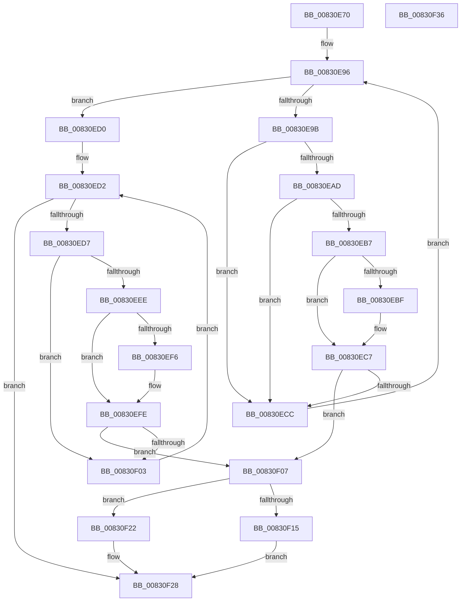

# CmGetInterfaceClassMappedPropertyLocales

- RVA: `0x00830E70`–`0x00830F37` (길이 `199` bytes)
- VA: `0x0000000140830E70`
- 실행 섹션: `PAGE`
- PDB 이름 있음: `예`; PDB Function 태그: `아니요`
- unwind 정보 RVA: `0x000D30C4`
- 디코드: `59`개 명령, `199/199` bytes 표시
- 미해석 바이트: `0` (있으면 어셈블리에 `.byte`로 보존)

> 이 문서는 커널 이미지의 기계어와 PDB 기호를 분석해 생성했습니다. 4번과 5번은 함수 원형과 자료형을 바이너리 사용 방식에서 추정한 C 해석이며 원본 소스 복구 결과는 아닙니다.

## 1. Dependencies

- 직접 호출 지점: **0**; 고유 호출 대상: **0**
- 직접 호출자로 확인된 함수: **1**
- RIP 상대 이미지 참조: **1**

### Outgoing calls
- 직접 디코드된 call 명령이 없습니다.

### Direct callers
- [_PnpDispatchInterfaceClass](../99/_PnpDispatchInterfaceClass_function_00993BD0.md) at `0x00993DBE`

### Static image references
- `0x00830E7F` → RVA `0x00000000` (`image boundary/outside`; read)

## 2. Other-region calls and transfers

- 다른 실행 섹션으로 향하는 call: **0**
- 별도 외부 분기/꼬리 이동을 확인하지 못했습니다.

## 3. Assembly (complete function range)

```asm
00830E70  48 89 5C 24 08                  mov qword ptr [rsp + 8], rbx
00830E75  48 89 74 24 10                  mov qword ptr [rsp + 0x10], rsi
00830E7A  4C 8B 5C 24 38                  mov r11, qword ptr [rsp + 0x38]
00830E7F  48 8D 35 7A F1 7C FF            lea rsi, [rip - 0x830e86]
00830E86  33 DB                           xor ebx, ebx
00830E88  4D 8B D1                        mov r10, r9
00830E8B  41 B8 16 00 00 C0               mov r8d, 0xc0000016
00830E91  8B D3                           mov edx, ebx
00830E93  41 89 1B                        mov dword ptr [r11], ebx
00830E96  83 FA 01                        cmp edx, 1
00830E99  73 35                           jae 0x140830ed0
00830E9B  8B C2                           mov eax, edx
00830E9D  48 03 C0                        add rax, rax
00830EA0  4C 8B 8C C6 80 AE B4 00         mov r9, qword ptr [rsi + rax*8 + 0xb4ae80]
00830EA8  4D 85 C9                        test r9, r9
00830EAB  74 1F                           je 0x140830ecc
00830EAD  41 8B 41 10                     mov eax, dword ptr [r9 + 0x10]
00830EB1  41 39 42 10                     cmp dword ptr [r10 + 0x10], eax
00830EB5  75 15                           jne 0x140830ecc
00830EB7  49 8B 0A                        mov rcx, qword ptr [r10]
00830EBA  49 2B 09                        sub rcx, qword ptr [r9]
00830EBD  75 08                           jne 0x140830ec7
00830EBF  49 8B 4A 08                     mov rcx, qword ptr [r10 + 8]
00830EC3  49 2B 49 08                     sub rcx, qword ptr [r9 + 8]
00830EC7  48 85 C9                        test rcx, rcx
00830ECA  74 3B                           je 0x140830f07
00830ECC  FF C2                           inc edx
00830ECE  EB C6                           jmp 0x140830e96
00830ED0  8B D3                           mov edx, ebx
00830ED2  83 FA 01                        cmp edx, 1
00830ED5  73 51                           jae 0x140830f28
00830ED7  8B C2                           mov eax, edx
00830ED9  48 03 C0                        add rax, rax
00830EDC  4C 8B 8C C6 10 AF B4 00         mov r9, qword ptr [rsi + rax*8 + 0xb4af10]
00830EE4  41 8B 41 10                     mov eax, dword ptr [r9 + 0x10]
00830EE8  41 39 42 10                     cmp dword ptr [r10 + 0x10], eax
00830EEC  75 15                           jne 0x140830f03
00830EEE  49 8B 0A                        mov rcx, qword ptr [r10]
00830EF1  49 2B 09                        sub rcx, qword ptr [r9]
00830EF4  75 08                           jne 0x140830efe
00830EF6  49 8B 4A 08                     mov rcx, qword ptr [r10 + 8]
00830EFA  49 2B 49 08                     sub rcx, qword ptr [r9 + 8]
00830EFE  48 85 C9                        test rcx, rcx
00830F01  74 04                           je 0x140830f07
00830F03  FF C2                           inc edx
00830F05  EB CB                           jmp 0x140830ed2
00830F07  83 7C 24 30 01                  cmp dword ptr [rsp + 0x30], 1
00830F0C  41 C7 03 01 00 00 00            mov dword ptr [r11], 1
00830F13  72 0D                           jb 0x140830f22
00830F15  48 8B 44 24 28                  mov rax, qword ptr [rsp + 0x28]
00830F1A  44 8B C3                        mov r8d, ebx
00830F1D  66 89 18                        mov word ptr [rax], bx
00830F20  EB 06                           jmp 0x140830f28
00830F22  41 B8 23 00 00 C0               mov r8d, 0xc0000023
00830F28  48 8B 5C 24 08                  mov rbx, qword ptr [rsp + 8]
00830F2D  41 8B C0                        mov eax, r8d
00830F30  48 8B 74 24 10                  mov rsi, qword ptr [rsp + 0x10]
00830F35  C3                              ret
00830F36  CC                              int3
```

## 4. C-style interpretation (structured pseudocode)

```c
__int64 __fastcall CmGetInterfaceClassMappedPropertyLocales(__int64 a1, __int64 a2, __int64 a3, __int64 a4, __int64 a5, unsigned int a6, __int64 a7)
{
    __int64 result;
    __int64 v_rbx;
    unsigned __int64 v_stack_p10;
    unsigned __int64 v_stack_p8;

    v_stack_p8 = v_rbx;
    v_stack_p10 = v_rsi;
    v_rbx = 0;
    *(unsigned int *)(a7) = 0;
loc_00830E96:
    if (0 >= 1) goto loc_00830ED0;
    result = (0) + (0);
    if (*(unsigned __int64 *)(v_rip - 8588934 + result * 8 + 11841152) == 0) goto loc_00830ECC;
    if ((*(unsigned int *)(a4 + 16)) != ((unsigned int)((unsigned int)(*(unsigned int *)(*(unsigned __int64 *)(v_rip - 8588934 + result * 8 + 11841152) + 16))))) goto loc_00830ECC;
    a1 = (*(unsigned __int64 *)(a4)) - (*(unsigned __int64 *)(*(unsigned __int64 *)(v_rip - 8588934 + result * 8 + 11841152)));
    if (!(condition_is_not_equal)) {
        a1 = *(unsigned __int64 *)(a4 + 8);
        a1 = (a1) - (*(unsigned __int64 *)(*(unsigned __int64 *)(v_rip - 8588934 + result * 8 + 11841152) + 8));
    }
    if (a1 == 0) goto loc_00830F07;
loc_00830ECC:
    a2 = (unsigned int)((0) + 1);
    goto loc_00830E96;
loc_00830ED0:
loc_00830ED2:
    if (0 >= 1) goto loc_00830F28;
    result = (0) + (0);
    if ((*(unsigned int *)(a4 + 16)) != ((unsigned int)((unsigned int)(*(unsigned int *)(*(unsigned __int64 *)(v_rip - 8588934 + result * 8 + 11841296) + 16))))) goto loc_00830F03;
    a1 = (*(unsigned __int64 *)(a4)) - (*(unsigned __int64 *)(*(unsigned __int64 *)(v_rip - 8588934 + result * 8 + 11841296)));
    if (!(condition_is_not_equal)) {
        a1 = *(unsigned __int64 *)(a4 + 8);
        a1 = (a1) - (*(unsigned __int64 *)(*(unsigned __int64 *)(v_rip - 8588934 + result * 8 + 11841296) + 8));
    }
    if (a1 == 0) goto loc_00830F07;
loc_00830F03:
    a2 = (unsigned int)((0) + 1);
    goto loc_00830ED2;
loc_00830F07:
    *(unsigned int *)(a7) = 1;
    if (a6 < 1) goto loc_00830F22;
    *(unsigned __int16 *)(a5) = 0;
    goto loc_00830F28;
loc_00830F22:
loc_00830F28:
    return (unsigned int)((unsigned int)((unsigned int)(0xC0000023ULL)));
}
```

## 5. (Beta) C Style

```c
int64_t CmGetInterfaceClassMappedPropertyLocales(int64_t Arg1, int64_t Arg2, int64_t Arg3, void *Arg4, void *Arg5, uint32_t Arg6, void *Arg7)
{
    uint8_t *arg4 = (uint8_t *)Arg4;
    uint8_t *arg5 = (uint8_t *)Arg5;
    uint8_t *arg7 = (uint8_t *)Arg7;

    int64_t result;
    int64_t local_rbx;
    uint64_t v_stack_p10;
    uint64_t v_stack_p8;

    v_stack_p8 = local_rbx;
    v_stack_p10 = local_rsi;
    local_rbx = 0;
    *(uint32_t *)(arg7) = 0;
loc_00830E96:
    if (0 >= 1) goto loc_00830ED0;
    result = (0) + (0);
    if (*(uint64_t *)(v_rip - 0x830E86 + result * 8 + 0xB4AE80) == 0) goto loc_00830ECC;
    if ((*(uint32_t *)(arg4 + 0x10)) != ((uint32_t)((uint32_t)(*(uint32_t *)(*(uint64_t *)(v_rip - 0x830E86 + result * 8 + 0xB4AE80) + 0x10))))) goto loc_00830ECC;
    Arg1 = (*(uint64_t *)(arg4)) - (*(uint64_t *)(*(uint64_t *)(v_rip - 0x830E86 + result * 8 + 0xB4AE80)));
    if (!(condition_is_not_equal)) {
        Arg1 = *(uint64_t *)(arg4 + 0x8);
        Arg1 = (Arg1) - (*(uint64_t *)(*(uint64_t *)(v_rip - 0x830E86 + result * 8 + 0xB4AE80) + 0x8));
    }
    if (Arg1 == 0) goto loc_00830F07;
loc_00830ECC:
    Arg2 = (uint32_t)((0) + 1);
    goto loc_00830E96;
loc_00830ED0:
loc_00830ED2:
    if (0 >= 1) goto loc_00830F28;
    result = (0) + (0);
    if ((*(uint32_t *)(arg4 + 0x10)) != ((uint32_t)((uint32_t)(*(uint32_t *)(*(uint64_t *)(v_rip - 0x830E86 + result * 8 + 0xB4AF10) + 0x10))))) goto loc_00830F03;
    Arg1 = (*(uint64_t *)(arg4)) - (*(uint64_t *)(*(uint64_t *)(v_rip - 0x830E86 + result * 8 + 0xB4AF10)));
    if (!(condition_is_not_equal)) {
        Arg1 = *(uint64_t *)(arg4 + 0x8);
        Arg1 = (Arg1) - (*(uint64_t *)(*(uint64_t *)(v_rip - 0x830E86 + result * 8 + 0xB4AF10) + 0x8));
    }
    if (Arg1 == 0) goto loc_00830F07;
loc_00830F03:
    Arg2 = (uint32_t)((0) + 1);
    goto loc_00830ED2;
loc_00830F07:
    *(uint32_t *)(arg7) = 1;
    if (Arg6 < 1) goto loc_00830F22;
    *(uint16_t *)(arg5) = 0;
    goto loc_00830F28;
loc_00830F22:
loc_00830F28:
    return (uint32_t)((uint32_t)((uint32_t)(0xC0000023ULL)));
}
```

### 관측된 메모리 오프셋

구조체 형식이 확인되지 않은 접근은 인자 기준의 오프셋으로만 기록했습니다.

| 기준 인자 | 오프셋 표현 | 폭 (bit) | 접근 |
|---|---:|---:|---|
| `Arg4` | `+ 0x0` | `64` | `R` |
| `Arg4` | `+ 0x8` | `64` | `R` |
| `Arg4` | `+ 0x10` | `32` | `R` |
| `Arg5` | `+ 0x0` | `16` | `W` |
| `Arg7` | `+ 0x0` | `32` | `W` |

## 6. Execution-region graph

[열기: 2D/3D 그래프와 함수 탐색 컨트롤 패널](../../../control-panel.html?section=page&rva=0x00830E70&view=graph)

- 2D 그래프는 위에서 아래로 흐르고, 3D 그래프는 빈 공간을 드래그해 회전합니다. Shift+드래그는 이동, 휠은 확대·축소, 함수 노드 선택은 대상 보고서 이동입니다.

### Static fallback


