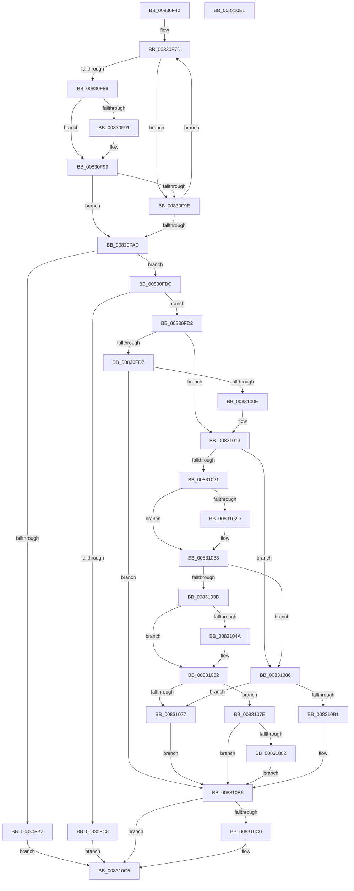

# CmSetDeviceMappedPropertyFromInstanceKeyRegValue

- RVA: `0x00830F40`–`0x008310E2` (길이 `418` bytes)
- VA: `0x0000000140830F40`
- 실행 섹션: `PAGE`
- PDB 이름 있음: `예`; PDB Function 태그: `아니요`
- unwind 정보 RVA: `0x0007EE78`
- 디코드: `115`개 명령, `418/418` bytes 표시
- 미해석 바이트: `0` (있으면 어셈블리에 `.byte`로 보존)

> 이 문서는 커널 이미지의 기계어와 PDB 기호를 분석해 생성했습니다. 4번과 5번은 함수 원형과 자료형을 바이너리 사용 방식에서 추정한 C 해석이며 원본 소스 복구 결과는 아닙니다.

## 1. Dependencies

- 직접 호출 지점: **4**; 고유 호출 대상: **3**
- 직접 호출자로 확인된 함수: **1**
- RIP 상대 이미지 참조: **3**

### Outgoing calls
- `0x00830FFF` → [_CmOpenDeviceRegKey](../8E/_CmOpenDeviceRegKey_function_008EE540.md) (function, `0x008EE540`)
- `0x0083106B` → [PnpCtxRegSetValue](../99/PnpCtxRegSetValue_function_00991B8C.md) (function, `0x00991B8C`)
- `0x008310A5` → [PnpCtxRegSetValue](../99/PnpCtxRegSetValue_function_00991B8C.md) (function, `0x00991B8C`)
- `0x008310C0` → [ZwClose](../../text/6A/ZwClose_function_006AD2B0.md) (function, `0x006AD2B0`)

### Direct callers
- [_CmSetDeviceMappedProperty](../A0/_CmSetDeviceMappedProperty_function_00A0B098.md) at `0x00A0B2BC`

### Static image references
- `0x00830F73` → RVA `0x00B4B720` (`PAGE`; read)
- `0x00831024` → RVA `0x00014428` (`.rdata`; read)
- `0x00831031` → RVA `0x00014430` (`.rdata`; read)

## 2. Other-region calls and transfers

- 다른 실행 섹션으로 향하는 call: **1**
  - `0x008310C0` → [ZwClose](../../text/6A/ZwClose_function_006AD2B0.md) (`PAGE` → `.text`)
- 별도 외부 분기/꼬리 이동을 확인하지 못했습니다.

## 3. Assembly (complete function range)

```asm
00830F40  48 8B C4                        mov rax, rsp
00830F43  48 89 58 08                     mov qword ptr [rax + 8], rbx
00830F47  48 89 68 10                     mov qword ptr [rax + 0x10], rbp
00830F4B  48 89 70 18                     mov qword ptr [rax + 0x18], rsi
00830F4F  57                              push rdi
00830F50  41 56                           push r14
00830F52  41 57                           push r15
00830F54  48 83 EC 50                     sub rsp, 0x50
00830F58  45 8B 59 10                     mov r11d, dword ptr [r9 + 0x10]
00830F5C  4C 8B F2                        mov r14, rdx
00830F5F  33 D2                           xor edx, edx
00830F61  33 DB                           xor ebx, ebx
00830F63  21 50 D8                        and dword ptr [rax - 0x28], edx
00830F66  49 8B F1                        mov rsi, r9
00830F69  45 33 D2                        xor r10d, r10d
00830F6C  48 89 50 E0                     mov qword ptr [rax - 0x20], rdx
00830F70  49 8B E8                        mov rbp, r8
00830F73  4C 8D 0D A6 A7 31 00            lea r9, [rip + 0x31a7a6]
00830F7A  4C 8B F9                        mov r15, rcx
00830F7D  4D 8B 01                        mov r8, qword ptr [r9]
00830F80  49 8B F9                        mov rdi, r9
00830F83  45 3B 58 10                     cmp r11d, dword ptr [r8 + 0x10]
00830F87  75 15                           jne 0x140830f9e
00830F89  48 8B 0E                        mov rcx, qword ptr [rsi]
00830F8C  49 2B 08                        sub rcx, qword ptr [r8]
00830F8F  75 08                           jne 0x140830f99
00830F91  48 8B 4E 08                     mov rcx, qword ptr [rsi + 8]
00830F95  49 2B 48 08                     sub rcx, qword ptr [r8 + 8]
00830F99  48 85 C9                        test rcx, rcx
00830F9C  74 0F                           je 0x140830fad
00830F9E  33 FF                           xor edi, edi
00830FA0  41 FF C2                        inc r10d
00830FA3  49 83 C1 20                     add r9, 0x20
00830FA7  41 83 FA 02                     cmp r10d, 2
00830FAB  72 D0                           jb 0x140830f7d
00830FAD  48 85 FF                        test rdi, rdi
00830FB0  75 0A                           jne 0x140830fbc
00830FB2  BB 30 02 00 C0                  mov ebx, 0xc0000230
00830FB7  E9 09 01 00 00                  jmp 0x1408310c5
00830FBC  8B 47 08                        mov eax, dword ptr [rdi + 8]
00830FBF  39 84 24 90 00 00 00            cmp dword ptr [rsp + 0x90], eax
00830FC6  74 0A                           je 0x140830fd2
00830FC8  BB 0D 00 00 C0                  mov ebx, 0xc000000d
00830FCD  E9 F3 00 00 00                  jmp 0x1408310c5
00830FD2  48 85 ED                        test rbp, rbp
00830FD5  75 3C                           jne 0x140831013
00830FD7  48 21 54 24 38                  and qword ptr [rsp + 0x38], rdx
00830FDC  48 8D 44 24 48                  lea rax, [rsp + 0x48]
00830FE1  48 89 44 24 30                  mov qword ptr [rsp + 0x30], rax
00830FE6  44 8D 45 10                     lea r8d, [rbp + 0x10]
00830FEA  88 54 24 28                     mov byte ptr [rsp + 0x28], dl
00830FEE  45 33 C9                        xor r9d, r9d
00830FF1  49 8B D6                        mov rdx, r14
00830FF4  C7 44 24 20 02 00 00 00         mov dword ptr [rsp + 0x20], 2
00830FFC  49 8B CF                        mov rcx, r15
00830FFF  E8 3C D5 0B 00                  call 0x1408ee540
00831004  8B D8                           mov ebx, eax
00831006  85 C0                           test eax, eax
00831008  0F 88 A8 00 00 00               js 0x1408310b6
0083100E  48 8B 54 24 48                  mov rdx, qword ptr [rsp + 0x48]
00831013  83 7E 10 02                     cmp dword ptr [rsi + 0x10], 2
00831017  4C 8B 47 10                     mov r8, qword ptr [rdi + 0x10]
0083101B  44 8B 4F 18                     mov r9d, dword ptr [rdi + 0x18]
0083101F  75 65                           jne 0x140831086
00831021  48 8B 06                        mov rax, qword ptr [rsi]
00831024  48 2B 05 FD 33 7E FF            sub rax, qword ptr [rip - 0x81cc03]
0083102B  75 0B                           jne 0x140831038
0083102D  48 8B 46 08                     mov rax, qword ptr [rsi + 8]
00831031  48 2B 05 F8 33 7E FF            sub rax, qword ptr [rip - 0x81cc08]
00831038  48 85 C0                        test rax, rax
0083103B  75 49                           jne 0x140831086
0083103D  48 8B 84 24 98 00 00 00         mov rax, qword ptr [rsp + 0x98]
00831045  80 38 FF                        cmp byte ptr [rax], 0xff
00831048  75 08                           jne 0x140831052
0083104A  C7 44 24 40 01 00 00 00         mov dword ptr [rsp + 0x40], 1
00831052  48 8D 44 24 40                  lea rax, [rsp + 0x40]
00831057  C7 44 24 28 04 00 00 00         mov dword ptr [rsp + 0x28], 4
0083105F  48 85 ED                        test rbp, rbp
00831062  48 89 44 24 20                  mov qword ptr [rsp + 0x20], rax
00831067  48 0F 45 D5                     cmovne rdx, rbp
0083106B  E8 1C 0B 16 00                  call 0x140991b8c
00831070  3D 7C 01 00 C0                  cmp eax, 0xc000017c
00831075  75 07                           jne 0x14083107e
00831077  BB 0E 00 00 C0                  mov ebx, 0xc000000e
0083107C  EB 38                           jmp 0x1408310b6
0083107E  85 C0                           test eax, eax
00831080  79 34                           jns 0x1408310b6
00831082  8B D8                           mov ebx, eax
00831084  EB 30                           jmp 0x1408310b6
00831086  8B 84 24 A0 00 00 00            mov eax, dword ptr [rsp + 0xa0]
0083108D  48 85 ED                        test rbp, rbp
00831090  89 44 24 28                     mov dword ptr [rsp + 0x28], eax
00831094  48 8B 84 24 98 00 00 00         mov rax, qword ptr [rsp + 0x98]
0083109C  48 0F 45 D5                     cmovne rdx, rbp
008310A0  48 89 44 24 20                  mov qword ptr [rsp + 0x20], rax
008310A5  E8 E2 0A 16 00                  call 0x140991b8c
008310AA  3D 7C 01 00 C0                  cmp eax, 0xc000017c
008310AF  74 C6                           je 0x140831077
008310B1  85 C0                           test eax, eax
008310B3  0F 48 D8                        cmovs ebx, eax
008310B6  48 8B 4C 24 48                  mov rcx, qword ptr [rsp + 0x48]
008310BB  48 85 C9                        test rcx, rcx
008310BE  74 05                           je 0x1408310c5
008310C0  E8 EB C1 E7 FF                  call 0x1406ad2b0
008310C5  4C 8D 5C 24 50                  lea r11, [rsp + 0x50]
008310CA  8B C3                           mov eax, ebx
008310CC  49 8B 5B 20                     mov rbx, qword ptr [r11 + 0x20]
008310D0  49 8B 6B 28                     mov rbp, qword ptr [r11 + 0x28]
008310D4  49 8B 73 30                     mov rsi, qword ptr [r11 + 0x30]
008310D8  49 8B E3                        mov rsp, r11
008310DB  41 5F                           pop r15
008310DD  41 5E                           pop r14
008310DF  5F                              pop rdi
008310E0  C3                              ret
008310E1  CC                              int3
```

## 4. C-style interpretation (structured pseudocode)

```c
__int64 __fastcall CmSetDeviceMappedPropertyFromInstanceKeyRegValue(__int64 a1, __int64 a2, __int64 a3, __int64 a4, unsigned int a5, __int64 a6, unsigned int a7)
{
    __int64 result;
    __int64 v_r10;
    __int64 v_rbx;
    __int64 v_rdi;
    __int64 v_rsp;
    unsigned __int64 v_stack_m18;
    unsigned __int64 v_stack_m20;
    unsigned int v_stack_m28;
    unsigned __int64 v_stack_m30;
    unsigned __int64 v_stack_m38;
    unsigned __int8 v_stack_m40;
    unsigned int v_stack_m48;

    *(unsigned __int64 *)(v_rsp + 8) = v_rbx;
    *(unsigned __int64 *)(v_rsp + 16) = v_rbp;
    *(unsigned __int64 *)(v_rsp + 24) = v_rsi;
    v_rsp = (v_rsp) - (80);
    a2 = 0;
    v_rbx = 0;
    v_r10 = 0;
    *(unsigned __int64 *)(v_rsp - 32) = 0;
loc_00830F7D:
    if (((unsigned int)((unsigned int)(*(unsigned int *)(a4 + 16)))) != (*(unsigned int *)(*(unsigned __int64 *)(v_rip + 3254182) + 16))) goto loc_00830F9E;
    a1 = (*(unsigned __int64 *)(a4)) - (*(unsigned __int64 *)(*(unsigned __int64 *)(v_rip + 3254182)));
    if (!(condition_is_not_equal)) {
        a1 = *(unsigned __int64 *)(a4 + 8);
        a1 = (a1) - (*(unsigned __int64 *)(*(unsigned __int64 *)(v_rip + 3254182) + 8));
    }
    if (a1 == 0) goto loc_00830FAD;
loc_00830F9E:
    v_rdi = 0;
    v_r10 = (unsigned int)((v_r10) + 1);
    a4 = (v_rip + 3254182) + (32);
    if (((unsigned int)(v_r10)) < 2) goto loc_00830F7D;
loc_00830FAD:
    if (0 != 0) goto loc_00830FBC;
    goto loc_008310C5;
loc_00830FBC:
    if (a5 == ((unsigned int)((unsigned int)(*(unsigned int *)(v_rdi + 8))))) goto loc_00830FD2;
    goto loc_008310C5;
loc_00830FD2:
    if (a3 != 0) goto loc_00831013;
    v_stack_m38 = v_stack_m20;
    v_stack_m40 = 0;
    a4 = 0;
    v_stack_m48 = 2;
    result = _CmOpenDeviceRegKey(a1, 0, a3 + 16, a4);
    if (sign_flag) goto loc_008310B6;
loc_00831013:
    if ((*(unsigned int *)(a4 + 16)) != 2) goto loc_00831086;
    result = (*(unsigned __int64 *)(a4)) - (*(unsigned __int64 *)(v_rip - 8506371));
    if (!(condition_is_not_equal)) {
        result = *(unsigned __int64 *)(a4 + 8);
        result = (result) - (*(unsigned __int64 *)(v_rip - 8506376));
    }
    if (result != 0) goto loc_00831086;
    if ((*(unsigned __int8 *)(a6)) == 255) {
        v_stack_m28 = 1;
    }
    v_stack_m40 = 4;
    v_stack_m48 = v_stack_m28;
    a2 = v_stack_m20;
    if (a3 != 0) { a2 = a3; }
    result = PnpCtxRegSetValue(a1, a2, *(unsigned __int64 *)(v_rdi + 16), (unsigned int)(*(unsigned int *)(v_rdi + 24)));
    if (((unsigned int)(result)) != 0xC000017CULL) goto loc_0083107E;
loc_00831077:
    goto loc_008310B6;
loc_0083107E:
    if (!sign_flag) goto loc_008310B6;
    goto loc_008310B6;
loc_00831086:
    v_stack_m40 = (unsigned int)((unsigned int)(a7));
    if (a3 != 0) { a2 = a3; }
    v_stack_m48 = a6;
    result = PnpCtxRegSetValue(a1, a2, *(unsigned __int64 *)(v_rdi + 16), (unsigned int)(*(unsigned int *)(v_rdi + 24)));
    if (((unsigned int)(result)) == 0xC000017CULL) goto loc_00831077;
    v_rbx = (unsigned int)((unsigned int)(result));
    if (sign_flag) { v_rbx = (unsigned int)(result); }
loc_008310B6:
    if (v_stack_m20 != 0) {
        result = ZwClose(v_stack_m20, a2, *(unsigned __int64 *)(v_rdi + 16), (unsigned int)(*(unsigned int *)(v_rdi + 24)));
    }
    return (unsigned int)((unsigned int)(v_rbx));
}
```

## 5. (Beta) C Style

```c
int64_t CmSetDeviceMappedPropertyFromInstanceKeyRegValue(int64_t Arg1, int64_t Arg2, int64_t Arg3, void *Arg4, uint32_t Arg5, void *Arg6, uint32_t Arg7)
{
    uint8_t *arg4 = (uint8_t *)Arg4;
    uint8_t *arg6 = (uint8_t *)Arg6;

    int64_t result;
    int64_t local_r10;
    int64_t local_rbx;
    int64_t local_rdi;
    int64_t local_rsp;
    uint64_t v_stack_m18;
    uint64_t v_stack_m20;
    uint32_t v_stack_m28;
    uint64_t v_stack_m30;
    uint64_t v_stack_m38;
    uint8_t v_stack_m40;
    uint32_t v_stack_m48;

    *(uint64_t *)(local_rsp + 0x8) = local_rbx;
    *(uint64_t *)(local_rsp + 0x10) = local_rbp;
    *(uint64_t *)(local_rsp + 0x18) = local_rsi;
    local_rsp = (local_rsp) - (80);
    Arg2 = 0;
    local_rbx = 0;
    local_r10 = 0;
    *(uint64_t *)(local_rsp - 0x20) = 0;
loc_00830F7D:
    if (((uint32_t)((uint32_t)(*(uint32_t *)(arg4 + 0x10)))) != (*(uint32_t *)(*(uint64_t *)(v_rip + 0x31A7A6) + 0x10))) goto loc_00830F9E;
    Arg1 = (*(uint64_t *)(arg4)) - (*(uint64_t *)(*(uint64_t *)(v_rip + 0x31A7A6)));
    if (!(condition_is_not_equal)) {
        Arg1 = *(uint64_t *)(arg4 + 0x8);
        Arg1 = (Arg1) - (*(uint64_t *)(*(uint64_t *)(v_rip + 0x31A7A6) + 0x8));
    }
    if (Arg1 == 0) goto loc_00830FAD;
loc_00830F9E:
    local_rdi = 0;
    local_r10 = (uint32_t)((local_r10) + 1);
    Arg4 = (v_rip + 3254182) + (32);
    if (((uint32_t)(local_r10)) < 2) goto loc_00830F7D;
loc_00830FAD:
    if (0 != 0) goto loc_00830FBC;
    goto loc_008310C5;
loc_00830FBC:
    if (Arg5 == ((uint32_t)((uint32_t)(*(uint32_t *)(local_rdi + 0x8))))) goto loc_00830FD2;
    goto loc_008310C5;
loc_00830FD2:
    if (Arg3 != 0) goto loc_00831013;
    v_stack_m38 = v_stack_m20;
    v_stack_m40 = 0;
    Arg4 = 0;
    v_stack_m48 = 2;
    result = _CmOpenDeviceRegKey(Arg1, 0, Arg3 + 16, Arg4);
    if (sign_flag) goto loc_008310B6;
loc_00831013:
    if ((*(uint32_t *)(arg4 + 0x10)) != 2) goto loc_00831086;
    result = (*(uint64_t *)(arg4)) - (*(uint64_t *)(v_rip - 0x81CC03));
    if (!(condition_is_not_equal)) {
        result = *(uint64_t *)(arg4 + 0x8);
        result = (result) - (*(uint64_t *)(v_rip - 0x81CC08));
    }
    if (result != 0) goto loc_00831086;
    if ((*(uint8_t *)(arg6)) == 255) {
        v_stack_m28 = 1;
    }
    v_stack_m40 = 4;
    v_stack_m48 = v_stack_m28;
    Arg2 = v_stack_m20;
    if (Arg3 != 0) { Arg2 = Arg3; }
    result = PnpCtxRegSetValue(Arg1, Arg2, *(uint64_t *)(local_rdi + 0x10), (uint32_t)(*(uint32_t *)(local_rdi + 0x18)));
    if (((uint32_t)(result)) != 0xC000017CULL) goto loc_0083107E;
loc_00831077:
    goto loc_008310B6;
loc_0083107E:
    if (!sign_flag) goto loc_008310B6;
    goto loc_008310B6;
loc_00831086:
    v_stack_m40 = (uint32_t)((uint32_t)(Arg7));
    if (Arg3 != 0) { Arg2 = Arg3; }
    v_stack_m48 = Arg6;
    result = PnpCtxRegSetValue(Arg1, Arg2, *(uint64_t *)(local_rdi + 0x10), (uint32_t)(*(uint32_t *)(local_rdi + 0x18)));
    if (((uint32_t)(result)) == 0xC000017CULL) goto loc_00831077;
    local_rbx = (uint32_t)((uint32_t)(result));
    if (sign_flag) { local_rbx = (uint32_t)(result); }
loc_008310B6:
    if (v_stack_m20 != 0) {
        result = ZwClose(v_stack_m20, Arg2, *(uint64_t *)(local_rdi + 0x10), (uint32_t)(*(uint32_t *)(local_rdi + 0x18)));
    }
    return (uint32_t)((uint32_t)(local_rbx));
}
```

### 관측된 메모리 오프셋

구조체 형식이 확인되지 않은 접근은 인자 기준의 오프셋으로만 기록했습니다.

| 기준 인자 | 오프셋 표현 | 폭 (bit) | 접근 |
|---|---:|---:|---|
| `Arg4` | `+ 0x0` | `64` | `R` |
| `Arg4` | `+ 0x8` | `64` | `R` |
| `Arg4` | `+ 0x10` | `32` | `R` |
| `Arg6` | `+ 0x0` | `8` | `R` |

## 6. Execution-region graph

[열기: 2D/3D 그래프와 함수 탐색 컨트롤 패널](../../../control-panel.html?section=page&rva=0x00830F40&view=graph)

- 2D 그래프는 위에서 아래로 흐르고, 3D 그래프는 빈 공간을 드래그해 회전합니다. Shift+드래그는 이동, 휠은 확대·축소, 함수 노드 선택은 대상 보고서 이동입니다.

### Static fallback


