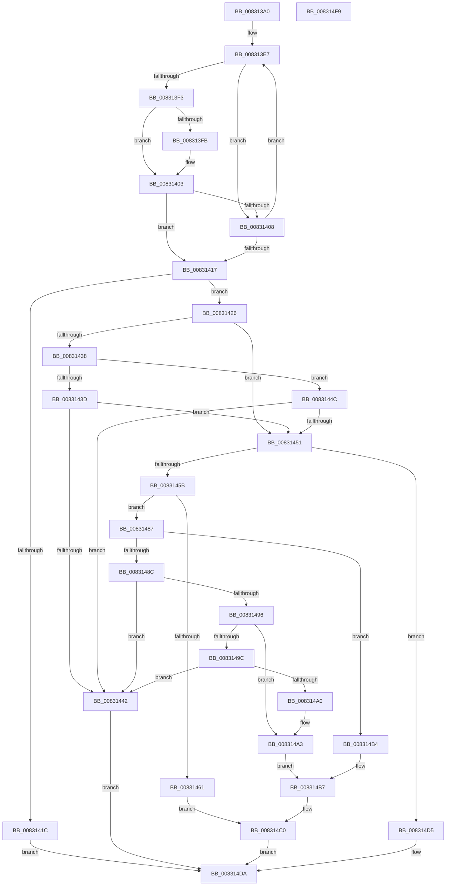

# CmSetInstallerClassMappedPropertyFromRegProp

- RVA: `0x008313A0`–`0x008314FA` (길이 `346` bytes)
- VA: `0x00000001408313A0`
- 실행 섹션: `PAGE`
- PDB 이름 있음: `예`; PDB Function 태그: `아니요`
- unwind 정보 RVA: `0x0007FF48`
- 디코드: `103`개 명령, `346/346` bytes 표시
- 미해석 바이트: `0` (있으면 어셈블리에 `.byte`로 보존)

> 이 문서는 커널 이미지의 기계어와 PDB 기호를 분석해 생성했습니다. 4번과 5번은 함수 원형과 자료형을 바이너리 사용 방식에서 추정한 C 해석이며 원본 소스 복구 결과는 아닙니다.

## 1. Dependencies

- 직접 호출 지점: **1**; 고유 호출 대상: **1**
- 직접 호출자로 확인된 함수: **1**
- RIP 상대 이미지 참조: **1**

### Outgoing calls
- `0x008314CE` → [CmSetInstallerClassRegProp](../82/CmSetInstallerClassRegProp_function_0082AA90.md) (function, `0x0082AA90`)

### Direct callers
- [CmSetInstallerClassMappedProperty](CmSetInstallerClassMappedProperty_function_008310E8.md) at `0x00831194`

### Static image references
- `0x008313C5` → RVA `0x00B4C710` (`CmClassRegPropMap`; read)

## 2. Other-region calls and transfers

- 다른 실행 섹션으로 향하는 call: **0**
- 별도 외부 분기/꼬리 이동을 확인하지 못했습니다.

## 3. Assembly (complete function range)

```asm
008313A0  48 8B C4                        mov rax, rsp
008313A3  48 89 58 08                     mov qword ptr [rax + 8], rbx
008313A7  48 89 68 10                     mov qword ptr [rax + 0x10], rbp
008313AB  48 89 70 18                     mov qword ptr [rax + 0x18], rsi
008313AF  48 89 78 20                     mov qword ptr [rax + 0x20], rdi
008313B3  41 54                           push r12
008313B5  41 56                           push r14
008313B7  41 57                           push r15
008313B9  48 83 EC 50                     sub rsp, 0x50
008313BD  48 8B BC 24 98 00 00 00         mov rdi, qword ptr [rsp + 0x98]
008313C5  48 8D 1D 44 B3 31 00            lea rbx, [rip + 0x31b344]
008313CC  41 8B 69 10                     mov ebp, dword ptr [r9 + 0x10]
008313D0  45 33 D2                        xor r10d, r10d
008313D3  4D 8B F0                        mov r14, r8
008313D6  44 89 50 D8                     mov dword ptr [rax - 0x28], r10d
008313DA  4C 8B FA                        mov r15, rdx
008313DD  4C 8B E1                        mov r12, rcx
008313E0  41 8B F2                        mov esi, r10d
008313E3  45 8D 5A 01                     lea r11d, [r10 + 1]
008313E7  4C 8B 03                        mov r8, qword ptr [rbx]
008313EA  48 8B CB                        mov rcx, rbx
008313ED  41 3B 68 10                     cmp ebp, dword ptr [r8 + 0x10]
008313F1  75 15                           jne 0x140831408
008313F3  49 8B 11                        mov rdx, qword ptr [r9]
008313F6  49 2B 10                        sub rdx, qword ptr [r8]
008313F9  75 08                           jne 0x140831403
008313FB  49 8B 51 08                     mov rdx, qword ptr [r9 + 8]
008313FF  49 2B 50 08                     sub rdx, qword ptr [r8 + 8]
00831403  48 85 D2                        test rdx, rdx
00831406  74 0F                           je 0x140831417
00831408  41 03 F3                        add esi, r11d
0083140B  48 83 C3 18                     add rbx, 0x18
0083140F  49 8B CA                        mov rcx, r10
00831412  83 FE 09                        cmp esi, 9
00831415  72 D0                           jb 0x1408313e7
00831417  48 85 C9                        test rcx, rcx
0083141A  75 0A                           jne 0x140831426
0083141C  B8 30 02 00 C0                  mov eax, 0xc0000230
00831421  E9 B4 00 00 00                  jmp 0x1408314da
00831426  8B 51 08                        mov edx, dword ptr [rcx + 8]
00831429  8B 84 24 90 00 00 00            mov eax, dword ptr [rsp + 0x90]
00831430  44 8B 49 0C                     mov r9d, dword ptr [rcx + 0xc]
00831434  3B C2                           cmp eax, edx
00831436  74 19                           je 0x140831451
00831438  83 F8 19                        cmp eax, 0x19
0083143B  75 0F                           jne 0x14083144c
0083143D  83 FA 12                        cmp edx, 0x12
00831440  74 0F                           je 0x140831451
00831442  B8 0D 00 00 C0                  mov eax, 0xc000000d
00831447  E9 8E 00 00 00                  jmp 0x1408314da
0083144C  83 F8 02                        cmp eax, 2
0083144F  73 F1                           jae 0x140831442
00831451  44 8B 41 10                     mov r8d, dword ptr [rcx + 0x10]
00831455  41 83 F9 19                     cmp r9d, 0x19
00831459  74 7A                           je 0x1408314d5
0083145B  41 83 F9 1B                     cmp r9d, 0x1b
0083145F  74 26                           je 0x140831487
00831461  48 8B C7                        mov rax, rdi
00831464  48 F7 D8                        neg rax
00831467  48 8B C7                        mov rax, rdi
0083146A  1B D2                           sbb edx, edx
0083146C  23 94 24 A0 00 00 00            and edx, dword ptr [rsp + 0xa0]
00831473  48 F7 D8                        neg rax
00831476  89 54 24 30                     mov dword ptr [rsp + 0x30], edx
0083147A  48 1B C9                        sbb rcx, rcx
0083147D  48 23 CF                        and rcx, rdi
00831480  48 89 4C 24 28                  mov qword ptr [rsp + 0x28], rcx
00831485  EB 39                           jmp 0x1408314c0
00831487  48 85 FF                        test rdi, rdi
0083148A  74 28                           je 0x1408314b4
0083148C  44 39 9C 24 A0 00 00 00         cmp dword ptr [rsp + 0xa0], r11d
00831494  72 AC                           jb 0x140831442
00831496  8A 07                           mov al, byte ptr [rdi]
00831498  3C FF                           cmp al, 0xff
0083149A  74 07                           je 0x1408314a3
0083149C  84 C0                           test al, al
0083149E  75 A2                           jne 0x140831442
008314A0  45 8B DA                        mov r11d, r10d
008314A3  44 89 5C 24 40                  mov dword ptr [rsp + 0x40], r11d
008314A8  4C 8D 54 24 40                  lea r10, [rsp + 0x40]
008314AD  B8 04 00 00 00                  mov eax, 4
008314B2  EB 03                           jmp 0x1408314b7
008314B4  41 8B C2                        mov eax, r10d
008314B7  89 44 24 30                     mov dword ptr [rsp + 0x30], eax
008314BB  4C 89 54 24 28                  mov qword ptr [rsp + 0x28], r10
008314C0  44 89 44 24 20                  mov dword ptr [rsp + 0x20], r8d
008314C5  49 8B D7                        mov rdx, r15
008314C8  4D 8B C6                        mov r8, r14
008314CB  49 8B CC                        mov rcx, r12
008314CE  E8 BD 95 FF FF                  call 0x14082aa90
008314D3  EB 05                           jmp 0x1408314da
008314D5  B8 BB 00 00 C0                  mov eax, 0xc00000bb
008314DA  4C 8D 5C 24 50                  lea r11, [rsp + 0x50]
008314DF  49 8B 5B 20                     mov rbx, qword ptr [r11 + 0x20]
008314E3  49 8B 6B 28                     mov rbp, qword ptr [r11 + 0x28]
008314E7  49 8B 73 30                     mov rsi, qword ptr [r11 + 0x30]
008314EB  49 8B 7B 38                     mov rdi, qword ptr [r11 + 0x38]
008314EF  49 8B E3                        mov rsp, r11
008314F2  41 5F                           pop r15
008314F4  41 5E                           pop r14
008314F6  41 5C                           pop r12
008314F8  C3                              ret
008314F9  CC                              int3
```

## 4. C-style interpretation (structured pseudocode)

```c
__int64 __fastcall CmSetInstallerClassMappedPropertyFromRegProp(__int64 a1, __int64 a2, __int64 a3, __int64 a4, unsigned int a5, __int64 a6, unsigned int a7)
{
    __int64 result;
    __int64 v_r10;
    __int64 v_rbx;
    __int64 v_rsi;
    __int64 v_rsp;
    unsigned __int64 v_stack_m18;
    unsigned int v_stack_m28;
    unsigned int v_stack_m38;
    unsigned __int64 v_stack_m40;
    unsigned int v_stack_m48;

    *(unsigned __int64 *)(v_rsp + 8) = v_rbx;
    *(unsigned __int64 *)(v_rsp + 16) = v_rbp;
    *(unsigned __int64 *)(v_rsp + 24) = v_rsi;
    *(unsigned __int64 *)(v_rsp + 32) = v_rdi;
    v_rsp = (v_rsp) - (80);
    v_r10 = 0;
    *(unsigned int *)(v_rsp - 40) = 0;
loc_008313E7:
    if (((unsigned int)((unsigned int)(*(unsigned int *)(a4 + 16)))) != (*(unsigned int *)(*(unsigned __int64 *)(v_rip + 3257156) + 16))) goto loc_00831408;
    a2 = (*(unsigned __int64 *)(a4)) - (*(unsigned __int64 *)(*(unsigned __int64 *)(v_rip + 3257156)));
    if (!(condition_is_not_equal)) {
        a2 = *(unsigned __int64 *)(a4 + 8);
        a2 = (a2) - (*(unsigned __int64 *)(*(unsigned __int64 *)(v_rip + 3257156) + 8));
    }
    if (a2 == 0) goto loc_00831417;
loc_00831408:
    v_rsi = (unsigned int)((0) + ((unsigned int)(v_r10 + 1)));
    v_rbx = (v_rip + 3257156) + (24);
    if (((unsigned int)(v_rsi)) < 9) goto loc_008313E7;
loc_00831417:
    if (0 != 0) goto loc_00831426;
    goto loc_008314DA;
loc_00831426:
    if (((unsigned int)((unsigned int)(a5))) == ((unsigned int)((unsigned int)(*(unsigned int *)(0 + 8))))) goto loc_00831451;
    if (((unsigned int)((unsigned int)(a5))) != 25) goto loc_0083144C;
    if (((unsigned int)((unsigned int)(*(unsigned int *)(0 + 8)))) == 18) goto loc_00831451;
loc_00831442:
    goto loc_008314DA;
loc_0083144C:
    if (((unsigned int)((unsigned int)(0xC000000DULL))) >= 2) goto loc_00831442;
loc_00831451:
    if (((unsigned int)((unsigned int)(*(unsigned int *)(0 + 12)))) == 25) goto loc_008314D5;
    if (((unsigned int)((unsigned int)(*(unsigned int *)(0 + 12)))) == 27) goto loc_00831487;
    result = -(a6);
    a2 = (unsigned int)(((unsigned int)(*(unsigned int *)(0 + 8))) & (a7));
    result = -(a6);
    v_stack_m38 = (unsigned int)(a2);
    a1 = (0) & (a6);
    v_stack_m40 = a1;
    goto loc_008314C0;
loc_00831487:
    if (a6 == 0) goto loc_008314B4;
    if (a7 < ((unsigned int)(v_r10 + 1))) goto loc_00831442;
    if (((unsigned __int8)(*(unsigned __int8 *)(a6))) == 255) goto loc_008314A3;
    if ((unsigned __int8)(*(unsigned __int8 *)(a6)) != 0) goto loc_00831442;
loc_008314A3:
    v_stack_m28 = 0;
    goto loc_008314B7;
loc_008314B4:
loc_008314B7:
    v_stack_m38 = (unsigned int)((unsigned int)((unsigned int)(v_stack_m28)));
    v_stack_m40 = v_stack_m28;
loc_008314C0:
    v_stack_m48 = (unsigned int)((unsigned int)(*(unsigned int *)(0 + 16)));
    result = CmSetInstallerClassRegProp(a1, a2, a3, (unsigned int)(*(unsigned int *)(0 + 12)));
    goto loc_008314DA;
loc_008314D5:
loc_008314DA:
    return (unsigned int)(0xC00000BBULL);
}
```

## 5. (Beta) C Style

```c
int64_t CmSetInstallerClassMappedPropertyFromRegProp(int64_t Arg1, int64_t Arg2, int64_t Arg3, void *Arg4, uint32_t Arg5, int64_t Arg6, uint32_t Arg7)
{
    uint8_t *arg4 = (uint8_t *)Arg4;

    int64_t result;
    int64_t local_r10;
    int64_t local_rbx;
    int64_t local_rsi;
    int64_t local_rsp;
    uint64_t v_stack_m18;
    uint32_t v_stack_m28;
    uint32_t v_stack_m38;
    uint64_t v_stack_m40;
    uint32_t v_stack_m48;

    *(uint64_t *)(local_rsp + 0x8) = local_rbx;
    *(uint64_t *)(local_rsp + 0x10) = local_rbp;
    *(uint64_t *)(local_rsp + 0x18) = local_rsi;
    *(uint64_t *)(local_rsp + 0x20) = local_rdi;
    local_rsp = (local_rsp) - (80);
    local_r10 = 0;
    *(uint32_t *)(local_rsp - 0x28) = 0;
loc_008313E7:
    if (((uint32_t)((uint32_t)(*(uint32_t *)(arg4 + 0x10)))) != (*(uint32_t *)(*(uint64_t *)(v_rip + 0x31B344) + 0x10))) goto loc_00831408;
    Arg2 = (*(uint64_t *)(arg4)) - (*(uint64_t *)(*(uint64_t *)(v_rip + 0x31B344)));
    if (!(condition_is_not_equal)) {
        Arg2 = *(uint64_t *)(arg4 + 0x8);
        Arg2 = (Arg2) - (*(uint64_t *)(*(uint64_t *)(v_rip + 0x31B344) + 0x8));
    }
    if (Arg2 == 0) goto loc_00831417;
loc_00831408:
    local_rsi = (uint32_t)((0) + ((uint32_t)(local_r10 + 1)));
    local_rbx = (v_rip + 3257156) + (24);
    if (((uint32_t)(local_rsi)) < 9) goto loc_008313E7;
loc_00831417:
    if (0 != 0) goto loc_00831426;
    goto loc_008314DA;
loc_00831426:
    if (((uint32_t)((uint32_t)(Arg5))) == ((uint32_t)((uint32_t)(*(uint32_t *)(0 + 0x8))))) goto loc_00831451;
    if (((uint32_t)((uint32_t)(Arg5))) != 25) goto loc_0083144C;
    if (((uint32_t)((uint32_t)(*(uint32_t *)(0 + 0x8)))) == 18) goto loc_00831451;
loc_00831442:
    goto loc_008314DA;
loc_0083144C:
    if (((uint32_t)((uint32_t)(0xC000000DULL))) >= 2) goto loc_00831442;
loc_00831451:
    if (((uint32_t)((uint32_t)(*(uint32_t *)(0 + 0xC)))) == 25) goto loc_008314D5;
    if (((uint32_t)((uint32_t)(*(uint32_t *)(0 + 0xC)))) == 27) goto loc_00831487;
    result = -(Arg6);
    Arg2 = (uint32_t)(((uint32_t)(*(uint32_t *)(0 + 0x8))) & (Arg7));
    result = -(Arg6);
    v_stack_m38 = (uint32_t)(Arg2);
    Arg1 = (0) & (Arg6);
    v_stack_m40 = Arg1;
    goto loc_008314C0;
loc_00831487:
    if (Arg6 == 0) goto loc_008314B4;
    if (Arg7 < ((uint32_t)(local_r10 + 1))) goto loc_00831442;
    if (((uint8_t)(*(uint8_t *)(Arg6))) == 255) goto loc_008314A3;
    if ((uint8_t)(*(uint8_t *)(Arg6)) != 0) goto loc_00831442;
loc_008314A3:
    v_stack_m28 = 0;
    goto loc_008314B7;
loc_008314B4:
loc_008314B7:
    v_stack_m38 = (uint32_t)((uint32_t)((uint32_t)(v_stack_m28)));
    v_stack_m40 = v_stack_m28;
loc_008314C0:
    v_stack_m48 = (uint32_t)((uint32_t)(*(uint32_t *)(0 + 0x10)));
    result = CmSetInstallerClassRegProp(Arg1, Arg2, Arg3, (uint32_t)(*(uint32_t *)(0 + 0xC)));
    goto loc_008314DA;
loc_008314D5:
loc_008314DA:
    return (uint32_t)(0xC00000BBULL);
}
```

### 관측된 메모리 오프셋

구조체 형식이 확인되지 않은 접근은 인자 기준의 오프셋으로만 기록했습니다.

| 기준 인자 | 오프셋 표현 | 폭 (bit) | 접근 |
|---|---:|---:|---|
| `Arg4` | `+ 0x0` | `64` | `R` |
| `Arg4` | `+ 0x8` | `64` | `R` |
| `Arg4` | `+ 0x10` | `32` | `R` |

## 6. Execution-region graph

[열기: 2D/3D 그래프와 함수 탐색 컨트롤 패널](../../../control-panel.html?section=page&rva=0x008313A0&view=graph)

- 2D 그래프는 위에서 아래로 흐르고, 3D 그래프는 빈 공간을 드래그해 회전합니다. Shift+드래그는 이동, 휠은 확대·축소, 함수 노드 선택은 대상 보고서 이동입니다.

### Static fallback


