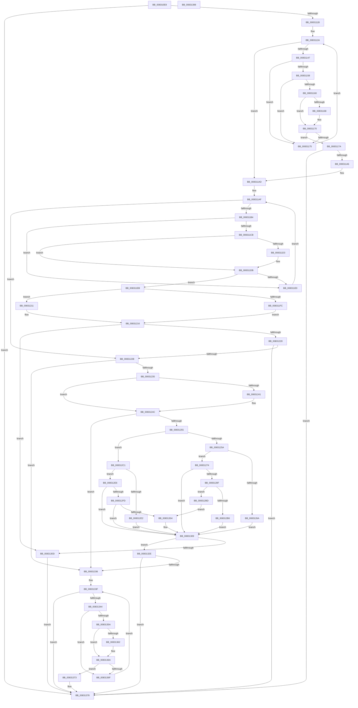

# CmSetInstallerClassMappedProperty

- RVA: `0x008310E8`–`0x00831399` (길이 `689` bytes)
- VA: `0x00000001408310E8`
- 실행 섹션: `PAGE`
- PDB 이름 있음: `예`; PDB Function 태그: `아니요`
- unwind 정보 RVA: `0x000AC264`
- 디코드: `185`개 명령, `689/689` bytes 표시
- 미해석 바이트: `0` (있으면 어셈블리에 `.byte`로 보존)

> 이 문서는 커널 이미지의 기계어와 PDB 기호를 분석해 생성했습니다. 4번과 5번은 함수 원형과 자료형을 바이너리 사용 방식에서 추정한 C 해석이며 원본 소스 복구 결과는 아닙니다.

## 1. Dependencies

- 직접 호출 지점: **8**; 고유 호출 대상: **7**
- 직접 호출자로 확인된 함수: **2**
- RIP 상대 이미지 참조: **3**

### Outgoing calls
- `0x00831194` → [CmSetInstallerClassMappedPropertyFromRegProp](CmSetInstallerClassMappedPropertyFromRegProp_function_008313A0.md) (function, `0x008313A0`)
- `0x0083120A` → [CmSetInstallerClassMappedPropertyFromRegValue](../AA/CmSetInstallerClassMappedPropertyFromRegValue_function_00AAEF20.md) (function, `0x00AAEF20`)
- `0x00831211` → [CmDeleteInstallerClassMappedPropertyFromRegValue](../82/CmDeleteInstallerClassMappedPropertyFromRegValue_function_0082FB70.md) (function, `0x0082FB70`)
- `0x00831284` → [_PnpCtxGetCachedContextBaseKey](../8E/_PnpCtxGetCachedContextBaseKey_function_008EFB2C.md) (function, `0x008EFB2C`)
- `0x008312AA` → [PnpCtxRegSetValue](../99/PnpCtxRegSetValue_function_00991B8C.md) (function, `0x00991B8C`)
- `0x008312D9` → [_PnpCtxGetCachedContextBaseKey](../8E/_PnpCtxGetCachedContextBaseKey_function_008EFB2C.md) (function, `0x008EFB2C`)
- `0x008312F1` → [PnpCtxRegDeleteValue](../8F/PnpCtxRegDeleteValue_function_008FE5E0.md) (function, `0x008FE5E0`)
- `0x00831327` → [PnpObjectRaisePropertyChangeEvent](../8F/PnpObjectRaisePropertyChangeEvent_function_008F7E94.md) (function, `0x008F7E94`)

### Direct callers
- [CmDeleteInstallerClassWorker](../82/CmDeleteInstallerClassWorker_function_0082A490.md) at `0x0082A641`
- [sub_00B2F630](../B2/Unknown_function_00B2F630.md) at `0x00B2F661`

### Static image references
- `0x00831123` → RVA `0x00000000` (`image boundary/outside`; read)
- `0x00831238` → RVA `0x000143F8` (`.rdata`; read)
- `0x00831245` → RVA `0x00014400` (`.rdata`; read)

## 2. Other-region calls and transfers

- 다른 실행 섹션으로 향하는 call: **0**
- 별도 외부 분기/꼬리 이동을 확인하지 못했습니다.

## 3. Assembly (complete function range)

```asm
008310E8  48 89 5C 24 08                  mov qword ptr [rsp + 8], rbx
008310ED  48 89 6C 24 10                  mov qword ptr [rsp + 0x10], rbp
008310F2  48 89 74 24 18                  mov qword ptr [rsp + 0x18], rsi
008310F7  57                              push rdi
008310F8  41 54                           push r12
008310FA  41 55                           push r13
008310FC  41 56                           push r14
008310FE  41 57                           push r15
00831100  48 83 EC 40                     sub rsp, 0x40
00831104  4D 8B F8                        mov r15, r8
00831107  48 8B EA                        mov rbp, rdx
0083110A  4C 8B F1                        mov r14, rcx
0083110D  BB 16 00 00 C0                  mov ebx, 0xc0000016
00831112  4D 85 C9                        test r9, r9
00831115  0F 85 5D 02 00 00               jne 0x140831378
0083111B  48 8B BC 24 90 00 00 00         mov rdi, qword ptr [rsp + 0x90]
00831123  4C 8D 05 D6 EE 7C FF            lea r8, [rip - 0x83112a]
0083112A  44 8B A4 24 A8 00 00 00         mov r12d, dword ptr [rsp + 0xa8]
00831132  4C 8B AC 24 A0 00 00 00         mov r13, qword ptr [rsp + 0xa0]
0083113A  8B B4 24 98 00 00 00            mov esi, dword ptr [rsp + 0x98]
00831141  41 83 F9 09                     cmp r9d, 9
00831145  73 66                           jae 0x1408311ad
00831147  4B 8D 0C 49                     lea rcx, [r9 + r9*2]
0083114B  49 8B 94 C8 10 C7 B4 00         mov rdx, qword ptr [r8 + rcx*8 + 0xb4c710]
00831153  48 85 D2                        test rdx, rdx
00831156  74 1D                           je 0x140831175
00831158  8B 42 10                        mov eax, dword ptr [rdx + 0x10]
0083115B  39 47 10                        cmp dword ptr [rdi + 0x10], eax
0083115E  75 15                           jne 0x140831175
00831160  48 8B 0F                        mov rcx, qword ptr [rdi]
00831163  48 2B 0A                        sub rcx, qword ptr [rdx]
00831166  75 08                           jne 0x140831170
00831168  48 8B 4F 08                     mov rcx, qword ptr [rdi + 8]
0083116C  48 2B 4A 08                     sub rcx, qword ptr [rdx + 8]
00831170  48 85 C9                        test rcx, rcx
00831173  74 05                           je 0x14083117a
00831175  41 FF C1                        inc r9d
00831178  EB B0                           jmp 0x14083112a
0083117A  44 89 64 24 30                  mov dword ptr [rsp + 0x30], r12d
0083117F  4C 8B CF                        mov r9, rdi
00831182  4C 89 6C 24 28                  mov qword ptr [rsp + 0x28], r13
00831187  4D 8B C7                        mov r8, r15
0083118A  48 8B D5                        mov rdx, rbp
0083118D  89 74 24 20                     mov dword ptr [rsp + 0x20], esi
00831191  49 8B CE                        mov rcx, r14
00831194  E8 07 02 00 00                  call 0x1408313a0
00831199  8B D8                           mov ebx, eax
0083119B  3D 16 00 00 C0                  cmp eax, 0xc0000016
008311A0  0F 85 D2 01 00 00               jne 0x140831378
008311A6  4C 8D 05 53 EE 7C FF            lea r8, [rip - 0x8311ad]
008311AD  33 D2                           xor edx, edx
008311AF  83 FA 0D                        cmp edx, 0xd
008311B2  73 77                           jae 0x14083122b
008311B4  8B CA                           mov ecx, edx
008311B6  48 C1 E1 05                     shl rcx, 5
008311BA  4E 8B 84 01 20 D3 B4 00         mov r8, qword ptr [rcx + r8 + 0xb4d320]
008311C2  41 8B 40 10                     mov eax, dword ptr [r8 + 0x10]
008311C6  39 47 10                        cmp dword ptr [rdi + 0x10], eax
008311C9  75 15                           jne 0x1408311e0
008311CB  48 8B 0F                        mov rcx, qword ptr [rdi]
008311CE  49 2B 08                        sub rcx, qword ptr [r8]
008311D1  75 08                           jne 0x1408311db
008311D3  48 8B 4F 08                     mov rcx, qword ptr [rdi + 8]
008311D7  49 2B 48 08                     sub rcx, qword ptr [r8 + 8]
008311DB  48 85 C9                        test rcx, rcx
008311DE  74 0B                           je 0x1408311eb
008311E0  FF C2                           inc edx
008311E2  4C 8D 05 17 EE 7C FF            lea r8, [rip - 0x8311e9]
008311E9  EB C4                           jmp 0x1408311af
008311EB  4C 8B CF                        mov r9, rdi
008311EE  4D 8B C7                        mov r8, r15
008311F1  48 8B D5                        mov rdx, rbp
008311F4  49 8B CE                        mov rcx, r14
008311F7  83 FE 02                        cmp esi, 2
008311FA  72 15                           jb 0x140831211
008311FC  44 89 64 24 30                  mov dword ptr [rsp + 0x30], r12d
00831201  4C 89 6C 24 28                  mov qword ptr [rsp + 0x28], r13
00831206  89 74 24 20                     mov dword ptr [rsp + 0x20], esi
0083120A  E8 11 DD 27 00                  call 0x140aaef20
0083120F  EB 05                           jmp 0x140831216
00831211  E8 5A E9 FF FF                  call 0x14082fb70
00831216  8B D8                           mov ebx, eax
00831218  85 C0                           test eax, eax
0083121A  0F 89 ED 00 00 00               jns 0x14083130d
00831220  3D 16 00 00 C0                  cmp eax, 0xc0000016
00831225  0F 85 4D 01 00 00               jne 0x140831378
0083122B  83 7F 10 02                     cmp dword ptr [rdi + 0x10], 2
0083122F  0F 85 01 01 00 00               jne 0x140831336
00831235  48 8B 07                        mov rax, qword ptr [rdi]
00831238  48 2B 05 B9 31 7E FF            sub rax, qword ptr [rip - 0x81ce47]
0083123F  75 0B                           jne 0x14083124c
00831241  48 8B 47 08                     mov rax, qword ptr [rdi + 8]
00831245  48 2B 05 B4 31 7E FF            sub rax, qword ptr [rip - 0x81ce4c]
0083124C  48 85 C0                        test rax, rax
0083124F  0F 85 E1 00 00 00               jne 0x140831336
00831255  83 FE 02                        cmp esi, 2
00831258  72 67                           jb 0x1408312c1
0083125A  48 21 84 24 88 00 00 00         and qword ptr [rsp + 0x88], rax
00831262  81 FE 12 20 00 00               cmp esi, 0x2012
00831268  74 0A                           je 0x140831274
0083126A  BB 0D 00 00 C0                  mov ebx, 0xc000000d
0083126F  E9 95 00 00 00                  jmp 0x140831309
00831274  4C 8D 84 24 88 00 00 00         lea r8, [rsp + 0x88]
0083127C  BA 0D 00 00 00                  mov edx, 0xd
00831281  49 8B CE                        mov rcx, r14
00831284  E8 A3 E8 0B 00                  call 0x1408efb2c
00831289  8B D8                           mov ebx, eax
0083128B  85 C0                           test eax, eax
0083128D  78 7A                           js 0x140831309
0083128F  48 8B 94 24 88 00 00 00         mov rdx, qword ptr [rsp + 0x88]
00831297  41 B9 07 00 00 00               mov r9d, 7
0083129D  44 89 64 24 28                  mov dword ptr [rsp + 0x28], r12d
008312A2  4C 8B C5                        mov r8, rbp
008312A5  4C 89 6C 24 20                  mov qword ptr [rsp + 0x20], r13
008312AA  E8 DD 08 16 00                  call 0x140991b8c
008312AF  3D 7C 01 00 C0                  cmp eax, 0xc000017c
008312B4  75 07                           jne 0x1408312bd
008312B6  BB E5 00 00 C0                  mov ebx, 0xc00000e5
008312BB  EB 4C                           jmp 0x140831309
008312BD  33 DB                           xor ebx, ebx
008312BF  EB 43                           jmp 0x140831304
008312C1  33 DB                           xor ebx, ebx
008312C3  4C 8D 84 24 88 00 00 00         lea r8, [rsp + 0x88]
008312CB  48 21 9C 24 88 00 00 00         and qword ptr [rsp + 0x88], rbx
008312D3  49 8B CE                        mov rcx, r14
008312D6  8D 53 0D                        lea edx, [rbx + 0xd]
008312D9  E8 4E E8 0B 00                  call 0x1408efb2c
008312DE  85 C0                           test eax, eax
008312E0  79 04                           jns 0x1408312e6
008312E2  8B D8                           mov ebx, eax
008312E4  EB 23                           jmp 0x140831309
008312E6  48 8B 94 24 88 00 00 00         mov rdx, qword ptr [rsp + 0x88]
008312EE  4C 8B C5                        mov r8, rbp
008312F1  E8 EA D2 0C 00                  call 0x1408fe5e0
008312F6  3D 34 00 00 C0                  cmp eax, 0xc0000034
008312FB  74 0C                           je 0x140831309
008312FD  3D 7C 01 00 C0                  cmp eax, 0xc000017c
00831302  74 05                           je 0x140831309
00831304  85 C0                           test eax, eax
00831306  0F 48 D8                        cmovs ebx, eax
00831309  85 DB                           test ebx, ebx
0083130B  78 21                           js 0x14083132e
0083130D  48 89 7C 24 28                  mov qword ptr [rsp + 0x28], rdi
00831312  4D 8B CF                        mov r9, r15
00831315  48 83 64 24 20 00               and qword ptr [rsp + 0x20], 0
0083131B  41 B8 02 00 00 00               mov r8d, 2
00831321  48 8B D5                        mov rdx, rbp
00831324  49 8B CE                        mov rcx, r14
00831327  E8 68 6B 0C 00                  call 0x1408f7e94
0083132C  EB 4A                           jmp 0x140831378
0083132E  81 FB 16 00 00 C0               cmp ebx, 0xc0000016
00831334  75 42                           jne 0x140831378
00831336  33 D2                           xor edx, edx
00831338  4C 8D 0D C1 EC 7C FF            lea r9, [rip - 0x83133f]
0083133F  83 FA 04                        cmp edx, 4
00831342  73 34                           jae 0x140831378
00831344  8B C2                           mov eax, edx
00831346  48 03 C0                        add rax, rax
00831349  4D 8B 84 C1 40 BA B4 00         mov r8, qword ptr [r9 + rax*8 + 0xb4ba40]
00831351  41 8B 40 10                     mov eax, dword ptr [r8 + 0x10]
00831355  39 47 10                        cmp dword ptr [rdi + 0x10], eax
00831358  75 15                           jne 0x14083136f
0083135A  48 8B 0F                        mov rcx, qword ptr [rdi]
0083135D  49 2B 08                        sub rcx, qword ptr [r8]
00831360  75 08                           jne 0x14083136a
00831362  48 8B 4F 08                     mov rcx, qword ptr [rdi + 8]
00831366  49 2B 48 08                     sub rcx, qword ptr [r8 + 8]
0083136A  48 85 C9                        test rcx, rcx
0083136D  74 04                           je 0x140831373
0083136F  FF C2                           inc edx
00831371  EB CC                           jmp 0x14083133f
00831373  BB 22 00 00 C0                  mov ebx, 0xc0000022
00831378  4C 8D 5C 24 40                  lea r11, [rsp + 0x40]
0083137D  8B C3                           mov eax, ebx
0083137F  49 8B 5B 30                     mov rbx, qword ptr [r11 + 0x30]
00831383  49 8B 6B 38                     mov rbp, qword ptr [r11 + 0x38]
00831387  49 8B 73 40                     mov rsi, qword ptr [r11 + 0x40]
0083138B  49 8B E3                        mov rsp, r11
0083138E  41 5F                           pop r15
00831390  41 5E                           pop r14
00831392  41 5D                           pop r13
00831394  41 5C                           pop r12
00831396  5F                              pop rdi
00831397  C3                              ret
00831398  CC                              int3
```

## 4. C-style interpretation (structured pseudocode)

```c
__int64 __fastcall CmSetInstallerClassMappedProperty(__int64 a1, __int64 a2, __int64 a3, __int64 a4, __int64 a5, unsigned int a6, __int64 a7, unsigned int a8)
{
    __int64 result;
    __int64 v_rbx;
    __int64 v_rsp;
    unsigned __int64 v_stack_m28;
    unsigned int v_stack_m38;
    unsigned __int64 v_stack_m40;
    unsigned int v_stack_m48;
    unsigned __int64 v_stack_p10;
    unsigned __int64 v_stack_p18;
    unsigned __int64 v_stack_p20;
    unsigned __int64 v_stack_p8;

    v_stack_p8 = v_rbx;
    v_stack_p10 = v_rbp;
    v_stack_p18 = v_rsi;
    v_rsp = (v_rsp) - (64);
    if (a4 != 0) goto loc_00831378;
loc_0083112A:
    if (((unsigned int)(a4)) >= 9) goto loc_008311AD;
    if (*(unsigned __int64 *)(v_rip - 8589610 + a4 + a4 * 2 * 8 + 11847440) == 0) goto loc_00831175;
    if ((*(unsigned int *)(a5 + 16)) != ((unsigned int)((unsigned int)(*(unsigned int *)(*(unsigned __int64 *)(v_rip - 8589610 + a4 + a4 * 2 * 8 + 11847440) + 16))))) goto loc_00831175;
    a1 = (*(unsigned __int64 *)(a5)) - (*(unsigned __int64 *)(*(unsigned __int64 *)(v_rip - 8589610 + a4 + a4 * 2 * 8 + 11847440)));
    if (!(condition_is_not_equal)) {
        a1 = *(unsigned __int64 *)(a5 + 8);
        a1 = (a1) - (*(unsigned __int64 *)(*(unsigned __int64 *)(v_rip - 8589610 + a4 + a4 * 2 * 8 + 11847440) + 8));
    }
    if (a1 == 0) goto loc_0083117A;
loc_00831175:
    a4 = (unsigned int)((a4) + 1);
    goto loc_0083112A;
loc_0083117A:
    v_stack_m38 = (unsigned int)((unsigned int)(a8));
    v_stack_m40 = a7;
    v_stack_m48 = (unsigned int)((unsigned int)(a6));
    result = CmSetInstallerClassMappedPropertyFromRegProp(a1, a2, a3, a5);
    if (((unsigned int)(result)) != 0xC0000016ULL) goto loc_00831378;
loc_008311AD:
    a2 = 0;
loc_008311AF:
    if (0 >= 13) goto loc_0083122B;
    a1 = (0) << (5);
    if ((*(unsigned int *)(a5 + 16)) != ((unsigned int)((unsigned int)(*(unsigned int *)(*(unsigned __int64 *)(a1 + v_rip - 8589741 * 1 + 11850528) + 16))))) goto loc_008311E0;
    a1 = (*(unsigned __int64 *)(a5)) - (*(unsigned __int64 *)(*(unsigned __int64 *)(a1 + v_rip - 8589741 * 1 + 11850528)));
    if (!(condition_is_not_equal)) {
        a1 = *(unsigned __int64 *)(a5 + 8);
        a1 = (a1) - (*(unsigned __int64 *)(*(unsigned __int64 *)(a1 + v_rip - 8589741 * 1 + 11850528) + 8));
    }
    if (a1 == 0) goto loc_008311EB;
loc_008311E0:
    a2 = (unsigned int)((a2) + 1);
    goto loc_008311AF;
loc_008311EB:
    if (((unsigned int)((unsigned int)(a6))) < 2) goto loc_00831211;
    v_stack_m38 = (unsigned int)((unsigned int)(a8));
    v_stack_m40 = a7;
    v_stack_m48 = (unsigned int)((unsigned int)(a6));
    result = CmSetInstallerClassMappedPropertyFromRegValue(a1, a2, a3, a5);
    goto loc_00831216;
loc_00831211:
    result = CmDeleteInstallerClassMappedPropertyFromRegValue(a1, a2, a3, a5);
loc_00831216:
    if (!sign_flag) goto loc_0083130D;
    if (((unsigned int)(result)) != 0xC0000016ULL) goto loc_00831378;
loc_0083122B:
    if ((*(unsigned int *)(a5 + 16)) != 2) goto loc_00831336;
    result = (*(unsigned __int64 *)(a5)) - (*(unsigned __int64 *)(v_rip - 8506951));
    if (!(condition_is_not_equal)) {
        result = *(unsigned __int64 *)(a5 + 8);
        result = (result) - (*(unsigned __int64 *)(v_rip - 8506956));
    }
    if (result != 0) goto loc_00831336;
    if (((unsigned int)((unsigned int)(a6))) < 2) goto loc_008312C1;
    if (((unsigned int)((unsigned int)(a6))) == 0x2012ULL) goto loc_00831274;
    goto loc_00831309;
loc_00831274:
    result = _PnpCtxGetCachedContextBaseKey(a1, 13, v_stack_p20, a5);
    if (sign_flag) goto loc_00831309;
    v_stack_m40 = (unsigned int)((unsigned int)(a8));
    v_stack_m48 = a7;
    result = PnpCtxRegSetValue(a1, v_stack_p20, a2, 7);
    if (((unsigned int)(result)) != 0xC000017CULL) goto loc_008312BD;
    goto loc_00831309;
loc_008312BD:
    v_rbx = 0;
    goto loc_00831304;
loc_008312C1:
    v_rbx = 0;
    result = _PnpCtxGetCachedContextBaseKey(a1, v_rbx + 13, v_stack_p20, 7);
    if (!sign_flag) goto loc_008312E6;
    goto loc_00831309;
loc_008312E6:
    result = PnpCtxRegDeleteValue(a1, v_stack_p20, a2, 7);
    if (((unsigned int)(result)) == 0xC0000034ULL) goto loc_00831309;
    v_rbx = (unsigned int)((unsigned int)(result));
    if (((unsigned int)(result)) != 0xC000017CULL) {
        v_rbx = (unsigned int)((unsigned int)(result));
        if (sign_flag) { v_rbx = (unsigned int)(result); }
    }
    if (sign_flag) goto loc_0083132E;
loc_0083130D:
    v_stack_m40 = a5;
    result = PnpObjectRaisePropertyChangeEvent(a1, a2, 2, a3);
    goto loc_00831378;
loc_0083132E:
    if (((unsigned int)(v_rbx)) != 0xC0000016ULL) goto loc_00831378;
loc_00831336:
    a2 = 0;
loc_0083133F:
    if (0 >= 4) goto loc_00831378;
    result = (0) + (0);
    if ((*(unsigned int *)(a5 + 16)) != ((unsigned int)((unsigned int)(*(unsigned int *)(*(unsigned __int64 *)(v_rip - 8590143 + result * 8 + 11844160) + 16))))) goto loc_0083136F;
    a1 = (*(unsigned __int64 *)(a5)) - (*(unsigned __int64 *)(*(unsigned __int64 *)(v_rip - 8590143 + result * 8 + 11844160)));
    if (!(condition_is_not_equal)) {
        a1 = *(unsigned __int64 *)(a5 + 8);
        a1 = (a1) - (*(unsigned __int64 *)(*(unsigned __int64 *)(v_rip - 8590143 + result * 8 + 11844160) + 8));
    }
    if (a1 == 0) goto loc_00831373;
loc_0083136F:
    a2 = (unsigned int)((a2) + 1);
    goto loc_0083133F;
loc_00831373:
loc_00831378:
    return (unsigned int)((unsigned int)((unsigned int)(0xC0000022ULL)));
}
```

## 5. (Beta) C Style

```c
int64_t CmSetInstallerClassMappedProperty(int64_t Arg1, int64_t Arg2, int64_t Arg3, int64_t Arg4, void *Arg5, uint32_t Arg6, int64_t Arg7, uint32_t Arg8)
{
    uint8_t *arg5 = (uint8_t *)Arg5;

    int64_t result;
    int64_t local_rbx;
    int64_t local_rsp;
    uint64_t v_stack_m28;
    uint32_t v_stack_m38;
    uint64_t v_stack_m40;
    uint32_t v_stack_m48;
    uint64_t v_stack_p10;
    uint64_t v_stack_p18;
    uint64_t v_stack_p20;
    uint64_t v_stack_p8;

    v_stack_p8 = local_rbx;
    v_stack_p10 = local_rbp;
    v_stack_p18 = local_rsi;
    local_rsp = (local_rsp) - (64);
    if (Arg4 != 0) goto loc_00831378;
loc_0083112A:
    if (((uint32_t)(Arg4)) >= 9) goto loc_008311AD;
    if (*(uint64_t *)(v_rip - 0x83112A + Arg4 + Arg4 * 2 * 8 + 0xB4C710) == 0) goto loc_00831175;
    if ((*(uint32_t *)(arg5 + 0x10)) != ((uint32_t)((uint32_t)(*(uint32_t *)(*(uint64_t *)(v_rip - 0x83112A + Arg4 + Arg4 * 2 * 8 + 0xB4C710) + 0x10))))) goto loc_00831175;
    Arg1 = (*(uint64_t *)(arg5)) - (*(uint64_t *)(*(uint64_t *)(v_rip - 0x83112A + Arg4 + Arg4 * 2 * 8 + 0xB4C710)));
    if (!(condition_is_not_equal)) {
        Arg1 = *(uint64_t *)(arg5 + 0x8);
        Arg1 = (Arg1) - (*(uint64_t *)(*(uint64_t *)(v_rip - 0x83112A + Arg4 + Arg4 * 2 * 8 + 0xB4C710) + 0x8));
    }
    if (Arg1 == 0) goto loc_0083117A;
loc_00831175:
    Arg4 = (uint32_t)((Arg4) + 1);
    goto loc_0083112A;
loc_0083117A:
    v_stack_m38 = (uint32_t)((uint32_t)(Arg8));
    v_stack_m40 = Arg7;
    v_stack_m48 = (uint32_t)((uint32_t)(Arg6));
    result = CmSetInstallerClassMappedPropertyFromRegProp(Arg1, Arg2, Arg3, Arg5);
    if (((uint32_t)(result)) != 0xC0000016ULL) goto loc_00831378;
loc_008311AD:
    Arg2 = 0;
loc_008311AF:
    if (0 >= 13) goto loc_0083122B;
    Arg1 = (0) << (5);
    if ((*(uint32_t *)(arg5 + 0x10)) != ((uint32_t)((uint32_t)(*(uint32_t *)(*(uint64_t *)(Arg1 + v_rip - 0x8311AD * 1 + 0xB4D320) + 0x10))))) goto loc_008311E0;
    Arg1 = (*(uint64_t *)(arg5)) - (*(uint64_t *)(*(uint64_t *)(Arg1 + v_rip - 0x8311AD * 1 + 0xB4D320)));
    if (!(condition_is_not_equal)) {
        Arg1 = *(uint64_t *)(arg5 + 0x8);
        Arg1 = (Arg1) - (*(uint64_t *)(*(uint64_t *)(Arg1 + v_rip - 0x8311AD * 1 + 0xB4D320) + 0x8));
    }
    if (Arg1 == 0) goto loc_008311EB;
loc_008311E0:
    Arg2 = (uint32_t)((Arg2) + 1);
    goto loc_008311AF;
loc_008311EB:
    if (((uint32_t)((uint32_t)(Arg6))) < 2) goto loc_00831211;
    v_stack_m38 = (uint32_t)((uint32_t)(Arg8));
    v_stack_m40 = Arg7;
    v_stack_m48 = (uint32_t)((uint32_t)(Arg6));
    result = CmSetInstallerClassMappedPropertyFromRegValue(Arg1, Arg2, Arg3, Arg5);
    goto loc_00831216;
loc_00831211:
    result = CmDeleteInstallerClassMappedPropertyFromRegValue(Arg1, Arg2, Arg3, Arg5);
loc_00831216:
    if (!sign_flag) goto loc_0083130D;
    if (((uint32_t)(result)) != 0xC0000016ULL) goto loc_00831378;
loc_0083122B:
    if ((*(uint32_t *)(arg5 + 0x10)) != 2) goto loc_00831336;
    result = (*(uint64_t *)(arg5)) - (*(uint64_t *)(v_rip - 0x81CE47));
    if (!(condition_is_not_equal)) {
        result = *(uint64_t *)(arg5 + 0x8);
        result = (result) - (*(uint64_t *)(v_rip - 0x81CE4C));
    }
    if (result != 0) goto loc_00831336;
    if (((uint32_t)((uint32_t)(Arg6))) < 2) goto loc_008312C1;
    if (((uint32_t)((uint32_t)(Arg6))) == 0x2012ULL) goto loc_00831274;
    goto loc_00831309;
loc_00831274:
    result = _PnpCtxGetCachedContextBaseKey(Arg1, 13, v_stack_p20, Arg5);
    if (sign_flag) goto loc_00831309;
    v_stack_m40 = (uint32_t)((uint32_t)(Arg8));
    v_stack_m48 = Arg7;
    result = PnpCtxRegSetValue(Arg1, v_stack_p20, Arg2, 7);
    if (((uint32_t)(result)) != 0xC000017CULL) goto loc_008312BD;
    goto loc_00831309;
loc_008312BD:
    local_rbx = 0;
    goto loc_00831304;
loc_008312C1:
    local_rbx = 0;
    result = _PnpCtxGetCachedContextBaseKey(Arg1, local_rbx + 13, v_stack_p20, 7);
    if (!sign_flag) goto loc_008312E6;
    goto loc_00831309;
loc_008312E6:
    result = PnpCtxRegDeleteValue(Arg1, v_stack_p20, Arg2, 7);
    if (((uint32_t)(result)) == 0xC0000034ULL) goto loc_00831309;
    local_rbx = (uint32_t)((uint32_t)(result));
    if (((uint32_t)(result)) != 0xC000017CULL) {
        local_rbx = (uint32_t)((uint32_t)(result));
        if (sign_flag) { local_rbx = (uint32_t)(result); }
    }
    if (sign_flag) goto loc_0083132E;
loc_0083130D:
    v_stack_m40 = Arg5;
    result = PnpObjectRaisePropertyChangeEvent(Arg1, Arg2, 2, Arg3);
    goto loc_00831378;
loc_0083132E:
    if (((uint32_t)(local_rbx)) != 0xC0000016ULL) goto loc_00831378;
loc_00831336:
    Arg2 = 0;
loc_0083133F:
    if (0 >= 4) goto loc_00831378;
    result = (0) + (0);
    if ((*(uint32_t *)(arg5 + 0x10)) != ((uint32_t)((uint32_t)(*(uint32_t *)(*(uint64_t *)(v_rip - 0x83133F + result * 8 + 0xB4BA40) + 0x10))))) goto loc_0083136F;
    Arg1 = (*(uint64_t *)(arg5)) - (*(uint64_t *)(*(uint64_t *)(v_rip - 0x83133F + result * 8 + 0xB4BA40)));
    if (!(condition_is_not_equal)) {
        Arg1 = *(uint64_t *)(arg5 + 0x8);
        Arg1 = (Arg1) - (*(uint64_t *)(*(uint64_t *)(v_rip - 0x83133F + result * 8 + 0xB4BA40) + 0x8));
    }
    if (Arg1 == 0) goto loc_00831373;
loc_0083136F:
    Arg2 = (uint32_t)((Arg2) + 1);
    goto loc_0083133F;
loc_00831373:
loc_00831378:
    return (uint32_t)((uint32_t)((uint32_t)(0xC0000022ULL)));
}
```

### 관측된 메모리 오프셋

구조체 형식이 확인되지 않은 접근은 인자 기준의 오프셋으로만 기록했습니다.

| 기준 인자 | 오프셋 표현 | 폭 (bit) | 접근 |
|---|---:|---:|---|
| `Arg5` | `+ 0x0` | `64` | `R` |
| `Arg5` | `+ 0x8` | `64` | `R` |
| `Arg5` | `+ 0x10` | `32` | `R` |

## 6. Execution-region graph

[열기: 2D/3D 그래프와 함수 탐색 컨트롤 패널](../../../control-panel.html?section=page&rva=0x008310E8&view=graph)

- 2D 그래프는 위에서 아래로 흐르고, 3D 그래프는 빈 공간을 드래그해 회전합니다. Shift+드래그는 이동, 휠은 확대·축소, 함수 노드 선택은 대상 보고서 이동입니다.

### Static fallback


