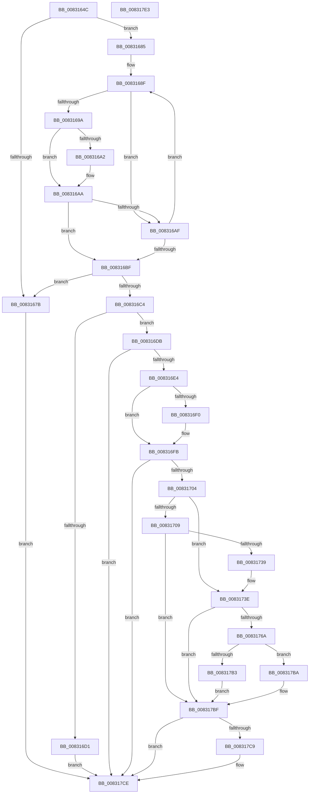

# CmSetInterfaceClassMappedPropertyFromRegValue

- RVA: `0x0083164C`–`0x008317E4` (길이 `408` bytes)
- VA: `0x000000014083164C`
- 실행 섹션: `PAGE`
- PDB 이름 있음: `예`; PDB Function 태그: `아니요`
- unwind 정보 RVA: `0x000B5608`
- 디코드: `107`개 명령, `408/408` bytes 표시
- 미해석 바이트: `0` (있으면 어셈블리에 `.byte`로 보존)

> 이 문서는 커널 이미지의 기계어와 PDB 기호를 분석해 생성했습니다. 4번과 5번은 함수 원형과 자료형을 바이너리 사용 방식에서 추정한 C 해석이며 원본 소스 복구 결과는 아닙니다.

## 1. Dependencies

- 직접 호출 지점: **5**; 고유 호출 대상: **4**
- 직접 호출자로 확인된 함수: **1**
- RIP 상대 이미지 참조: **4**

### Outgoing calls
- `0x0083172A` → [CmOpenInterfaceClassRegKey](../A3/CmOpenInterfaceClassRegKey_function_00A304F8.md) (function, `0x00A304F8`)
- `0x0083175F` → [_PnpOpenPropertiesKey](../99/_PnpOpenPropertiesKey_function_009938A0.md) (function, `0x009938A0`)
- `0x00831797` → [PnpCtxRegSetValue](../99/PnpCtxRegSetValue_function_00991B8C.md) (function, `0x00991B8C`)
- `0x008317A6` → [ZwClose](../../text/6A/ZwClose_function_006AD2B0.md) (function, `0x006AD2B0`)
- `0x008317C9` → [ZwClose](../../text/6A/ZwClose_function_006AD2B0.md) (function, `0x006AD2B0`)

### Direct callers
- [CmSetInterfaceClassMappedProperty](CmSetInterfaceClassMappedProperty_function_00831500.md) at `0x008315AE`

### Static image references
- `0x00831688` → RVA `0x00B4AE80` (`PAGE`; read)
- `0x008316E7` → RVA `0x00013348` (`.rdata`; read)
- `0x008316F4` → RVA `0x00013350` (`.rdata`; read)
- `0x00831771` → RVA `0x00AFF600` (` ?? ::NNGAKEGL::`string'`; read)

## 2. Other-region calls and transfers

- 다른 실행 섹션으로 향하는 call: **2**
  - `0x008317A6` → [ZwClose](../../text/6A/ZwClose_function_006AD2B0.md) (`PAGE` → `.text`)
  - `0x008317C9` → [ZwClose](../../text/6A/ZwClose_function_006AD2B0.md) (`PAGE` → `.text`)
- 별도 외부 분기/꼬리 이동을 확인하지 못했습니다.

## 3. Assembly (complete function range)

```asm
0083164C  48 8B C4                        mov rax, rsp
0083164F  48 89 58 08                     mov qword ptr [rax + 8], rbx
00831653  48 89 68 10                     mov qword ptr [rax + 0x10], rbp
00831657  56                              push rsi
00831658  57                              push rdi
00831659  41 56                           push r14
0083165B  48 83 EC 50                     sub rsp, 0x50
0083165F  41 8B 79 10                     mov edi, dword ptr [r9 + 0x10]
00831663  33 DB                           xor ebx, ebx
00831665  48 21 58 D8                     and qword ptr [rax - 0x28], rbx
00831669  4D 8B D0                        mov r10, r8
0083166C  48 21 58 20                     and qword ptr [rax + 0x20], rbx
00831670  4C 8B F2                        mov r14, rdx
00831673  48 8B E9                        mov rbp, rcx
00831676  83 FF 02                        cmp edi, 2
00831679  73 0A                           jae 0x140831685
0083167B  BB 30 02 00 C0                  mov ebx, 0xc0000230
00831680  E9 49 01 00 00                  jmp 0x1408317ce
00831685  45 33 DB                        xor r11d, r11d
00831688  48 8D 0D F1 97 31 00            lea rcx, [rip + 0x3197f1]
0083168F  48 8B 31                        mov rsi, qword ptr [rcx]
00831692  4C 8B C1                        mov r8, rcx
00831695  3B 7E 10                        cmp edi, dword ptr [rsi + 0x10]
00831698  75 15                           jne 0x1408316af
0083169A  49 8B 11                        mov rdx, qword ptr [r9]
0083169D  48 2B 16                        sub rdx, qword ptr [rsi]
008316A0  75 08                           jne 0x1408316aa
008316A2  49 8B 51 08                     mov rdx, qword ptr [r9 + 8]
008316A6  48 2B 56 08                     sub rdx, qword ptr [rsi + 8]
008316AA  48 85 D2                        test rdx, rdx
008316AD  74 10                           je 0x1408316bf
008316AF  45 33 C0                        xor r8d, r8d
008316B2  41 FF C3                        inc r11d
008316B5  48 83 C1 10                     add rcx, 0x10
008316B9  41 83 FB 01                     cmp r11d, 1
008316BD  72 D0                           jb 0x14083168f
008316BF  4D 85 C0                        test r8, r8
008316C2  74 B7                           je 0x14083167b
008316C4  41 8B 40 08                     mov eax, dword ptr [r8 + 8]
008316C8  39 84 24 90 00 00 00            cmp dword ptr [rsp + 0x90], eax
008316CF  74 0A                           je 0x1408316db
008316D1  BB 0D 00 00 C0                  mov ebx, 0xc000000d
008316D6  E9 F3 00 00 00                  jmp 0x1408317ce
008316DB  83 FF 02                        cmp edi, 2
008316DE  0F 85 EA 00 00 00               jne 0x1408317ce
008316E4  49 8B 01                        mov rax, qword ptr [r9]
008316E7  48 2B 05 5A 1C 7E FF            sub rax, qword ptr [rip - 0x81e3a6]
008316EE  75 0B                           jne 0x1408316fb
008316F0  49 8B 41 08                     mov rax, qword ptr [r9 + 8]
008316F4  48 2B 05 55 1C 7E FF            sub rax, qword ptr [rip - 0x81e3ab]
008316FB  48 85 C0                        test rax, rax
008316FE  0F 85 CA 00 00 00               jne 0x1408317ce
00831704  4D 85 D2                        test r10, r10
00831707  75 35                           jne 0x14083173e
00831709  48 21 5C 24 38                  and qword ptr [rsp + 0x38], rbx
0083170E  48 8D 44 24 40                  lea rax, [rsp + 0x40]
00831713  48 89 44 24 30                  mov qword ptr [rsp + 0x30], rax
00831718  49 8B D6                        mov rdx, r14
0083171B  88 5C 24 28                     mov byte ptr [rsp + 0x28], bl
0083171F  48 8B CD                        mov rcx, rbp
00831722  C7 44 24 20 01 00 00 00         mov dword ptr [rsp + 0x20], 1
0083172A  E8 C9 ED 1F 00                  call 0x140a304f8
0083172F  8B D8                           mov ebx, eax
00831731  85 C0                           test eax, eax
00831733  0F 88 86 00 00 00               js 0x1408317bf
00831739  4C 8B 54 24 40                  mov r10, qword ptr [rsp + 0x40]
0083173E  48 8D 84 24 88 00 00 00         lea rax, [rsp + 0x88]
00831746  41 B9 02 00 00 00               mov r9d, 2
0083174C  48 89 44 24 30                  mov qword ptr [rsp + 0x30], rax
00831751  45 33 C0                        xor r8d, r8d
00831754  49 8B D2                        mov rdx, r10
00831757  C6 44 24 20 01                  mov byte ptr [rsp + 0x20], 1
0083175C  48 8B CD                        mov rcx, rbp
0083175F  E8 3C 21 16 00                  call 0x1409938a0
00831764  8B D8                           mov ebx, eax
00831766  85 C0                           test eax, eax
00831768  78 55                           js 0x1408317bf
0083176A  8B 84 24 A0 00 00 00            mov eax, dword ptr [rsp + 0xa0]
00831771  4C 8D 05 88 DE 2C 00            lea r8, [rip + 0x2cde88]
00831778  48 8B 94 24 88 00 00 00         mov rdx, qword ptr [rsp + 0x88]
00831780  41 B9 01 00 00 00               mov r9d, 1
00831786  89 44 24 28                     mov dword ptr [rsp + 0x28], eax
0083178A  48 8B 84 24 98 00 00 00         mov rax, qword ptr [rsp + 0x98]
00831792  48 89 44 24 20                  mov qword ptr [rsp + 0x20], rax
00831797  E8 F0 03 16 00                  call 0x140991b8c
0083179C  48 8B 8C 24 88 00 00 00         mov rcx, qword ptr [rsp + 0x88]
008317A4  8B F8                           mov edi, eax
008317A6  E8 05 BB E7 FF                  call 0x1406ad2b0
008317AB  81 FF 7C 01 00 C0               cmp edi, 0xc000017c
008317B1  75 07                           jne 0x1408317ba
008317B3  BB 34 00 00 C0                  mov ebx, 0xc0000034
008317B8  EB 05                           jmp 0x1408317bf
008317BA  85 FF                           test edi, edi
008317BC  0F 48 DF                        cmovs ebx, edi
008317BF  48 8B 4C 24 40                  mov rcx, qword ptr [rsp + 0x40]
008317C4  48 85 C9                        test rcx, rcx
008317C7  74 05                           je 0x1408317ce
008317C9  E8 E2 BA E7 FF                  call 0x1406ad2b0
008317CE  48 8B 6C 24 78                  mov rbp, qword ptr [rsp + 0x78]
008317D3  8B C3                           mov eax, ebx
008317D5  48 8B 5C 24 70                  mov rbx, qword ptr [rsp + 0x70]
008317DA  48 83 C4 50                     add rsp, 0x50
008317DE  41 5E                           pop r14
008317E0  5F                              pop rdi
008317E1  5E                              pop rsi
008317E2  C3                              ret
008317E3  CC                              int3
```

## 4. C-style interpretation (structured pseudocode)

```c
__int64 __fastcall CmSetInterfaceClassMappedPropertyFromRegValue(__int64 a1, __int64 a2, __int64 a3, __int64 a4, unsigned int a5, __int64 a6, unsigned int a7)
{
    __int64 result;
    __int64 v_r11;
    __int64 v_rbx;
    __int64 v_rsp;
    unsigned __int64 v_stack_m28;
    unsigned __int64 v_stack_m30;
    unsigned __int64 v_stack_m38;
    unsigned __int8 v_stack_m40;
    unsigned int v_stack_m48;
    unsigned __int64 v_stack_p10;
    unsigned __int64 v_stack_p20;
    unsigned __int64 v_stack_p8;

    *(unsigned __int64 *)(v_rsp + 8) = v_rbx;
    *(unsigned __int64 *)(v_rsp + 16) = v_rbp;
    v_rsp = (v_rsp) - (80);
    v_rbx = 0;
    if (((unsigned int)((unsigned int)(*(unsigned int *)(a4 + 16)))) >= 2) goto loc_00831685;
loc_0083167B:
    goto loc_008317CE;
loc_00831685:
    v_r11 = 0;
loc_0083168F:
    if (((unsigned int)((unsigned int)(*(unsigned int *)(a4 + 16)))) != (*(unsigned int *)(*(unsigned __int64 *)(v_rip + 3250161) + 16))) goto loc_008316AF;
    a2 = (*(unsigned __int64 *)(a4)) - (*(unsigned __int64 *)(*(unsigned __int64 *)(v_rip + 3250161)));
    if (!(condition_is_not_equal)) {
        a2 = *(unsigned __int64 *)(a4 + 8);
        a2 = (a2) - (*(unsigned __int64 *)(*(unsigned __int64 *)(v_rip + 3250161) + 8));
    }
    if (a2 == 0) goto loc_008316BF;
loc_008316AF:
    a3 = 0;
    v_r11 = (unsigned int)((v_r11) + 1);
    a1 = (v_rip + 3250161) + (16);
    if (((unsigned int)(v_r11)) < 1) goto loc_0083168F;
loc_008316BF:
    if (0 == 0) goto loc_0083167B;
    if (a5 == ((unsigned int)((unsigned int)(*(unsigned int *)(a3 + 8))))) goto loc_008316DB;
    goto loc_008317CE;
loc_008316DB:
    if (((unsigned int)((unsigned int)(*(unsigned int *)(a4 + 16)))) != 2) goto loc_008317CE;
    result = (*(unsigned __int64 *)(a4)) - (*(unsigned __int64 *)(v_rip - 8512422));
    if (!(condition_is_not_equal)) {
        result = *(unsigned __int64 *)(a4 + 8);
        result = (result) - (*(unsigned __int64 *)(v_rip - 8512427));
    }
    if (result != 0) goto loc_008317CE;
    if (0 != 0) goto loc_0083173E;
    v_stack_m38 = v_stack_m28;
    v_stack_m40 = (unsigned __int8)((unsigned int)(0xC000000DULL));
    v_stack_m48 = 1;
    result = CmOpenInterfaceClassRegKey(a1, a2, a3, a4);
    if (sign_flag) goto loc_008317BF;
loc_0083173E:
    v_stack_m38 = v_stack_p20;
    a3 = 0;
    v_stack_m48 = 1;
    result = _PnpOpenPropertiesKey(a1, v_stack_m28, a3, 2);
    if (sign_flag) goto loc_008317BF;
    v_stack_m40 = (unsigned int)((unsigned int)(a7));
    v_stack_m48 = a6;
    result = PnpCtxRegSetValue(a1, v_stack_p20, v_rip + 2940552, 1);
    result = ZwClose(v_stack_p20, v_stack_p20, v_rip + 2940552, 1);
    if (((unsigned int)((unsigned int)((unsigned int)(result)))) != 0xC000017CULL) goto loc_008317BA;
    goto loc_008317BF;
loc_008317BA:
    v_rbx = (unsigned int)(0xC0000034ULL);
    if (sign_flag) { v_rbx = (unsigned int)((unsigned int)((unsigned int)(result))); }
loc_008317BF:
    if (v_stack_m28 != 0) {
        result = ZwClose(v_stack_m28, v_stack_p20, v_rip + 2940552, 1);
    }
    v_rsp = (v_rsp) + (80);
    return (unsigned int)((unsigned int)(v_rbx));
}
```

## 5. (Beta) C Style

```c
int64_t CmSetInterfaceClassMappedPropertyFromRegValue(int64_t Arg1, int64_t Arg2, int64_t Arg3, void *Arg4, uint32_t Arg5, int64_t Arg6, uint32_t Arg7)
{
    uint8_t *arg4 = (uint8_t *)Arg4;

    int64_t result;
    int64_t local_r11;
    int64_t local_rbx;
    int64_t local_rsp;
    uint64_t v_stack_m28;
    uint64_t v_stack_m30;
    uint64_t v_stack_m38;
    uint8_t v_stack_m40;
    uint32_t v_stack_m48;
    uint64_t v_stack_p10;
    uint64_t v_stack_p20;
    uint64_t v_stack_p8;

    *(uint64_t *)(local_rsp + 0x8) = local_rbx;
    *(uint64_t *)(local_rsp + 0x10) = local_rbp;
    local_rsp = (local_rsp) - (80);
    local_rbx = 0;
    if (((uint32_t)((uint32_t)(*(uint32_t *)(arg4 + 0x10)))) >= 2) goto loc_00831685;
loc_0083167B:
    goto loc_008317CE;
loc_00831685:
    local_r11 = 0;
loc_0083168F:
    if (((uint32_t)((uint32_t)(*(uint32_t *)(arg4 + 0x10)))) != (*(uint32_t *)(*(uint64_t *)(v_rip + 0x3197F1) + 0x10))) goto loc_008316AF;
    Arg2 = (*(uint64_t *)(arg4)) - (*(uint64_t *)(*(uint64_t *)(v_rip + 0x3197F1)));
    if (!(condition_is_not_equal)) {
        Arg2 = *(uint64_t *)(arg4 + 0x8);
        Arg2 = (Arg2) - (*(uint64_t *)(*(uint64_t *)(v_rip + 0x3197F1) + 0x8));
    }
    if (Arg2 == 0) goto loc_008316BF;
loc_008316AF:
    Arg3 = 0;
    local_r11 = (uint32_t)((local_r11) + 1);
    Arg1 = (v_rip + 3250161) + (16);
    if (((uint32_t)(local_r11)) < 1) goto loc_0083168F;
loc_008316BF:
    if (0 == 0) goto loc_0083167B;
    if (Arg5 == ((uint32_t)((uint32_t)(*(uint32_t *)(Arg3 + 0x8))))) goto loc_008316DB;
    goto loc_008317CE;
loc_008316DB:
    if (((uint32_t)((uint32_t)(*(uint32_t *)(arg4 + 0x10)))) != 2) goto loc_008317CE;
    result = (*(uint64_t *)(arg4)) - (*(uint64_t *)(v_rip - 0x81E3A6));
    if (!(condition_is_not_equal)) {
        result = *(uint64_t *)(arg4 + 0x8);
        result = (result) - (*(uint64_t *)(v_rip - 0x81E3AB));
    }
    if (result != 0) goto loc_008317CE;
    if (0 != 0) goto loc_0083173E;
    v_stack_m38 = v_stack_m28;
    v_stack_m40 = (uint8_t)((uint32_t)(0xC000000DULL));
    v_stack_m48 = 1;
    result = CmOpenInterfaceClassRegKey(Arg1, Arg2, Arg3, Arg4);
    if (sign_flag) goto loc_008317BF;
loc_0083173E:
    v_stack_m38 = v_stack_p20;
    Arg3 = 0;
    v_stack_m48 = 1;
    result = _PnpOpenPropertiesKey(Arg1, v_stack_m28, Arg3, 2);
    if (sign_flag) goto loc_008317BF;
    v_stack_m40 = (uint32_t)((uint32_t)(Arg7));
    v_stack_m48 = Arg6;
    result = PnpCtxRegSetValue(Arg1, v_stack_p20, v_rip + 2940552, 1);
    result = ZwClose(v_stack_p20, v_stack_p20, v_rip + 2940552, 1);
    if (((uint32_t)((uint32_t)((uint32_t)(result)))) != 0xC000017CULL) goto loc_008317BA;
    goto loc_008317BF;
loc_008317BA:
    local_rbx = (uint32_t)(0xC0000034ULL);
    if (sign_flag) { local_rbx = (uint32_t)((uint32_t)((uint32_t)(result))); }
loc_008317BF:
    if (v_stack_m28 != 0) {
        result = ZwClose(v_stack_m28, v_stack_p20, v_rip + 2940552, 1);
    }
    local_rsp = (local_rsp) + (80);
    return (uint32_t)((uint32_t)(local_rbx));
}
```

### 관측된 메모리 오프셋

구조체 형식이 확인되지 않은 접근은 인자 기준의 오프셋으로만 기록했습니다.

| 기준 인자 | 오프셋 표현 | 폭 (bit) | 접근 |
|---|---:|---:|---|
| `Arg4` | `+ 0x0` | `64` | `R` |
| `Arg4` | `+ 0x8` | `64` | `R` |
| `Arg4` | `+ 0x10` | `32` | `R` |

## 6. Execution-region graph

[열기: 2D/3D 그래프와 함수 탐색 컨트롤 패널](../../../control-panel.html?section=page&rva=0x0083164C&view=graph)

- 2D 그래프는 위에서 아래로 흐르고, 3D 그래프는 빈 공간을 드래그해 회전합니다. Shift+드래그는 이동, 휠은 확대·축소, 함수 노드 선택은 대상 보고서 이동입니다.

### Static fallback


