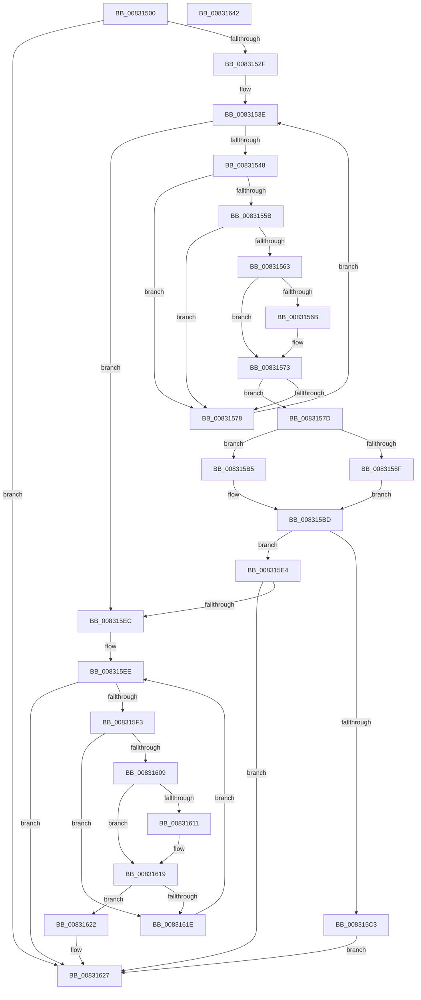

# CmSetInterfaceClassMappedProperty

- RVA: `0x00831500`–`0x00831643` (길이 `323` bytes)
- VA: `0x0000000140831500`
- 실행 섹션: `PAGE`
- PDB 이름 있음: `예`; PDB Function 태그: `아니요`
- unwind 정보 RVA: `0x000BC898`
- 디코드: `91`개 명령, `323/323` bytes 표시
- 미해석 바이트: `0` (있으면 어셈블리에 `.byte`로 보존)

> 이 문서는 커널 이미지의 기계어와 PDB 기호를 분석해 생성했습니다. 4번과 5번은 함수 원형과 자료형을 바이너리 사용 방식에서 추정한 C 해석이며 원본 소스 복구 결과는 아닙니다.

## 1. Dependencies

- 직접 호출 지점: **3**; 고유 호출 대상: **3**
- 직접 호출자로 확인된 함수: **2**
- RIP 상대 이미지 참조: **1**

### Outgoing calls
- `0x008315AE` → [CmSetInterfaceClassMappedPropertyFromRegValue](CmSetInterfaceClassMappedPropertyFromRegValue_function_0083164C.md) (function, `0x0083164C`)
- `0x008315B8` → [CmDeleteInterfaceClassMappedPropertyFromRegValue](../82/CmDeleteInterfaceClassMappedPropertyFromRegValue_function_0082FD08.md) (function, `0x0082FD08`)
- `0x008315DD` → [PnpObjectRaisePropertyChangeEvent](../8F/PnpObjectRaisePropertyChangeEvent_function_008F7E94.md) (function, `0x008F7E94`)

### Direct callers
- [CmDeleteInterfaceClassWorker](../82/CmDeleteInterfaceClassWorker_function_0082A838.md) at `0x0082A9EF`
- [sub_00B2C010](../B2/Unknown_function_00B2C010.md) at `0x00B2C041`

### Static image references
- `0x00831537` → RVA `0x00000000` (`image boundary/outside`; read)

## 2. Other-region calls and transfers

- 다른 실행 섹션으로 향하는 call: **0**
- 별도 외부 분기/꼬리 이동을 확인하지 못했습니다.

## 3. Assembly (complete function range)

```asm
00831500  48 89 5C 24 08                  mov qword ptr [rsp + 8], rbx
00831505  48 89 6C 24 10                  mov qword ptr [rsp + 0x10], rbp
0083150A  48 89 74 24 18                  mov qword ptr [rsp + 0x18], rsi
0083150F  57                              push rdi
00831510  41 54                           push r12
00831512  41 56                           push r14
00831514  48 83 EC 40                     sub rsp, 0x40
00831518  49 8B F0                        mov rsi, r8
0083151B  48 8B EA                        mov rbp, rdx
0083151E  4C 8B F1                        mov r14, rcx
00831521  BF 16 00 00 C0                  mov edi, 0xc0000016
00831526  4D 85 C9                        test r9, r9
00831529  0F 85 F8 00 00 00               jne 0x140831627
0083152F  48 8B 9C 24 80 00 00 00         mov rbx, qword ptr [rsp + 0x80]
00831537  4C 8D 25 C2 EA 7C FF            lea r12, [rip - 0x83153e]
0083153E  41 83 F9 01                     cmp r9d, 1
00831542  0F 83 A4 00 00 00               jae 0x1408315ec
00831548  41 8B C1                        mov eax, r9d
0083154B  48 03 C0                        add rax, rax
0083154E  49 8B 94 C4 80 AE B4 00         mov rdx, qword ptr [r12 + rax*8 + 0xb4ae80]
00831556  48 85 D2                        test rdx, rdx
00831559  74 1D                           je 0x140831578
0083155B  8B 42 10                        mov eax, dword ptr [rdx + 0x10]
0083155E  39 43 10                        cmp dword ptr [rbx + 0x10], eax
00831561  75 15                           jne 0x140831578
00831563  48 8B 0B                        mov rcx, qword ptr [rbx]
00831566  48 2B 0A                        sub rcx, qword ptr [rdx]
00831569  75 08                           jne 0x140831573
0083156B  48 8B 4B 08                     mov rcx, qword ptr [rbx + 8]
0083156F  48 2B 4A 08                     sub rcx, qword ptr [rdx + 8]
00831573  48 85 C9                        test rcx, rcx
00831576  74 05                           je 0x14083157d
00831578  41 FF C1                        inc r9d
0083157B  EB C1                           jmp 0x14083153e
0083157D  8B 8C 24 88 00 00 00            mov ecx, dword ptr [rsp + 0x88]
00831584  4C 8B CB                        mov r9, rbx
00831587  48 8B D5                        mov rdx, rbp
0083158A  83 F9 02                        cmp ecx, 2
0083158D  72 26                           jb 0x1408315b5
0083158F  8B 84 24 98 00 00 00            mov eax, dword ptr [rsp + 0x98]
00831596  89 44 24 30                     mov dword ptr [rsp + 0x30], eax
0083159A  48 8B 84 24 90 00 00 00         mov rax, qword ptr [rsp + 0x90]
008315A2  48 89 44 24 28                  mov qword ptr [rsp + 0x28], rax
008315A7  89 4C 24 20                     mov dword ptr [rsp + 0x20], ecx
008315AB  49 8B CE                        mov rcx, r14
008315AE  E8 99 00 00 00                  call 0x14083164c
008315B3  EB 08                           jmp 0x1408315bd
008315B5  49 8B CE                        mov rcx, r14
008315B8  E8 4B E7 FF FF                  call 0x14082fd08
008315BD  8B F8                           mov edi, eax
008315BF  85 C0                           test eax, eax
008315C1  78 21                           js 0x1408315e4
008315C3  48 89 5C 24 28                  mov qword ptr [rsp + 0x28], rbx
008315C8  4C 8B CE                        mov r9, rsi
008315CB  48 83 64 24 20 00               and qword ptr [rsp + 0x20], 0
008315D1  41 B8 04 00 00 00               mov r8d, 4
008315D7  48 8B D5                        mov rdx, rbp
008315DA  49 8B CE                        mov rcx, r14
008315DD  E8 B2 68 0C 00                  call 0x1408f7e94
008315E2  EB 43                           jmp 0x140831627
008315E4  81 FF 16 00 00 C0               cmp edi, 0xc0000016
008315EA  75 3B                           jne 0x140831627
008315EC  33 D2                           xor edx, edx
008315EE  83 FA 01                        cmp edx, 1
008315F1  73 34                           jae 0x140831627
008315F3  8B C2                           mov eax, edx
008315F5  48 03 C0                        add rax, rax
008315F8  4D 8B 84 C4 10 AF B4 00         mov r8, qword ptr [r12 + rax*8 + 0xb4af10]
00831600  41 8B 40 10                     mov eax, dword ptr [r8 + 0x10]
00831604  39 43 10                        cmp dword ptr [rbx + 0x10], eax
00831607  75 15                           jne 0x14083161e
00831609  48 8B 0B                        mov rcx, qword ptr [rbx]
0083160C  49 2B 08                        sub rcx, qword ptr [r8]
0083160F  75 08                           jne 0x140831619
00831611  48 8B 4B 08                     mov rcx, qword ptr [rbx + 8]
00831615  49 2B 48 08                     sub rcx, qword ptr [r8 + 8]
00831619  48 85 C9                        test rcx, rcx
0083161C  74 04                           je 0x140831622
0083161E  FF C2                           inc edx
00831620  EB CC                           jmp 0x1408315ee
00831622  BF 22 00 00 C0                  mov edi, 0xc0000022
00831627  48 8B 5C 24 60                  mov rbx, qword ptr [rsp + 0x60]
0083162C  8B C7                           mov eax, edi
0083162E  48 8B 6C 24 68                  mov rbp, qword ptr [rsp + 0x68]
00831633  48 8B 74 24 70                  mov rsi, qword ptr [rsp + 0x70]
00831638  48 83 C4 40                     add rsp, 0x40
0083163C  41 5E                           pop r14
0083163E  41 5C                           pop r12
00831640  5F                              pop rdi
00831641  C3                              ret
00831642  CC                              int3
```

## 4. C-style interpretation (structured pseudocode)

```c
__int64 __fastcall CmSetInterfaceClassMappedProperty(__int64 a1, __int64 a2, __int64 a3, __int64 a4, __int64 a5, unsigned int a6, __int64 a7, unsigned int a8)
{
    __int64 result;
    __int64 v_rsp;
    unsigned int v_stack_m28;
    unsigned __int64 v_stack_m30;
    unsigned int v_stack_m38;
    unsigned __int64 v_stack_p10;
    unsigned __int64 v_stack_p18;
    unsigned __int64 v_stack_p8;

    v_stack_p8 = v_rbx;
    v_stack_p10 = v_rbp;
    v_stack_p18 = v_rsi;
    v_rsp = (v_rsp) - (64);
    if (a4 != 0) goto loc_00831627;
loc_0083153E:
    if (((unsigned int)(a4)) >= 1) goto loc_008315EC;
    result = ((unsigned int)((unsigned int)(a4))) + ((unsigned int)((unsigned int)(a4)));
    if (*(unsigned __int64 *)(v_rip - 8590654 + result * 8 + 11841152) == 0) goto loc_00831578;
    if ((*(unsigned int *)(a5 + 16)) != ((unsigned int)((unsigned int)(*(unsigned int *)(*(unsigned __int64 *)(v_rip - 8590654 + result * 8 + 11841152) + 16))))) goto loc_00831578;
    a1 = (*(unsigned __int64 *)(a5)) - (*(unsigned __int64 *)(*(unsigned __int64 *)(v_rip - 8590654 + result * 8 + 11841152)));
    if (!(condition_is_not_equal)) {
        a1 = *(unsigned __int64 *)(a5 + 8);
        a1 = (a1) - (*(unsigned __int64 *)(*(unsigned __int64 *)(v_rip - 8590654 + result * 8 + 11841152) + 8));
    }
    if (a1 == 0) goto loc_0083157D;
loc_00831578:
    a4 = (unsigned int)((a4) + 1);
    goto loc_0083153E;
loc_0083157D:
    if (((unsigned int)((unsigned int)(a6))) < 2) goto loc_008315B5;
    v_stack_m28 = (unsigned int)((unsigned int)(a8));
    v_stack_m30 = a7;
    v_stack_m38 = (unsigned int)((unsigned int)(a6));
    result = CmSetInterfaceClassMappedPropertyFromRegValue(a1, a2, a3, a5);
    goto loc_008315BD;
loc_008315B5:
    result = CmDeleteInterfaceClassMappedPropertyFromRegValue(a1, a2, a3, a5);
loc_008315BD:
    if (sign_flag) goto loc_008315E4;
    v_stack_m30 = a5;
    result = PnpObjectRaisePropertyChangeEvent(a1, a2, 4, a3);
    goto loc_00831627;
loc_008315E4:
    if (((unsigned int)((unsigned int)((unsigned int)(result)))) != 0xC0000016ULL) goto loc_00831627;
loc_008315EC:
    a2 = 0;
loc_008315EE:
    if (0 >= 1) goto loc_00831627;
    result = (0) + (0);
    if ((*(unsigned int *)(a5 + 16)) != ((unsigned int)((unsigned int)(*(unsigned int *)(*(unsigned __int64 *)(v_rip - 8590654 + result * 8 + 11841296) + 16))))) goto loc_0083161E;
    a1 = (*(unsigned __int64 *)(a5)) - (*(unsigned __int64 *)(*(unsigned __int64 *)(v_rip - 8590654 + result * 8 + 11841296)));
    if (!(condition_is_not_equal)) {
        a1 = *(unsigned __int64 *)(a5 + 8);
        a1 = (a1) - (*(unsigned __int64 *)(*(unsigned __int64 *)(v_rip - 8590654 + result * 8 + 11841296) + 8));
    }
    if (a1 == 0) goto loc_00831622;
loc_0083161E:
    a2 = (unsigned int)((a2) + 1);
    goto loc_008315EE;
loc_00831622:
loc_00831627:
    v_rsp = (v_rsp) + (64);
    return (unsigned int)((unsigned int)((unsigned int)(0xC0000022ULL)));
}
```

## 5. (Beta) C Style

```c
int64_t CmSetInterfaceClassMappedProperty(int64_t Arg1, int64_t Arg2, int64_t Arg3, int64_t Arg4, void *Arg5, uint32_t Arg6, int64_t Arg7, uint32_t Arg8)
{
    uint8_t *arg5 = (uint8_t *)Arg5;

    int64_t result;
    int64_t local_rsp;
    uint32_t v_stack_m28;
    uint64_t v_stack_m30;
    uint32_t v_stack_m38;
    uint64_t v_stack_p10;
    uint64_t v_stack_p18;
    uint64_t v_stack_p8;

    v_stack_p8 = local_rbx;
    v_stack_p10 = local_rbp;
    v_stack_p18 = local_rsi;
    local_rsp = (local_rsp) - (64);
    if (Arg4 != 0) goto loc_00831627;
loc_0083153E:
    if (((uint32_t)(Arg4)) >= 1) goto loc_008315EC;
    result = ((uint32_t)((uint32_t)(Arg4))) + ((uint32_t)((uint32_t)(Arg4)));
    if (*(uint64_t *)(v_rip - 0x83153E + result * 8 + 0xB4AE80) == 0) goto loc_00831578;
    if ((*(uint32_t *)(arg5 + 0x10)) != ((uint32_t)((uint32_t)(*(uint32_t *)(*(uint64_t *)(v_rip - 0x83153E + result * 8 + 0xB4AE80) + 0x10))))) goto loc_00831578;
    Arg1 = (*(uint64_t *)(arg5)) - (*(uint64_t *)(*(uint64_t *)(v_rip - 0x83153E + result * 8 + 0xB4AE80)));
    if (!(condition_is_not_equal)) {
        Arg1 = *(uint64_t *)(arg5 + 0x8);
        Arg1 = (Arg1) - (*(uint64_t *)(*(uint64_t *)(v_rip - 0x83153E + result * 8 + 0xB4AE80) + 0x8));
    }
    if (Arg1 == 0) goto loc_0083157D;
loc_00831578:
    Arg4 = (uint32_t)((Arg4) + 1);
    goto loc_0083153E;
loc_0083157D:
    if (((uint32_t)((uint32_t)(Arg6))) < 2) goto loc_008315B5;
    v_stack_m28 = (uint32_t)((uint32_t)(Arg8));
    v_stack_m30 = Arg7;
    v_stack_m38 = (uint32_t)((uint32_t)(Arg6));
    result = CmSetInterfaceClassMappedPropertyFromRegValue(Arg1, Arg2, Arg3, Arg5);
    goto loc_008315BD;
loc_008315B5:
    result = CmDeleteInterfaceClassMappedPropertyFromRegValue(Arg1, Arg2, Arg3, Arg5);
loc_008315BD:
    if (sign_flag) goto loc_008315E4;
    v_stack_m30 = Arg5;
    result = PnpObjectRaisePropertyChangeEvent(Arg1, Arg2, 4, Arg3);
    goto loc_00831627;
loc_008315E4:
    if (((uint32_t)((uint32_t)((uint32_t)(result)))) != 0xC0000016ULL) goto loc_00831627;
loc_008315EC:
    Arg2 = 0;
loc_008315EE:
    if (0 >= 1) goto loc_00831627;
    result = (0) + (0);
    if ((*(uint32_t *)(arg5 + 0x10)) != ((uint32_t)((uint32_t)(*(uint32_t *)(*(uint64_t *)(v_rip - 0x83153E + result * 8 + 0xB4AF10) + 0x10))))) goto loc_0083161E;
    Arg1 = (*(uint64_t *)(arg5)) - (*(uint64_t *)(*(uint64_t *)(v_rip - 0x83153E + result * 8 + 0xB4AF10)));
    if (!(condition_is_not_equal)) {
        Arg1 = *(uint64_t *)(arg5 + 0x8);
        Arg1 = (Arg1) - (*(uint64_t *)(*(uint64_t *)(v_rip - 0x83153E + result * 8 + 0xB4AF10) + 0x8));
    }
    if (Arg1 == 0) goto loc_00831622;
loc_0083161E:
    Arg2 = (uint32_t)((Arg2) + 1);
    goto loc_008315EE;
loc_00831622:
loc_00831627:
    local_rsp = (local_rsp) + (64);
    return (uint32_t)((uint32_t)((uint32_t)(0xC0000022ULL)));
}
```

### 관측된 메모리 오프셋

구조체 형식이 확인되지 않은 접근은 인자 기준의 오프셋으로만 기록했습니다.

| 기준 인자 | 오프셋 표현 | 폭 (bit) | 접근 |
|---|---:|---:|---|
| `Arg5` | `+ 0x0` | `64` | `R` |
| `Arg5` | `+ 0x8` | `64` | `R` |
| `Arg5` | `+ 0x10` | `32` | `R` |

## 6. Execution-region graph

[열기: 2D/3D 그래프와 함수 탐색 컨트롤 패널](../../../control-panel.html?section=page&rva=0x00831500&view=graph)

- 2D 그래프는 위에서 아래로 흐르고, 3D 그래프는 빈 공간을 드래그해 회전합니다. Shift+드래그는 이동, 휠은 확대·축소, 함수 노드 선택은 대상 보고서 이동입니다.

### Static fallback


