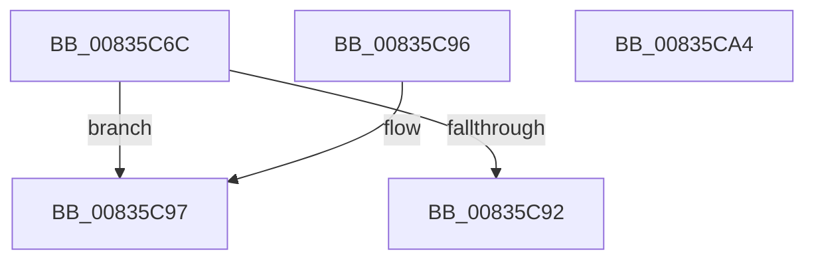

# CompareFileTimeType

- RVA: `0x00835C6C`–`0x00835CA5` (길이 `57` bytes)
- VA: `0x0000000140835C6C`
- 실행 섹션: `PAGE`
- PDB 이름 있음: `예`; PDB Function 태그: `아니요`
- unwind 정보 RVA: `0x000DB714`
- 디코드: `20`개 명령, `57/57` bytes 표시
- 미해석 바이트: `0` (있으면 어셈블리에 `.byte`로 보존)

> 이 문서는 커널 이미지의 기계어와 PDB 기호를 분석해 생성했습니다. 4번과 5번은 함수 원형과 자료형을 바이너리 사용 방식에서 추정한 C 해석이며 원본 소스 복구 결과는 아닙니다.

## 1. Dependencies

- 직접 호출 지점: **0**; 고유 호출 대상: **0**
- 직접 호출자로 확인된 함수: **1**
- RIP 상대 이미지 참조: **0**

### Outgoing calls
- 직접 디코드된 call 명령이 없습니다.

### Direct callers
- [PropertyEval](../9C/PropertyEval_function_009CB300.md) at `0x009CFBE8`
- [PropertyEval](../9C/PropertyEval_function_009CB300.md) at `0x009CFC01`
- [PropertyEval](../9C/PropertyEval_function_009CB300.md) at `0x009CFC25`
- [PropertyEval](../9C/PropertyEval_function_009CB300.md) at `0x009CFC3E`
- [PropertyEval](../9C/PropertyEval_function_009CB300.md) at `0x009CFC62`
- [PropertyEval](../9C/PropertyEval_function_009CB300.md) at `0x009CFC7F`
- [PropertyEval](../9C/PropertyEval_function_009CB300.md) at `0x009CFC9C`

### Static image references
- 디코드된 RIP-relative 메모리 참조가 없습니다.

## 2. Other-region calls and transfers

- 다른 실행 섹션으로 향하는 call: **0**
- 별도 외부 분기/꼬리 이동을 확인하지 못했습니다.

## 3. Assembly (complete function range)

```asm
00835C6C  8B 01                           mov eax, dword ptr [rcx]
00835C6E  89 44 24 08                     mov dword ptr [rsp + 8], eax
00835C72  8B 41 04                        mov eax, dword ptr [rcx + 4]
00835C75  89 44 24 0C                     mov dword ptr [rsp + 0xc], eax
00835C79  8B 02                           mov eax, dword ptr [rdx]
00835C7B  89 44 24 10                     mov dword ptr [rsp + 0x10], eax
00835C7F  8B 42 04                        mov eax, dword ptr [rdx + 4]
00835C82  89 44 24 14                     mov dword ptr [rsp + 0x14], eax
00835C86  48 8B 44 24 10                  mov rax, qword ptr [rsp + 0x10]
00835C8B  48 39 44 24 08                  cmp qword ptr [rsp + 8], rax
00835C90  73 05                           jae 0x140835c97
00835C92  83 C8 FF                        or eax, 0xffffffff
00835C95  C3                              ret
00835C96  CC                              int3
00835C97  33 C9                           xor ecx, ecx
00835C99  48 39 44 24 08                  cmp qword ptr [rsp + 8], rax
00835C9E  0F 97 C1                        seta cl
00835CA1  8B C1                           mov eax, ecx
00835CA3  C3                              ret
00835CA4  CC                              int3
```

## 4. C-style interpretation (structured pseudocode)

```c
__int64 __fastcall CompareFileTimeType(__int64 a1, __int64 a2)
{
    __int64 result;
    unsigned int v_stack_p10;
    unsigned int v_stack_p14;
    unsigned int v_stack_p8;
    unsigned int v_stack_pC;

    v_stack_p8 = (unsigned int)((unsigned int)(*(unsigned int *)(a1)));
    v_stack_pC = (unsigned int)((unsigned int)(*(unsigned int *)(a1 + 4)));
    v_stack_p10 = (unsigned int)((unsigned int)(*(unsigned int *)(a2)));
    v_stack_p14 = (unsigned int)((unsigned int)(*(unsigned int *)(a2 + 4)));
    if (v_stack_p8 >= v_stack_p10) goto loc_00835C97;
    result = (unsigned int)((v_stack_p10) | (0xFFFFFFFFULL));
    return result;
loc_00835C97:
    a1 = 0;
    a1 = (v_stack_p8 > result) ? 1 : 0;
    return (unsigned int)((unsigned int)(a1));
}
```

## 5. (Beta) C Style

```c
int64_t CompareFileTimeType(void *Arg1, void *Arg2)
{
    uint8_t *arg1 = (uint8_t *)Arg1;
    uint8_t *arg2 = (uint8_t *)Arg2;

    int64_t result;
    uint32_t v_stack_p10;
    uint32_t v_stack_p14;
    uint32_t v_stack_p8;
    uint32_t v_stack_pC;

    v_stack_p8 = (uint32_t)((uint32_t)(*(uint32_t *)(arg1)));
    v_stack_pC = (uint32_t)((uint32_t)(*(uint32_t *)(arg1 + 0x4)));
    v_stack_p10 = (uint32_t)((uint32_t)(*(uint32_t *)(arg2)));
    v_stack_p14 = (uint32_t)((uint32_t)(*(uint32_t *)(arg2 + 0x4)));
    if (v_stack_p8 >= v_stack_p10) goto loc_00835C97;
    result = (uint32_t)((v_stack_p10) | (0xFFFFFFFFULL));
    return result;
loc_00835C97:
    Arg1 = 0;
    Arg1 = (v_stack_p8 > result) ? 1 : 0;
    return (uint32_t)((uint32_t)(Arg1));
}
```

### 관측된 메모리 오프셋

구조체 형식이 확인되지 않은 접근은 인자 기준의 오프셋으로만 기록했습니다.

| 기준 인자 | 오프셋 표현 | 폭 (bit) | 접근 |
|---|---:|---:|---|
| `Arg1` | `+ 0x0` | `32` | `R` |
| `Arg1` | `+ 0x4` | `32` | `R` |
| `Arg2` | `+ 0x0` | `32` | `R` |
| `Arg2` | `+ 0x4` | `32` | `R` |

## 6. Execution-region graph

[열기: 2D/3D 그래프와 함수 탐색 컨트롤 패널](../../../control-panel.html?section=page&rva=0x00835C6C&view=graph)

- 2D 그래프는 위에서 아래로 흐르고, 3D 그래프는 빈 공간을 드래그해 회전합니다. Shift+드래그는 이동, 휠은 확대·축소, 함수 노드 선택은 대상 보고서 이동입니다.

### Static fallback


