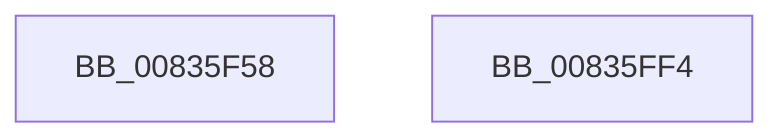

# ComputeFlushPeriod

- RVA: `0x00835F58`–`0x00835FF5` (길이 `157` bytes)
- VA: `0x0000000140835F58`
- 실행 섹션: `PAGE`
- PDB 이름 있음: `예`; PDB Function 태그: `예`
- unwind 정보 RVA: `0x00060904`
- 디코드: `34`개 명령, `157/157` bytes 표시
- 미해석 바이트: `0` (있으면 어셈블리에 `.byte`로 보존)

> 이 문서는 커널 이미지의 기계어와 PDB 기호를 분석해 생성했습니다. 4번과 5번은 함수 원형과 자료형을 바이너리 사용 방식에서 추정한 C 해석이며 원본 소스 복구 결과는 아닙니다.

## 1. Dependencies

- 직접 호출 지점: **4**; 고유 호출 대상: **3**
- 직접 호출자로 확인된 함수: **1**
- RIP 상대 이미지 참조: **1**

### Outgoing calls
- `0x00835F9E` → [RunningHash](../../text/44/RunningHash_function_00445570.md) (function, `0x00445570`)
- `0x00835FB3` → [RunningHash](../../text/44/RunningHash_function_00445570.md) (function, `0x00445570`)
- `0x00835FBD` → [FinishHash](../../text/48/FinishHash_function_00480894.md) (function, `0x00480894`)
- `0x00835FEA` → [_security_check_cookie](../../text/6A/_security_check_cookie_function_006AC640.md) (function, `0x006AC640`)

### Direct callers
- [TlgRegisterAggregateProviderEx](../AD/TlgRegisterAggregateProviderEx_function_00ADBA94.md) at `0x00ADBAF4`

### Static image references
- `0x00835F5C` → RVA `0x00E0A740` (`.data`; read)

## 2. Other-region calls and transfers

- 다른 실행 섹션으로 향하는 call: **4**
  - `0x00835F9E` → [RunningHash](../../text/44/RunningHash_function_00445570.md) (`PAGE` → `.text`)
  - `0x00835FB3` → [RunningHash](../../text/44/RunningHash_function_00445570.md) (`PAGE` → `.text`)
  - `0x00835FBD` → [FinishHash](../../text/48/FinishHash_function_00480894.md) (`PAGE` → `.text`)
  - `0x00835FEA` → [_security_check_cookie](../../text/6A/_security_check_cookie_function_006AC640.md) (`PAGE` → `.text`)
- 별도 외부 분기/꼬리 이동을 확인하지 못했습니다.

## 3. Assembly (complete function range)

```asm
00835F58  48 83 EC 58                     sub rsp, 0x58
00835F5C  48 8B 05 DD 47 5D 00            mov rax, qword ptr [rip + 0x5d47dd]
00835F63  48 33 C4                        xor rax, rsp
00835F66  48 89 44 24 40                  mov qword ptr [rsp + 0x40], rax
00835F6B  48 8B 81 58 01 00 00            mov rax, qword ptr [rcx + 0x158]
00835F72  41 B8 10 00 00 00               mov r8d, 0x10
00835F78  83 64 24 20 00                  and dword ptr [rsp + 0x20], 0
00835F7D  48 C1 E9 04                     shr rcx, 4
00835F81  48 89 4C 24 28                  mov qword ptr [rsp + 0x28], rcx
00835F86  48 8D 4C 24 20                  lea rcx, [rsp + 0x20]
00835F8B  48 8B 50 08                     mov rdx, qword ptr [rax + 8]
00835F8F  0F 10 42 F0                     movups xmm0, xmmword ptr [rdx - 0x10]
00835F93  48 8D 54 24 30                  lea rdx, [rsp + 0x30]
00835F98  F3 0F 7F 44 24 30               movdqu xmmword ptr [rsp + 0x30], xmm0
00835F9E  E8 CD F5 C0 FF                  call 0x140445570
00835FA3  41 B8 08 00 00 00               mov r8d, 8
00835FA9  48 8D 54 24 28                  lea rdx, [rsp + 0x28]
00835FAE  48 8D 4C 24 20                  lea rcx, [rsp + 0x20]
00835FB3  E8 B8 F5 C0 FF                  call 0x140445570
00835FB8  48 8D 4C 24 20                  lea rcx, [rsp + 0x20]
00835FBD  E8 D2 A8 C4 FF                  call 0x140480894
00835FC2  44 8B 44 24 20                  mov r8d, dword ptr [rsp + 0x20]
00835FC7  B8 85 1D D9 6F                  mov eax, 0x6fd91d85
00835FCC  41 F7 E0                        mul r8d
00835FCF  C1 EA 12                        shr edx, 0x12
00835FD2  69 CA C0 27 09 00               imul ecx, edx, 0x927c0
00835FD8  44 2B C1                        sub r8d, ecx
00835FDB  41 8D 80 C0 27 09 00            lea eax, [r8 + 0x927c0]
00835FE2  48 8B 4C 24 40                  mov rcx, qword ptr [rsp + 0x40]
00835FE7  48 33 CC                        xor rcx, rsp
00835FEA  E8 51 66 E7 FF                  call 0x1406ac640
00835FEF  48 83 C4 58                     add rsp, 0x58
00835FF3  C3                              ret
00835FF4  CC                              int3
```

## 4. C-style interpretation (structured pseudocode)

```c
__int64 __fastcall ComputeFlushPeriod(__int64 a1)
{
    __int64 result;
    __int64 v_rsp;
    unsigned __int64 v_stack_m18;
    unsigned __int64 v_stack_m28;
    unsigned __int64 v_stack_m30;
    unsigned int v_stack_m38;

    v_rsp = (v_rsp) - (88);
    result = (*(unsigned __int64 *)(v_rip + 6113245)) ^ (v_rsp);
    v_stack_m18 = result;
    a1 = (a1) >> (4);
    v_stack_m30 = a1;
    v_stack_m28 = v_xmm0;
    result = RunningHash(v_stack_m38, v_stack_m28, 16, a4);
    result = RunningHash(v_stack_m38, v_stack_m30, 8, a4);
    result = FinishHash(v_stack_m38, v_stack_m30, 8, a4);
    a2 = (unsigned int)((v_stack_m30) >> (18));
    a1 = (unsigned int)((v_stack_m38) * ((unsigned int)(a2)));
    a3 = (unsigned int)(((unsigned int)(v_stack_m38)) - ((unsigned int)(a1)));
    a1 = (v_stack_m18) ^ (v_rsp);
    result = _security_check_cookie(a1, a2, a3, a4);
    v_rsp = (v_rsp) + (88);
    return result;
}
```

## 5. (Beta) C Style

```c
int64_t ComputeFlushPeriod(void *Arg1)
{
    uint8_t *arg1 = (uint8_t *)Arg1;

    int64_t result;
    int64_t local_rsp;
    uint64_t v_stack_m18;
    uint64_t v_stack_m28;
    uint64_t v_stack_m30;
    uint32_t v_stack_m38;

    local_rsp = (local_rsp) - (88);
    result = (*(uint64_t *)(v_rip + 0x5D47DD)) ^ (local_rsp);
    v_stack_m18 = result;
    Arg1 = (Arg1) >> (4);
    v_stack_m30 = Arg1;
    v_stack_m28 = v_xmm0;
    result = RunningHash(v_stack_m38, v_stack_m28, 16, a4);
    result = RunningHash(v_stack_m38, v_stack_m30, 8, a4);
    result = FinishHash(v_stack_m38, v_stack_m30, 8, a4);
    a2 = (uint32_t)((v_stack_m30) >> (18));
    Arg1 = (uint32_t)((v_stack_m38) * ((uint32_t)(a2)));
    a3 = (uint32_t)(((uint32_t)(v_stack_m38)) - ((uint32_t)(Arg1)));
    Arg1 = (v_stack_m18) ^ (local_rsp);
    result = _security_check_cookie(Arg1, a2, a3, a4);
    local_rsp = (local_rsp) + (88);
    return result;
}
```

### 관측된 메모리 오프셋

구조체 형식이 확인되지 않은 접근은 인자 기준의 오프셋으로만 기록했습니다.

| 기준 인자 | 오프셋 표현 | 폭 (bit) | 접근 |
|---|---:|---:|---|
| `Arg1` | `+ 0x158` | `64` | `R` |

## 6. Execution-region graph

[열기: 2D/3D 그래프와 함수 탐색 컨트롤 패널](../../../control-panel.html?section=page&rva=0x00835F58&view=graph)

- 2D 그래프는 위에서 아래로 흐르고, 3D 그래프는 빈 공간을 드래그해 회전합니다. Shift+드래그는 이동, 휠은 확대·축소, 함수 노드 선택은 대상 보고서 이동입니다.

### Static fallback


