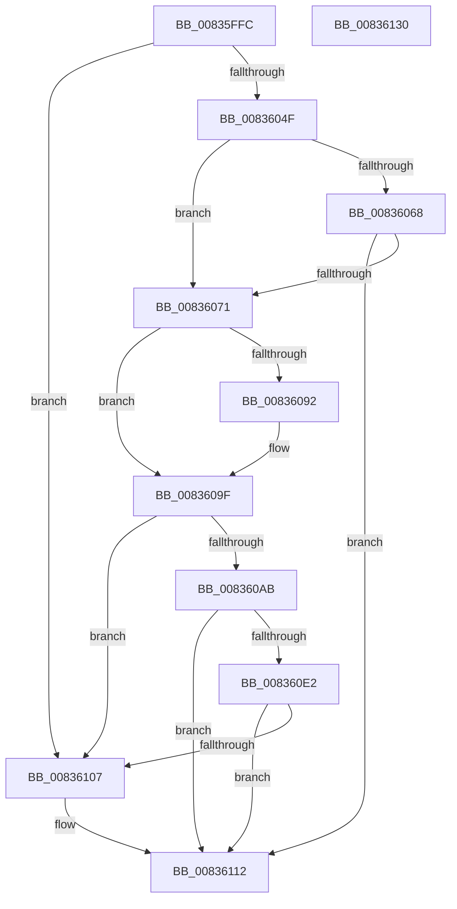

# CreateTlgAggregateSession

- RVA: `0x00835FFC`–`0x00836131` (길이 `309` bytes)
- VA: `0x0000000140835FFC`
- 실행 섹션: `PAGE`
- PDB 이름 있음: `예`; PDB Function 태그: `예`
- unwind 정보 RVA: `0x0005E6B4`
- 디코드: `78`개 명령, `309/309` bytes 표시
- 미해석 바이트: `0` (있으면 어셈블리에 `.byte`로 보존)

> 이 문서는 커널 이미지의 기계어와 PDB 기호를 분석해 생성했습니다. 4번과 5번은 함수 원형과 자료형을 바이너리 사용 방식에서 추정한 C 해석이며 원본 소스 복구 결과는 아닙니다.

## 1. Dependencies

- 직접 호출 지점: **7**; 고유 호출 대상: **5**
- 직접 호출자로 확인된 함수: **1**
- RIP 상대 이미지 참조: **2**

### Outgoing calls
- `0x0083603C` → [ExAllocatePoolWithTag](../../poolcode/B8/ExAllocatePoolWithTag_function_00B82010.md) (function, `0x00B82010`)
- `0x00836057` → [memset](../../text/6C/memset_function_006C6C40.md) (function, `0x006C6C40`)
- `0x00836085` → [ExAllocatePoolWithTag](../../poolcode/B8/ExAllocatePoolWithTag_function_00B82010.md) (function, `0x00B82010`)
- `0x0083609A` → [memset](../../text/6C/memset_function_006C6C40.md) (function, `0x006C6C40`)
- `0x008360B4` → [KeInitializeEvent](../../text/40/KeInitializeEvent_function_0040DD10.md) (function, `0x0040DD10`)
- `0x008360F6` → [ExAllocateTimer](../../text/3A/ExAllocateTimer_function_003A30D0.md) (function, `0x003A30D0`)
- `0x0083610A` → [DestroyAggregateSession](DestroyAggregateSession_function_00836138.md) (function, `0x00836138`)

### Direct callers
- [TlgRegisterAggregateProviderEx](../AD/TlgRegisterAggregateProviderEx_function_00ADBA94.md) at `0x00ADBAB5`

### Static image references
- `0x008360C0` → RVA `0x00A693B0` (`TlgAggregateInternalFlushWorkItemRoutineKernelMode`; read)
- `0x008360E9` → RVA `0x004C4240` (`TlgAggregateInternalFlushTimerCallbackKernelMode`; read)

## 2. Other-region calls and transfers

- 다른 실행 섹션으로 향하는 call: **6**
  - `0x0083603C` → [ExAllocatePoolWithTag](../../poolcode/B8/ExAllocatePoolWithTag_function_00B82010.md) (`PAGE` → `POOLCODE`)
  - `0x00836057` → [memset](../../text/6C/memset_function_006C6C40.md) (`PAGE` → `.text`)
  - `0x00836085` → [ExAllocatePoolWithTag](../../poolcode/B8/ExAllocatePoolWithTag_function_00B82010.md) (`PAGE` → `POOLCODE`)
  - `0x0083609A` → [memset](../../text/6C/memset_function_006C6C40.md) (`PAGE` → `.text`)
  - `0x008360B4` → [KeInitializeEvent](../../text/40/KeInitializeEvent_function_0040DD10.md) (`PAGE` → `.text`)
  - `0x008360F6` → [ExAllocateTimer](../../text/3A/ExAllocateTimer_function_003A30D0.md) (`PAGE` → `.text`)
- 별도 외부 분기/꼬리 이동을 확인하지 못했습니다.

## 3. Assembly (complete function range)

```asm
00835FFC  48 8B C4                        mov rax, rsp
00835FFF  48 89 58 08                     mov qword ptr [rax + 8], rbx
00836003  48 89 68 10                     mov qword ptr [rax + 0x10], rbp
00836007  48 89 70 18                     mov qword ptr [rax + 0x18], rsi
0083600B  48 89 78 20                     mov qword ptr [rax + 0x20], rdi
0083600F  41 56                           push r14
00836011  48 83 EC 20                     sub rsp, 0x20
00836015  8A C1                           mov al, cl
00836017  40 8A F9                        mov dil, cl
0083601A  F6 D8                           neg al
0083601C  40 8A F2                        mov sil, dl
0083601F  41 BE 78 01 00 00               mov r14d, 0x178
00836025  41 B8 54 72 41 47               mov r8d, 0x47417254
0083602B  1B C9                           sbb ecx, ecx
0083602D  41 8B D6                        mov edx, r14d
00836030  81 E1 01 FE FF FF               and ecx, 0xfffffe01
00836036  81 C1 00 02 00 00               add ecx, 0x200
0083603C  E8 CF BF 34 00                  call 0x140b82010
00836041  33 ED                           xor ebp, ebp
00836043  48 8B D8                        mov rbx, rax
00836046  48 85 C0                        test rax, rax
00836049  0F 84 B8 00 00 00               je 0x140836107
0083604F  45 8B C6                        mov r8d, r14d
00836052  33 D2                           xor edx, edx
00836054  48 8B C8                        mov rcx, rax
00836057  E8 E4 0B E9 FF                  call 0x1406c6c40
0083605C  48 89 AB 10 01 00 00            mov qword ptr [rbx + 0x110], rbp
00836063  40 84 F6                        test sil, sil
00836066  75 09                           jne 0x140836071
00836068  40 84 FF                        test dil, dil
0083606B  0F 85 A1 00 00 00               jne 0x140836112
00836071  41 BE 40 00 00 00               mov r14d, 0x40
00836077  41 B8 54 72 41 47               mov r8d, 0x47417254
0083607D  41 8B D6                        mov edx, r14d
00836080  B9 00 02 00 00                  mov ecx, 0x200
00836085  E8 86 BF 34 00                  call 0x140b82010
0083608A  48 8B F8                        mov rdi, rax
0083608D  48 85 C0                        test rax, rax
00836090  74 0D                           je 0x14083609f
00836092  45 8B C6                        mov r8d, r14d
00836095  33 D2                           xor edx, edx
00836097  48 8B C8                        mov rcx, rax
0083609A  E8 A1 0B E9 FF                  call 0x1406c6c40
0083609F  48 89 BB 08 01 00 00            mov qword ptr [rbx + 0x108], rdi
008360A6  48 85 FF                        test rdi, rdi
008360A9  74 5C                           je 0x140836107
008360AB  48 8D 4F 20                     lea rcx, [rdi + 0x20]
008360AF  45 33 C0                        xor r8d, r8d
008360B2  33 D2                           xor edx, edx
008360B4  E8 57 7C BD FF                  call 0x14040dd10
008360B9  48 8B 83 08 01 00 00            mov rax, qword ptr [rbx + 0x108]
008360C0  48 8D 0D E9 32 23 00            lea rcx, [rip + 0x2332e9]
008360C7  48 89 48 10                     mov qword ptr [rax + 0x10], rcx
008360CB  48 89 58 18                     mov qword ptr [rax + 0x18], rbx
008360CF  48 89 28                        mov qword ptr [rax], rbp
008360D2  48 8B 83 08 01 00 00            mov rax, qword ptr [rbx + 0x108]
008360D9  66 89 68 38                     mov word ptr [rax + 0x38], bp
008360DD  40 84 F6                        test sil, sil
008360E0  74 30                           je 0x140836112
008360E2  48 8B 93 08 01 00 00            mov rdx, qword ptr [rbx + 0x108]
008360E9  48 8D 0D 50 E1 C8 FF            lea rcx, [rip - 0x371eb0]
008360F0  41 B8 08 00 00 00               mov r8d, 8
008360F6  E8 D5 CF B6 FF                  call 0x1403a30d0
008360FB  48 89 83 68 01 00 00            mov qword ptr [rbx + 0x168], rax
00836102  48 85 C0                        test rax, rax
00836105  75 0B                           jne 0x140836112
00836107  48 8B CB                        mov rcx, rbx
0083610A  E8 29 00 00 00                  call 0x140836138
0083610F  48 8B DD                        mov rbx, rbp
00836112  48 8B 6C 24 38                  mov rbp, qword ptr [rsp + 0x38]
00836117  48 8B C3                        mov rax, rbx
0083611A  48 8B 5C 24 30                  mov rbx, qword ptr [rsp + 0x30]
0083611F  48 8B 74 24 40                  mov rsi, qword ptr [rsp + 0x40]
00836124  48 8B 7C 24 48                  mov rdi, qword ptr [rsp + 0x48]
00836129  48 83 C4 20                     add rsp, 0x20
0083612D  41 5E                           pop r14
0083612F  C3                              ret
00836130  CC                              int3
```

## 4. C-style interpretation (structured pseudocode)

```c
__int64 __fastcall CreateTlgAggregateSession(int a1, unsigned __int8 a2)
{
    __int64 result;
    __int64 v_rbp;
    __int64 v_rbx;
    __int64 v_rsp;
    unsigned __int64 v_stack_p10;
    unsigned __int64 v_stack_p18;
    unsigned __int64 v_stack_p20;
    unsigned __int64 v_stack_p8;

    *(unsigned __int64 *)(v_rsp + 8) = v_rbx;
    *(unsigned __int64 *)(v_rsp + 16) = v_rbp;
    *(unsigned __int64 *)(v_rsp + 24) = v_rsi;
    *(unsigned __int64 *)(v_rsp + 32) = v_rdi;
    v_rsp = (v_rsp) - (32);
    result = (unsigned __int8)(-((unsigned __int8)(a1)));
    a1 = (unsigned int)((a1) & (0xFFFFFE01ULL));
    a1 = (unsigned int)((a1) + (512));
    result = ExAllocatePoolWithTag(a1, 376, (unsigned int)(0x47417254ULL), a4);
    v_rbp = 0;
    if (result == 0) goto loc_00836107;
    a2 = 0;
    result = memset(result, a2, 376, a4);
    *(unsigned __int64 *)(result + 272) = 0;
    if (0 != 0) goto loc_00836071;
    if ((unsigned __int8)((unsigned __int8)(a1)) != 0) goto loc_00836112;
loc_00836071:
    result = ExAllocatePoolWithTag(512, 64, (unsigned int)(0x47417254ULL), a4);
    if (result != 0) {
        a3 = 64;
        a2 = 0;
        a1 = result;
        result = memset(a1, a2, a3, a4);
    }
    *(unsigned __int64 *)(result + 264) = result;
    if (result == 0) goto loc_00836107;
    a3 = 0;
    a2 = 0;
    result = KeInitializeEvent(result + 32, a2, a3, a4);
    *(unsigned __int64 *)(*(unsigned __int64 *)(result + 264) + 16) = v_rip + 2306793;
    *(unsigned __int64 *)(*(unsigned __int64 *)(result + 264) + 24) = result;
    *(unsigned __int64 *)(*(unsigned __int64 *)(result + 264)) = 0;
    *(unsigned __int16 *)(*(unsigned __int64 *)(result + 264) + 56) = 0;
    if (0 == 0) goto loc_00836112;
    result = ExAllocateTimer(v_rip - 3612336, *(unsigned __int64 *)(result + 264), 8, a4);
    *(unsigned __int64 *)(result + 360) = result;
    v_rbx = result;
    if (result == 0) {
        a1 = result;
        result = DestroyAggregateSession(a1, *(unsigned __int64 *)(result + 264), 8, a4);
        v_rbx = 0;
    }
    v_rsp = (v_rsp) + (32);
    return v_rbx;
}
```

## 5. (Beta) C Style

```c
int64_t CreateTlgAggregateSession(int32_t Arg1, uint8_t Arg2)
{
    int64_t result;
    int64_t local_rbp;
    int64_t local_rbx;
    int64_t local_rsp;
    uint64_t v_stack_p10;
    uint64_t v_stack_p18;
    uint64_t v_stack_p20;
    uint64_t v_stack_p8;

    *(uint64_t *)(local_rsp + 0x8) = local_rbx;
    *(uint64_t *)(local_rsp + 0x10) = local_rbp;
    *(uint64_t *)(local_rsp + 0x18) = local_rsi;
    *(uint64_t *)(local_rsp + 0x20) = local_rdi;
    local_rsp = (local_rsp) - (32);
    result = (uint8_t)(-((uint8_t)(Arg1)));
    Arg1 = (uint32_t)((Arg1) & (0xFFFFFE01ULL));
    Arg1 = (uint32_t)((Arg1) + (512));
    result = ExAllocatePoolWithTag(Arg1, 376, (uint32_t)(0x47417254ULL), a4);
    local_rbp = 0;
    if (result == 0) goto loc_00836107;
    Arg2 = 0;
    result = memset(result, Arg2, 376, a4);
    *(uint64_t *)(result + 0x110) = 0;
    if (0 != 0) goto loc_00836071;
    if ((uint8_t)((uint8_t)(Arg1)) != 0) goto loc_00836112;
loc_00836071:
    result = ExAllocatePoolWithTag(512, 64, (uint32_t)(0x47417254ULL), a4);
    if (result != 0) {
        a3 = 64;
        Arg2 = 0;
        Arg1 = result;
        result = memset(Arg1, Arg2, a3, a4);
    }
    *(uint64_t *)(result + 0x108) = result;
    if (result == 0) goto loc_00836107;
    a3 = 0;
    Arg2 = 0;
    result = KeInitializeEvent(result + 32, Arg2, a3, a4);
    *(uint64_t *)(*(uint64_t *)(result + 0x108) + 0x10) = v_rip + 2306793;
    *(uint64_t *)(*(uint64_t *)(result + 0x108) + 0x18) = result;
    *(uint64_t *)(*(uint64_t *)(result + 0x108)) = 0;
    *(uint16_t *)(*(uint64_t *)(result + 0x108) + 0x38) = 0;
    if (0 == 0) goto loc_00836112;
    result = ExAllocateTimer(v_rip - 3612336, *(uint64_t *)(result + 0x108), 8, a4);
    *(uint64_t *)(result + 0x168) = result;
    local_rbx = result;
    if (result == 0) {
        Arg1 = result;
        result = DestroyAggregateSession(Arg1, *(uint64_t *)(result + 0x108), 8, a4);
        local_rbx = 0;
    }
    local_rsp = (local_rsp) + (32);
    return local_rbx;
}
```

## 6. Execution-region graph

[열기: 2D/3D 그래프와 함수 탐색 컨트롤 패널](../../../control-panel.html?section=page&rva=0x00835FFC&view=graph)

- 2D 그래프는 위에서 아래로 흐르고, 3D 그래프는 빈 공간을 드래그해 회전합니다. Shift+드래그는 이동, 휠은 확대·축소, 함수 노드 선택은 대상 보고서 이동입니다.

### Static fallback


