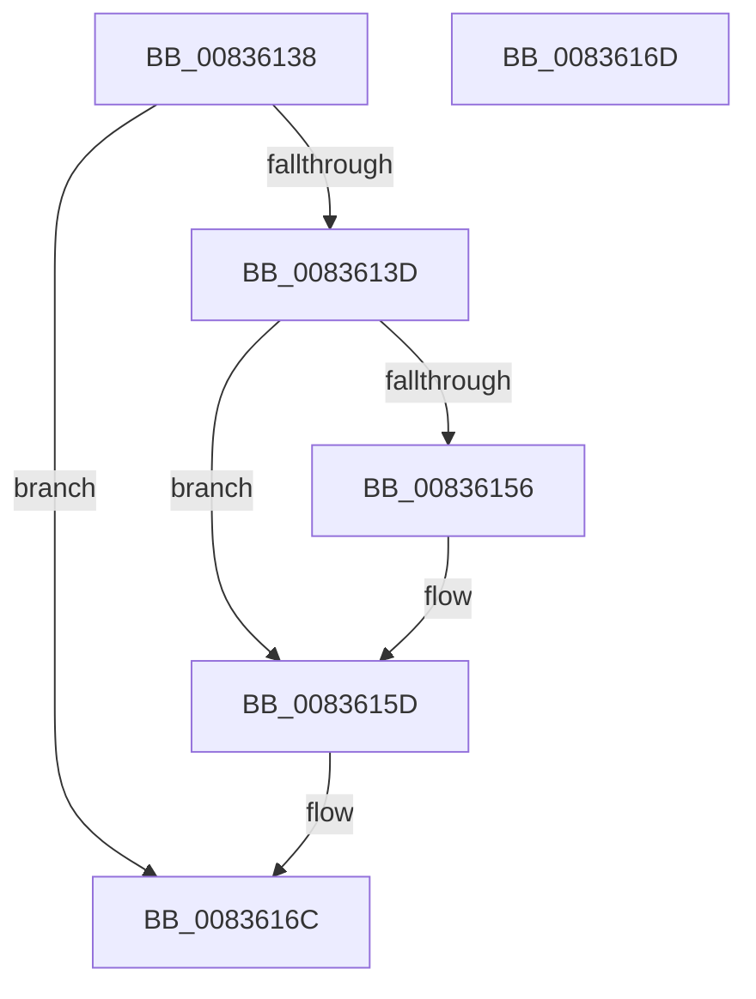

# DestroyAggregateSession

- RVA: `0x00836138`–`0x0083616E` (길이 `54` bytes)
- VA: `0x0000000140836138`
- 실행 섹션: `PAGE`
- PDB 이름 있음: `예`; PDB Function 태그: `예`
- unwind 정보 RVA: `0x000805BC`
- 디코드: `18`개 명령, `54/54` bytes 표시
- 미해석 바이트: `0` (있으면 어셈블리에 `.byte`로 보존)

> 이 문서는 커널 이미지의 기계어와 PDB 기호를 분석해 생성했습니다. 4번과 5번은 함수 원형과 자료형을 바이너리 사용 방식에서 추정한 C 해석이며 원본 소스 복구 결과는 아닙니다.

## 1. Dependencies

- 직접 호출 지점: **3**; 고유 호출 대상: **2**
- 직접 호출자로 확인된 함수: **2**
- RIP 상대 이미지 참조: **0**

### Outgoing calls
- `0x00836145` → [CancelTimerCallbacksAndDeleteTimer](CancelTimerCallbacksAndDeleteTimer_function_00835ED4.md) (function, `0x00835ED4`)
- `0x00836158` → [ExFreePoolWithTag](../../poolcode/B8/ExFreePoolWithTag_function_00B82870.md) (function, `0x00B82870`)
- `0x00836162` → [ExFreePoolWithTag](../../poolcode/B8/ExFreePoolWithTag_function_00B82870.md) (function, `0x00B82870`)

### Direct callers
- [CreateTlgAggregateSession](CreateTlgAggregateSession_function_00835FFC.md) at `0x0083610A`
- [TlgRegisterAggregateProviderEx](../AD/TlgRegisterAggregateProviderEx_function_00ADBA94.md) at `0x00ADBBC5`

### Static image references
- 디코드된 RIP-relative 메모리 참조가 없습니다.

## 2. Other-region calls and transfers

- 다른 실행 섹션으로 향하는 call: **2**
  - `0x00836158` → [ExFreePoolWithTag](../../poolcode/B8/ExFreePoolWithTag_function_00B82870.md) (`PAGE` → `POOLCODE`)
  - `0x00836162` → [ExFreePoolWithTag](../../poolcode/B8/ExFreePoolWithTag_function_00B82870.md) (`PAGE` → `POOLCODE`)
- 별도 외부 분기/꼬리 이동을 확인하지 못했습니다.

## 3. Assembly (complete function range)

```asm
00836138  48 85 C9                        test rcx, rcx
0083613B  74 2F                           je 0x14083616c
0083613D  53                              push rbx
0083613E  48 83 EC 20                     sub rsp, 0x20
00836142  48 8B D9                        mov rbx, rcx
00836145  E8 8A FD FF FF                  call 0x140835ed4
0083614A  48 8B 8B 08 01 00 00            mov rcx, qword ptr [rbx + 0x108]
00836151  48 85 C9                        test rcx, rcx
00836154  74 07                           je 0x14083615d
00836156  33 D2                           xor edx, edx
00836158  E8 13 C7 34 00                  call 0x140b82870
0083615D  33 D2                           xor edx, edx
0083615F  48 8B CB                        mov rcx, rbx
00836162  E8 09 C7 34 00                  call 0x140b82870
00836167  48 83 C4 20                     add rsp, 0x20
0083616B  5B                              pop rbx
0083616C  C3                              ret
0083616D  CC                              int3
```

## 4. C-style interpretation (structured pseudocode)

```c
__int64 __fastcall DestroyAggregateSession(__int64 a1, int a2)
{
    __int64 result;
    __int64 v_rsp;

    if (a1 == 0) goto loc_0083616C;
    v_rsp = (v_rsp) - (32);
    result = CancelTimerCallbacksAndDeleteTimer(a1, a2, a3, a4);
    if (*(unsigned __int64 *)(a1 + 264) != 0) {
        a2 = 0;
        result = ExFreePoolWithTag(*(unsigned __int64 *)(a1 + 264), a2, a3, a4);
    }
    a2 = 0;
    result = ExFreePoolWithTag(a1, a2, a3, a4);
    v_rsp = (v_rsp) + (32);
loc_0083616C:
    return result;
}
```

## 5. (Beta) C Style

```c
int64_t DestroyAggregateSession(int64_t Arg1, int32_t Arg2)
{
    int64_t result;
    int64_t local_rsp;

    if (Arg1 == 0) goto loc_0083616C;
    local_rsp = (local_rsp) - (32);
    result = CancelTimerCallbacksAndDeleteTimer(Arg1, Arg2, a3, a4);
    if (*(uint64_t *)(Arg1 + 0x108) != 0) {
        Arg2 = 0;
        result = ExFreePoolWithTag(*(uint64_t *)(Arg1 + 0x108), Arg2, a3, a4);
    }
    Arg2 = 0;
    result = ExFreePoolWithTag(Arg1, Arg2, a3, a4);
    local_rsp = (local_rsp) + (32);
loc_0083616C:
    return result;
}
```

## 6. Execution-region graph

[열기: 2D/3D 그래프와 함수 탐색 컨트롤 패널](../../../control-panel.html?section=page&rva=0x00836138&view=graph)

- 2D 그래프는 위에서 아래로 흐르고, 3D 그래프는 빈 공간을 드래그해 회전합니다. Shift+드래그는 이동, 휠은 확대·축소, 함수 노드 선택은 대상 보고서 이동입니다.

### Static fallback


