# DrvDbCreateDatabaseNode

- RVA: `0x0083533C`–`0x0083566B` (길이 `815` bytes)
- VA: `0x000000014083533C`
- 실행 섹션: `PAGE`
- PDB 이름 있음: `예`; PDB Function 태그: `아니요`
- unwind 정보 RVA: `0x000DAC34`
- 디코드: `211`개 명령, `815/815` bytes 표시
- 미해석 바이트: `0` (있으면 어셈블리에 `.byte`로 보존)

> 이 문서는 커널 이미지의 기계어와 PDB 기호를 분석해 생성했습니다. 4번과 5번은 함수 원형과 자료형을 바이너리 사용 방식에서 추정한 C 해석이며 원본 소스 복구 결과는 아닙니다.

## 1. Dependencies

- 직접 호출 지점: **13**; 고유 호출 대상: **9**
- 직접 호출자로 확인된 함수: **3**
- RIP 상대 이미지 참조: **4**

### Outgoing calls
- `0x008353EF` → [ExAllocatePool2](../../poolcode/B8/ExAllocatePool2_function_00B820F0.md) (function, `0x00B820F0`)
- `0x0083540E` → [ZwClose](../../text/6A/ZwClose_function_006AD2B0.md) (function, `0x006AD2B0`)
- `0x00835422` → [DrvDbDestroyDatabaseNode](DrvDbDestroyDatabaseNode_function_00835674.md) (function, `0x00835674`)
- `0x0083543B` → [ExFreePoolWithTag](../../poolcode/B8/ExFreePoolWithTag_function_00B82870.md) (function, `0x00B82870`)
- `0x0083549C` → [RtlStringCchPrintfExW](../../text/42/RtlStringCchPrintfExW_function_0042B390.md) (function, `0x0042B390`)
- `0x008354C1` → [ExAllocatePool2](../../poolcode/B8/ExAllocatePool2_function_00B820F0.md) (function, `0x00B820F0`)
- `0x00835509` → [RtlCreateUnicodeString](../9B/RtlCreateUnicodeString_function_009BD860.md) (function, `0x009BD860`)
- `0x00835526` → [RtlCreateUnicodeString](../9B/RtlCreateUnicodeString_function_009BD860.md) (function, `0x009BD860`)
- `0x0083553D` → [ExAllocatePool2](../../poolcode/B8/ExAllocatePool2_function_00B820F0.md) (function, `0x00B820F0`)
- `0x00835551` → [ExInitializeResourceLite](../../text/41/ExInitializeResourceLite_function_0041F9A0.md) (function, `0x0041F9A0`)
- `0x00835565` → [ExFreePoolWithTag](../../poolcode/B8/ExFreePoolWithTag_function_00B82870.md) (function, `0x00B82870`)
- `0x008355E7` → [DrvDbOpenObjectRegKey](../93/DrvDbOpenObjectRegKey_function_00931060.md) (function, `0x00931060`)
- `0x0083562B` → [DrvDbSetDriverDatabaseMappedProperty](DrvDbSetDriverDatabaseMappedProperty_function_00834014.md) (function, `0x00834014`)

### Direct callers
- [DrvDbOpenContext](DrvDbOpenContext_function_00834F8C.md) at `0x00835076`
- [DrvDbRegisterDatabase](DrvDbRegisterDatabase_function_0083513C.md) at `0x00835209`
- [DrvDbOpenDriverDatabaseRegKey](../AA/DrvDbOpenDriverDatabaseRegKey_function_00AA0FB8.md) at `0x00AA1111`

### Static image references
- `0x0083545C` → RVA `0x00B00330` (` ?? ::NNGAKEGL::`string'`; read)
- `0x00835473` → RVA `0x00B0DA10` (` ?? ::NNGAKEGL::`string'`; read)
- `0x00835482` → RVA `0x00B0DA40` (` ?? ::NNGAKEGL::`string'`; read)
- `0x00835601` → RVA `0x00023648` (`.rdata`; read)

## 2. Other-region calls and transfers

- 다른 실행 섹션으로 향하는 call: **8**
  - `0x008353EF` → [ExAllocatePool2](../../poolcode/B8/ExAllocatePool2_function_00B820F0.md) (`PAGE` → `POOLCODE`)
  - `0x0083540E` → [ZwClose](../../text/6A/ZwClose_function_006AD2B0.md) (`PAGE` → `.text`)
  - `0x0083543B` → [ExFreePoolWithTag](../../poolcode/B8/ExFreePoolWithTag_function_00B82870.md) (`PAGE` → `POOLCODE`)
  - `0x0083549C` → [RtlStringCchPrintfExW](../../text/42/RtlStringCchPrintfExW_function_0042B390.md) (`PAGE` → `.text`)
  - `0x008354C1` → [ExAllocatePool2](../../poolcode/B8/ExAllocatePool2_function_00B820F0.md) (`PAGE` → `POOLCODE`)
  - `0x0083553D` → [ExAllocatePool2](../../poolcode/B8/ExAllocatePool2_function_00B820F0.md) (`PAGE` → `POOLCODE`)
  - `0x00835551` → [ExInitializeResourceLite](../../text/41/ExInitializeResourceLite_function_0041F9A0.md) (`PAGE` → `.text`)
  - `0x00835565` → [ExFreePoolWithTag](../../poolcode/B8/ExFreePoolWithTag_function_00B82870.md) (`PAGE` → `POOLCODE`)
- 별도 외부 분기/꼬리 이동을 확인하지 못했습니다.

## 3. Assembly (complete function range)

```asm
0083533C  48 8B C4                        mov rax, rsp
0083533F  48 89 58 08                     mov qword ptr [rax + 8], rbx
00835343  48 89 68 10                     mov qword ptr [rax + 0x10], rbp
00835347  4C 89 40 18                     mov qword ptr [rax + 0x18], r8
0083534B  56                              push rsi
0083534C  57                              push rdi
0083534D  41 55                           push r13
0083534F  41 56                           push r14
00835351  41 57                           push r15
00835353  48 83 EC 60                     sub rsp, 0x60
00835357  8B AC 24 B8 00 00 00            mov ebp, dword ptr [rsp + 0xb8]
0083535E  4C 8B FA                        mov r15, rdx
00835361  33 D2                           xor edx, edx
00835363  45 8B E9                        mov r13d, r9d
00835366  48 89 50 D0                     mov qword ptr [rax - 0x30], rdx
0083536A  49 8B D8                        mov rbx, r8
0083536D  89 50 C8                        mov dword ptr [rax - 0x38], edx
00835370  48 8B F1                        mov rsi, rcx
00835373  48 8B 84 24 D0 00 00 00         mov rax, qword ptr [rsp + 0xd0]
0083537B  8B FA                           mov edi, edx
0083537D  48 89 10                        mov qword ptr [rax], rdx
00835380  8B C5                           mov eax, ebp
00835382  83 E0 30                        and eax, 0x30
00835385  3C 30                           cmp al, 0x30
00835387  75 0A                           jne 0x140835393
00835389  BB 0D 00 00 C0                  mov ebx, 0xc000000d
0083538E  E9 AD 00 00 00                  jmp 0x140835440
00835393  40 F6 C5 01                     test bpl, 1
00835397  74 06                           je 0x14083539f
00835399  48 39 51 20                     cmp qword ptr [rcx + 0x20], rdx
0083539D  75 EA                           jne 0x140835389
0083539F  40 F6 C5 20                     test bpl, 0x20
008353A3  74 0F                           je 0x1408353b4
008353A5  48 8B 49 28                     mov rcx, qword ptr [rcx + 0x28]
008353A9  48 85 C9                        test rcx, rcx
008353AC  74 06                           je 0x1408353b4
008353AE  48 3B 4E 20                     cmp rcx, qword ptr [rsi + 0x20]
008353B2  75 D5                           jne 0x140835389
008353B4  48 39 94 24 B0 00 00 00         cmp qword ptr [rsp + 0xb0], rdx
008353BC  74 0D                           je 0x1408353cb
008353BE  4C 8B B4 24 B0 00 00 00         mov r14, qword ptr [rsp + 0xb0]
008353C6  E9 E8 00 00 00                  jmp 0x1408354b3
008353CB  48 83 C8 FF                     or rax, 0xffffffffffffffff
008353CF  48 FF C0                        inc rax
008353D2  66 41 39 14 47                  cmp word ptr [r15 + rax*2], dx
008353D7  75 F6                           jne 0x1408353cf
008353D9  8D 04 45 44 00 00 00            lea eax, [rax*2 + 0x44]
008353E0  41 B8 50 44 44 42               mov r8d, 0x42444450
008353E6  8B D0                           mov edx, eax
008353E8  B9 00 01 00 00                  mov ecx, 0x100
008353ED  8B D8                           mov ebx, eax
008353EF  E8 FC CC 34 00                  call 0x140b820f0
008353F4  4C 8B F0                        mov r14, rax
008353F7  48 85 C0                        test rax, rax
008353FA  75 60                           jne 0x14083545c
008353FC  BB 17 00 00 C0                  mov ebx, 0xc0000017
00835401  45 33 ED                        xor r13d, r13d
00835404  48 8B 4C 24 58                  mov rcx, qword ptr [rsp + 0x58]
00835409  48 85 C9                        test rcx, rcx
0083540C  74 05                           je 0x140835413
0083540E  E8 9D 7E E7 FF                  call 0x1406ad2b0
00835413  48 85 FF                        test rdi, rdi
00835416  74 0F                           je 0x140835427
00835418  48 8B D7                        mov rdx, rdi
0083541B  4C 89 6F 50                     mov qword ptr [rdi + 0x50], r13
0083541F  48 8B CE                        mov rcx, rsi
00835422  E8 4D 02 00 00                  call 0x140835674
00835427  4D 85 F6                        test r14, r14
0083542A  74 14                           je 0x140835440
0083542C  4C 3B B4 24 B0 00 00 00         cmp r14, qword ptr [rsp + 0xb0]
00835434  74 0A                           je 0x140835440
00835436  33 D2                           xor edx, edx
00835438  49 8B CE                        mov rcx, r14
0083543B  E8 30 D4 34 00                  call 0x140b82870
00835440  4C 8D 5C 24 60                  lea r11, [rsp + 0x60]
00835445  8B C3                           mov eax, ebx
00835447  49 8B 5B 30                     mov rbx, qword ptr [r11 + 0x30]
0083544B  49 8B 6B 38                     mov rbp, qword ptr [r11 + 0x38]
0083544F  49 8B E3                        mov rsp, r11
00835452  41 5F                           pop r15
00835454  41 5E                           pop r14
00835456  41 5D                           pop r13
00835458  5F                              pop rdi
00835459  5E                              pop rsi
0083545A  C3                              ret
0083545B  CC                              int3
0083545C  48 8D 05 CD AE 2C 00            lea rax, [rip + 0x2caecd]
00835463  48 D1 EB                        shr rbx, 1
00835466  48 89 44 24 40                  mov qword ptr [rsp + 0x40], rax
0083546B  45 33 C9                        xor r9d, r9d
0083546E  4C 89 7C 24 38                  mov qword ptr [rsp + 0x38], r15
00835473  48 8D 05 96 85 2D 00            lea rax, [rip + 0x2d8596]
0083547A  48 89 44 24 30                  mov qword ptr [rsp + 0x30], rax
0083547F  45 33 C0                        xor r8d, r8d
00835482  48 8D 05 B7 85 2D 00            lea rax, [rip + 0x2d85b7]
00835489  48 8B D3                        mov rdx, rbx
0083548C  48 89 44 24 28                  mov qword ptr [rsp + 0x28], rax
00835491  49 8B CE                        mov rcx, r14
00835494  C7 44 24 20 00 08 00 00         mov dword ptr [rsp + 0x20], 0x800
0083549C  E8 EF 5E BF FF                  call 0x14042b390
008354A1  8B D8                           mov ebx, eax
008354A3  85 C0                           test eax, eax
008354A5  0F 88 56 FF FF FF               js 0x140835401
008354AB  48 8B 9C 24 A0 00 00 00         mov rbx, qword ptr [rsp + 0xa0]
008354B3  BA A8 00 00 00                  mov edx, 0xa8
008354B8  41 B8 50 44 44 42               mov r8d, 0x42444450
008354BE  8D 4A 58                        lea ecx, [rdx + 0x58]
008354C1  E8 2A CC 34 00                  call 0x140b820f0
008354C6  48 8B F8                        mov rdi, rax
008354C9  48 85 C0                        test rax, rax
008354CC  0F 84 2A FF FF FF               je 0x1408353fc
008354D2  8B 46 08                        mov eax, dword ptr [rsi + 8]
008354D5  48 8D 4F 10                     lea rcx, [rdi + 0x10]
008354D9  89 47 44                        mov dword ptr [rdi + 0x44], eax
008354DC  49 8B D7                        mov rdx, r15
008354DF  48 8B 84 24 C0 00 00 00         mov rax, qword ptr [rsp + 0xc0]
008354E7  48 89 47 50                     mov qword ptr [rdi + 0x50], rax
008354EB  48 8B 84 24 C8 00 00 00         mov rax, qword ptr [rsp + 0xc8]
008354F3  48 89 47 58                     mov qword ptr [rdi + 0x58], rax
008354F7  C7 47 48 00 00 01 00            mov dword ptr [rdi + 0x48], 0x10000
008354FE  89 6F 40                        mov dword ptr [rdi + 0x40], ebp
00835501  44 89 6F 28                     mov dword ptr [rdi + 0x28], r13d
00835505  48 89 5F 20                     mov qword ptr [rdi + 0x20], rbx
00835509  E8 52 83 18 00                  call 0x1409bd860
0083550E  45 33 ED                        xor r13d, r13d
00835511  84 C0                           test al, al
00835513  75 0A                           jne 0x14083551f
00835515  BB 9A 00 00 C0                  mov ebx, 0xc000009a
0083551A  E9 E5 FE FF FF                  jmp 0x140835404
0083551F  48 8D 4F 30                     lea rcx, [rdi + 0x30]
00835523  49 8B D6                        mov rdx, r14
00835526  E8 35 83 18 00                  call 0x1409bd860
0083552B  84 C0                           test al, al
0083552D  74 E6                           je 0x140835515
0083552F  BA 68 00 00 00                  mov edx, 0x68
00835534  41 B8 50 44 44 42               mov r8d, 0x42444450
0083553A  8D 4A D8                        lea ecx, [rdx - 0x28]
0083553D  E8 AE CB 34 00                  call 0x140b820f0
00835542  48 89 87 98 00 00 00            mov qword ptr [rdi + 0x98], rax
00835549  48 85 C0                        test rax, rax
0083554C  74 C7                           je 0x140835515
0083554E  48 8B C8                        mov rcx, rax
00835551  E8 4A A4 BE FF                  call 0x14041f9a0
00835556  8B D8                           mov ebx, eax
00835558  85 C0                           test eax, eax
0083555A  79 1A                           jns 0x140835576
0083555C  48 8B 8F 98 00 00 00            mov rcx, qword ptr [rdi + 0x98]
00835563  33 D2                           xor edx, edx
00835565  E8 06 D3 34 00                  call 0x140b82870
0083556A  4C 89 AF 98 00 00 00            mov qword ptr [rdi + 0x98], r13
00835571  E9 8E FE FF FF                  jmp 0x140835404
00835576  40 F6 C5 20                     test bpl, 0x20
0083557A  75 22                           jne 0x14083559e
0083557C  48 8D 46 10                     lea rax, [rsi + 0x10]
00835580  48 8B 48 08                     mov rcx, qword ptr [rax + 8]
00835584  48 39 01                        cmp qword ptr [rcx], rax
00835587  74 07                           je 0x140835590
00835589  B9 03 00 00 00                  mov ecx, 3
0083558E  CD 29                           int 0x29
00835590  48 89 07                        mov qword ptr [rdi], rax
00835593  48 89 4F 08                     mov qword ptr [rdi + 8], rcx
00835597  48 89 39                        mov qword ptr [rcx], rdi
0083559A  48 89 78 08                     mov qword ptr [rax + 8], rdi
0083559E  40 F6 C5 10                     test bpl, 0x10
008355A2  0F 84 92 00 00 00               je 0x14083563a
008355A8  48 8B 56 28                     mov rdx, qword ptr [rsi + 0x28]
008355AC  48 85 D2                        test rdx, rdx
008355AF  0F 84 85 00 00 00               je 0x14083563a
008355B5  4C 89 6C 24 40                  mov qword ptr [rsp + 0x40], r13
008355BA  48 8D 44 24 50                  lea rax, [rsp + 0x50]
008355BF  48 89 44 24 38                  mov qword ptr [rsp + 0x38], rax
008355C4  4D 8B CF                        mov r9, r15
008355C7  48 8D 44 24 58                  lea rax, [rsp + 0x58]
008355CC  41 B8 01 00 00 00               mov r8d, 1
008355D2  48 89 44 24 30                  mov qword ptr [rsp + 0x30], rax
008355D7  48 8B CE                        mov rcx, rsi
008355DA  C6 44 24 28 01                  mov byte ptr [rsp + 0x28], 1
008355DF  C7 44 24 20 00 00 00 02         mov dword ptr [rsp + 0x20], 0x2000000
008355E7  E8 74 BA 0F 00                  call 0x140931060
008355EC  8B D8                           mov ebx, eax
008355EE  85 C0                           test eax, eax
008355F0  0F 88 0E FE FF FF               js 0x140835404
008355F6  83 7C 24 50 01                  cmp dword ptr [rsp + 0x50], 1
008355FB  75 3D                           jne 0x14083563a
008355FD  0F B7 47 30                     movzx eax, word ptr [rdi + 0x30]
00835601  4C 8D 0D 40 E0 7E FF            lea r9, [rip - 0x811fc0]
00835608  4C 8B 44 24 58                  mov r8, qword ptr [rsp + 0x58]
0083560D  83 C0 02                        add eax, 2
00835610  89 44 24 30                     mov dword ptr [rsp + 0x30], eax
00835614  49 8B D7                        mov rdx, r15
00835617  48 8B 47 38                     mov rax, qword ptr [rdi + 0x38]
0083561B  48 8B CE                        mov rcx, rsi
0083561E  48 89 44 24 28                  mov qword ptr [rsp + 0x28], rax
00835623  C7 44 24 20 12 00 00 00         mov dword ptr [rsp + 0x20], 0x12
0083562B  E8 E4 E9 FF FF                  call 0x140834014
00835630  8B D8                           mov ebx, eax
00835632  85 C0                           test eax, eax
00835634  0F 88 CA FD FF FF               js 0x140835404
0083563A  40 F6 C5 20                     test bpl, 0x20
0083563E  74 04                           je 0x140835644
00835640  48 89 7E 28                     mov qword ptr [rsi + 0x28], rdi
00835644  40 F6 C5 01                     test bpl, 1
00835648  74 0E                           je 0x140835658
0083564A  48 89 7E 20                     mov qword ptr [rsi + 0x20], rdi
0083564E  4C 39 6E 28                     cmp qword ptr [rsi + 0x28], r13
00835652  75 04                           jne 0x140835658
00835654  48 89 7E 28                     mov qword ptr [rsi + 0x28], rdi
00835658  48 8B 84 24 D0 00 00 00         mov rax, qword ptr [rsp + 0xd0]
00835660  48 89 38                        mov qword ptr [rax], rdi
00835663  49 8B FD                        mov rdi, r13
00835666  E9 99 FD FF FF                  jmp 0x140835404
```

## 4. C-style interpretation (structured pseudocode)

```c
__int64 __fastcall DrvDbCreateDatabaseNode(__int64 a1, __int64 a2, __int64 a3, int a4, __int64 a5, unsigned int a6, __int64 a7, __int64 a8, __int64 a9)
{
    __int64 result;
    __int64 v_r13;
    __int64 v_rbx;
    __int64 v_rsp;
    unsigned __int64 v_stack_m10;
    unsigned __int64 v_stack_m20;
    unsigned __int64 v_stack_m28;
    unsigned __int64 v_stack_m30;
    unsigned __int64 v_stack_m38;
    unsigned int v_stack_m40;
    unsigned __int64 v_stack_m8;
    unsigned __int64 v_stack_p40;

    *(unsigned __int64 *)(v_rsp + 8) = v_rbx;
    *(unsigned __int64 *)(v_rsp + 16) = v_rbp;
    *(unsigned __int64 *)(v_rsp + 24) = a3;
    v_rsp = (v_rsp) - (96);
    a2 = 0;
    *(unsigned __int64 *)(v_rsp - 48) = 0;
    *(unsigned int *)(v_rsp - 56) = 0;
    *(unsigned __int64 *)(a9) = 0;
    result = (unsigned int)(((unsigned int)((unsigned int)((unsigned int)(a6)))) & (48));
    if (((unsigned __int8)(result)) != 48) goto loc_00835393;
loc_00835389:
    goto loc_00835440;
loc_00835393:
    if ((((unsigned __int8)((unsigned int)(a6))) & (1)) == 0) goto loc_0083539F;
    if ((*(unsigned __int64 *)(a1 + 32)) != 0) goto loc_00835389;
loc_0083539F:
    if ((((unsigned __int8)((unsigned int)(a6))) & (32)) == 0) goto loc_008353B4;
    if (*(unsigned __int64 *)(a1 + 40) == 0) goto loc_008353B4;
    if ((*(unsigned __int64 *)(a1 + 40)) != (*(unsigned __int64 *)(a1 + 32))) goto loc_00835389;
loc_008353B4:
    if (a5 == 0) goto loc_008353CB;
    goto loc_008354B3;
loc_008353CB:
    result = (result) | (-1);
loc_008353CF:
    result = (result) + 1;
    if ((*(unsigned __int16 *)(a2 + result * 2)) != 0) goto loc_008353CF;
    result = ExAllocatePool2(256, (unsigned int)((unsigned int)(result * 2 + 68)), (unsigned int)(0x42444450ULL), a4);
    if (result != 0) goto loc_0083545C;
loc_008353FC:
loc_00835401:
    v_r13 = 0;
loc_00835404:
    if (v_stack_m30 != 0) {
        result = ZwClose(v_stack_m30, (unsigned int)((unsigned int)(result * 2 + 68)), (unsigned int)(0x42444450ULL), a4);
    }
    if (0 != 0) {
        a2 = 0;
        *(unsigned __int64 *)(0 + 80) = 0;
        a1 = a1;
        result = DrvDbDestroyDatabaseNode(a1, a2, (unsigned int)(0x42444450ULL), a4);
    }
    if (result == 0) goto loc_00835440;
    if (result != a5) {
        a2 = 0;
        a1 = result;
        result = ExFreePoolWithTag(a1, a2, (unsigned int)(0x42444450ULL), a4);
    }
    return (unsigned int)((unsigned int)((unsigned int)(0xC0000017ULL)));
loc_0083545C:
    v_rbx = (*(unsigned __int64 *)(v_stack_m28 + 48)) >> (1);
    v_stack_m20 = v_rip + 2928333;
    a4 = 0;
    v_stack_m28 = 0;
    v_stack_m30 = v_rip + 2983318;
    a3 = 0;
    v_stack_m38 = v_rip + 2983351;
    v_stack_m40 = 0x800ULL;
    result = RtlStringCchPrintfExW(result, v_rbx, a3, a4);
    if (sign_flag) goto loc_00835401;
loc_008354B3:
    result = ExAllocatePool2(168 + 88, 168, (unsigned int)(0x42444450ULL), a4);
    if (result == 0) goto loc_008353FC;
    *(unsigned int *)(result + 68) = (unsigned int)((unsigned int)(*(unsigned int *)(a1 + 8)));
    *(unsigned __int64 *)(result + 80) = a7;
    *(unsigned __int64 *)(result + 88) = a8;
    *(unsigned int *)(result + 72) = 0x10000ULL;
    *(unsigned int *)(result + 64) = (unsigned int)(*(unsigned __int64 *)(v_stack_m28 + 56));
    *(unsigned int *)(result + 40) = 0;
    *(unsigned __int64 *)(result + 32) = v_stack_p40;
    result = RtlCreateUnicodeString(result + 16, 0, (unsigned int)(0x42444450ULL), a4);
    v_r13 = 0;
    if ((unsigned __int8)(result) != 0) goto loc_0083551F;
loc_00835515:
    goto loc_00835404;
loc_0083551F:
    result = RtlCreateUnicodeString(result + 48, result, (unsigned int)(0x42444450ULL), a4);
    if ((unsigned __int8)(result) == 0) goto loc_00835515;
    result = ExAllocatePool2(104 - 40, 104, (unsigned int)(0x42444450ULL), a4);
    *(unsigned __int64 *)(result + 152) = result;
    if (result == 0) goto loc_00835515;
    result = ExInitializeResourceLite(result, 104, (unsigned int)(0x42444450ULL), a4);
    if (!sign_flag) goto loc_00835576;
    a2 = 0;
    result = ExFreePoolWithTag(*(unsigned __int64 *)(result + 152), a2, (unsigned int)(0x42444450ULL), a4);
    *(unsigned __int64 *)(result + 152) = 0;
    goto loc_00835404;
loc_00835576:
    if ((((unsigned __int8)(*(unsigned __int64 *)(v_stack_m28 + 56))) & (32)) != 0) goto loc_0083559E;
    if ((*(unsigned __int64 *)(*(unsigned __int64 *)(a1 + 16 + 8))) != (a1 + 16)) {
        a1 = 3;
    }
    *(unsigned __int64 *)(result) = a1 + 16;
    *(unsigned __int64 *)(result + 8) = a1;
    *(unsigned __int64 *)(a1) = result;
    *(unsigned __int64 *)(a1 + 16 + 8) = result;
loc_0083559E:
    if ((((unsigned __int8)(*(unsigned __int64 *)(v_stack_m28 + 56))) & (16)) == 0) goto loc_0083563A;
    if (*(unsigned __int64 *)(a1 + 40) == 0) goto loc_0083563A;
    v_stack_m20 = 0;
    v_stack_m28 = v_stack_m10;
    v_stack_m30 = v_stack_m8;
    v_stack_m38 = 1;
    v_stack_m40 = 0x2000000ULL;
    result = DrvDbOpenObjectRegKey(a1, *(unsigned __int64 *)(a1 + 40), 1, 0);
    if (sign_flag) goto loc_00835404;
    if (v_stack_m10 != 1) goto loc_0083563A;
    result = (unsigned int)((*(unsigned __int16 *)(result + 48)) + (2));
    v_stack_m30 = (unsigned int)(result);
    v_stack_m38 = *(unsigned __int64 *)(result + 56);
    v_stack_m40 = 18;
    result = DrvDbSetDriverDatabaseMappedProperty(a1, 0, v_stack_m8, v_rip - 8462272);
    if (sign_flag) goto loc_00835404;
loc_0083563A:
    if ((((unsigned __int8)(*(unsigned __int64 *)(v_stack_m28 + 56))) & (32)) != 0) {
        *(unsigned __int64 *)(a1 + 40) = result;
    }
    if ((((unsigned __int8)(*(unsigned __int64 *)(v_stack_m28 + 56))) & (1)) == 0) goto loc_00835658;
    *(unsigned __int64 *)(a1 + 32) = result;
    if ((*(unsigned __int64 *)(a1 + 40)) == 0) {
        *(unsigned __int64 *)(a1 + 40) = result;
    }
    *(unsigned __int64 *)(a9) = result;
    goto loc_00835404;
}
```

## 5. (Beta) C Style

```c
int64_t DrvDbCreateDatabaseNode(void *Arg1, void *Arg2, int64_t Arg3, int32_t Arg4, int64_t Arg5, uint32_t Arg6, int64_t Arg7, int64_t Arg8, void *Arg9)
{
    uint8_t *arg1 = (uint8_t *)Arg1;
    uint8_t *arg2 = (uint8_t *)Arg2;
    uint8_t *arg9 = (uint8_t *)Arg9;

    int64_t result;
    int64_t local_r13;
    int64_t local_rbx;
    int64_t local_rsp;
    uint64_t v_stack_m10;
    uint64_t v_stack_m20;
    uint64_t v_stack_m28;
    uint64_t v_stack_m30;
    uint64_t v_stack_m38;
    uint32_t v_stack_m40;
    uint64_t v_stack_m8;
    uint64_t v_stack_p40;

    *(uint64_t *)(local_rsp + 0x8) = local_rbx;
    *(uint64_t *)(local_rsp + 0x10) = local_rbp;
    *(uint64_t *)(local_rsp + 0x18) = Arg3;
    local_rsp = (local_rsp) - (96);
    Arg2 = 0;
    *(uint64_t *)(local_rsp - 0x30) = 0;
    *(uint32_t *)(local_rsp - 0x38) = 0;
    *(uint64_t *)(arg9) = 0;
    result = (uint32_t)(((uint32_t)((uint32_t)((uint32_t)(Arg6)))) & (48));
    if (((uint8_t)(result)) != 48) goto loc_00835393;
loc_00835389:
    goto loc_00835440;
loc_00835393:
    if ((((uint8_t)((uint32_t)(Arg6))) & (1)) == 0) goto loc_0083539F;
    if ((*(uint64_t *)(arg1 + 0x20)) != 0) goto loc_00835389;
loc_0083539F:
    if ((((uint8_t)((uint32_t)(Arg6))) & (32)) == 0) goto loc_008353B4;
    if (*(uint64_t *)(arg1 + 0x28) == 0) goto loc_008353B4;
    if ((*(uint64_t *)(arg1 + 0x28)) != (*(uint64_t *)(arg1 + 0x20))) goto loc_00835389;
loc_008353B4:
    if (Arg5 == 0) goto loc_008353CB;
    goto loc_008354B3;
loc_008353CB:
    result = (result) | (-1);
loc_008353CF:
    result = (result) + 1;
    if ((*(uint16_t *)(arg2 + result * 2)) != 0) goto loc_008353CF;
    result = ExAllocatePool2(256, (uint32_t)((uint32_t)(result * 2 + 68)), (uint32_t)(0x42444450ULL), Arg4);
    if (result != 0) goto loc_0083545C;
loc_008353FC:
loc_00835401:
    local_r13 = 0;
loc_00835404:
    if (v_stack_m30 != 0) {
        result = ZwClose(v_stack_m30, (uint32_t)((uint32_t)(result * 2 + 68)), (uint32_t)(0x42444450ULL), Arg4);
    }
    if (0 != 0) {
        Arg2 = 0;
        *(uint64_t *)(0 + 0x50) = 0;
        Arg1 = Arg1;
        result = DrvDbDestroyDatabaseNode(Arg1, Arg2, (uint32_t)(0x42444450ULL), Arg4);
    }
    if (result == 0) goto loc_00835440;
    if (result != Arg5) {
        Arg2 = 0;
        Arg1 = result;
        result = ExFreePoolWithTag(Arg1, Arg2, (uint32_t)(0x42444450ULL), Arg4);
    }
    return (uint32_t)((uint32_t)((uint32_t)(0xC0000017ULL)));
loc_0083545C:
    local_rbx = (*(uint64_t *)(v_stack_m28 + 0x30)) >> (1);
    v_stack_m20 = v_rip + 2928333;
    Arg4 = 0;
    v_stack_m28 = 0;
    v_stack_m30 = v_rip + 2983318;
    Arg3 = 0;
    v_stack_m38 = v_rip + 2983351;
    v_stack_m40 = 0x800ULL;
    result = RtlStringCchPrintfExW(result, local_rbx, Arg3, Arg4);
    if (sign_flag) goto loc_00835401;
loc_008354B3:
    result = ExAllocatePool2(168 + 88, 168, (uint32_t)(0x42444450ULL), Arg4);
    if (result == 0) goto loc_008353FC;
    *(uint32_t *)(result + 0x44) = (uint32_t)((uint32_t)(*(uint32_t *)(arg1 + 0x8)));
    *(uint64_t *)(result + 0x50) = Arg7;
    *(uint64_t *)(result + 0x58) = Arg8;
    *(uint32_t *)(result + 0x48) = 0x10000ULL;
    *(uint32_t *)(result + 0x40) = (uint32_t)(*(uint64_t *)(v_stack_m28 + 0x38));
    *(uint32_t *)(result + 0x28) = 0;
    *(uint64_t *)(result + 0x20) = v_stack_p40;
    result = RtlCreateUnicodeString(result + 16, 0, (uint32_t)(0x42444450ULL), Arg4);
    local_r13 = 0;
    if ((uint8_t)(result) != 0) goto loc_0083551F;
loc_00835515:
    goto loc_00835404;
loc_0083551F:
    result = RtlCreateUnicodeString(result + 48, result, (uint32_t)(0x42444450ULL), Arg4);
    if ((uint8_t)(result) == 0) goto loc_00835515;
    result = ExAllocatePool2(104 - 40, 104, (uint32_t)(0x42444450ULL), Arg4);
    *(uint64_t *)(result + 0x98) = result;
    if (result == 0) goto loc_00835515;
    result = ExInitializeResourceLite(result, 104, (uint32_t)(0x42444450ULL), Arg4);
    if (!sign_flag) goto loc_00835576;
    Arg2 = 0;
    result = ExFreePoolWithTag(*(uint64_t *)(result + 0x98), Arg2, (uint32_t)(0x42444450ULL), Arg4);
    *(uint64_t *)(result + 0x98) = 0;
    goto loc_00835404;
loc_00835576:
    if ((((uint8_t)(*(uint64_t *)(v_stack_m28 + 0x38))) & (32)) != 0) goto loc_0083559E;
    if ((*(uint64_t *)(*(uint64_t *)(arg1 + 0x10 + 0x8))) != (Arg1 + 16)) {
        Arg1 = 3;
    }
    *(void **)(result) = Arg1 + 16;
    *(void **)(result + 0x8) = Arg1;
    *(uint64_t *)(arg1) = result;
    *(uint64_t *)(arg1 + 0x10 + 0x8) = result;
loc_0083559E:
    if ((((uint8_t)(*(uint64_t *)(v_stack_m28 + 0x38))) & (16)) == 0) goto loc_0083563A;
    if (*(uint64_t *)(arg1 + 0x28) == 0) goto loc_0083563A;
    v_stack_m20 = 0;
    v_stack_m28 = v_stack_m10;
    v_stack_m30 = v_stack_m8;
    v_stack_m38 = 1;
    v_stack_m40 = 0x2000000ULL;
    result = DrvDbOpenObjectRegKey(Arg1, *(uint64_t *)(arg1 + 0x28), 1, 0);
    if (sign_flag) goto loc_00835404;
    if (v_stack_m10 != 1) goto loc_0083563A;
    result = (uint32_t)((*(uint16_t *)(result + 0x30)) + (2));
    v_stack_m30 = (uint32_t)(result);
    v_stack_m38 = *(uint64_t *)(result + 0x38);
    v_stack_m40 = 18;
    result = DrvDbSetDriverDatabaseMappedProperty(Arg1, 0, v_stack_m8, v_rip - 8462272);
    if (sign_flag) goto loc_00835404;
loc_0083563A:
    if ((((uint8_t)(*(uint64_t *)(v_stack_m28 + 0x38))) & (32)) != 0) {
        *(uint64_t *)(arg1 + 0x28) = result;
    }
    if ((((uint8_t)(*(uint64_t *)(v_stack_m28 + 0x38))) & (1)) == 0) goto loc_00835658;
    *(uint64_t *)(arg1 + 0x20) = result;
    if ((*(uint64_t *)(arg1 + 0x28)) == 0) {
        *(uint64_t *)(arg1 + 0x28) = result;
    }
    *(uint64_t *)(arg9) = result;
    goto loc_00835404;
}
```

### 관측된 메모리 오프셋

구조체 형식이 확인되지 않은 접근은 인자 기준의 오프셋으로만 기록했습니다.

| 기준 인자 | 오프셋 표현 | 폭 (bit) | 접근 |
|---|---:|---:|---|
| `Arg1` | `+ 0x8` | `32` | `R` |
| `Arg1` | `+ 0x8` | `64` | `R` |
| `Arg1` | `+ 0x8` | `64` | `W` |
| `Arg1` | `+ 0x10` | `64` | `R` |
| `Arg1` | `+ 0x20` | `64` | `R` |
| `Arg1` | `+ 0x20` | `64` | `W` |
| `Arg1` | `+ 0x28` | `64` | `R` |
| `Arg1` | `+ 0x28` | `64` | `W` |
| `Arg2` | `+ 0x0 + rax*2` | `16` | `R` |
| `Arg9` | `+ 0x0` | `64` | `W` |

## 6. Execution-region graph

[열기: 2D/3D 그래프와 함수 탐색 컨트롤 패널](../../../control-panel.html?section=page&rva=0x0083533C&view=graph)

- 2D 그래프는 위에서 아래로 흐르고, 3D 그래프는 빈 공간을 드래그해 회전합니다. Shift+드래그는 이동, 휠은 확대·축소, 함수 노드 선택은 대상 보고서 이동입니다.

### Static fallback

```mermaid
flowchart TD
  bb_0083533C[BB_0083533C]
  bb_00835389[BB_00835389]
  bb_00835393[BB_00835393]
  bb_00835399[BB_00835399]
  bb_0083539F[BB_0083539F]
  bb_008353A5[BB_008353A5]
  bb_008353AE[BB_008353AE]
  bb_008353B4[BB_008353B4]
  bb_008353BE[BB_008353BE]
  bb_008353CB[BB_008353CB]
  bb_008353CF[BB_008353CF]
  bb_008353D9[BB_008353D9]
  bb_008353FC[BB_008353FC]
  bb_00835401[BB_00835401]
  bb_00835404[BB_00835404]
  bb_0083540E[BB_0083540E]
  bb_00835413[BB_00835413]
  bb_00835418[BB_00835418]
  bb_00835427[BB_00835427]
  bb_0083542C[BB_0083542C]
  bb_00835436[BB_00835436]
  bb_00835440[BB_00835440]
  bb_0083545B[BB_0083545B]
  bb_0083545C[BB_0083545C]
  bb_008354AB[BB_008354AB]
  bb_008354B3[BB_008354B3]
  bb_008354D2[BB_008354D2]
  bb_00835515[BB_00835515]
  bb_0083551F[BB_0083551F]
  bb_0083552F[BB_0083552F]
  bb_0083554E[BB_0083554E]
  bb_0083555C[BB_0083555C]
  bb_00835576[BB_00835576]
  bb_0083557C[BB_0083557C]
  bb_00835589[BB_00835589]
  bb_00835590[BB_00835590]
  bb_0083559E[BB_0083559E]
  bb_008355A8[BB_008355A8]
  bb_008355B5[BB_008355B5]
  bb_008355F6[BB_008355F6]
  bb_008355FD[BB_008355FD]
  bb_0083563A[BB_0083563A]
  bb_00835640[BB_00835640]
  bb_00835644[BB_00835644]
  bb_0083564A[BB_0083564A]
  bb_00835654[BB_00835654]
  bb_00835658[BB_00835658]
  bb_0083533C -->|branch| bb_00835393
  bb_0083533C -->|fallthrough| bb_00835389
  bb_00835389 -->|branch| bb_00835440
  bb_00835393 -->|branch| bb_0083539F
  bb_00835393 -->|fallthrough| bb_00835399
  bb_00835399 -->|branch| bb_00835389
  bb_00835399 -->|fallthrough| bb_0083539F
  bb_0083539F -->|branch| bb_008353B4
  bb_0083539F -->|fallthrough| bb_008353A5
  bb_008353A5 -->|branch| bb_008353B4
  bb_008353A5 -->|fallthrough| bb_008353AE
  bb_008353AE -->|branch| bb_00835389
  bb_008353AE -->|fallthrough| bb_008353B4
  bb_008353B4 -->|branch| bb_008353CB
  bb_008353B4 -->|fallthrough| bb_008353BE
  bb_008353BE -->|branch| bb_008354B3
  bb_008353CB -->|flow| bb_008353CF
  bb_008353CF -->|branch| bb_008353CF
  bb_008353CF -->|fallthrough| bb_008353D9
  bb_008353D9 -->|branch| bb_0083545C
  bb_008353D9 -->|fallthrough| bb_008353FC
  bb_008353FC -->|flow| bb_00835401
  bb_00835401 -->|flow| bb_00835404
  bb_00835404 -->|branch| bb_00835413
  bb_00835404 -->|fallthrough| bb_0083540E
  bb_0083540E -->|flow| bb_00835413
  bb_00835413 -->|branch| bb_00835427
  bb_00835413 -->|fallthrough| bb_00835418
  bb_00835418 -->|flow| bb_00835427
  bb_00835427 -->|branch| bb_00835440
  bb_00835427 -->|fallthrough| bb_0083542C
  bb_0083542C -->|branch| bb_00835440
  bb_0083542C -->|fallthrough| bb_00835436
  bb_00835436 -->|flow| bb_00835440
  bb_0083545B -->|flow| bb_0083545C
  bb_0083545C -->|branch| bb_00835401
  bb_0083545C -->|fallthrough| bb_008354AB
  bb_008354AB -->|flow| bb_008354B3
  bb_008354B3 -->|branch| bb_008353FC
  bb_008354B3 -->|fallthrough| bb_008354D2
  bb_008354D2 -->|branch| bb_0083551F
  bb_008354D2 -->|fallthrough| bb_00835515
  bb_00835515 -->|branch| bb_00835404
  bb_0083551F -->|branch| bb_00835515
  bb_0083551F -->|fallthrough| bb_0083552F
  bb_0083552F -->|branch| bb_00835515
  bb_0083552F -->|fallthrough| bb_0083554E
  bb_0083554E -->|branch| bb_00835576
  bb_0083554E -->|fallthrough| bb_0083555C
  bb_0083555C -->|branch| bb_00835404
  bb_00835576 -->|branch| bb_0083559E
  bb_00835576 -->|fallthrough| bb_0083557C
  bb_0083557C -->|branch| bb_00835590
  bb_0083557C -->|fallthrough| bb_00835589
  bb_00835589 -->|flow| bb_00835590
  bb_00835590 -->|flow| bb_0083559E
  bb_0083559E -->|branch| bb_0083563A
  bb_0083559E -->|fallthrough| bb_008355A8
  bb_008355A8 -->|branch| bb_0083563A
  bb_008355A8 -->|fallthrough| bb_008355B5
  bb_008355B5 -->|branch| bb_00835404
  bb_008355B5 -->|fallthrough| bb_008355F6
  bb_008355F6 -->|branch| bb_0083563A
  bb_008355F6 -->|fallthrough| bb_008355FD
  bb_008355FD -->|branch| bb_00835404
  bb_008355FD -->|fallthrough| bb_0083563A
  bb_0083563A -->|branch| bb_00835644
  bb_0083563A -->|fallthrough| bb_00835640
  bb_00835640 -->|flow| bb_00835644
  bb_00835644 -->|branch| bb_00835658
  bb_00835644 -->|fallthrough| bb_0083564A
  bb_0083564A -->|branch| bb_00835658
  bb_0083564A -->|fallthrough| bb_00835654
  bb_00835654 -->|flow| bb_00835658
  bb_00835658 -->|branch| bb_00835404
```


