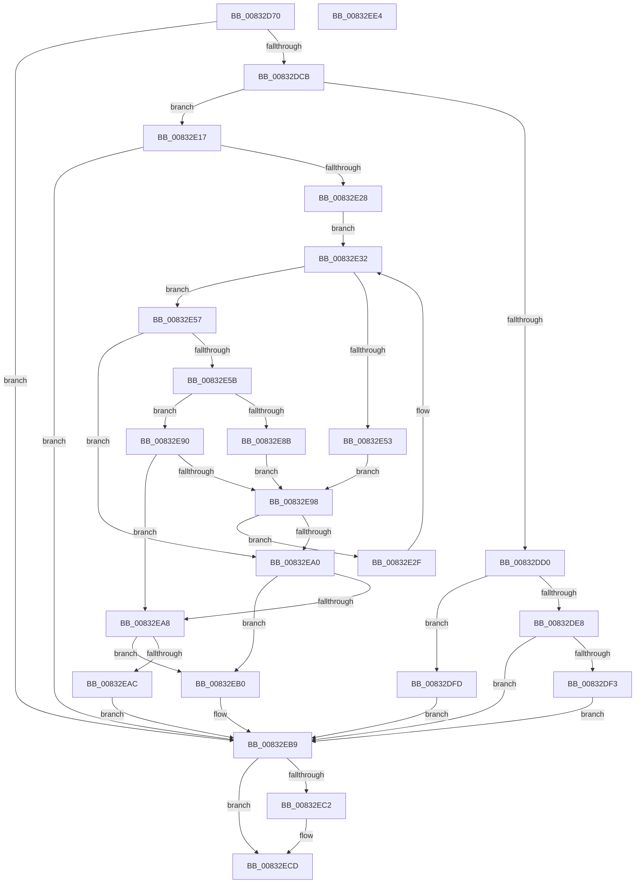

# DrvDbDeleteObjectRegKey

- RVA: `0x00832D70`–`0x00832EE5` (길이 `373` bytes)
- VA: `0x0000000140832D70`
- 실행 섹션: `PAGE`
- PDB 이름 있음: `예`; PDB Function 태그: `아니요`
- unwind 정보 RVA: `0x000DAC00`
- 디코드: `120`개 명령, `373/373` bytes 표시
- 미해석 바이트: `0` (있으면 어셈블리에 `.byte`로 보존)

> 이 문서는 커널 이미지의 기계어와 PDB 기호를 분석해 생성했습니다. 4번과 5번은 함수 원형과 자료형을 바이너리 사용 방식에서 추정한 C 해석이며 원본 소스 복구 결과는 아닙니다.

## 1. Dependencies

- 직접 호출 지점: **7**; 고유 호출 대상: **4**
- 직접 호출자로 확인된 함수: **4**
- RIP 상대 이미지 참조: **0**

### Outgoing calls
- `0x00832DB8` → [DrvDbGetObjectDatabaseNode](../93/DrvDbGetObjectDatabaseNode_function_00930228.md) (function, `0x00930228`)
- `0x00832DDD` → [DrvDbAcquireDatabaseNodeBaseKey](../93/DrvDbAcquireDatabaseNodeBaseKey_function_00930DE0.md) (function, `0x00930DE0`)
- `0x00832E0B` → [DrvDbDeleteObjectSubKey](DrvDbDeleteObjectSubKey_function_00832EEC.md) (function, `0x00832EEC`)
- `0x00832E42` → [DrvDbAcquireDatabaseNodeBaseKey](../93/DrvDbAcquireDatabaseNodeBaseKey_function_00930DE0.md) (function, `0x00930DE0`)
- `0x00832E6A` → [DrvDbDeleteObjectSubKey](DrvDbDeleteObjectSubKey_function_00832EEC.md) (function, `0x00832EEC`)
- `0x00832E7B` → [DrvDbReleaseDatabaseNodeBaseKey](../93/DrvDbReleaseDatabaseNodeBaseKey_function_00930D44.md) (function, `0x00930D44`)
- `0x00832EC8` → [DrvDbReleaseDatabaseNodeBaseKey](../93/DrvDbReleaseDatabaseNodeBaseKey_function_00930D44.md) (function, `0x00930D44`)

### Direct callers
- [DrvDbDispatchDeviceId](../92/DrvDbDispatchDeviceId_function_0092F490.md) at `0x0092F636`
- [DrvDbDispatchDriverInfFile](../92/DrvDbDispatchDriverInfFile_function_0092FE10.md) at `0x0092FFB0`
- [DrvDbDispatchDriverPackage](../93/DrvDbDispatchDriverPackage_function_009303A0.md) at `0x00930560`
- [DrvDbDispatchDriverFile](../AC/DrvDbDispatchDriverFile_function_00AC8880.md) at `0x00AC8A25`

### Static image references
- 디코드된 RIP-relative 메모리 참조가 없습니다.

## 2. Other-region calls and transfers

- 다른 실행 섹션으로 향하는 call: **0**
- 별도 외부 분기/꼬리 이동을 확인하지 못했습니다.

## 3. Assembly (complete function range)

```asm
00832D70  48 8B C4                        mov rax, rsp
00832D73  48 89 58 08                     mov qword ptr [rax + 8], rbx
00832D77  44 89 48 20                     mov dword ptr [rax + 0x20], r9d
00832D7B  4C 89 40 18                     mov qword ptr [rax + 0x18], r8
00832D7F  89 50 10                        mov dword ptr [rax + 0x10], edx
00832D82  55                              push rbp
00832D83  56                              push rsi
00832D84  57                              push rdi
00832D85  41 54                           push r12
00832D87  41 55                           push r13
00832D89  41 56                           push r14
00832D8B  41 57                           push r15
00832D8D  48 8B EC                        mov rbp, rsp
00832D90  48 83 EC 30                     sub rsp, 0x30
00832D94  49 8B C0                        mov rax, r8
00832D97  45 33 E4                        xor r12d, r12d
00832D9A  45 8B F1                        mov r14d, r9d
00832D9D  4C 89 65 F0                     mov qword ptr [rbp - 0x10], r12
00832DA1  8B FA                           mov edi, edx
00832DA3  4C 89 65 F8                     mov qword ptr [rbp - 8], r12
00832DA7  48 8B D0                        mov rdx, rax
00832DAA  4C 8D 4D F8                     lea r9, [rbp - 8]
00832DAE  4C 8D 45 50                     lea r8, [rbp + 0x50]
00832DB2  48 8B F1                        mov rsi, rcx
00832DB5  45 8A EC                        mov r13b, r12b
00832DB8  E8 6B D4 0F 00                  call 0x140930228
00832DBD  4C 8B 7D F8                     mov r15, qword ptr [rbp - 8]
00832DC1  8B D8                           mov ebx, eax
00832DC3  85 C0                           test eax, eax
00832DC5  0F 88 EE 00 00 00               js 0x140832eb9
00832DCB  4D 85 FF                        test r15, r15
00832DCE  74 47                           je 0x140832e17
00832DD0  4C 8D 4D F0                     lea r9, [rbp - 0x10]
00832DD4  44 8B C7                        mov r8d, edi
00832DD7  49 8B D7                        mov rdx, r15
00832DDA  48 8B CE                        mov rcx, rsi
00832DDD  E8 FE DF 0F 00                  call 0x140930de0
00832DE2  8B D8                           mov ebx, eax
00832DE4  85 C0                           test eax, eax
00832DE6  79 15                           jns 0x140832dfd
00832DE8  3D 67 04 00 C0                  cmp eax, 0xc0000467
00832DED  0F 85 C6 00 00 00               jne 0x140832eb9
00832DF3  BB A2 00 00 C0                  mov ebx, 0xc00000a2
00832DF8  E9 BC 00 00 00                  jmp 0x140832eb9
00832DFD  4C 8B 45 50                     mov r8, qword ptr [rbp + 0x50]
00832E01  45 8B CE                        mov r9d, r14d
00832E04  48 8B 55 F0                     mov rdx, qword ptr [rbp - 0x10]
00832E08  48 8B CE                        mov rcx, rsi
00832E0B  E8 DC 00 00 00                  call 0x140832eec
00832E10  8B D8                           mov ebx, eax
00832E12  E9 A2 00 00 00                  jmp 0x140832eb9
00832E17  4C 8D 66 10                     lea r12, [rsi + 0x10]
00832E1B  4D 8B 34 24                     mov r14, qword ptr [r12]
00832E1F  4D 3B F4                        cmp r14, r12
00832E22  0F 84 91 00 00 00               je 0x140832eb9
00832E28  BB A2 00 00 C0                  mov ebx, 0xc00000a2
00832E2D  EB 03                           jmp 0x140832e32
00832E2F  8B 7D 48                        mov edi, dword ptr [rbp + 0x48]
00832E32  4C 8D 4D F0                     lea r9, [rbp - 0x10]
00832E36  44 8B C7                        mov r8d, edi
00832E39  49 8B D6                        mov rdx, r14
00832E3C  48 8B CE                        mov rcx, rsi
00832E3F  4D 8B FE                        mov r15, r14
00832E42  E8 99 DF 0F 00                  call 0x140930de0
00832E47  45 33 C9                        xor r9d, r9d
00832E4A  8B F8                           mov edi, eax
00832E4C  3D 67 04 00 C0                  cmp eax, 0xc0000467
00832E51  75 04                           jne 0x140832e57
00832E53  8B FB                           mov edi, ebx
00832E55  EB 41                           jmp 0x140832e98
00832E57  85 C0                           test eax, eax
00832E59  78 45                           js 0x140832ea0
00832E5B  44 8B 4D 58                     mov r9d, dword ptr [rbp + 0x58]
00832E5F  48 8B CE                        mov rcx, rsi
00832E62  4C 8B 45 50                     mov r8, qword ptr [rbp + 0x50]
00832E66  48 8B 55 F0                     mov rdx, qword ptr [rbp - 0x10]
00832E6A  E8 7D 00 00 00                  call 0x140832eec
00832E6F  4C 8B 4D F0                     mov r9, qword ptr [rbp - 0x10]
00832E73  49 8B D6                        mov rdx, r14
00832E76  48 8B CE                        mov rcx, rsi
00832E79  8B F8                           mov edi, eax
00832E7B  E8 C4 DE 0F 00                  call 0x140930d44
00832E80  45 33 C9                        xor r9d, r9d
00832E83  4C 89 4D F0                     mov qword ptr [rbp - 0x10], r9
00832E87  85 FF                           test edi, edi
00832E89  78 05                           js 0x140832e90
00832E8B  41 B5 01                        mov r13b, 1
00832E8E  EB 08                           jmp 0x140832e98
00832E90  81 FF 34 00 00 C0               cmp edi, 0xc0000034
00832E96  75 10                           jne 0x140832ea8
00832E98  4D 8B 36                        mov r14, qword ptr [r14]
00832E9B  4D 3B F4                        cmp r14, r12
00832E9E  75 8F                           jne 0x140832e2f
00832EA0  81 FF 34 00 00 C0               cmp edi, 0xc0000034
00832EA6  74 08                           je 0x140832eb0
00832EA8  3B FB                           cmp edi, ebx
00832EAA  74 04                           je 0x140832eb0
00832EAC  8B DF                           mov ebx, edi
00832EAE  EB 09                           jmp 0x140832eb9
00832EB0  45 84 ED                        test r13b, r13b
00832EB3  8B DF                           mov ebx, edi
00832EB5  41 0F 45 D9                     cmovne ebx, r9d
00832EB9  4C 8B 4D F0                     mov r9, qword ptr [rbp - 0x10]
00832EBD  4D 85 C9                        test r9, r9
00832EC0  74 0B                           je 0x140832ecd
00832EC2  49 8B D7                        mov rdx, r15
00832EC5  48 8B CE                        mov rcx, rsi
00832EC8  E8 77 DE 0F 00                  call 0x140930d44
00832ECD  8B C3                           mov eax, ebx
00832ECF  48 8B 5C 24 70                  mov rbx, qword ptr [rsp + 0x70]
00832ED4  48 83 C4 30                     add rsp, 0x30
00832ED8  41 5F                           pop r15
00832EDA  41 5E                           pop r14
00832EDC  41 5D                           pop r13
00832EDE  41 5C                           pop r12
00832EE0  5F                              pop rdi
00832EE1  5E                              pop rsi
00832EE2  5D                              pop rbp
00832EE3  C3                              ret
00832EE4  CC                              int3
```

## 4. C-style interpretation (structured pseudocode)

```c
__int64 __fastcall DrvDbDeleteObjectRegKey(__int64 a1, int a2, __int64 a3, int a4)
{
    __int64 result;
    __int64 v_r12;
    __int64 v_rbx;
    __int64 v_rsp;
    unsigned __int64 v_stack_m40;
    unsigned __int64 v_stack_m48;
    unsigned int v_stack_p10;
    unsigned __int64 v_stack_p18;
    unsigned int v_stack_p20;
    unsigned __int64 v_stack_p8;

    *(unsigned __int64 *)(v_rsp + 8) = v_rbx;
    *(unsigned int *)(v_rsp + 32) = a4;
    *(unsigned __int64 *)(v_rsp + 24) = a3;
    *(unsigned int *)(v_rsp + 16) = a2;
    v_rsp = (v_rsp) - (48);
    v_r12 = 0;
    v_stack_m48 = 0;
    v_stack_m40 = 0;
    result = DrvDbGetObjectDatabaseNode(a1, a3, v_stack_p18, v_stack_m40);
    if (sign_flag) goto loc_00832EB9;
    if (v_stack_m40 == 0) goto loc_00832E17;
    result = DrvDbAcquireDatabaseNodeBaseKey(a1, v_stack_m40, (unsigned int)((unsigned int)((unsigned int)(a2))), v_stack_m48);
    if (!sign_flag) goto loc_00832DFD;
    if (((unsigned int)(result)) != 0xC0000467ULL) goto loc_00832EB9;
    goto loc_00832EB9;
loc_00832DFD:
    result = DrvDbDeleteObjectSubKey(a1, v_stack_m48, v_stack_p18, (unsigned int)((unsigned int)((unsigned int)(a4))));
    goto loc_00832EB9;
loc_00832E17:
    if ((*(unsigned __int64 *)(a1 + 16)) == (a1 + 16)) goto loc_00832EB9;
    goto loc_00832E32;
loc_00832E2F:
loc_00832E32:
    result = DrvDbAcquireDatabaseNodeBaseKey(a1, *(unsigned __int64 *)(a1 + 16), (unsigned int)((unsigned int)((unsigned int)(v_stack_p10))), v_stack_m48);
    a4 = 0;
    if (((unsigned int)(result)) != 0xC0000467ULL) goto loc_00832E57;
    goto loc_00832E98;
loc_00832E57:
    if (sign_flag) goto loc_00832EA0;
    result = DrvDbDeleteObjectSubKey(a1, v_stack_m48, v_stack_p18, (unsigned int)(v_stack_p20));
    result = DrvDbReleaseDatabaseNodeBaseKey(a1, *(unsigned __int64 *)(a1 + 16), v_stack_p18, v_stack_m48);
    a4 = 0;
    v_stack_m48 = 0;
    if (sign_flag) goto loc_00832E90;
    goto loc_00832E98;
loc_00832E90:
    if (((unsigned int)((unsigned int)((unsigned int)(result)))) != 0xC0000034ULL) goto loc_00832EA8;
loc_00832E98:
    if ((*(unsigned __int64 *)(*(unsigned __int64 *)(a1 + 16))) != (a1 + 16)) goto loc_00832E2F;
loc_00832EA0:
    if (((unsigned int)((unsigned int)((unsigned int)(result)))) == 0xC0000034ULL) goto loc_00832EB0;
loc_00832EA8:
    if (((unsigned int)((unsigned int)((unsigned int)(result)))) == ((unsigned int)((unsigned int)(0xC00000A2ULL)))) goto loc_00832EB0;
    goto loc_00832EB9;
loc_00832EB0:
    v_rbx = (unsigned int)((unsigned int)((unsigned int)((unsigned int)(result))));
    if (1 != 0) { v_rbx = 0; }
loc_00832EB9:
    if (v_stack_m48 != 0) {
        a2 = *(unsigned __int64 *)(a1 + 16);
        a1 = a1;
        result = DrvDbReleaseDatabaseNodeBaseKey(a1, a2, v_stack_p18, v_stack_m48);
    }
    v_rsp = (v_rsp) + (48);
    return (unsigned int)((unsigned int)(v_rbx));
}
```

## 5. (Beta) C Style

```c
int64_t DrvDbDeleteObjectRegKey(void *Arg1, int32_t Arg2, int64_t Arg3, int32_t Arg4)
{
    uint8_t *arg1 = (uint8_t *)Arg1;

    int64_t result;
    int64_t local_r12;
    int64_t local_rbx;
    int64_t local_rsp;
    uint64_t v_stack_m40;
    uint64_t v_stack_m48;
    uint32_t v_stack_p10;
    uint64_t v_stack_p18;
    uint32_t v_stack_p20;
    uint64_t v_stack_p8;

    *(uint64_t *)(local_rsp + 0x8) = local_rbx;
    *(uint32_t *)(local_rsp + 0x20) = Arg4;
    *(uint64_t *)(local_rsp + 0x18) = Arg3;
    *(uint32_t *)(local_rsp + 0x10) = Arg2;
    local_rsp = (local_rsp) - (48);
    local_r12 = 0;
    v_stack_m48 = 0;
    v_stack_m40 = 0;
    result = DrvDbGetObjectDatabaseNode(Arg1, Arg3, v_stack_p18, v_stack_m40);
    if (sign_flag) goto loc_00832EB9;
    if (v_stack_m40 == 0) goto loc_00832E17;
    result = DrvDbAcquireDatabaseNodeBaseKey(Arg1, v_stack_m40, (uint32_t)((uint32_t)((uint32_t)(Arg2))), v_stack_m48);
    if (!sign_flag) goto loc_00832DFD;
    if (((uint32_t)(result)) != 0xC0000467ULL) goto loc_00832EB9;
    goto loc_00832EB9;
loc_00832DFD:
    result = DrvDbDeleteObjectSubKey(Arg1, v_stack_m48, v_stack_p18, (uint32_t)((uint32_t)((uint32_t)(Arg4))));
    goto loc_00832EB9;
loc_00832E17:
    if ((*(uint64_t *)(arg1 + 0x10)) == (Arg1 + 16)) goto loc_00832EB9;
    goto loc_00832E32;
loc_00832E2F:
loc_00832E32:
    result = DrvDbAcquireDatabaseNodeBaseKey(Arg1, *(uint64_t *)(arg1 + 0x10), (uint32_t)((uint32_t)((uint32_t)(v_stack_p10))), v_stack_m48);
    Arg4 = 0;
    if (((uint32_t)(result)) != 0xC0000467ULL) goto loc_00832E57;
    goto loc_00832E98;
loc_00832E57:
    if (sign_flag) goto loc_00832EA0;
    result = DrvDbDeleteObjectSubKey(Arg1, v_stack_m48, v_stack_p18, (uint32_t)(v_stack_p20));
    result = DrvDbReleaseDatabaseNodeBaseKey(Arg1, *(uint64_t *)(arg1 + 0x10), v_stack_p18, v_stack_m48);
    Arg4 = 0;
    v_stack_m48 = 0;
    if (sign_flag) goto loc_00832E90;
    goto loc_00832E98;
loc_00832E90:
    if (((uint32_t)((uint32_t)((uint32_t)(result)))) != 0xC0000034ULL) goto loc_00832EA8;
loc_00832E98:
    if ((*(uint64_t *)(*(uint64_t *)(arg1 + 0x10))) != (Arg1 + 16)) goto loc_00832E2F;
loc_00832EA0:
    if (((uint32_t)((uint32_t)((uint32_t)(result)))) == 0xC0000034ULL) goto loc_00832EB0;
loc_00832EA8:
    if (((uint32_t)((uint32_t)((uint32_t)(result)))) == ((uint32_t)((uint32_t)(0xC00000A2ULL)))) goto loc_00832EB0;
    goto loc_00832EB9;
loc_00832EB0:
    local_rbx = (uint32_t)((uint32_t)((uint32_t)((uint32_t)(result))));
    if (1 != 0) { local_rbx = 0; }
loc_00832EB9:
    if (v_stack_m48 != 0) {
        Arg2 = *(uint64_t *)(arg1 + 0x10);
        Arg1 = Arg1;
        result = DrvDbReleaseDatabaseNodeBaseKey(Arg1, Arg2, v_stack_p18, v_stack_m48);
    }
    local_rsp = (local_rsp) + (48);
    return (uint32_t)((uint32_t)(local_rbx));
}
```

### 관측된 메모리 오프셋

구조체 형식이 확인되지 않은 접근은 인자 기준의 오프셋으로만 기록했습니다.

| 기준 인자 | 오프셋 표현 | 폭 (bit) | 접근 |
|---|---:|---:|---|
| `Arg1` | `+ 0x0` | `64` | `R` |
| `Arg1` | `+ 0x10` | `64` | `R` |

## 6. Execution-region graph

[열기: 2D/3D 그래프와 함수 탐색 컨트롤 패널](../../../control-panel.html?section=page&rva=0x00832D70&view=graph)

- 2D 그래프는 위에서 아래로 흐르고, 3D 그래프는 빈 공간을 드래그해 회전합니다. Shift+드래그는 이동, 휠은 확대·축소, 함수 노드 선택은 대상 보고서 이동입니다.

### Static fallback


