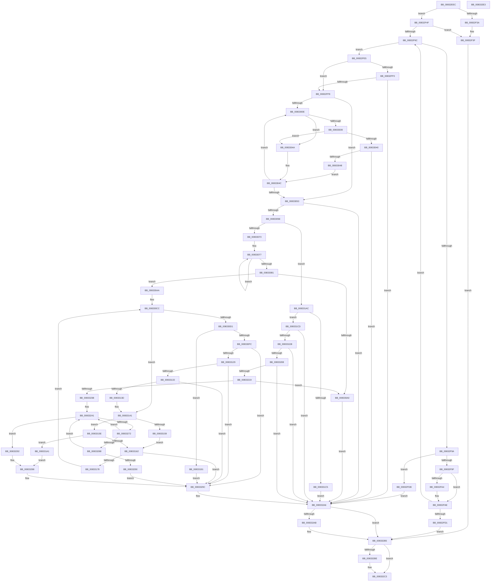

# DrvDbDeleteObjectSubKey

- RVA: `0x00832EEC`–`0x008332E4` (길이 `1,016` bytes)
- VA: `0x0000000140832EEC`
- 실행 섹션: `PAGE`
- PDB 이름 있음: `예`; PDB Function 태그: `아니요`
- unwind 정보 RVA: `0x000BE68C`
- 디코드: `275`개 명령, `1,016/1,016` bytes 표시
- 미해석 바이트: `0` (있으면 어셈블리에 `.byte`로 보존)

> 이 문서는 커널 이미지의 기계어와 PDB 기호를 분석해 생성했습니다. 4번과 5번은 함수 원형과 자료형을 바이너리 사용 방식에서 추정한 C 해석이며 원본 소스 복구 결과는 아닙니다.

## 1. Dependencies

- 직접 호출 지점: **22**; 고유 호출 대상: **14**
- 직접 호출자로 확인된 함수: **1**
- RIP 상대 이미지 참조: **0**

### Outgoing calls
- `0x00832F3A` → [PnpCtxRegDeleteTree](../96/PnpCtxRegDeleteTree_function_00965CC8.md) (function, `0x00965CC8`)
- `0x00832F63` → [PnpCtxRegOpenKey](../8E/PnpCtxRegOpenKey_function_008EF7B8.md) (function, `0x008EF7B8`)
- `0x00832F8C` → [PnpGetGenericStorePropertyKeys](../99/PnpGetGenericStorePropertyKeys_function_00992378.md) (function, `0x00992378`)
- `0x00832FA9` → [ExFreePoolWithTag](../../poolcode/B8/ExFreePoolWithTag_function_00B82870.md) (function, `0x00B82870`)
- `0x00832FC4` → [ExAllocatePool2](../../poolcode/B8/ExAllocatePool2_function_00B820F0.md) (function, `0x00B820F0`)
- `0x0083302B` → [PnpDeletePropertyWorker](../8F/PnpDeletePropertyWorker_function_008FE754.md) (function, `0x008FE754`)
- `0x00833065` → [wcschr](../../text/50/wcschr_function_00501A60.md) (function, `0x00501A60`)
- `0x00833093` → [ExAllocatePool2](../../poolcode/B8/ExAllocatePool2_function_00B820F0.md) (function, `0x00B820F0`)
- `0x008330C3` → [RtlStringCchCopyExW](../../text/41/RtlStringCchCopyExW_function_0041E1C0.md) (function, `0x0041E1C0`)
- `0x008330EF` → [PnpCtxRegOpenKey](../8E/PnpCtxRegOpenKey_function_008EF7B8.md) (function, `0x008EF7B8`)
- `0x0083311A` → [PnpCtxRegQueryInfoKey](../99/PnpCtxRegQueryInfoKey_function_009945FC.md) (function, `0x009945FC`)
- `0x0083314B` → [PnpCtxRegDeleteKey](../96/PnpCtxRegDeleteKey_function_00965EC8.md) (function, `0x00965EC8`)
- `0x0083316A` → [wcsrchr](../../text/50/wcsrchr_function_00501E50.md) (function, `0x00501E50`)
- `0x00833180` → [ZwClose](../../text/6A/ZwClose_function_006AD2B0.md) (function, `0x006AD2B0`)
- `0x008331B7` → [PnpCtxRegDeleteKey](../96/PnpCtxRegDeleteKey_function_00965EC8.md) (function, `0x00965EC8`)
- `0x008331F9` → [PnpCtxRegQueryInfoKey](../99/PnpCtxRegQueryInfoKey_function_009945FC.md) (function, `0x009945FC`)
- `0x0083322A` → [ExAllocatePool2](../../poolcode/B8/ExAllocatePool2_function_00B820F0.md) (function, `0x00B820F0`)
- `0x00833267` → [PnpCtxRegEnumValue](../99/PnpCtxRegEnumValue_function_0099364C.md) (function, `0x0099364C`)
- `0x00833279` → [PnpCtxRegDeleteValue](../8F/PnpCtxRegDeleteValue_function_008FE5E0.md) (function, `0x008FE5E0`)
- `0x008332A1` → [ExFreePoolWithTag](../../poolcode/B8/ExFreePoolWithTag_function_00B82870.md) (function, `0x00B82870`)
- `0x008332B0` → [ExFreePoolWithTag](../../poolcode/B8/ExFreePoolWithTag_function_00B82870.md) (function, `0x00B82870`)
- `0x008332BE` → [ZwClose](../../text/6A/ZwClose_function_006AD2B0.md) (function, `0x006AD2B0`)

### Direct callers
- [DrvDbDeleteObjectRegKey](DrvDbDeleteObjectRegKey_function_00832D70.md) at `0x00832E0B`
- [DrvDbDeleteObjectRegKey](DrvDbDeleteObjectRegKey_function_00832D70.md) at `0x00832E6A`

### Static image references
- 디코드된 RIP-relative 메모리 참조가 없습니다.

## 2. Other-region calls and transfers

- 다른 실행 섹션으로 향하는 call: **11**
  - `0x00832FA9` → [ExFreePoolWithTag](../../poolcode/B8/ExFreePoolWithTag_function_00B82870.md) (`PAGE` → `POOLCODE`)
  - `0x00832FC4` → [ExAllocatePool2](../../poolcode/B8/ExAllocatePool2_function_00B820F0.md) (`PAGE` → `POOLCODE`)
  - `0x00833065` → [wcschr](../../text/50/wcschr_function_00501A60.md) (`PAGE` → `.text`)
  - `0x00833093` → [ExAllocatePool2](../../poolcode/B8/ExAllocatePool2_function_00B820F0.md) (`PAGE` → `POOLCODE`)
  - `0x008330C3` → [RtlStringCchCopyExW](../../text/41/RtlStringCchCopyExW_function_0041E1C0.md) (`PAGE` → `.text`)
  - `0x0083316A` → [wcsrchr](../../text/50/wcsrchr_function_00501E50.md) (`PAGE` → `.text`)
  - `0x00833180` → [ZwClose](../../text/6A/ZwClose_function_006AD2B0.md) (`PAGE` → `.text`)
  - `0x0083322A` → [ExAllocatePool2](../../poolcode/B8/ExAllocatePool2_function_00B820F0.md) (`PAGE` → `POOLCODE`)
  - `0x008332A1` → [ExFreePoolWithTag](../../poolcode/B8/ExFreePoolWithTag_function_00B82870.md) (`PAGE` → `POOLCODE`)
  - `0x008332B0` → [ExFreePoolWithTag](../../poolcode/B8/ExFreePoolWithTag_function_00B82870.md) (`PAGE` → `POOLCODE`)
  - `0x008332BE` → [ZwClose](../../text/6A/ZwClose_function_006AD2B0.md) (`PAGE` → `.text`)
- 별도 외부 분기/꼬리 이동을 확인하지 못했습니다.

## 3. Assembly (complete function range)

```asm
00832EEC  48 89 5C 24 08                  mov qword ptr [rsp + 8], rbx
00832EF1  48 89 74 24 10                  mov qword ptr [rsp + 0x10], rsi
00832EF6  48 89 7C 24 18                  mov qword ptr [rsp + 0x18], rdi
00832EFB  55                              push rbp
00832EFC  41 54                           push r12
00832EFE  41 55                           push r13
00832F00  41 56                           push r14
00832F02  41 57                           push r15
00832F04  48 8B EC                        mov rbp, rsp
00832F07  48 83 EC 60                     sub rsp, 0x60
00832F0B  45 33 FF                        xor r15d, r15d
00832F0E  4C 8B E1                        mov r12, rcx
00832F11  48 8B 09                        mov rcx, qword ptr [rcx]
00832F14  4D 8B F0                        mov r14, r8
00832F17  4C 89 7D F0                     mov qword ptr [rbp - 0x10], r15
00832F1B  4C 8B EA                        mov r13, rdx
00832F1E  44 89 7D E0                     mov dword ptr [rbp - 0x20], r15d
00832F22  41 8B FF                        mov edi, r15d
00832F25  44 89 7D E8                     mov dword ptr [rbp - 0x18], r15d
00832F29  41 8B F7                        mov esi, r15d
00832F2C  44 89 7D 48                     mov dword ptr [rbp + 0x48], r15d
00832F30  44 89 7D EC                     mov dword ptr [rbp - 0x14], r15d
00832F34  41 83 F9 01                     cmp r9d, 1
00832F38  77 15                           ja 0x140832f4f
00832F3A  E8 89 2D 13 00                  call 0x140965cc8
00832F3F  3D 7C 01 00 C0                  cmp eax, 0xc000017c
00832F44  41 8B DF                        mov ebx, r15d
00832F47  0F 45 D8                        cmovne ebx, eax
00832F4A  E9 66 03 00 00                  jmp 0x1408332b5
00832F4F  48 8D 45 F0                     lea rax, [rbp - 0x10]
00832F53  45 33 C9                        xor r9d, r9d
00832F56  48 89 44 24 28                  mov qword ptr [rsp + 0x28], rax
00832F5B  C7 44 24 20 1F 00 03 00         mov dword ptr [rsp + 0x20], 0x3001f
00832F63  E8 50 C8 0B 00                  call 0x1408ef7b8
00832F68  85 C0                           test eax, eax
00832F6A  78 D3                           js 0x140832f3f
00832F6C  48 8B 55 F0                     mov rdx, qword ptr [rbp - 0x10]
00832F70  48 8D 45 E0                     lea rax, [rbp - 0x20]
00832F74  49 8B 0C 24                     mov rcx, qword ptr [r12]
00832F78  45 33 C9                        xor r9d, r9d
00832F7B  48 89 44 24 30                  mov qword ptr [rsp + 0x30], rax
00832F80  45 33 C0                        xor r8d, r8d
00832F83  89 74 24 28                     mov dword ptr [rsp + 0x28], esi
00832F87  48 89 7C 24 20                  mov qword ptr [rsp + 0x20], rdi
00832F8C  E8 E7 F3 15 00                  call 0x140992378
00832F91  8B D8                           mov ebx, eax
00832F93  3D 23 00 00 C0                  cmp eax, 0xc0000023
00832F98  75 4B                           jne 0x140832fe5
00832F9A  39 75 E0                        cmp dword ptr [rbp - 0x20], esi
00832F9D  76 3C                           jbe 0x140832fdb
00832F9F  48 85 FF                        test rdi, rdi
00832FA2  74 0A                           je 0x140832fae
00832FA4  33 D2                           xor edx, edx
00832FA6  48 8B CF                        mov rcx, rdi
00832FA9  E8 C2 F8 34 00                  call 0x140b82870
00832FAE  8B 75 E0                        mov esi, dword ptr [rbp - 0x20]
00832FB1  B9 00 01 00 00                  mov ecx, 0x100
00832FB6  41 B8 50 44 44 42               mov r8d, 0x42444450
00832FBC  48 8D 14 B6                     lea rdx, [rsi + rsi*4]
00832FC0  48 C1 E2 02                     shl rdx, 2
00832FC4  E8 27 F1 34 00                  call 0x140b820f0
00832FC9  48 8B F8                        mov rdi, rax
00832FCC  48 85 C0                        test rax, rax
00832FCF  75 9B                           jne 0x140832f6c
00832FD1  BB 17 00 00 C0                  mov ebx, 0xc0000017
00832FD6  E9 DA 02 00 00                  jmp 0x1408332b5
00832FDB  BB E5 00 00 C0                  mov ebx, 0xc00000e5
00832FE0  E9 C1 02 00 00                  jmp 0x1408332a6
00832FE5  BA 25 02 00 C0                  mov edx, 0xc0000225
00832FEA  8B C8                           mov ecx, eax
00832FEC  3B C2                           cmp eax, edx
00832FEE  74 08                           je 0x140832ff8
00832FF0  85 C0                           test eax, eax
00832FF2  0F 88 AE 02 00 00               js 0x1408332a6
00832FF8  3B DA                           cmp ebx, edx
00832FFA  44 0F 45 FE                     cmovne r15d, esi
00832FFE  33 C0                           xor eax, eax
00833000  33 F6                           xor esi, esi
00833002  3B DA                           cmp ebx, edx
00833004  0F 45 C1                        cmovne eax, ecx
00833007  8B D8                           mov ebx, eax
00833009  45 85 FF                        test r15d, r15d
0083300C  74 45                           je 0x140833053
0083300E  83 64 24 30 00                  and dword ptr [rsp + 0x30], 0
00833013  48 8D 0C B6                     lea rcx, [rsi + rsi*4]
00833017  48 8B 55 F0                     mov rdx, qword ptr [rbp - 0x10]
0083301B  4C 8D 0C 8F                     lea r9, [rdi + rcx*4]
0083301F  49 8B 0C 24                     mov rcx, qword ptr [r12]
00833023  45 33 C0                        xor r8d, r8d
00833026  83 64 24 20 00                  and dword ptr [rsp + 0x20], 0
0083302B  E8 24 B7 0C 00                  call 0x1408fe754
00833030  8B D8                           mov ebx, eax
00833032  3D 25 02 00 C0                  cmp eax, 0xc0000225
00833037  74 11                           je 0x14083304a
00833039  3D 22 00 00 C0                  cmp eax, 0xc0000022
0083303E  74 0A                           je 0x14083304a
00833040  85 C0                           test eax, eax
00833042  0F 88 5E 02 00 00               js 0x1408332a6
00833048  EB 02                           jmp 0x14083304c
0083304A  33 DB                           xor ebx, ebx
0083304C  FF C6                           inc esi
0083304E  41 3B F7                        cmp esi, r15d
00833051  72 BB                           jb 0x14083300e
00833053  45 33 FF                        xor r15d, r15d
00833056  85 DB                           test ebx, ebx
00833058  0F 88 48 02 00 00               js 0x1408332a6
0083305E  41 8D 57 5C                     lea edx, [r15 + 0x5c]
00833062  49 8B CE                        mov rcx, r14
00833065  E8 F6 E9 CC FF                  call 0x140501a60
0083306A  48 85 C0                        test rax, rax
0083306D  0F 84 39 01 00 00               je 0x1408331ac
00833073  48 83 CB FF                     or rbx, 0xffffffffffffffff
00833077  48 FF C3                        inc rbx
0083307A  66 45 39 3C 5E                  cmp word ptr [r14 + rbx*2], r15w
0083307F  75 F6                           jne 0x140833077
00833081  48 FF C3                        inc rbx
00833084  B9 00 01 00 00                  mov ecx, 0x100
00833089  41 B8 50 44 44 42               mov r8d, 0x42444450
0083308F  48 8D 14 1B                     lea rdx, [rbx + rbx]
00833093  E8 58 F0 34 00                  call 0x140b820f0
00833098  48 8B F0                        mov rsi, rax
0083309B  48 85 C0                        test rax, rax
0083309E  75 0A                           jne 0x1408330aa
008330A0  BB 17 00 00 C0                  mov ebx, 0xc0000017
008330A5  E9 FC 01 00 00                  jmp 0x1408332a6
008330AA  C7 44 24 28 00 09 00 00         mov dword ptr [rsp + 0x28], 0x900
008330B2  45 33 C9                        xor r9d, r9d
008330B5  4D 8B C6                        mov r8, r14
008330B8  4C 89 7C 24 20                  mov qword ptr [rsp + 0x20], r15
008330BD  48 8B D3                        mov rdx, rbx
008330C0  48 8B CE                        mov rcx, rsi
008330C3  E8 F8 B0 BE FF                  call 0x14041e1c0
008330C8  48 8B 45 F0                     mov rax, qword ptr [rbp - 0x10]
008330CC  48 85 C0                        test rax, rax
008330CF  75 70                           jne 0x140833141
008330D1  49 8B 0C 24                     mov rcx, qword ptr [r12]
008330D5  48 8D 45 F0                     lea rax, [rbp - 0x10]
008330D9  48 89 44 24 28                  mov qword ptr [rsp + 0x28], rax
008330DE  45 33 C9                        xor r9d, r9d
008330E1  4C 8B C6                        mov r8, rsi
008330E4  C7 44 24 20 1F 00 03 00         mov dword ptr [rsp + 0x20], 0x3001f
008330EC  49 8B D5                        mov rdx, r13
008330EF  E8 C4 C6 0B 00                  call 0x1408ef7b8
008330F4  85 C0                           test eax, eax
008330F6  0F 88 95 00 00 00               js 0x140833191
008330FC  48 8B 55 F0                     mov rdx, qword ptr [rbp - 0x10]
00833100  48 8D 45 48                     lea rax, [rbp + 0x48]
00833104  4C 89 7C 24 30                  mov qword ptr [rsp + 0x30], r15
00833109  4C 8D 45 E8                     lea r8, [rbp - 0x18]
0083310D  4C 89 7C 24 28                  mov qword ptr [rsp + 0x28], r15
00833112  45 33 C9                        xor r9d, r9d
00833115  48 89 44 24 20                  mov qword ptr [rsp + 0x20], rax
0083311A  E8 DD 14 16 00                  call 0x1409945fc
0083311F  8B D8                           mov ebx, eax
00833121  85 C0                           test eax, eax
00833123  0F 88 73 01 00 00               js 0x14083329c
00833129  44 39 7D E8                     cmp dword ptr [rbp - 0x18], r15d
0083312D  0F 87 69 01 00 00               ja 0x14083329c
00833133  44 39 7D 48                     cmp dword ptr [rbp + 0x48], r15d
00833137  0F 87 5F 01 00 00               ja 0x14083329c
0083313D  48 8B 45 F0                     mov rax, qword ptr [rbp - 0x10]
00833141  49 8B 0C 24                     mov rcx, qword ptr [r12]
00833145  45 33 C0                        xor r8d, r8d
00833148  48 8B D0                        mov rdx, rax
0083314B  E8 78 2D 13 00                  call 0x140965ec8
00833150  8B D8                           mov ebx, eax
00833152  3D 7C 01 00 C0                  cmp eax, 0xc000017c
00833157  75 05                           jne 0x14083315e
00833159  41 8B DF                        mov ebx, r15d
0083315C  EB 04                           jmp 0x140833162
0083315E  85 DB                           test ebx, ebx
00833160  78 3F                           js 0x1408331a1
00833162  BA 5C 00 00 00                  mov edx, 0x5c
00833167  48 8B CE                        mov rcx, rsi
0083316A  E8 E1 EC CC FF                  call 0x140501e50
0083316F  48 85 C0                        test rax, rax
00833172  0F 84 24 01 00 00               je 0x14083329c
00833178  66 44 89 38                     mov word ptr [rax], r15w
0083317C  48 8B 4D F0                     mov rcx, qword ptr [rbp - 0x10]
00833180  E8 2B A1 E7 FF                  call 0x1406ad2b0
00833185  49 8B C7                        mov rax, r15
00833188  48 89 45 F0                     mov qword ptr [rbp - 0x10], rax
0083318C  E9 3B FF FF FF                  jmp 0x1408330cc
00833191  3D 7C 01 00 C0                  cmp eax, 0xc000017c
00833196  41 8B DF                        mov ebx, r15d
00833199  0F 45 D8                        cmovne ebx, eax
0083319C  E9 FB 00 00 00                  jmp 0x14083329c
008331A1  81 FB 21 01 00 C0               cmp ebx, 0xc0000121
008331A7  E9 EC 00 00 00                  jmp 0x140833298
008331AC  48 8B 55 F0                     mov rdx, qword ptr [rbp - 0x10]
008331B0  45 33 C0                        xor r8d, r8d
008331B3  49 8B 0C 24                     mov rcx, qword ptr [r12]
008331B7  E8 0C 2D 13 00                  call 0x140965ec8
008331BC  8B D8                           mov ebx, eax
008331BE  3D 7C 01 00 C0                  cmp eax, 0xc000017c
008331C3  75 08                           jne 0x1408331cd
008331C5  41 8B DF                        mov ebx, r15d
008331C8  E9 D9 00 00 00                  jmp 0x1408332a6
008331CD  3D 21 01 00 C0                  cmp eax, 0xc0000121
008331D2  0F 85 CE 00 00 00               jne 0x1408332a6
008331D8  48 8B 55 F0                     mov rdx, qword ptr [rbp - 0x10]
008331DC  48 8D 45 EC                     lea rax, [rbp - 0x14]
008331E0  4C 89 7C 24 30                  mov qword ptr [rsp + 0x30], r15
008331E5  45 33 C9                        xor r9d, r9d
008331E8  48 89 44 24 28                  mov qword ptr [rsp + 0x28], rax
008331ED  45 33 C0                        xor r8d, r8d
008331F0  48 8D 45 48                     lea rax, [rbp + 0x48]
008331F4  48 89 44 24 20                  mov qword ptr [rsp + 0x20], rax
008331F9  E8 FE 13 16 00                  call 0x1409945fc
008331FE  8B D8                           mov ebx, eax
00833200  85 C0                           test eax, eax
00833202  0F 88 9E 00 00 00               js 0x1408332a6
00833208  44 8B 75 EC                     mov r14d, dword ptr [rbp - 0x14]
0083320C  41 FF C6                        inc r14d
0083320F  44 39 7D 48                     cmp dword ptr [rbp + 0x48], r15d
00833213  0F 86 8D 00 00 00               jbe 0x1408332a6
00833219  41 8B D6                        mov edx, r14d
0083321C  B9 00 01 00 00                  mov ecx, 0x100
00833221  48 03 D2                        add rdx, rdx
00833224  41 B8 50 44 44 42               mov r8d, 0x42444450
0083322A  E8 C1 EE 34 00                  call 0x140b820f0
0083322F  48 8B F0                        mov rsi, rax
00833232  48 85 C0                        test rax, rax
00833235  0F 84 65 FE FF FF               je 0x1408330a0
0083323B  41 BC 00 00 00 80               mov r12d, 0x80000000
00833241  48 8B 55 F0                     mov rdx, qword ptr [rbp - 0x10]
00833245  48 8D 45 48                     lea rax, [rbp + 0x48]
00833249  4C 89 7C 24 38                  mov qword ptr [rsp + 0x38], r15
0083324E  4C 8B CE                        mov r9, rsi
00833251  4C 89 7C 24 30                  mov qword ptr [rsp + 0x30], r15
00833256  45 33 C0                        xor r8d, r8d
00833259  4C 89 7C 24 28                  mov qword ptr [rsp + 0x28], r15
0083325E  48 89 44 24 20                  mov qword ptr [rsp + 0x20], rax
00833263  44 89 75 48                     mov dword ptr [rbp + 0x48], r14d
00833267  E8 E0 03 16 00                  call 0x14099364c
0083326C  8B D8                           mov ebx, eax
0083326E  85 C0                           test eax, eax
00833270  78 20                           js 0x140833292
00833272  48 8B 55 F0                     mov rdx, qword ptr [rbp - 0x10]
00833276  4C 8B C6                        mov r8, rsi
00833279  E8 62 B3 0C 00                  call 0x1408fe5e0
0083327E  8B D8                           mov ebx, eax
00833280  41 03 C4                        add eax, r12d
00833283  41 85 C4                        test r12d, eax
00833286  75 B9                           jne 0x140833241
00833288  81 FB 34 00 00 C0               cmp ebx, 0xc0000034
0083328E  74 B1                           je 0x140833241
00833290  EB 0A                           jmp 0x14083329c
00833292  81 FB 1A 00 00 80               cmp ebx, 0x8000001a
00833298  41 0F 44 DF                     cmove ebx, r15d
0083329C  33 D2                           xor edx, edx
0083329E  48 8B CE                        mov rcx, rsi
008332A1  E8 CA F5 34 00                  call 0x140b82870
008332A6  48 85 FF                        test rdi, rdi
008332A9  74 0A                           je 0x1408332b5
008332AB  33 D2                           xor edx, edx
008332AD  48 8B CF                        mov rcx, rdi
008332B0  E8 BB F5 34 00                  call 0x140b82870
008332B5  48 8B 4D F0                     mov rcx, qword ptr [rbp - 0x10]
008332B9  48 85 C9                        test rcx, rcx
008332BC  74 05                           je 0x1408332c3
008332BE  E8 ED 9F E7 FF                  call 0x1406ad2b0
008332C3  4C 8D 5C 24 60                  lea r11, [rsp + 0x60]
008332C8  8B C3                           mov eax, ebx
008332CA  49 8B 5B 30                     mov rbx, qword ptr [r11 + 0x30]
008332CE  49 8B 73 38                     mov rsi, qword ptr [r11 + 0x38]
008332D2  49 8B 7B 40                     mov rdi, qword ptr [r11 + 0x40]
008332D6  49 8B E3                        mov rsp, r11
008332D9  41 5F                           pop r15
008332DB  41 5E                           pop r14
008332DD  41 5D                           pop r13
008332DF  41 5C                           pop r12
008332E1  5D                              pop rbp
008332E2  C3                              ret
008332E3  CC                              int3
```

## 4. C-style interpretation (structured pseudocode)

```c
__int64 __fastcall DrvDbDeleteObjectSubKey(__int64 a1, __int64 a2, __int64 a3, int a4)
{
    __int64 result;
    __int64 v_r14;
    __int64 v_r15;
    __int64 v_rbx;
    __int64 v_rsi;
    __int64 v_rsp;
    unsigned __int64 v_stack_m28;
    unsigned __int64 v_stack_m38;
    unsigned int v_stack_m3C;
    unsigned int v_stack_m40;
    unsigned int v_stack_m48;
    unsigned __int64 v_stack_m50;
    unsigned __int64 v_stack_m58;
    unsigned __int64 v_stack_m60;
    unsigned int v_stack_m68;
    unsigned __int64 v_stack_p10;
    unsigned __int64 v_stack_p18;
    unsigned int v_stack_p20;
    unsigned __int64 v_stack_p8;

    v_stack_p8 = v_rbx;
    v_stack_p10 = v_rsi;
    v_stack_p18 = v_rdi;
    v_rsp = (v_rsp) - (96);
    v_r15 = 0;
    v_stack_m38 = 0;
    v_stack_m48 = 0;
    v_stack_m40 = 0;
    v_stack_p20 = 0;
    v_stack_m3C = 0;
    if (a4 > 1) goto loc_00832F4F;
    result = PnpCtxRegDeleteTree(*(unsigned __int64 *)(a1), a2, a3, a4);
loc_00832F3F:
    v_rbx = 0;
    if (((unsigned int)(result)) != 0xC000017CULL) { v_rbx = (unsigned int)(result); }
    goto loc_008332B5;
loc_00832F4F:
    a4 = 0;
    v_stack_m60 = v_stack_m38;
    v_stack_m68 = 0x3001FULL;
    result = PnpCtxRegOpenKey(*(unsigned __int64 *)(a1), a2, a3, a4);
    if (sign_flag) goto loc_00832F3F;
loc_00832F6C:
    a4 = 0;
    v_stack_m58 = v_stack_m48;
    a3 = 0;
    v_stack_m60 = 0;
    v_stack_m68 = 0;
    result = PnpGetGenericStorePropertyKeys(*(unsigned __int64 *)(a1), v_stack_m38, a3, a4);
    if (((unsigned int)(result)) != 0xC0000023ULL) goto loc_00832FE5;
    if (v_stack_m48 <= 0) goto loc_00832FDB;
    if (0 != 0) {
        a2 = 0;
        a1 = 0;
        result = ExFreePoolWithTag(a1, a2, a3, a4);
    }
    a2 = ((unsigned int)(v_stack_m48) + (unsigned int)(v_stack_m48) * 4) << (2);
    result = ExAllocatePool2(256, a2, (unsigned int)(0x42444450ULL), a4);
    if (result != 0) goto loc_00832F6C;
    goto loc_008332B5;
loc_00832FDB:
    goto loc_008332A6;
loc_00832FE5:
    if (((unsigned int)(result)) == ((unsigned int)((unsigned int)(0xC0000225ULL)))) goto loc_00832FF8;
    if (sign_flag) goto loc_008332A6;
loc_00832FF8:
    if (((unsigned int)((unsigned int)(0xC00000E5ULL))) != ((unsigned int)((unsigned int)(0xC0000225ULL)))) { v_r15 = (unsigned int)((unsigned int)(v_stack_m48)); }
    result = 0;
    v_rsi = 0;
    if (((unsigned int)((unsigned int)(0xC00000E5ULL))) != ((unsigned int)((unsigned int)(0xC0000225ULL)))) { result = (unsigned int)((unsigned int)((unsigned int)(result))); }
    if ((unsigned int)(v_r15) == 0) goto loc_00833053;
loc_0083300E:
    a3 = 0;
    result = PnpDeletePropertyWorker(*(unsigned __int64 *)(a1), v_stack_m38, a3, result + v_rsi + v_rsi * 4 * 4);
    if (((unsigned int)(result)) == 0xC0000225ULL) goto loc_0083304A;
    if (((unsigned int)(result)) == 0xC0000022ULL) goto loc_0083304A;
    if (sign_flag) goto loc_008332A6;
    goto loc_0083304C;
loc_0083304A:
    v_rbx = 0;
loc_0083304C:
    v_rsi = (unsigned int)((v_rsi) + 1);
    if (((unsigned int)(v_rsi)) < ((unsigned int)(v_r15))) goto loc_0083300E;
loc_00833053:
    v_r15 = 0;
    if (sign_flag) goto loc_008332A6;
    result = wcschr(0, v_r15 + 92, a3, result + v_rsi + v_rsi * 4 * 4);
    if (result == 0) goto loc_008331AC;
    v_rbx = (v_rbx) | (-1);
loc_00833077:
    v_rbx = (v_rbx) + 1;
    if ((*(unsigned __int16 *)(a3 + v_rbx * 2)) != 0) goto loc_00833077;
    v_rbx = (v_rbx) + 1;
    result = ExAllocatePool2(256, v_rbx + v_rbx * 1, (unsigned int)(0x42444450ULL), result + v_rsi + v_rsi * 4 * 4);
    if (result != 0) goto loc_008330AA;
loc_008330A0:
    goto loc_008332A6;
loc_008330AA:
    v_stack_m60 = 0x900ULL;
    a4 = 0;
    v_stack_m68 = 0;
    result = RtlStringCchCopyExW(result, (unsigned int)(0xC0000017ULL), 0, a4);
loc_008330CC:
    if (v_stack_m38 != 0) goto loc_00833141;
    v_stack_m60 = v_stack_m38;
    a4 = 0;
    v_stack_m68 = 0x3001FULL;
    result = PnpCtxRegOpenKey(*(unsigned __int64 *)(a1), a2, result, a4);
    if (sign_flag) goto loc_00833191;
    v_stack_m58 = 0;
    v_stack_m60 = 0;
    a4 = 0;
    v_stack_m68 = v_stack_p20;
    result = PnpCtxRegQueryInfoKey(*(unsigned __int64 *)(a1), v_stack_m38, v_stack_m40, a4);
    if (sign_flag) goto loc_0083329C;
    if (v_stack_m40 > 0) goto loc_0083329C;
    if (v_stack_p20 > 0) goto loc_0083329C;
loc_00833141:
    a3 = 0;
    result = PnpCtxRegDeleteKey(*(unsigned __int64 *)(a1), v_stack_m38, a3, a4);
    if (((unsigned int)(result)) != 0xC000017CULL) goto loc_0083315E;
    goto loc_00833162;
loc_0083315E:
    if (sign_flag) goto loc_008331A1;
loc_00833162:
    result = wcsrchr(result, 92, a3, a4);
    if (result == 0) goto loc_0083329C;
    *(unsigned __int16 *)(result) = 0;
    result = ZwClose(v_stack_m38, 92, a3, a4);
    v_stack_m38 = 0;
    goto loc_008330CC;
loc_00833191:
    v_rbx = 0;
    if (0 != 0xC000017CULL) { v_rbx = 0; }
    goto loc_0083329C;
loc_008331A1:
    goto loc_00833298;
loc_008331AC:
    a3 = 0;
    result = PnpCtxRegDeleteKey(*(unsigned __int64 *)(a1), v_stack_m38, a3, a4);
    if (((unsigned int)(result)) != 0xC000017CULL) goto loc_008331CD;
    goto loc_008332A6;
loc_008331CD:
    if (((unsigned int)(result)) != 0xC0000121ULL) goto loc_008332A6;
    v_stack_m58 = 0;
    a4 = 0;
    v_stack_m60 = v_stack_m3C;
    a3 = 0;
    v_stack_m68 = v_stack_p20;
    result = PnpCtxRegQueryInfoKey(*(unsigned __int64 *)(a1), v_stack_m38, a3, a4);
    if (sign_flag) goto loc_008332A6;
    v_r14 = (unsigned int)(((unsigned int)(v_stack_m3C)) + 1);
    if (v_stack_p20 <= 0) goto loc_008332A6;
    a2 = ((unsigned int)((unsigned int)(v_r14))) + ((unsigned int)((unsigned int)(v_r14)));
    result = ExAllocatePool2(256, a2, (unsigned int)(0x42444450ULL), a4);
    if (result == 0) goto loc_008330A0;
loc_00833241:
    v_stack_m50 = 0;
    v_stack_m58 = 0;
    a3 = 0;
    v_stack_m60 = 0;
    v_stack_m68 = v_stack_p20;
    v_stack_p20 = (unsigned int)(v_r14);
    result = PnpCtxRegEnumValue(256, v_stack_m38, a3, result);
    if (sign_flag) goto loc_00833292;
    result = PnpCtxRegDeleteValue(256, v_stack_m38, result, result);
    result = (unsigned int)((result) + ((unsigned int)((unsigned int)(0x80000000ULL))));
    if ((((unsigned int)((unsigned int)(0x80000000ULL))) & ((unsigned int)(result))) != 0) goto loc_00833241;
    if (((unsigned int)((unsigned int)((unsigned int)(result)))) == 0xC0000034ULL) goto loc_00833241;
    goto loc_0083329C;
loc_00833292:
loc_00833298:
    v_rbx = (unsigned int)((unsigned int)(result));
    if (((unsigned int)((unsigned int)((unsigned int)(result)))) == 0x8000001AULL) { v_rbx = 0; }
loc_0083329C:
    a2 = 0;
    result = ExFreePoolWithTag(result, a2, result, result);
loc_008332A6:
    if (result != 0) {
        a2 = 0;
        a1 = result;
        result = ExFreePoolWithTag(a1, a2, result, result);
    }
    if (v_stack_m38 != 0) {
        result = ZwClose(v_stack_m38, a2, result, result);
    }
    return (unsigned int)((unsigned int)(v_rbx));
}
```

## 5. (Beta) C Style

```c
int64_t DrvDbDeleteObjectSubKey(void *Arg1, int64_t Arg2, void *Arg3, int32_t Arg4)
{
    uint8_t *arg1 = (uint8_t *)Arg1;
    uint8_t *arg3 = (uint8_t *)Arg3;

    int64_t result;
    int64_t local_r14;
    int64_t local_r15;
    int64_t local_rbx;
    int64_t local_rsi;
    int64_t local_rsp;
    uint64_t v_stack_m28;
    uint64_t v_stack_m38;
    uint32_t v_stack_m3C;
    uint32_t v_stack_m40;
    uint32_t v_stack_m48;
    uint64_t v_stack_m50;
    uint64_t v_stack_m58;
    uint64_t v_stack_m60;
    uint32_t v_stack_m68;
    uint64_t v_stack_p10;
    uint64_t v_stack_p18;
    uint32_t v_stack_p20;
    uint64_t v_stack_p8;

    v_stack_p8 = local_rbx;
    v_stack_p10 = local_rsi;
    v_stack_p18 = local_rdi;
    local_rsp = (local_rsp) - (96);
    local_r15 = 0;
    v_stack_m38 = 0;
    v_stack_m48 = 0;
    v_stack_m40 = 0;
    v_stack_p20 = 0;
    v_stack_m3C = 0;
    if (Arg4 > 1) goto loc_00832F4F;
    result = PnpCtxRegDeleteTree(*(uint64_t *)(arg1), Arg2, Arg3, Arg4);
loc_00832F3F:
    local_rbx = 0;
    if (((uint32_t)(result)) != 0xC000017CULL) { local_rbx = (uint32_t)(result); }
    goto loc_008332B5;
loc_00832F4F:
    Arg4 = 0;
    v_stack_m60 = v_stack_m38;
    v_stack_m68 = 0x3001FULL;
    result = PnpCtxRegOpenKey(*(uint64_t *)(arg1), Arg2, Arg3, Arg4);
    if (sign_flag) goto loc_00832F3F;
loc_00832F6C:
    Arg4 = 0;
    v_stack_m58 = v_stack_m48;
    Arg3 = 0;
    v_stack_m60 = 0;
    v_stack_m68 = 0;
    result = PnpGetGenericStorePropertyKeys(*(uint64_t *)(arg1), v_stack_m38, Arg3, Arg4);
    if (((uint32_t)(result)) != 0xC0000023ULL) goto loc_00832FE5;
    if (v_stack_m48 <= 0) goto loc_00832FDB;
    if (0 != 0) {
        Arg2 = 0;
        Arg1 = 0;
        result = ExFreePoolWithTag(Arg1, Arg2, Arg3, Arg4);
    }
    Arg2 = ((uint32_t)(v_stack_m48) + (uint32_t)(v_stack_m48) * 4) << (2);
    result = ExAllocatePool2(256, Arg2, (uint32_t)(0x42444450ULL), Arg4);
    if (result != 0) goto loc_00832F6C;
    goto loc_008332B5;
loc_00832FDB:
    goto loc_008332A6;
loc_00832FE5:
    if (((uint32_t)(result)) == ((uint32_t)((uint32_t)(0xC0000225ULL)))) goto loc_00832FF8;
    if (sign_flag) goto loc_008332A6;
loc_00832FF8:
    if (((uint32_t)((uint32_t)(0xC00000E5ULL))) != ((uint32_t)((uint32_t)(0xC0000225ULL)))) { local_r15 = (uint32_t)((uint32_t)(v_stack_m48)); }
    result = 0;
    local_rsi = 0;
    if (((uint32_t)((uint32_t)(0xC00000E5ULL))) != ((uint32_t)((uint32_t)(0xC0000225ULL)))) { result = (uint32_t)((uint32_t)((uint32_t)(result))); }
    if ((uint32_t)(local_r15) == 0) goto loc_00833053;
loc_0083300E:
    Arg3 = 0;
    result = PnpDeletePropertyWorker(*(uint64_t *)(arg1), v_stack_m38, Arg3, result + local_rsi + local_rsi * 4 * 4);
    if (((uint32_t)(result)) == 0xC0000225ULL) goto loc_0083304A;
    if (((uint32_t)(result)) == 0xC0000022ULL) goto loc_0083304A;
    if (sign_flag) goto loc_008332A6;
    goto loc_0083304C;
loc_0083304A:
    local_rbx = 0;
loc_0083304C:
    local_rsi = (uint32_t)((local_rsi) + 1);
    if (((uint32_t)(local_rsi)) < ((uint32_t)(local_r15))) goto loc_0083300E;
loc_00833053:
    local_r15 = 0;
    if (sign_flag) goto loc_008332A6;
    result = wcschr(0, local_r15 + 92, Arg3, result + local_rsi + local_rsi * 4 * 4);
    if (result == 0) goto loc_008331AC;
    local_rbx = (local_rbx) | (-1);
loc_00833077:
    local_rbx = (local_rbx) + 1;
    if ((*(uint16_t *)(arg3 + local_rbx * 2)) != 0) goto loc_00833077;
    local_rbx = (local_rbx) + 1;
    result = ExAllocatePool2(256, local_rbx + local_rbx * 1, (uint32_t)(0x42444450ULL), result + local_rsi + local_rsi * 4 * 4);
    if (result != 0) goto loc_008330AA;
loc_008330A0:
    goto loc_008332A6;
loc_008330AA:
    v_stack_m60 = 0x900ULL;
    Arg4 = 0;
    v_stack_m68 = 0;
    result = RtlStringCchCopyExW(result, (uint32_t)(0xC0000017ULL), 0, Arg4);
loc_008330CC:
    if (v_stack_m38 != 0) goto loc_00833141;
    v_stack_m60 = v_stack_m38;
    Arg4 = 0;
    v_stack_m68 = 0x3001FULL;
    result = PnpCtxRegOpenKey(*(uint64_t *)(arg1), Arg2, result, Arg4);
    if (sign_flag) goto loc_00833191;
    v_stack_m58 = 0;
    v_stack_m60 = 0;
    Arg4 = 0;
    v_stack_m68 = v_stack_p20;
    result = PnpCtxRegQueryInfoKey(*(uint64_t *)(arg1), v_stack_m38, v_stack_m40, Arg4);
    if (sign_flag) goto loc_0083329C;
    if (v_stack_m40 > 0) goto loc_0083329C;
    if (v_stack_p20 > 0) goto loc_0083329C;
loc_00833141:
    Arg3 = 0;
    result = PnpCtxRegDeleteKey(*(uint64_t *)(arg1), v_stack_m38, Arg3, Arg4);
    if (((uint32_t)(result)) != 0xC000017CULL) goto loc_0083315E;
    goto loc_00833162;
loc_0083315E:
    if (sign_flag) goto loc_008331A1;
loc_00833162:
    result = wcsrchr(result, 92, Arg3, Arg4);
    if (result == 0) goto loc_0083329C;
    *(uint16_t *)(result) = 0;
    result = ZwClose(v_stack_m38, 92, Arg3, Arg4);
    v_stack_m38 = 0;
    goto loc_008330CC;
loc_00833191:
    local_rbx = 0;
    if (0 != 0xC000017CULL) { local_rbx = 0; }
    goto loc_0083329C;
loc_008331A1:
    goto loc_00833298;
loc_008331AC:
    Arg3 = 0;
    result = PnpCtxRegDeleteKey(*(uint64_t *)(arg1), v_stack_m38, Arg3, Arg4);
    if (((uint32_t)(result)) != 0xC000017CULL) goto loc_008331CD;
    goto loc_008332A6;
loc_008331CD:
    if (((uint32_t)(result)) != 0xC0000121ULL) goto loc_008332A6;
    v_stack_m58 = 0;
    Arg4 = 0;
    v_stack_m60 = v_stack_m3C;
    Arg3 = 0;
    v_stack_m68 = v_stack_p20;
    result = PnpCtxRegQueryInfoKey(*(uint64_t *)(arg1), v_stack_m38, Arg3, Arg4);
    if (sign_flag) goto loc_008332A6;
    local_r14 = (uint32_t)(((uint32_t)(v_stack_m3C)) + 1);
    if (v_stack_p20 <= 0) goto loc_008332A6;
    Arg2 = ((uint32_t)((uint32_t)(local_r14))) + ((uint32_t)((uint32_t)(local_r14)));
    result = ExAllocatePool2(256, Arg2, (uint32_t)(0x42444450ULL), Arg4);
    if (result == 0) goto loc_008330A0;
loc_00833241:
    v_stack_m50 = 0;
    v_stack_m58 = 0;
    Arg3 = 0;
    v_stack_m60 = 0;
    v_stack_m68 = v_stack_p20;
    v_stack_p20 = (uint32_t)(local_r14);
    result = PnpCtxRegEnumValue(256, v_stack_m38, Arg3, result);
    if (sign_flag) goto loc_00833292;
    result = PnpCtxRegDeleteValue(256, v_stack_m38, result, result);
    result = (uint32_t)((result) + ((uint32_t)((uint32_t)(0x80000000ULL))));
    if ((((uint32_t)((uint32_t)(0x80000000ULL))) & ((uint32_t)(result))) != 0) goto loc_00833241;
    if (((uint32_t)((uint32_t)((uint32_t)(result)))) == 0xC0000034ULL) goto loc_00833241;
    goto loc_0083329C;
loc_00833292:
loc_00833298:
    local_rbx = (uint32_t)((uint32_t)(result));
    if (((uint32_t)((uint32_t)((uint32_t)(result)))) == 0x8000001AULL) { local_rbx = 0; }
loc_0083329C:
    Arg2 = 0;
    result = ExFreePoolWithTag(result, Arg2, result, result);
loc_008332A6:
    if (result != 0) {
        Arg2 = 0;
        Arg1 = result;
        result = ExFreePoolWithTag(Arg1, Arg2, result, result);
    }
    if (v_stack_m38 != 0) {
        result = ZwClose(v_stack_m38, Arg2, result, result);
    }
    return (uint32_t)((uint32_t)(local_rbx));
}
```

### 관측된 메모리 오프셋

구조체 형식이 확인되지 않은 접근은 인자 기준의 오프셋으로만 기록했습니다.

| 기준 인자 | 오프셋 표현 | 폭 (bit) | 접근 |
|---|---:|---:|---|
| `Arg1` | `+ 0x0` | `64` | `R` |
| `Arg3` | `+ 0x0 + rbx*2` | `16` | `R` |

## 6. Execution-region graph

[열기: 2D/3D 그래프와 함수 탐색 컨트롤 패널](../../../control-panel.html?section=page&rva=0x00832EEC&view=graph)

- 2D 그래프는 위에서 아래로 흐르고, 3D 그래프는 빈 공간을 드래그해 회전합니다. Shift+드래그는 이동, 휠은 확대·축소, 함수 노드 선택은 대상 보고서 이동입니다.

### Static fallback


