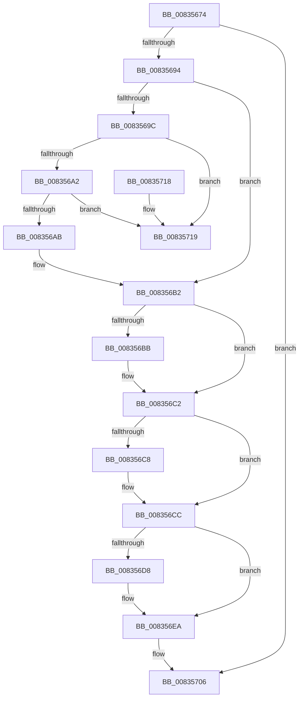

# DrvDbDestroyDatabaseNode

- RVA: `0x00835674`–`0x00835720` (길이 `172` bytes)
- VA: `0x0000000140835674`
- 실행 섹션: `PAGE`
- PDB 이름 있음: `예`; PDB Function 태그: `아니요`
- unwind 정보 RVA: `0x0006383C`
- 디코드: `52`개 명령, `172/172` bytes 표시
- 미해석 바이트: `0` (있으면 어셈블리에 `.byte`로 보존)

> 이 문서는 커널 이미지의 기계어와 PDB 기호를 분석해 생성했습니다. 4번과 5번은 함수 원형과 자료형을 바이너리 사용 방식에서 추정한 C 해석이며 원본 소스 복구 결과는 아닙니다.

## 1. Dependencies

- 직접 호출 지점: **6**; 고유 호출 대상: **4**
- 직접 호출자로 확인된 함수: **5**
- RIP 상대 이미지 참조: **0**

### Outgoing calls
- `0x00835689` → [DrvDbUnloadDatabaseNode](../93/DrvDbUnloadDatabaseNode_function_0093183C.md) (function, `0x0093183C`)
- `0x008356DB` → [ExDeleteResourceLite](../../text/38/ExDeleteResourceLite_function_0038BA60.md) (function, `0x0038BA60`)
- `0x008356E5` → [ExFreePoolWithTag](../../poolcode/B8/ExFreePoolWithTag_function_00B82870.md) (function, `0x00B82870`)
- `0x008356EE` → [RtlFreeAnsiString](../9C/RtlFreeAnsiString_function_009C0800.md) (function, `0x009C0800`)
- `0x008356F7` → [RtlFreeAnsiString](../9C/RtlFreeAnsiString_function_009C0800.md) (function, `0x009C0800`)
- `0x00835701` → [ExFreePoolWithTag](../../poolcode/B8/ExFreePoolWithTag_function_00B82870.md) (function, `0x00B82870`)

### Direct callers
- [DrvDbOpenContext](DrvDbOpenContext_function_00834F8C.md) at `0x008350F1`
- [DrvDbUnregisterDatabase](DrvDbUnregisterDatabase_function_008352E0.md) at `0x00835329`
- [DrvDbCreateDatabaseNode](DrvDbCreateDatabaseNode_function_0083533C.md) at `0x00835422`
- [DrvDbOpenDriverDatabaseRegKey](../AA/DrvDbOpenDriverDatabaseRegKey_function_00AA0FB8.md) at `0x00AA10CE`
- [sub_00B1D6D0](../B1/Unknown_function_00B1D6D0.md) at `0x00B1D741`

### Static image references
- 디코드된 RIP-relative 메모리 참조가 없습니다.

## 2. Other-region calls and transfers

- 다른 실행 섹션으로 향하는 call: **3**
  - `0x008356DB` → [ExDeleteResourceLite](../../text/38/ExDeleteResourceLite_function_0038BA60.md) (`PAGE` → `.text`)
  - `0x008356E5` → [ExFreePoolWithTag](../../poolcode/B8/ExFreePoolWithTag_function_00B82870.md) (`PAGE` → `POOLCODE`)
  - `0x00835701` → [ExFreePoolWithTag](../../poolcode/B8/ExFreePoolWithTag_function_00B82870.md) (`PAGE` → `POOLCODE`)
- 별도 외부 분기/꼬리 이동을 확인하지 못했습니다.

## 3. Assembly (complete function range)

```asm
00835674  48 89 5C 24 08                  mov qword ptr [rsp + 8], rbx
00835679  48 89 74 24 10                  mov qword ptr [rsp + 0x10], rsi
0083567E  57                              push rdi
0083567F  48 83 EC 20                     sub rsp, 0x20
00835683  48 8B DA                        mov rbx, rdx
00835686  48 8B F9                        mov rdi, rcx
00835689  E8 AE C1 0F 00                  call 0x14093183c
0083568E  8B F0                           mov esi, eax
00835690  85 C0                           test eax, eax
00835692  78 72                           js 0x140835706
00835694  48 8B 13                        mov rdx, qword ptr [rbx]
00835697  48 85 D2                        test rdx, rdx
0083569A  74 16                           je 0x1408356b2
0083569C  48 39 5A 08                     cmp qword ptr [rdx + 8], rbx
008356A0  75 77                           jne 0x140835719
008356A2  48 8B 43 08                     mov rax, qword ptr [rbx + 8]
008356A6  48 39 18                        cmp qword ptr [rax], rbx
008356A9  75 6E                           jne 0x140835719
008356AB  48 89 10                        mov qword ptr [rax], rdx
008356AE  48 89 42 08                     mov qword ptr [rdx + 8], rax
008356B2  48 8B 47 20                     mov rax, qword ptr [rdi + 0x20]
008356B6  48 3B C3                        cmp rax, rbx
008356B9  75 07                           jne 0x1408356c2
008356BB  48 83 67 20 00                  and qword ptr [rdi + 0x20], 0
008356C0  33 C0                           xor eax, eax
008356C2  48 39 5F 28                     cmp qword ptr [rdi + 0x28], rbx
008356C6  75 04                           jne 0x1408356cc
008356C8  48 89 47 28                     mov qword ptr [rdi + 0x28], rax
008356CC  48 8B BB 98 00 00 00            mov rdi, qword ptr [rbx + 0x98]
008356D3  48 85 FF                        test rdi, rdi
008356D6  74 12                           je 0x1408356ea
008356D8  48 8B CF                        mov rcx, rdi
008356DB  E8 80 63 B5 FF                  call 0x14038ba60
008356E0  33 D2                           xor edx, edx
008356E2  48 8B CF                        mov rcx, rdi
008356E5  E8 86 D1 34 00                  call 0x140b82870
008356EA  48 8D 4B 10                     lea rcx, [rbx + 0x10]
008356EE  E8 0D B1 18 00                  call 0x1409c0800
008356F3  48 8D 4B 30                     lea rcx, [rbx + 0x30]
008356F7  E8 04 B1 18 00                  call 0x1409c0800
008356FC  33 D2                           xor edx, edx
008356FE  48 8B CB                        mov rcx, rbx
00835701  E8 6A D1 34 00                  call 0x140b82870
00835706  48 8B 5C 24 30                  mov rbx, qword ptr [rsp + 0x30]
0083570B  8B C6                           mov eax, esi
0083570D  48 8B 74 24 38                  mov rsi, qword ptr [rsp + 0x38]
00835712  48 83 C4 20                     add rsp, 0x20
00835716  5F                              pop rdi
00835717  C3                              ret
00835718  CC                              int3
00835719  B9 03 00 00 00                  mov ecx, 3
0083571E  CD 29                           int 0x29
```

## 4. C-style interpretation (structured pseudocode)

```c
__int64 __fastcall DrvDbDestroyDatabaseNode(__int64 a1, __int64 a2)
{
    __int64 result;
    __int64 v_rsp;
    unsigned __int64 v_stack_p10;
    unsigned __int64 v_stack_p8;

    v_stack_p8 = v_rbx;
    v_stack_p10 = v_rsi;
    v_rsp = (v_rsp) - (32);
    result = DrvDbUnloadDatabaseNode(a1, a2, a3, a4);
    if (sign_flag) goto loc_00835706;
    if (*(unsigned __int64 *)(a2) == 0) goto loc_008356B2;
    if ((*(unsigned __int64 *)(*(unsigned __int64 *)(a2) + 8)) != a2) goto loc_00835719;
    if ((*(unsigned __int64 *)(*(unsigned __int64 *)(a2 + 8))) != a2) goto loc_00835719;
    *(unsigned __int64 *)(*(unsigned __int64 *)(a2 + 8)) = *(unsigned __int64 *)(a2);
    *(unsigned __int64 *)(*(unsigned __int64 *)(a2) + 8) = *(unsigned __int64 *)(a2 + 8);
loc_008356B2:
    result = *(unsigned __int64 *)(a1 + 32);
    if ((*(unsigned __int64 *)(a1 + 32)) == a2) {
        result = 0;
    }
    if ((*(unsigned __int64 *)(a1 + 40)) == a2) {
        *(unsigned __int64 *)(a1 + 40) = 0;
    }
    if (*(unsigned __int64 *)(a2 + 152) != 0) {
        a1 = *(unsigned __int64 *)(a2 + 152);
        result = ExDeleteResourceLite(a1, *(unsigned __int64 *)(a2), a3, a4);
        a2 = 0;
        a1 = *(unsigned __int64 *)(a2 + 152);
        result = ExFreePoolWithTag(a1, a2, a3, a4);
    }
    result = RtlFreeAnsiString(a2 + 16, a2, a3, a4);
    result = RtlFreeAnsiString(a2 + 48, a2, a3, a4);
    a2 = 0;
    result = ExFreePoolWithTag(0, a2, a3, a4);
loc_00835706:
    v_rsp = (v_rsp) + (32);
    return (unsigned int)((unsigned int)((unsigned int)((unsigned int)(result))));
loc_00835719:
    return (unsigned int)((unsigned int)((unsigned int)((unsigned int)(result))));
}
```

## 5. (Beta) C Style

```c
int64_t DrvDbDestroyDatabaseNode(void *Arg1, void *Arg2)
{
    uint8_t *arg1 = (uint8_t *)Arg1;
    uint8_t *arg2 = (uint8_t *)Arg2;

    int64_t result;
    int64_t local_rsp;
    uint64_t v_stack_p10;
    uint64_t v_stack_p8;

    v_stack_p8 = local_rbx;
    v_stack_p10 = local_rsi;
    local_rsp = (local_rsp) - (32);
    result = DrvDbUnloadDatabaseNode(Arg1, Arg2, a3, a4);
    if (sign_flag) goto loc_00835706;
    if (*(uint64_t *)(arg2) == 0) goto loc_008356B2;
    if ((*(uint64_t *)(*(uint64_t *)(arg2) + 0x8)) != Arg2) goto loc_00835719;
    if ((*(uint64_t *)(*(uint64_t *)(arg2 + 0x8))) != Arg2) goto loc_00835719;
    *(uint64_t *)(*(uint64_t *)(arg2 + 0x8)) = *(uint64_t *)(arg2);
    *(uint64_t *)(*(uint64_t *)(arg2) + 0x8) = *(uint64_t *)(arg2 + 0x8);
loc_008356B2:
    result = *(uint64_t *)(arg1 + 0x20);
    if ((*(uint64_t *)(arg1 + 0x20)) == Arg2) {
        result = 0;
    }
    if ((*(uint64_t *)(arg1 + 0x28)) == Arg2) {
        *(uint64_t *)(arg1 + 0x28) = 0;
    }
    if (*(uint64_t *)(arg2 + 0x98) != 0) {
        Arg1 = *(uint64_t *)(arg2 + 0x98);
        result = ExDeleteResourceLite(Arg1, *(uint64_t *)(arg2), a3, a4);
        Arg2 = 0;
        Arg1 = *(uint64_t *)(arg2 + 0x98);
        result = ExFreePoolWithTag(Arg1, Arg2, a3, a4);
    }
    result = RtlFreeAnsiString(Arg2 + 16, Arg2, a3, a4);
    result = RtlFreeAnsiString(Arg2 + 48, Arg2, a3, a4);
    Arg2 = 0;
    result = ExFreePoolWithTag(0, Arg2, a3, a4);
loc_00835706:
    local_rsp = (local_rsp) + (32);
    return (uint32_t)((uint32_t)((uint32_t)((uint32_t)(result))));
loc_00835719:
    return (uint32_t)((uint32_t)((uint32_t)((uint32_t)(result))));
}
```

### 관측된 메모리 오프셋

구조체 형식이 확인되지 않은 접근은 인자 기준의 오프셋으로만 기록했습니다.

| 기준 인자 | 오프셋 표현 | 폭 (bit) | 접근 |
|---|---:|---:|---|
| `Arg1` | `+ 0x20` | `64` | `R` |
| `Arg1` | `+ 0x20` | `64` | `R/W` |
| `Arg1` | `+ 0x28` | `64` | `R` |
| `Arg1` | `+ 0x28` | `64` | `W` |
| `Arg2` | `+ 0x0` | `64` | `R` |
| `Arg2` | `+ 0x8` | `64` | `R` |
| `Arg2` | `+ 0x10` | `64` | `R` |
| `Arg2` | `+ 0x30` | `64` | `R` |
| `Arg2` | `+ 0x98` | `64` | `R` |

## 6. Execution-region graph

[열기: 2D/3D 그래프와 함수 탐색 컨트롤 패널](../../../control-panel.html?section=page&rva=0x00835674&view=graph)

- 2D 그래프는 위에서 아래로 흐르고, 3D 그래프는 빈 공간을 드래그해 회전합니다. Shift+드래그는 이동, 휠은 확대·축소, 함수 노드 선택은 대상 보고서 이동입니다.

### Static fallback


