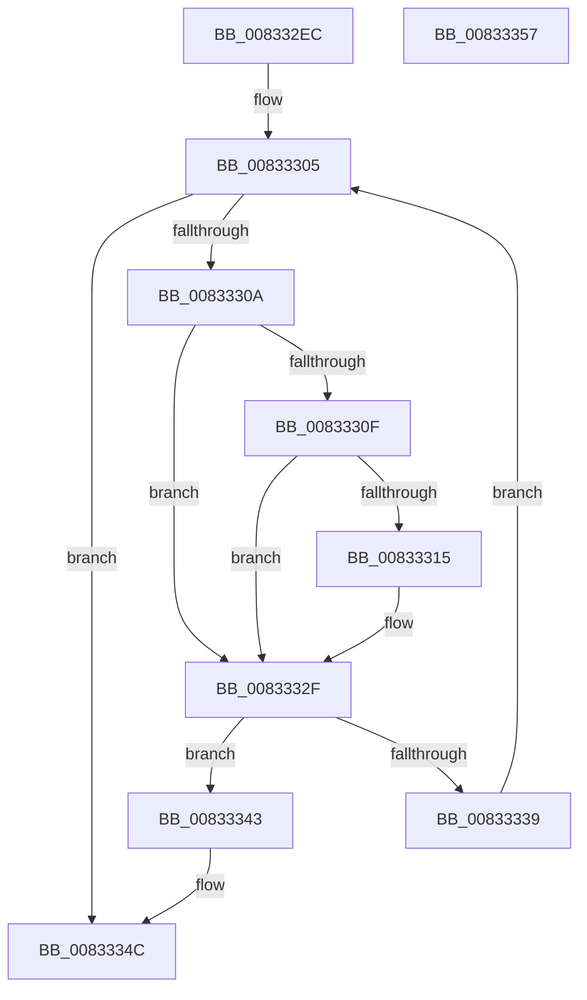

# DrvDbGetCompositeMappedPropertyKeys

- RVA: `0x008332EC`–`0x00833358` (길이 `108` bytes)
- VA: `0x00000001408332EC`
- 실행 섹션: `PAGE`
- PDB 이름 있음: `예`; PDB Function 태그: `아니요`
- unwind 정보 RVA: `0x000950EC`
- 디코드: `34`개 명령, `108/108` bytes 표시
- 미해석 바이트: `0` (있으면 어셈블리에 `.byte`로 보존)

> 이 문서는 커널 이미지의 기계어와 PDB 기호를 분석해 생성했습니다. 4번과 5번은 함수 원형과 자료형을 바이너리 사용 방식에서 추정한 C 해석이며 원본 소스 복구 결과는 아닙니다.

## 1. Dependencies

- 직접 호출 지점: **0**; 고유 호출 대상: **0**
- 직접 호출자로 확인된 함수: **4**
- RIP 상대 이미지 참조: **0**

### Outgoing calls
- 직접 디코드된 call 명령이 없습니다.

### Direct callers
- [DrvDbGetDeviceIdMappedPropertyKeys](DrvDbGetDeviceIdMappedPropertyKeys_function_00833360.md) at `0x00833408`
- [DrvDbGetDriverFileMappedPropertyKeys](DrvDbGetDriverFileMappedPropertyKeys_function_008338FC.md) at `0x00833952`
- [DrvDbGetDriverInfFileMappedPropertyKeys](DrvDbGetDriverInfFileMappedPropertyKeys_function_00833A18.md) at `0x00833A6E`
- [DrvDbGetDriverPackageMappedPropertyKeys](DrvDbGetDriverPackageMappedPropertyKeys_function_00833B34.md) at `0x00833B91`

### Static image references
- 디코드된 RIP-relative 메모리 참조가 없습니다.

## 2. Other-region calls and transfers

- 다른 실행 섹션으로 향하는 call: **0**
- 별도 외부 분기/꼬리 이동을 확인하지 못했습니다.

## 3. Assembly (complete function range)

```asm
008332EC  48 89 5C 24 08                  mov qword ptr [rsp + 8], rbx
008332F1  48 89 7C 24 10                  mov qword ptr [rsp + 0x10], rdi
008332F6  4C 8B 54 24 30                  mov r10, qword ptr [rsp + 0x30]
008332FB  33 C0                           xor eax, eax
008332FD  33 DB                           xor ebx, ebx
008332FF  48 8B FA                        mov rdi, rdx
00833302  45 33 DB                        xor r11d, r11d
00833305  45 3B D8                        cmp r11d, r8d
00833308  73 42                           jae 0x14083334c
0083330A  4D 85 C9                        test r9, r9
0083330D  74 20                           je 0x14083332f
0083330F  3B 5C 24 28                     cmp ebx, dword ptr [rsp + 0x28]
00833313  73 1A                           jae 0x14083332f
00833315  4A 8B 14 DF                     mov rdx, qword ptr [rdi + r11*8]
00833319  48 8D 0C 9B                     lea rcx, [rbx + rbx*4]
0083331D  FF C3                           inc ebx
0083331F  0F 10 02                        movups xmm0, xmmword ptr [rdx]
00833322  41 0F 11 04 89                  movups xmmword ptr [r9 + rcx*4], xmm0
00833327  8B 42 10                        mov eax, dword ptr [rdx + 0x10]
0083332A  41 89 44 89 10                  mov dword ptr [r9 + rcx*4 + 0x10], eax
0083332F  41 8B 02                        mov eax, dword ptr [r10]
00833332  8D 48 01                        lea ecx, [rax + 1]
00833335  3B C8                           cmp ecx, eax
00833337  72 0A                           jb 0x140833343
00833339  33 C0                           xor eax, eax
0083333B  41 89 0A                        mov dword ptr [r10], ecx
0083333E  41 FF C3                        inc r11d
00833341  EB C2                           jmp 0x140833305
00833343  41 83 22 00                     and dword ptr [r10], 0
00833347  B8 95 00 00 C0                  mov eax, 0xc0000095
0083334C  48 8B 5C 24 08                  mov rbx, qword ptr [rsp + 8]
00833351  48 8B 7C 24 10                  mov rdi, qword ptr [rsp + 0x10]
00833356  C3                              ret
00833357  CC                              int3
```

## 4. C-style interpretation (structured pseudocode)

```c
__int64 __fastcall DrvDbGetCompositeMappedPropertyKeys(__int64 a1, __int64 a2, int a3, __int64 a4, unsigned int a5, __int64 a6)
{
    __int64 result;
    __int64 v_r11;
    __int64 v_rbx;
    unsigned __int64 v_stack_p10;
    unsigned __int64 v_stack_p8;

    v_stack_p8 = v_rbx;
    v_stack_p10 = v_rdi;
    result = 0;
    v_rbx = 0;
    v_r11 = 0;
loc_00833305:
    if (0 >= a3) goto loc_0083334C;
    if (a4 == 0) goto loc_0083332F;
    if (0 < a5) {
        a2 = *(unsigned __int64 *)(a2 + v_r11 * 8);
        a1 = v_rbx + v_rbx * 4;
        v_rbx = (unsigned int)((v_rbx) + 1);
        *(unsigned __int64 *)(a4 + a1 * 4) = v_xmm0;
        result = *(unsigned int *)(a2 + 16);
        *(unsigned int *)(a4 + a1 * 4 + 16) = (unsigned int)(result);
    }
    if (((unsigned int)((unsigned int)(*(unsigned int *)(a6)) + 1)) < ((unsigned int)((unsigned int)(*(unsigned int *)(a6))))) goto loc_00833343;
    result = 0;
    *(unsigned int *)(a6) = (unsigned int)((unsigned int)(*(unsigned int *)(a6)) + 1);
    v_r11 = (unsigned int)((v_r11) + 1);
    goto loc_00833305;
loc_00833343:
loc_0083334C:
    return (unsigned int)(0xC0000095ULL);
}
```

## 5. (Beta) C Style

```c
int64_t DrvDbGetCompositeMappedPropertyKeys(int64_t Arg1, void *Arg2, int32_t Arg3, int64_t Arg4, uint32_t Arg5, void *Arg6)
{
    uint8_t *arg2 = (uint8_t *)Arg2;
    uint8_t *arg6 = (uint8_t *)Arg6;

    int64_t result;
    int64_t local_r11;
    int64_t local_rbx;
    uint64_t v_stack_p10;
    uint64_t v_stack_p8;

    v_stack_p8 = local_rbx;
    v_stack_p10 = local_rdi;
    result = 0;
    local_rbx = 0;
    local_r11 = 0;
loc_00833305:
    if (0 >= Arg3) goto loc_0083334C;
    if (Arg4 == 0) goto loc_0083332F;
    if (0 < Arg5) {
        Arg2 = *(uint64_t *)(arg2 + local_r11 * 8);
        Arg1 = local_rbx + local_rbx * 4;
        local_rbx = (uint32_t)((local_rbx) + 1);
        *(uint64_t *)(Arg4 + Arg1 * 4) = v_xmm0;
        result = *(uint32_t *)(arg2 + 0x10);
        *(uint32_t *)(Arg4 + Arg1 * 4 + 0x10) = (uint32_t)(result);
    }
    if (((uint32_t)((uint32_t)(*(uint32_t *)(arg6)) + 1)) < ((uint32_t)((uint32_t)(*(uint32_t *)(arg6))))) goto loc_00833343;
    result = 0;
    *(uint32_t *)(arg6) = (uint32_t)((uint32_t)(*(uint32_t *)(arg6)) + 1);
    local_r11 = (uint32_t)((local_r11) + 1);
    goto loc_00833305;
loc_00833343:
loc_0083334C:
    return (uint32_t)(0xC0000095ULL);
}
```

### 관측된 메모리 오프셋

구조체 형식이 확인되지 않은 접근은 인자 기준의 오프셋으로만 기록했습니다.

| 기준 인자 | 오프셋 표현 | 폭 (bit) | 접근 |
|---|---:|---:|---|
| `Arg2` | `+ 0x0 + r11*8` | `64` | `R` |
| `Arg6` | `+ 0x0` | `32` | `R` |
| `Arg6` | `+ 0x0` | `32` | `R/W` |
| `Arg6` | `+ 0x0` | `32` | `W` |

## 6. Execution-region graph

[열기: 2D/3D 그래프와 함수 탐색 컨트롤 패널](../../../control-panel.html?section=page&rva=0x008332EC&view=graph)

- 2D 그래프는 위에서 아래로 흐르고, 3D 그래프는 빈 공간을 드래그해 회전합니다. Shift+드래그는 이동, 휠은 확대·축소, 함수 노드 선택은 대상 보고서 이동입니다.

### Static fallback


