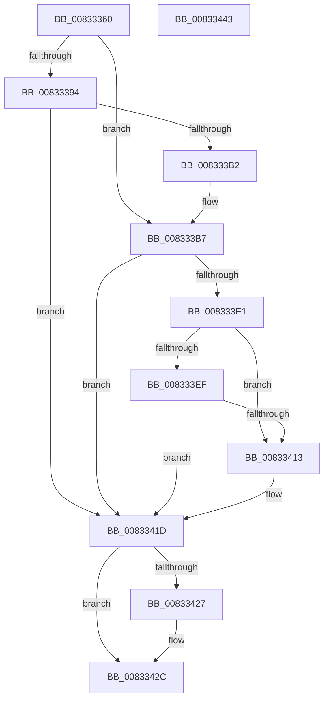

# DrvDbGetDeviceIdMappedPropertyKeys

- RVA: `0x00833360`–`0x00833444` (길이 `228` bytes)
- VA: `0x0000000140833360`
- 실행 섹션: `PAGE`
- PDB 이름 있음: `예`; PDB Function 태그: `아니요`
- unwind 정보 RVA: `0x000DAB7C`
- 디코드: `62`개 명령, `228/228` bytes 표시
- 미해석 바이트: `0` (있으면 어셈블리에 `.byte`로 보존)

> 이 문서는 커널 이미지의 기계어와 PDB 기호를 분석해 생성했습니다. 4번과 5번은 함수 원형과 자료형을 바이너리 사용 방식에서 추정한 C 해석이며 원본 소스 복구 결과는 아닙니다.

## 1. Dependencies

- 직접 호출 지점: **4**; 고유 호출 대상: **4**
- 직접 호출자로 확인된 함수: **1**
- RIP 상대 이미지 참조: **1**

### Outgoing calls
- `0x008333A7` → [DrvDbOpenDeviceIdRegKey](../92/DrvDbOpenDeviceIdRegKey_function_0092F080.md) (function, `0x0092F080`)
- `0x008333D6` → [PnpCtxRegQueryInfoKey](../99/PnpCtxRegQueryInfoKey_function_009945FC.md) (function, `0x009945FC`)
- `0x00833408` → [DrvDbGetCompositeMappedPropertyKeys](DrvDbGetCompositeMappedPropertyKeys_function_008332EC.md) (function, `0x008332EC`)
- `0x00833427` → [ZwClose](../../text/6A/ZwClose_function_006AD2B0.md) (function, `0x006AD2B0`)

### Direct callers
- [DrvDbDispatchDeviceId](../92/DrvDbDispatchDeviceId_function_0092F490.md) at `0x0092F5E7`

### Static image references
- `0x008333F4` → RVA `0x00E0A430` (`.data`; read)

## 2. Other-region calls and transfers

- 다른 실행 섹션으로 향하는 call: **1**
  - `0x00833427` → [ZwClose](../../text/6A/ZwClose_function_006AD2B0.md) (`PAGE` → `.text`)
- 별도 외부 분기/꼬리 이동을 확인하지 못했습니다.

## 3. Assembly (complete function range)

```asm
00833360  4C 8B DC                        mov r11, rsp
00833363  49 89 5B 08                     mov qword ptr [r11 + 8], rbx
00833367  49 89 6B 10                     mov qword ptr [r11 + 0x10], rbp
0083336B  49 89 73 20                     mov qword ptr [r11 + 0x20], rsi
0083336F  57                              push rdi
00833370  48 83 EC 50                     sub rsp, 0x50
00833374  48 8B B4 24 88 00 00 00         mov rsi, qword ptr [rsp + 0x88]
0083337C  49 8B E9                        mov rbp, r9
0083337F  49 83 63 E8 00                  and qword ptr [r11 - 0x18], 0
00833384  49 8B C0                        mov rax, r8
00833387  83 64 24 70 00                  and dword ptr [rsp + 0x70], 0
0083338C  83 26 00                        and dword ptr [rsi], 0
0083338F  4D 85 C0                        test r8, r8
00833392  75 23                           jne 0x1408333b7
00833394  4D 21 43 D0                     and qword ptr [r11 - 0x30], r8
00833398  49 8D 43 E8                     lea rax, [r11 - 0x18]
0083339C  45 33 C9                        xor r9d, r9d
0083339F  49 89 43 C8                     mov qword ptr [r11 - 0x38], rax
008333A3  45 8D 41 01                     lea r8d, [r9 + 1]
008333A7  E8 D4 BC 0F 00                  call 0x14092f080
008333AC  8B D8                           mov ebx, eax
008333AE  85 C0                           test eax, eax
008333B0  78 6B                           js 0x14083341d
008333B2  48 8B 44 24 40                  mov rax, qword ptr [rsp + 0x40]
008333B7  48 83 64 24 30 00               and qword ptr [rsp + 0x30], 0
008333BD  48 8D 4C 24 70                  lea rcx, [rsp + 0x70]
008333C2  48 83 64 24 28 00               and qword ptr [rsp + 0x28], 0
008333C8  45 33 C9                        xor r9d, r9d
008333CB  45 33 C0                        xor r8d, r8d
008333CE  48 89 4C 24 20                  mov qword ptr [rsp + 0x20], rcx
008333D3  48 8B D0                        mov rdx, rax
008333D6  E8 21 12 16 00                  call 0x1409945fc
008333DB  8B D8                           mov ebx, eax
008333DD  85 C0                           test eax, eax
008333DF  78 3C                           js 0x14083341d
008333E1  83 7C 24 70 00                  cmp dword ptr [rsp + 0x70], 0
008333E6  8B BC 24 80 00 00 00            mov edi, dword ptr [rsp + 0x80]
008333ED  76 24                           jbe 0x140833413
008333EF  48 89 74 24 28                  mov qword ptr [rsp + 0x28], rsi
008333F4  48 8D 15 35 70 5D 00            lea rdx, [rip + 0x5d7035]
008333FB  4C 8B CD                        mov r9, rbp
008333FE  89 7C 24 20                     mov dword ptr [rsp + 0x20], edi
00833402  41 B8 03 00 00 00               mov r8d, 3
00833408  E8 DF FE FF FF                  call 0x1408332ec
0083340D  8B D8                           mov ebx, eax
0083340F  85 C0                           test eax, eax
00833411  78 0A                           js 0x14083341d
00833413  3B 3E                           cmp edi, dword ptr [rsi]
00833415  B8 23 00 00 C0                  mov eax, 0xc0000023
0083341A  0F 42 D8                        cmovb ebx, eax
0083341D  48 8B 4C 24 40                  mov rcx, qword ptr [rsp + 0x40]
00833422  48 85 C9                        test rcx, rcx
00833425  74 05                           je 0x14083342c
00833427  E8 84 9E E7 FF                  call 0x1406ad2b0
0083342C  48 8B 6C 24 68                  mov rbp, qword ptr [rsp + 0x68]
00833431  8B C3                           mov eax, ebx
00833433  48 8B 5C 24 60                  mov rbx, qword ptr [rsp + 0x60]
00833438  48 8B 74 24 78                  mov rsi, qword ptr [rsp + 0x78]
0083343D  48 83 C4 50                     add rsp, 0x50
00833441  5F                              pop rdi
00833442  C3                              ret
00833443  CC                              int3
```

## 4. C-style interpretation (structured pseudocode)

```c
__int64 __fastcall DrvDbGetDeviceIdMappedPropertyKeys(__int64 a1, __int64 a2, __int64 a3, __int64 a4, unsigned int a5, __int64 a6)
{
    __int64 result;
    __int64 v_rbx;
    __int64 v_rsp;
    unsigned __int64 v_stack_m18;
    unsigned __int64 v_stack_m28;
    unsigned __int64 v_stack_m30;
    unsigned __int64 v_stack_m38;
    unsigned __int64 v_stack_p10;
    unsigned int v_stack_p18;
    unsigned __int64 v_stack_p20;
    unsigned __int64 v_stack_p8;

    *(unsigned __int64 *)(v_rsp + 8) = v_rbx;
    *(unsigned __int64 *)(v_rsp + 16) = v_rbp;
    *(unsigned __int64 *)(v_rsp + 32) = v_rsi;
    v_rsp = (v_rsp) - (80);
    if (a3 != 0) goto loc_008333B7;
    a4 = 0;
    *(unsigned __int64 *)(v_rsp - 56) = v_rsp - 24;
    result = DrvDbOpenDeviceIdRegKey(a1, a2, a4 + 1, a4);
    if (sign_flag) goto loc_0083341D;
loc_008333B7:
    a4 = 0;
    a3 = 0;
    v_stack_m38 = v_stack_p18;
    result = PnpCtxRegQueryInfoKey(v_stack_p18, v_stack_m18, a3, a4);
    if (sign_flag) goto loc_0083341D;
    if (v_stack_p18 <= 0) goto loc_00833413;
    v_stack_m30 = a6;
    v_stack_m38 = (unsigned int)((unsigned int)(a5));
    result = DrvDbGetCompositeMappedPropertyKeys(v_stack_p18, v_rip + 6123573, 3, 0);
    v_rbx = (unsigned int)((unsigned int)(result));
    if (!(sign_flag)) {
        result = 0xC0000023ULL;
        v_rbx = (unsigned int)((unsigned int)(result));
        if (((unsigned int)((unsigned int)(a5))) < (*(unsigned int *)(a6))) { v_rbx = (unsigned int)(result); }
    }
    if (v_stack_m18 != 0) {
        result = ZwClose(v_stack_m18, v_rip + 6123573, 3, 0);
    }
    v_rsp = (v_rsp) + (80);
    return (unsigned int)((unsigned int)(v_rbx));
}
```

## 5. (Beta) C Style

```c
int64_t DrvDbGetDeviceIdMappedPropertyKeys(int64_t Arg1, int64_t Arg2, int64_t Arg3, int64_t Arg4, uint32_t Arg5, void *Arg6)
{
    uint8_t *arg6 = (uint8_t *)Arg6;

    int64_t result;
    int64_t local_rbx;
    int64_t local_rsp;
    uint64_t v_stack_m18;
    uint64_t v_stack_m28;
    uint64_t v_stack_m30;
    uint64_t v_stack_m38;
    uint64_t v_stack_p10;
    uint32_t v_stack_p18;
    uint64_t v_stack_p20;
    uint64_t v_stack_p8;

    *(uint64_t *)(local_rsp + 0x8) = local_rbx;
    *(uint64_t *)(local_rsp + 0x10) = local_rbp;
    *(uint64_t *)(local_rsp + 0x20) = local_rsi;
    local_rsp = (local_rsp) - (80);
    if (Arg3 != 0) goto loc_008333B7;
    Arg4 = 0;
    *(uint64_t *)(local_rsp - 0x38) = local_rsp - 24;
    result = DrvDbOpenDeviceIdRegKey(Arg1, Arg2, Arg4 + 1, Arg4);
    if (sign_flag) goto loc_0083341D;
loc_008333B7:
    Arg4 = 0;
    Arg3 = 0;
    v_stack_m38 = v_stack_p18;
    result = PnpCtxRegQueryInfoKey(v_stack_p18, v_stack_m18, Arg3, Arg4);
    if (sign_flag) goto loc_0083341D;
    if (v_stack_p18 <= 0) goto loc_00833413;
    v_stack_m30 = Arg6;
    v_stack_m38 = (uint32_t)((uint32_t)(Arg5));
    result = DrvDbGetCompositeMappedPropertyKeys(v_stack_p18, v_rip + 6123573, 3, 0);
    local_rbx = (uint32_t)((uint32_t)(result));
    if (!(sign_flag)) {
        result = 0xC0000023ULL;
        local_rbx = (uint32_t)((uint32_t)(result));
        if (((uint32_t)((uint32_t)(Arg5))) < (*(uint32_t *)(arg6))) { local_rbx = (uint32_t)(result); }
    }
    if (v_stack_m18 != 0) {
        result = ZwClose(v_stack_m18, v_rip + 6123573, 3, 0);
    }
    local_rsp = (local_rsp) + (80);
    return (uint32_t)((uint32_t)(local_rbx));
}
```

### 관측된 메모리 오프셋

구조체 형식이 확인되지 않은 접근은 인자 기준의 오프셋으로만 기록했습니다.

| 기준 인자 | 오프셋 표현 | 폭 (bit) | 접근 |
|---|---:|---:|---|
| `Arg6` | `+ 0x0` | `32` | `R` |
| `Arg6` | `+ 0x0` | `32` | `R/W` |

## 6. Execution-region graph

[열기: 2D/3D 그래프와 함수 탐색 컨트롤 패널](../../../control-panel.html?section=page&rva=0x00833360&view=graph)

- 2D 그래프는 위에서 아래로 흐르고, 3D 그래프는 빈 공간을 드래그해 회전합니다. Shift+드래그는 이동, 휠은 확대·축소, 함수 노드 선택은 대상 보고서 이동입니다.

### Static fallback


