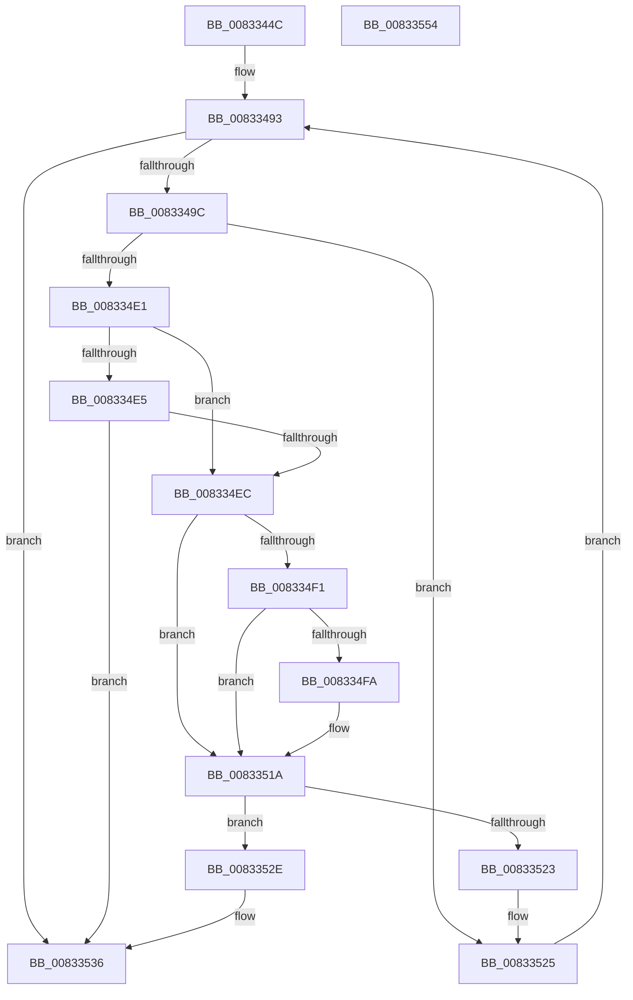

# DrvDbGetDriverDatabaseCompositeMappedPropertyKeys

- RVA: `0x0083344C`–`0x00833555` (길이 `265` bytes)
- VA: `0x000000014083344C`
- 실행 섹션: `PAGE`
- PDB 이름 있음: `예`; PDB Function 태그: `아니요`
- unwind 정보 RVA: `0x000C6A34`
- 디코드: `75`개 명령, `265/265` bytes 표시
- 미해석 바이트: `0` (있으면 어셈블리에 `.byte`로 보존)

> 이 문서는 커널 이미지의 기계어와 PDB 기호를 분석해 생성했습니다. 4번과 5번은 함수 원형과 자료형을 바이너리 사용 방식에서 추정한 C 해석이며 원본 소스 복구 결과는 아닙니다.

## 1. Dependencies

- 직접 호출 지점: **1**; 고유 호출 대상: **1**
- 직접 호출자로 확인된 함수: **1**
- RIP 상대 이미지 참조: **1**

### Outgoing calls
- `0x008334D5` → [DrvDbGetDriverDatabaseMappedProperty](../92/DrvDbGetDriverDatabaseMappedProperty_function_0092EE28.md) (function, `0x0092EE28`)

### Direct callers
- [DrvDbGetDriverDatabaseMappedPropertyKeys](DrvDbGetDriverDatabaseMappedPropertyKeys_function_0083355C.md) at `0x008335EA`

### Static image references
- `0x008334AC` → RVA `0x00E0A540` (`.data`; read)

## 2. Other-region calls and transfers

- 다른 실행 섹션으로 향하는 call: **0**
- 별도 외부 분기/꼬리 이동을 확인하지 못했습니다.

## 3. Assembly (complete function range)

```asm
0083344C  4C 8B DC                        mov r11, rsp
0083344F  49 89 5B 08                     mov qword ptr [r11 + 8], rbx
00833453  49 89 6B 10                     mov qword ptr [r11 + 0x10], rbp
00833457  49 89 73 18                     mov qword ptr [r11 + 0x18], rsi
0083345B  4D 89 4B 20                     mov qword ptr [r11 + 0x20], r9
0083345F  57                              push rdi
00833460  41 54                           push r12
00833462  41 55                           push r13
00833464  41 56                           push r14
00833466  41 57                           push r15
00833468  48 83 EC 40                     sub rsp, 0x40
0083346C  48 8B BC 24 A8 00 00 00         mov rdi, qword ptr [rsp + 0xa8]
00833474  33 C0                           xor eax, eax
00833476  41 21 43 20                     and dword ptr [r11 + 0x20], eax
0083347A  33 F6                           xor esi, esi
0083347C  41 21 43 28                     and dword ptr [r11 + 0x28], eax
00833480  4D 8B F8                        mov r15, r8
00833483  48 8B AC 24 98 00 00 00         mov rbp, qword ptr [rsp + 0x98]
0083348B  33 DB                           xor ebx, ebx
0083348D  4C 8B E2                        mov r12, rdx
00833490  4C 8B E9                        mov r13, rcx
00833493  83 FB 08                        cmp ebx, 8
00833496  0F 83 9A 00 00 00               jae 0x140833536
0083349C  48 8D 84 24 90 00 00 00         lea rax, [rsp + 0x90]
008334A4  4D 8B C7                        mov r8, r15
008334A7  48 89 44 24 38                  mov qword ptr [rsp + 0x38], rax
008334AC  48 8D 0D 8D 70 5D 00            lea rcx, [rip + 0x5d708d]
008334B3  83 64 24 30 00                  and dword ptr [rsp + 0x30], 0
008334B8  48 8D 84 24 88 00 00 00         lea rax, [rsp + 0x88]
008334C0  4C 8B 0C D9                     mov r9, qword ptr [rcx + rbx*8]
008334C4  49 8B D4                        mov rdx, r12
008334C7  48 83 64 24 28 00               and qword ptr [rsp + 0x28], 0
008334CD  49 8B CD                        mov rcx, r13
008334D0  48 89 44 24 20                  mov qword ptr [rsp + 0x20], rax
008334D5  E8 4E B9 0F 00                  call 0x14092ee28
008334DA  3D 34 00 00 C0                  cmp eax, 0xc0000034
008334DF  74 44                           je 0x140833525
008334E1  85 C0                           test eax, eax
008334E3  74 07                           je 0x1408334ec
008334E5  3D 23 00 00 C0                  cmp eax, 0xc0000023
008334EA  75 4A                           jne 0x140833536
008334EC  48 85 ED                        test rbp, rbp
008334EF  74 29                           je 0x14083351a
008334F1  3B B4 24 A0 00 00 00            cmp esi, dword ptr [rsp + 0xa0]
008334F8  73 20                           jae 0x14083351a
008334FA  48 8D 0C B6                     lea rcx, [rsi + rsi*4]
008334FE  FF C6                           inc esi
00833500  48 8D 15 39 70 5D 00            lea rdx, [rip + 0x5d7039]
00833507  48 8B 14 DA                     mov rdx, qword ptr [rdx + rbx*8]
0083350B  0F 10 02                        movups xmm0, xmmword ptr [rdx]
0083350E  0F 11 44 8D 00                  movups xmmword ptr [rbp + rcx*4], xmm0
00833513  8B 42 10                        mov eax, dword ptr [rdx + 0x10]
00833516  89 44 8D 10                     mov dword ptr [rbp + rcx*4 + 0x10], eax
0083351A  8B 07                           mov eax, dword ptr [rdi]
0083351C  8D 48 01                        lea ecx, [rax + 1]
0083351F  3B C8                           cmp ecx, eax
00833521  72 0B                           jb 0x14083352e
00833523  89 0F                           mov dword ptr [rdi], ecx
00833525  33 C0                           xor eax, eax
00833527  FF C3                           inc ebx
00833529  E9 65 FF FF FF                  jmp 0x140833493
0083352E  83 27 00                        and dword ptr [rdi], 0
00833531  B8 95 00 00 C0                  mov eax, 0xc0000095
00833536  4C 8D 5C 24 40                  lea r11, [rsp + 0x40]
0083353B  49 8B 5B 30                     mov rbx, qword ptr [r11 + 0x30]
0083353F  49 8B 6B 38                     mov rbp, qword ptr [r11 + 0x38]
00833543  49 8B 73 40                     mov rsi, qword ptr [r11 + 0x40]
00833547  49 8B E3                        mov rsp, r11
0083354A  41 5F                           pop r15
0083354C  41 5E                           pop r14
0083354E  41 5D                           pop r13
00833550  41 5C                           pop r12
00833552  5F                              pop rdi
00833553  C3                              ret
00833554  CC                              int3
```

## 4. C-style interpretation (structured pseudocode)

```c
__int64 __fastcall DrvDbGetDriverDatabaseCompositeMappedPropertyKeys(__int64 a1, __int64 a2, __int64 a3, __int64 a4, __int64 a5, __int64 a6, unsigned int a7, __int64 a8)
{
    __int64 result;
    __int64 v_rbx;
    __int64 v_rsi;
    __int64 v_rsp;
    unsigned __int64 v_stack_m28;
    unsigned __int64 v_stack_m30;
    unsigned int v_stack_m38;
    unsigned __int64 v_stack_m40;
    unsigned __int64 v_stack_m48;
    unsigned __int64 v_stack_p20;

    *(unsigned __int64 *)(v_rsp + 8) = v_rbx;
    *(unsigned __int64 *)(v_rsp + 16) = v_rbp;
    *(unsigned __int64 *)(v_rsp + 24) = v_rsi;
    *(unsigned __int64 *)(v_rsp + 32) = a4;
    v_rsp = (v_rsp) - (64);
    result = 0;
    v_rsi = 0;
    v_rbx = 0;
loc_00833493:
    if (0 >= 8) goto loc_00833536;
    v_stack_m30 = a5;
    v_stack_m48 = v_stack_p20;
    result = DrvDbGetDriverDatabaseMappedProperty(a1, a2, a3, *(unsigned __int64 *)(v_rip + 6123661 + v_rbx * 8));
    if (((unsigned int)(result)) == 0xC0000034ULL) goto loc_00833525;
    if ((unsigned int)(result) == 0) goto loc_008334EC;
    if (((unsigned int)(result)) != 0xC0000023ULL) goto loc_00833536;
loc_008334EC:
    if (a6 == 0) goto loc_0083351A;
    if (0 < a7) {
        a1 = v_rsi + v_rsi * 4;
        v_rsi = (unsigned int)((v_rsi) + 1);
        a2 = v_rip + 6123577;
        a2 = *(unsigned __int64 *)(a2 + v_rbx * 8);
        *(unsigned __int64 *)(a6 + a1 * 4) = v_xmm0;
        result = *(unsigned int *)(a2 + 16);
        *(unsigned int *)(a6 + a1 * 4 + 16) = (unsigned int)(result);
    }
    if (((unsigned int)((unsigned int)(*(unsigned int *)(a8)) + 1)) < ((unsigned int)((unsigned int)(*(unsigned int *)(a8))))) goto loc_0083352E;
    *(unsigned int *)(a8) = (unsigned int)((unsigned int)(*(unsigned int *)(a8)) + 1);
loc_00833525:
    result = 0;
    v_rbx = (unsigned int)((v_rbx) + 1);
    goto loc_00833493;
loc_0083352E:
loc_00833536:
    return (unsigned int)(0xC0000095ULL);
}
```

## 5. (Beta) C Style

```c
int64_t DrvDbGetDriverDatabaseCompositeMappedPropertyKeys(int64_t Arg1, int64_t Arg2, int64_t Arg3, int64_t Arg4, int64_t Arg5, int64_t Arg6, uint32_t Arg7, void *Arg8)
{
    uint8_t *arg8 = (uint8_t *)Arg8;

    int64_t result;
    int64_t local_rbx;
    int64_t local_rsi;
    int64_t local_rsp;
    uint64_t v_stack_m28;
    uint64_t v_stack_m30;
    uint32_t v_stack_m38;
    uint64_t v_stack_m40;
    uint64_t v_stack_m48;
    uint64_t v_stack_p20;

    *(uint64_t *)(local_rsp + 0x8) = local_rbx;
    *(uint64_t *)(local_rsp + 0x10) = local_rbp;
    *(uint64_t *)(local_rsp + 0x18) = local_rsi;
    *(uint64_t *)(local_rsp + 0x20) = Arg4;
    local_rsp = (local_rsp) - (64);
    result = 0;
    local_rsi = 0;
    local_rbx = 0;
loc_00833493:
    if (0 >= 8) goto loc_00833536;
    v_stack_m30 = Arg5;
    v_stack_m48 = v_stack_p20;
    result = DrvDbGetDriverDatabaseMappedProperty(Arg1, Arg2, Arg3, *(uint64_t *)(v_rip + 0x5D708D + local_rbx * 8));
    if (((uint32_t)(result)) == 0xC0000034ULL) goto loc_00833525;
    if ((uint32_t)(result) == 0) goto loc_008334EC;
    if (((uint32_t)(result)) != 0xC0000023ULL) goto loc_00833536;
loc_008334EC:
    if (Arg6 == 0) goto loc_0083351A;
    if (0 < Arg7) {
        Arg1 = local_rsi + local_rsi * 4;
        local_rsi = (uint32_t)((local_rsi) + 1);
        Arg2 = v_rip + 6123577;
        Arg2 = *(uint64_t *)(Arg2 + local_rbx * 8);
        *(uint64_t *)(Arg6 + Arg1 * 4) = v_xmm0;
        result = *(uint32_t *)(Arg2 + 0x10);
        *(uint32_t *)(Arg6 + Arg1 * 4 + 0x10) = (uint32_t)(result);
    }
    if (((uint32_t)((uint32_t)(*(uint32_t *)(arg8)) + 1)) < ((uint32_t)((uint32_t)(*(uint32_t *)(arg8))))) goto loc_0083352E;
    *(uint32_t *)(arg8) = (uint32_t)((uint32_t)(*(uint32_t *)(arg8)) + 1);
loc_00833525:
    result = 0;
    local_rbx = (uint32_t)((local_rbx) + 1);
    goto loc_00833493;
loc_0083352E:
loc_00833536:
    return (uint32_t)(0xC0000095ULL);
}
```

### 관측된 메모리 오프셋

구조체 형식이 확인되지 않은 접근은 인자 기준의 오프셋으로만 기록했습니다.

| 기준 인자 | 오프셋 표현 | 폭 (bit) | 접근 |
|---|---:|---:|---|
| `Arg8` | `+ 0x0` | `32` | `R` |
| `Arg8` | `+ 0x0` | `32` | `R/W` |
| `Arg8` | `+ 0x0` | `32` | `W` |

## 6. Execution-region graph

[열기: 2D/3D 그래프와 함수 탐색 컨트롤 패널](../../../control-panel.html?section=page&rva=0x0083344C&view=graph)

- 2D 그래프는 위에서 아래로 흐르고, 3D 그래프는 빈 공간을 드래그해 회전합니다. Shift+드래그는 이동, 휠은 확대·축소, 함수 노드 선택은 대상 보고서 이동입니다.

### Static fallback


