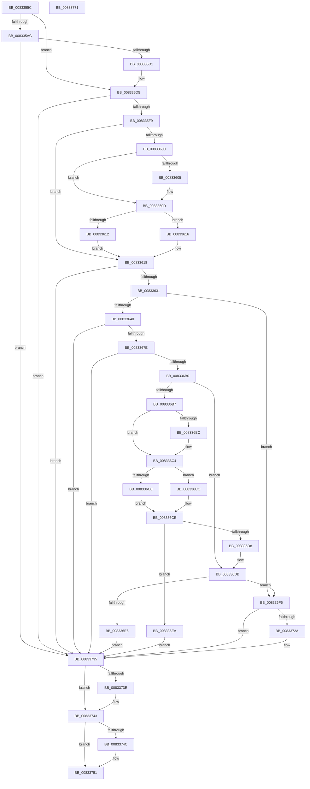

# DrvDbGetDriverDatabaseMappedPropertyKeys

- RVA: `0x0083355C`–`0x00833772` (길이 `534` bytes)
- VA: `0x000000014083355C`
- 실행 섹션: `PAGE`
- PDB 이름 있음: `예`; PDB Function 태그: `아니요`
- unwind 정보 RVA: `0x000DABE0`
- 디코드: `157`개 명령, `534/534` bytes 표시
- 미해석 바이트: `0` (있으면 어셈블리에 `.byte`로 보존)

> 이 문서는 커널 이미지의 기계어와 PDB 기호를 분석해 생성했습니다. 4번과 5번은 함수 원형과 자료형을 바이너리 사용 방식에서 추정한 C 해석이며 원본 소스 복구 결과는 아닙니다.

## 1. Dependencies

- 직접 호출 지점: **8**; 고유 호출 대상: **6**
- 직접 호출자로 확인된 함수: **1**
- RIP 상대 이미지 참조: **2**

### Outgoing calls
- `0x008335C2` → [DrvDbOpenDriverDatabaseRegKey](../AA/DrvDbOpenDriverDatabaseRegKey_function_00AA0FB8.md) (function, `0x00AA0FB8`)
- `0x008335EA` → [DrvDbGetDriverDatabaseCompositeMappedPropertyKeys](DrvDbGetDriverDatabaseCompositeMappedPropertyKeys_function_0083344C.md) (function, `0x0083344C`)
- `0x00833622` → [DrvDbFindDatabaseNode](../93/DrvDbFindDatabaseNode_function_00932628.md) (function, `0x00932628`)
- `0x0083366F` → [DrvDbOpenObjectRegKey](../93/DrvDbOpenObjectRegKey_function_00931060.md) (function, `0x00931060`)
- `0x008336A1` → [DrvDbGetRegValueMappedPropertyKeys](DrvDbGetRegValueMappedPropertyKeys_function_00833EEC.md) (function, `0x00833EEC`)
- `0x0083371F` → [DrvDbGetRegValueMappedPropertyKeys](DrvDbGetRegValueMappedPropertyKeys_function_00833EEC.md) (function, `0x00833EEC`)
- `0x0083373E` → [ZwClose](../../text/6A/ZwClose_function_006AD2B0.md) (function, `0x006AD2B0`)
- `0x0083374C` → [ZwClose](../../text/6A/ZwClose_function_006AD2B0.md) (function, `0x006AD2B0`)

### Direct callers
- [sub_00B1D6D0](../B1/Unknown_function_00B1D6D0.md) at `0x00B1D733`

### Static image references
- `0x0083368B` → RVA `0x0000CEC0` (`.rdata`; read)
- `0x008336F9` → RVA `0x0000CCE0` (`.rdata`; read)

## 2. Other-region calls and transfers

- 다른 실행 섹션으로 향하는 call: **2**
  - `0x0083373E` → [ZwClose](../../text/6A/ZwClose_function_006AD2B0.md) (`PAGE` → `.text`)
  - `0x0083374C` → [ZwClose](../../text/6A/ZwClose_function_006AD2B0.md) (`PAGE` → `.text`)
- 별도 외부 분기/꼬리 이동을 확인하지 못했습니다.

## 3. Assembly (complete function range)

```asm
0083355C  4C 8B DC                        mov r11, rsp
0083355F  49 89 5B 08                     mov qword ptr [r11 + 8], rbx
00833563  49 89 73 10                     mov qword ptr [r11 + 0x10], rsi
00833567  49 89 7B 20                     mov qword ptr [r11 + 0x20], rdi
0083356B  4D 89 43 18                     mov qword ptr [r11 + 0x18], r8
0083356F  55                              push rbp
00833570  41 54                           push r12
00833572  41 55                           push r13
00833574  41 56                           push r14
00833576  41 57                           push r15
00833578  48 8B EC                        mov rbp, rsp
0083357B  48 83 EC 70                     sub rsp, 0x70
0083357F  4C 8B 75 58                     mov r14, qword ptr [rbp + 0x58]
00833583  4C 8B E9                        mov r13, rcx
00833586  44 8B 7D 50                     mov r15d, dword ptr [rbp + 0x50]
0083358A  33 C9                           xor ecx, ecx
0083358C  48 89 4D E8                     mov qword ptr [rbp - 0x18], rcx
00833590  49 8B F1                        mov rsi, r9
00833593  48 89 4D E0                     mov qword ptr [rbp - 0x20], rcx
00833597  4C 8B E2                        mov r12, rdx
0083359A  41 89 0E                        mov dword ptr [r14], ecx
0083359D  41 8B FF                        mov edi, r15d
008335A0  48 89 4D F0                     mov qword ptr [rbp - 0x10], rcx
008335A4  89 4D 58                        mov dword ptr [rbp + 0x58], ecx
008335A7  4D 85 C0                        test r8, r8
008335AA  75 29                           jne 0x1408335d5
008335AC  49 89 4B 90                     mov qword ptr [r11 - 0x70], rcx
008335B0  48 8D 45 E0                     lea rax, [rbp - 0x20]
008335B4  44 8D 41 01                     lea r8d, [rcx + 1]
008335B8  49 89 43 88                     mov qword ptr [r11 - 0x78], rax
008335BC  49 8B CD                        mov rcx, r13
008335BF  45 33 C9                        xor r9d, r9d
008335C2  E8 F1 D9 26 00                  call 0x140aa0fb8
008335C7  8B D8                           mov ebx, eax
008335C9  85 C0                           test eax, eax
008335CB  0F 88 64 01 00 00               js 0x140833735
008335D1  4C 8B 45 E0                     mov r8, qword ptr [rbp - 0x20]
008335D5  4C 89 74 24 38                  mov qword ptr [rsp + 0x38], r14
008335DA  49 8B D4                        mov rdx, r12
008335DD  44 89 7C 24 30                  mov dword ptr [rsp + 0x30], r15d
008335E2  49 8B CD                        mov rcx, r13
008335E5  48 89 74 24 28                  mov qword ptr [rsp + 0x28], rsi
008335EA  E8 5D FE FF FF                  call 0x14083344c
008335EF  8B D8                           mov ebx, eax
008335F1  85 C0                           test eax, eax
008335F3  0F 88 3C 01 00 00               js 0x140833735
008335F9  41 8B 16                        mov edx, dword ptr [r14]
008335FC  85 D2                           test edx, edx
008335FE  74 18                           je 0x140833618
00833600  48 85 F6                        test rsi, rsi
00833603  74 08                           je 0x14083360d
00833605  48 8D 0C 92                     lea rcx, [rdx + rdx*4]
00833609  48 8D 34 8E                     lea rsi, [rsi + rcx*4]
0083360D  41 3B D7                        cmp edx, r15d
00833610  76 04                           jbe 0x140833616
00833612  33 FF                           xor edi, edi
00833614  EB 02                           jmp 0x140833618
00833616  2B FA                           sub edi, edx
00833618  4C 8D 45 E8                     lea r8, [rbp - 0x18]
0083361C  49 8B D4                        mov rdx, r12
0083361F  49 8B CD                        mov rcx, r13
00833622  E8 01 F0 0F 00                  call 0x140932628
00833627  8B D8                           mov ebx, eax
00833629  85 C0                           test eax, eax
0083362B  0F 88 04 01 00 00               js 0x140833735
00833631  48 8B 45 E8                     mov rax, qword ptr [rbp - 0x18]
00833635  8B 40 40                        mov eax, dword ptr [rax + 0x40]
00833638  A8 10                           test al, 0x10
0083363A  0F 84 B5 00 00 00               je 0x1408336f5
00833640  48 83 64 24 40 00               and qword ptr [rsp + 0x40], 0
00833646  48 8D 45 F0                     lea rax, [rbp - 0x10]
0083364A  48 83 64 24 38 00               and qword ptr [rsp + 0x38], 0
00833650  41 B8 01 00 00 00               mov r8d, 1
00833656  49 8B 55 28                     mov rdx, qword ptr [r13 + 0x28]
0083365A  4D 8B CC                        mov r9, r12
0083365D  48 89 44 24 30                  mov qword ptr [rsp + 0x30], rax
00833662  49 8B CD                        mov rcx, r13
00833665  C6 44 24 28 00                  mov byte ptr [rsp + 0x28], 0
0083366A  44 89 44 24 20                  mov dword ptr [rsp + 0x20], r8d
0083366F  E8 EC D9 0F 00                  call 0x140931060
00833674  8B D8                           mov ebx, eax
00833676  85 C0                           test eax, eax
00833678  0F 88 B7 00 00 00               js 0x140833735
0083367E  48 8B 55 F0                     mov rdx, qword ptr [rbp - 0x10]
00833682  48 8D 45 58                     lea rax, [rbp + 0x58]
00833686  48 89 44 24 30                  mov qword ptr [rsp + 0x30], rax
0083368B  4C 8D 05 2E 98 7D FF            lea r8, [rip - 0x8267d2]
00833692  89 7C 24 28                     mov dword ptr [rsp + 0x28], edi
00833696  41 B9 04 00 00 00               mov r9d, 4
0083369C  48 89 74 24 20                  mov qword ptr [rsp + 0x20], rsi
008336A1  E8 46 08 00 00                  call 0x140833eec
008336A6  8B D8                           mov ebx, eax
008336A8  85 C0                           test eax, eax
008336AA  0F 88 85 00 00 00               js 0x140833735
008336B0  8B 55 58                        mov edx, dword ptr [rbp + 0x58]
008336B3  85 D2                           test edx, edx
008336B5  74 24                           je 0x1408336db
008336B7  48 85 F6                        test rsi, rsi
008336BA  74 08                           je 0x1408336c4
008336BC  48 8D 0C 92                     lea rcx, [rdx + rdx*4]
008336C0  48 8D 34 8E                     lea rsi, [rsi + rcx*4]
008336C4  3B D7                           cmp edx, edi
008336C6  76 04                           jbe 0x1408336cc
008336C8  33 FF                           xor edi, edi
008336CA  EB 02                           jmp 0x1408336ce
008336CC  2B FA                           sub edi, edx
008336CE  41 8B 06                        mov eax, dword ptr [r14]
008336D1  8D 0C 10                        lea ecx, [rax + rdx]
008336D4  3B C8                           cmp ecx, eax
008336D6  72 12                           jb 0x1408336ea
008336D8  41 89 0E                        mov dword ptr [r14], ecx
008336DB  48 8B 45 E8                     mov rax, qword ptr [rbp - 0x18]
008336DF  8B 40 40                        mov eax, dword ptr [rax + 0x40]
008336E2  A8 04                           test al, 4
008336E4  74 0F                           je 0x1408336f5
008336E6  33 DB                           xor ebx, ebx
008336E8  EB 4B                           jmp 0x140833735
008336EA  41 83 26 00                     and dword ptr [r14], 0
008336EE  BB 95 00 00 C0                  mov ebx, 0xc0000095
008336F3  EB 40                           jmp 0x140833735
008336F5  48 8B 45 40                     mov rax, qword ptr [rbp + 0x40]
008336F9  4C 8D 05 E0 95 7D FF            lea r8, [rip - 0x826a20]
00833700  48 8B 55 E0                     mov rdx, qword ptr [rbp - 0x20]
00833704  48 85 C0                        test rax, rax
00833707  4C 89 74 24 30                  mov qword ptr [rsp + 0x30], r14
0083370C  41 B9 0C 00 00 00               mov r9d, 0xc
00833712  48 0F 45 D0                     cmovne rdx, rax
00833716  89 7C 24 28                     mov dword ptr [rsp + 0x28], edi
0083371A  48 89 74 24 20                  mov qword ptr [rsp + 0x20], rsi
0083371F  E8 C8 07 00 00                  call 0x140833eec
00833724  8B D8                           mov ebx, eax
00833726  85 C0                           test eax, eax
00833728  78 0B                           js 0x140833735
0083372A  45 3B 3E                        cmp r15d, dword ptr [r14]
0083372D  B8 23 00 00 C0                  mov eax, 0xc0000023
00833732  0F 42 D8                        cmovb ebx, eax
00833735  48 8B 4D E0                     mov rcx, qword ptr [rbp - 0x20]
00833739  48 85 C9                        test rcx, rcx
0083373C  74 05                           je 0x140833743
0083373E  E8 6D 9B E7 FF                  call 0x1406ad2b0
00833743  48 8B 4D F0                     mov rcx, qword ptr [rbp - 0x10]
00833747  48 85 C9                        test rcx, rcx
0083374A  74 05                           je 0x140833751
0083374C  E8 5F 9B E7 FF                  call 0x1406ad2b0
00833751  4C 8D 5C 24 70                  lea r11, [rsp + 0x70]
00833756  8B C3                           mov eax, ebx
00833758  49 8B 5B 30                     mov rbx, qword ptr [r11 + 0x30]
0083375C  49 8B 73 38                     mov rsi, qword ptr [r11 + 0x38]
00833760  49 8B 7B 48                     mov rdi, qword ptr [r11 + 0x48]
00833764  49 8B E3                        mov rsp, r11
00833767  41 5F                           pop r15
00833769  41 5E                           pop r14
0083376B  41 5D                           pop r13
0083376D  41 5C                           pop r12
0083376F  5D                              pop rbp
00833770  C3                              ret
00833771  CC                              int3
```

## 4. C-style interpretation (structured pseudocode)

```c
__int64 __fastcall DrvDbGetDriverDatabaseMappedPropertyKeys(__int64 a1, __int64 a2, __int64 a3, __int64 a4, unsigned int a5, unsigned int a6)
{
    __int64 result;
    __int64 v_rbx;
    __int64 v_rdi;
    __int64 v_rsi;
    __int64 v_rsp;
    unsigned __int64 v_stack_m28;
    unsigned __int64 v_stack_m38;
    unsigned __int64 v_stack_m40;
    unsigned __int64 v_stack_m48;
    unsigned __int64 v_stack_m58;
    unsigned __int64 v_stack_m60;
    unsigned int v_stack_m68;
    unsigned __int64 v_stack_m70;
    unsigned int v_stack_m78;
    unsigned __int64 v_stack_p18;
    unsigned int v_stack_p30;

    *(unsigned __int64 *)(v_rsp + 8) = v_rbx;
    *(unsigned __int64 *)(v_rsp + 16) = v_rsi;
    *(unsigned __int64 *)(v_rsp + 32) = v_rdi;
    *(unsigned __int64 *)(v_rsp + 24) = a3;
    v_rsp = (v_rsp) - (112);
    a1 = 0;
    v_stack_m40 = 0;
    v_stack_m48 = 0;
    *(unsigned int *)(a6) = 0;
    v_stack_m38 = 0;
    v_stack_p30 = 0;
    if (a3 != 0) goto loc_008335D5;
    *(unsigned __int64 *)(v_rsp - 112) = 0;
    *(unsigned __int64 *)(v_rsp - 120) = v_stack_m48;
    a4 = 0;
    result = DrvDbOpenDriverDatabaseRegKey(0, a2, a1 + 1, a4);
    if (sign_flag) goto loc_00833735;
loc_008335D5:
    v_stack_m60 = a6;
    v_stack_m68 = (unsigned int)((unsigned int)(a5));
    v_stack_m70 = 0;
    result = DrvDbGetDriverDatabaseCompositeMappedPropertyKeys(0, a2, v_stack_m48, a4);
    if (sign_flag) goto loc_00833735;
    if ((unsigned int)((unsigned int)(*(unsigned int *)(a6))) == 0) goto loc_00833618;
    v_rsi = a4;
    if (0 != 0) {
        a1 = (unsigned int)(*(unsigned int *)(a6)) + (unsigned int)(*(unsigned int *)(a6)) * 4;
        v_rsi = a4 + a1 * 4;
    }
    if (((unsigned int)((unsigned int)(*(unsigned int *)(a6)))) <= ((unsigned int)((unsigned int)(a5)))) goto loc_00833616;
    v_rdi = 0;
    goto loc_00833618;
loc_00833616:
    v_rdi = (unsigned int)((v_rdi) - ((unsigned int)((unsigned int)(*(unsigned int *)(a6)))));
loc_00833618:
    result = DrvDbFindDatabaseNode(a1, a2, v_stack_m40, a4);
    if (sign_flag) goto loc_00833735;
    if ((((unsigned __int8)((unsigned int)(*(unsigned int *)(v_stack_m40 + 64)))) & (16)) == 0) goto loc_008336F5;
    v_stack_m68 = v_stack_m38;
    v_stack_m70 = 0;
    v_stack_m78 = 1;
    result = DrvDbOpenObjectRegKey(a1, *(unsigned __int64 *)(a1 + 40), 1, a2);
    if (sign_flag) goto loc_00833735;
    v_stack_m68 = a6;
    v_stack_m70 = (unsigned int)(v_rdi);
    v_stack_m78 = v_rsi;
    result = DrvDbGetRegValueMappedPropertyKeys(a1, v_stack_m38, v_rip - 8546258, 4);
    if (sign_flag) goto loc_00833735;
    if ((unsigned int)((unsigned int)(a6)) == 0) goto loc_008336DB;
    if (v_rsi != 0) {
        a1 = (unsigned int)(a6) + (unsigned int)(a6) * 4;
        v_rsi = v_rsi + a1 * 4;
    }
    if (((unsigned int)((unsigned int)(a6))) <= ((unsigned int)(v_rdi))) goto loc_008336CC;
    v_rdi = 0;
    goto loc_008336CE;
loc_008336CC:
    v_rdi = (unsigned int)((v_rdi) - ((unsigned int)((unsigned int)(a6))));
loc_008336CE:
    if (((unsigned int)((unsigned int)(*(unsigned int *)(a6)) + (unsigned int)(a6) * 1)) < ((unsigned int)((unsigned int)(*(unsigned int *)(a6))))) goto loc_008336EA;
    *(unsigned int *)(a6) = (unsigned int)((unsigned int)(*(unsigned int *)(a6)) + (unsigned int)(a6) * 1);
loc_008336DB:
    if ((((unsigned __int8)((unsigned int)(*(unsigned int *)(v_stack_m40 + 64)))) & (4)) == 0) goto loc_008336F5;
    v_rbx = 0;
    goto loc_00833735;
loc_008336EA:
    goto loc_00833735;
loc_008336F5:
    v_stack_m68 = a6;
    a2 = v_stack_m48;
    if (v_stack_p18 != 0) { a2 = v_stack_p18; }
    v_stack_m70 = (unsigned int)(v_rdi);
    v_stack_m78 = v_rsi;
    result = DrvDbGetRegValueMappedPropertyKeys((unsigned int)(*(unsigned int *)(a6)) + (unsigned int)(a6) * 1, a2, v_rip - 8546848, 12);
    v_rbx = (unsigned int)((unsigned int)(result));
    if (!(sign_flag)) {
        result = 0xC0000023ULL;
        v_rbx = (unsigned int)((unsigned int)(result));
        if (((unsigned int)((unsigned int)(a5))) < (*(unsigned int *)(a6))) { v_rbx = (unsigned int)(result); }
    }
    if (v_stack_m48 != 0) {
        result = ZwClose(v_stack_m48, a2, v_rip - 8546848, 12);
    }
    if (v_stack_m38 != 0) {
        result = ZwClose(v_stack_m38, a2, v_rip - 8546848, 12);
    }
    return (unsigned int)((unsigned int)(v_rbx));
}
```

## 5. (Beta) C Style

```c
int64_t DrvDbGetDriverDatabaseMappedPropertyKeys(void *Arg1, int64_t Arg2, int64_t Arg3, int64_t Arg4, uint32_t Arg5, void *Arg6)
{
    uint8_t *arg1 = (uint8_t *)Arg1;
    uint8_t *arg6 = (uint8_t *)Arg6;

    int64_t result;
    int64_t local_rbx;
    int64_t local_rdi;
    int64_t local_rsi;
    int64_t local_rsp;
    uint64_t v_stack_m28;
    uint64_t v_stack_m38;
    uint64_t v_stack_m40;
    uint64_t v_stack_m48;
    uint64_t v_stack_m58;
    uint64_t v_stack_m60;
    uint32_t v_stack_m68;
    uint64_t v_stack_m70;
    uint32_t v_stack_m78;
    uint64_t v_stack_p18;
    uint32_t v_stack_p30;

    *(uint64_t *)(local_rsp + 0x8) = local_rbx;
    *(uint64_t *)(local_rsp + 0x10) = local_rsi;
    *(uint64_t *)(local_rsp + 0x20) = local_rdi;
    *(uint64_t *)(local_rsp + 0x18) = Arg3;
    local_rsp = (local_rsp) - (112);
    Arg1 = 0;
    v_stack_m40 = 0;
    v_stack_m48 = 0;
    *(uint32_t *)(arg6) = 0;
    v_stack_m38 = 0;
    v_stack_p30 = 0;
    if (Arg3 != 0) goto loc_008335D5;
    *(uint64_t *)(local_rsp - 0x70) = 0;
    *(uint64_t *)(local_rsp - 0x78) = v_stack_m48;
    Arg4 = 0;
    result = DrvDbOpenDriverDatabaseRegKey(0, Arg2, Arg1 + 1, Arg4);
    if (sign_flag) goto loc_00833735;
loc_008335D5:
    v_stack_m60 = Arg6;
    v_stack_m68 = (uint32_t)((uint32_t)(Arg5));
    v_stack_m70 = 0;
    result = DrvDbGetDriverDatabaseCompositeMappedPropertyKeys(0, Arg2, v_stack_m48, Arg4);
    if (sign_flag) goto loc_00833735;
    if ((uint32_t)((uint32_t)(*(uint32_t *)(arg6))) == 0) goto loc_00833618;
    local_rsi = Arg4;
    if (0 != 0) {
        Arg1 = (uint32_t)(*(uint32_t *)(arg6)) + (uint32_t)(*(uint32_t *)(arg6)) * 4;
        local_rsi = Arg4 + Arg1 * 4;
    }
    if (((uint32_t)((uint32_t)(*(uint32_t *)(arg6)))) <= ((uint32_t)((uint32_t)(Arg5)))) goto loc_00833616;
    local_rdi = 0;
    goto loc_00833618;
loc_00833616:
    local_rdi = (uint32_t)((local_rdi) - ((uint32_t)((uint32_t)(*(uint32_t *)(arg6)))));
loc_00833618:
    result = DrvDbFindDatabaseNode(Arg1, Arg2, v_stack_m40, Arg4);
    if (sign_flag) goto loc_00833735;
    if ((((uint8_t)((uint32_t)(*(uint32_t *)(v_stack_m40 + 0x40)))) & (16)) == 0) goto loc_008336F5;
    v_stack_m68 = v_stack_m38;
    v_stack_m70 = 0;
    v_stack_m78 = 1;
    result = DrvDbOpenObjectRegKey(Arg1, *(uint64_t *)(arg1 + 0x28), 1, Arg2);
    if (sign_flag) goto loc_00833735;
    v_stack_m68 = Arg6;
    v_stack_m70 = (uint32_t)(local_rdi);
    v_stack_m78 = local_rsi;
    result = DrvDbGetRegValueMappedPropertyKeys(Arg1, v_stack_m38, v_rip - 8546258, 4);
    if (sign_flag) goto loc_00833735;
    if ((uint32_t)((uint32_t)(Arg6)) == 0) goto loc_008336DB;
    if (local_rsi != 0) {
        Arg1 = (uint32_t)(Arg6) + (uint32_t)(Arg6) * 4;
        local_rsi = local_rsi + Arg1 * 4;
    }
    if (((uint32_t)((uint32_t)(Arg6))) <= ((uint32_t)(local_rdi))) goto loc_008336CC;
    local_rdi = 0;
    goto loc_008336CE;
loc_008336CC:
    local_rdi = (uint32_t)((local_rdi) - ((uint32_t)((uint32_t)(Arg6))));
loc_008336CE:
    if (((uint32_t)((uint32_t)(*(uint32_t *)(arg6)) + (uint32_t)(Arg6) * 1)) < ((uint32_t)((uint32_t)(*(uint32_t *)(arg6))))) goto loc_008336EA;
    *(uint32_t *)(arg6) = (uint32_t)((uint32_t)(*(uint32_t *)(arg6)) + (uint32_t)(Arg6) * 1);
loc_008336DB:
    if ((((uint8_t)((uint32_t)(*(uint32_t *)(v_stack_m40 + 0x40)))) & (4)) == 0) goto loc_008336F5;
    local_rbx = 0;
    goto loc_00833735;
loc_008336EA:
    goto loc_00833735;
loc_008336F5:
    v_stack_m68 = Arg6;
    Arg2 = v_stack_m48;
    if (v_stack_p18 != 0) { Arg2 = v_stack_p18; }
    v_stack_m70 = (uint32_t)(local_rdi);
    v_stack_m78 = local_rsi;
    result = DrvDbGetRegValueMappedPropertyKeys((uint32_t)(*(uint32_t *)(arg6)) + (uint32_t)(Arg6) * 1, Arg2, v_rip - 8546848, 12);
    local_rbx = (uint32_t)((uint32_t)(result));
    if (!(sign_flag)) {
        result = 0xC0000023ULL;
        local_rbx = (uint32_t)((uint32_t)(result));
        if (((uint32_t)((uint32_t)(Arg5))) < (*(uint32_t *)(arg6))) { local_rbx = (uint32_t)(result); }
    }
    if (v_stack_m48 != 0) {
        result = ZwClose(v_stack_m48, Arg2, v_rip - 8546848, 12);
    }
    if (v_stack_m38 != 0) {
        result = ZwClose(v_stack_m38, Arg2, v_rip - 8546848, 12);
    }
    return (uint32_t)((uint32_t)(local_rbx));
}
```

### 관측된 메모리 오프셋

구조체 형식이 확인되지 않은 접근은 인자 기준의 오프셋으로만 기록했습니다.

| 기준 인자 | 오프셋 표현 | 폭 (bit) | 접근 |
|---|---:|---:|---|
| `Arg1` | `+ 0x28` | `64` | `R` |
| `Arg6` | `+ 0x0` | `32` | `R` |
| `Arg6` | `+ 0x0` | `32` | `R/W` |
| `Arg6` | `+ 0x0` | `32` | `W` |

## 6. Execution-region graph

[열기: 2D/3D 그래프와 함수 탐색 컨트롤 패널](../../../control-panel.html?section=page&rva=0x0083355C&view=graph)

- 2D 그래프는 위에서 아래로 흐르고, 3D 그래프는 빈 공간을 드래그해 회전합니다. Shift+드래그는 이동, 휠은 확대·축소, 함수 노드 선택은 대상 보고서 이동입니다.

### Static fallback


