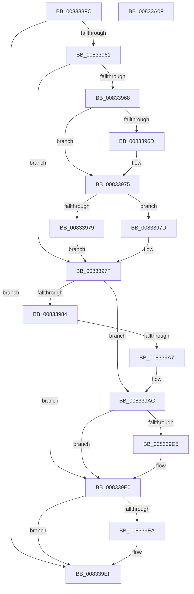

# DrvDbGetDriverFileMappedPropertyKeys

- RVA: `0x008338FC`–`0x00833A10` (길이 `276` bytes)
- VA: `0x00000001408338FC`
- 실행 섹션: `PAGE`
- PDB 이름 있음: `예`; PDB Function 태그: `아니요`
- unwind 정보 RVA: `0x000C3AF8`
- 디코드: `82`개 명령, `276/276` bytes 표시
- 미해석 바이트: `0` (있으면 어셈블리에 `.byte`로 보존)

> 이 문서는 커널 이미지의 기계어와 PDB 기호를 분석해 생성했습니다. 4번과 5번은 함수 원형과 자료형을 바이너리 사용 방식에서 추정한 C 해석이며 원본 소스 복구 결과는 아닙니다.

## 1. Dependencies

- 직접 호출 지점: **4**; 고유 호출 대상: **4**
- 직접 호출자로 확인된 함수: **1**
- RIP 상대 이미지 참조: **2**

### Outgoing calls
- `0x00833952` → [DrvDbGetCompositeMappedPropertyKeys](DrvDbGetCompositeMappedPropertyKeys_function_008332EC.md) (function, `0x008332EC`)
- `0x0083399C` → [DrvDbOpenDriverFileRegKey](DrvDbOpenDriverFileRegKey_function_00833FCC.md) (function, `0x00833FCC`)
- `0x008339CA` → [DrvDbGetRegValueMappedPropertyKeys](DrvDbGetRegValueMappedPropertyKeys_function_00833EEC.md) (function, `0x00833EEC`)
- `0x008339EA` → [ZwClose](../../text/6A/ZwClose_function_006AD2B0.md) (function, `0x006AD2B0`)

### Direct callers
- [DrvDbDispatchDriverFile](../AC/DrvDbDispatchDriverFile_function_00AC8880.md) at `0x00AC89DA`

### Static image references
- `0x0083392A` → RVA `0x00E0A448` (`.data`; read)
- `0x008339B1` → RVA `0x0000C600` (`.rdata`; read)

## 2. Other-region calls and transfers

- 다른 실행 섹션으로 향하는 call: **1**
  - `0x008339EA` → [ZwClose](../../text/6A/ZwClose_function_006AD2B0.md) (`PAGE` → `.text`)
- 별도 외부 분기/꼬리 이동을 확인하지 못했습니다.

## 3. Assembly (complete function range)

```asm
008338FC  48 8B C4                        mov rax, rsp
008338FF  48 89 58 08                     mov qword ptr [rax + 8], rbx
00833903  48 89 68 10                     mov qword ptr [rax + 0x10], rbp
00833907  48 89 70 18                     mov qword ptr [rax + 0x18], rsi
0083390B  57                              push rdi
0083390C  41 54                           push r12
0083390E  41 55                           push r13
00833910  41 56                           push r14
00833912  41 57                           push r15
00833914  48 83 EC 50                     sub rsp, 0x50
00833918  4C 8B B4 24 A8 00 00 00         mov r14, qword ptr [rsp + 0xa8]
00833920  4C 8B E2                        mov r12, rdx
00833923  8B AC 24 A0 00 00 00            mov ebp, dword ptr [rsp + 0xa0]
0083392A  48 8D 15 17 6B 5D 00            lea rdx, [rip + 0x5d6b17]
00833931  48 83 60 C8 00                  and qword ptr [rax - 0x38], 0
00833936  4D 8B F8                        mov r15, r8
00833939  4C 89 70 B0                     mov qword ptr [rax - 0x50], r14
0083393D  41 B8 01 00 00 00               mov r8d, 1
00833943  41 83 26 00                     and dword ptr [r14], 0
00833947  49 8B F1                        mov rsi, r9
0083394A  4C 8B E9                        mov r13, rcx
0083394D  89 68 A8                        mov dword ptr [rax - 0x58], ebp
00833950  8B FD                           mov edi, ebp
00833952  E8 95 F9 FF FF                  call 0x1408332ec
00833957  8B D8                           mov ebx, eax
00833959  85 C0                           test eax, eax
0083395B  0F 88 8E 00 00 00               js 0x1408339ef
00833961  41 8B 16                        mov edx, dword ptr [r14]
00833964  85 D2                           test edx, edx
00833966  74 17                           je 0x14083397f
00833968  4D 85 C9                        test r9, r9
0083396B  74 08                           je 0x140833975
0083396D  48 8D 0C 92                     lea rcx, [rdx + rdx*4]
00833971  49 8D 34 89                     lea rsi, [r9 + rcx*4]
00833975  3B D5                           cmp edx, ebp
00833977  76 04                           jbe 0x14083397d
00833979  33 FF                           xor edi, edi
0083397B  EB 02                           jmp 0x14083397f
0083397D  2B FA                           sub edi, edx
0083397F  4D 85 FF                        test r15, r15
00833982  75 28                           jne 0x1408339ac
00833984  4C 21 7C 24 28                  and qword ptr [rsp + 0x28], r15
00833989  48 8D 44 24 40                  lea rax, [rsp + 0x40]
0083398E  45 33 C9                        xor r9d, r9d
00833991  48 89 44 24 20                  mov qword ptr [rsp + 0x20], rax
00833996  49 8B D4                        mov rdx, r12
00833999  49 8B CD                        mov rcx, r13
0083399C  E8 2B 06 00 00                  call 0x140833fcc
008339A1  8B D8                           mov ebx, eax
008339A3  85 C0                           test eax, eax
008339A5  78 39                           js 0x1408339e0
008339A7  4C 8B 7C 24 40                  mov r15, qword ptr [rsp + 0x40]
008339AC  4C 89 74 24 30                  mov qword ptr [rsp + 0x30], r14
008339B1  4C 8D 05 48 8C 7D FF            lea r8, [rip - 0x8273b8]
008339B8  89 7C 24 28                     mov dword ptr [rsp + 0x28], edi
008339BC  41 B9 02 00 00 00               mov r9d, 2
008339C2  49 8B D7                        mov rdx, r15
008339C5  48 89 74 24 20                  mov qword ptr [rsp + 0x20], rsi
008339CA  E8 1D 05 00 00                  call 0x140833eec
008339CF  8B D8                           mov ebx, eax
008339D1  85 C0                           test eax, eax
008339D3  78 0B                           js 0x1408339e0
008339D5  41 3B 2E                        cmp ebp, dword ptr [r14]
008339D8  B8 23 00 00 C0                  mov eax, 0xc0000023
008339DD  0F 42 D8                        cmovb ebx, eax
008339E0  48 8B 4C 24 40                  mov rcx, qword ptr [rsp + 0x40]
008339E5  48 85 C9                        test rcx, rcx
008339E8  74 05                           je 0x1408339ef
008339EA  E8 C1 98 E7 FF                  call 0x1406ad2b0
008339EF  4C 8D 5C 24 50                  lea r11, [rsp + 0x50]
008339F4  8B C3                           mov eax, ebx
008339F6  49 8B 5B 30                     mov rbx, qword ptr [r11 + 0x30]
008339FA  49 8B 6B 38                     mov rbp, qword ptr [r11 + 0x38]
008339FE  49 8B 73 40                     mov rsi, qword ptr [r11 + 0x40]
00833A02  49 8B E3                        mov rsp, r11
00833A05  41 5F                           pop r15
00833A07  41 5E                           pop r14
00833A09  41 5D                           pop r13
00833A0B  41 5C                           pop r12
00833A0D  5F                              pop rdi
00833A0E  C3                              ret
00833A0F  CC                              int3
```

## 4. C-style interpretation (structured pseudocode)

```c
__int64 __fastcall DrvDbGetDriverFileMappedPropertyKeys(__int64 a1, __int64 a2, __int64 a3, __int64 a4, unsigned int a5, __int64 a6)
{
    __int64 result;
    __int64 v_rbx;
    __int64 v_rdi;
    __int64 v_rsi;
    __int64 v_rsp;
    unsigned __int64 v_stack_m28;
    unsigned __int64 v_stack_m38;
    unsigned __int64 v_stack_m48;
    unsigned __int64 v_stack_m50;
    unsigned __int64 v_stack_m58;

    *(unsigned __int64 *)(v_rsp + 8) = v_rbx;
    *(unsigned __int64 *)(v_rsp + 16) = v_rbp;
    *(unsigned __int64 *)(v_rsp + 24) = v_rsi;
    v_rsp = (v_rsp) - (80);
    *(unsigned __int64 *)(v_rsp - 80) = a6;
    *(unsigned int *)(v_rsp - 88) = (unsigned int)((unsigned int)(a5));
    result = DrvDbGetCompositeMappedPropertyKeys(a1, v_rip + 6122263, 1, a4);
    if (sign_flag) goto loc_008339EF;
    if ((unsigned int)((unsigned int)(*(unsigned int *)(a6))) == 0) goto loc_0083397F;
    v_rsi = a4;
    if (a4 != 0) {
        a1 = (unsigned int)(*(unsigned int *)(a6)) + (unsigned int)(*(unsigned int *)(a6)) * 4;
        v_rsi = a4 + a1 * 4;
    }
    if (((unsigned int)((unsigned int)(*(unsigned int *)(a6)))) <= ((unsigned int)((unsigned int)(a5)))) goto loc_0083397D;
    v_rdi = 0;
    goto loc_0083397F;
loc_0083397D:
    v_rdi = (unsigned int)((v_rdi) - ((unsigned int)((unsigned int)(*(unsigned int *)(a6)))));
loc_0083397F:
    if (a3 != 0) goto loc_008339AC;
    a4 = 0;
    v_stack_m58 = v_stack_m38;
    result = DrvDbOpenDriverFileRegKey(a1, a2, 1, a4);
    if (sign_flag) goto loc_008339E0;
loc_008339AC:
    v_stack_m48 = a6;
    v_stack_m50 = (unsigned int)(v_rdi);
    v_stack_m58 = v_rsi;
    result = DrvDbGetRegValueMappedPropertyKeys(a1, v_stack_m38, v_rip - 8549304, 2);
    v_rbx = (unsigned int)((unsigned int)(result));
    if (!(sign_flag)) {
        result = 0xC0000023ULL;
        v_rbx = (unsigned int)((unsigned int)(result));
        if (((unsigned int)((unsigned int)(a5))) < (*(unsigned int *)(a6))) { v_rbx = (unsigned int)(result); }
    }
    if (v_stack_m38 != 0) {
        result = ZwClose(v_stack_m38, v_stack_m38, v_rip - 8549304, 2);
    }
    return (unsigned int)((unsigned int)(v_rbx));
}
```

## 5. (Beta) C Style

```c
int64_t DrvDbGetDriverFileMappedPropertyKeys(int64_t Arg1, int64_t Arg2, int64_t Arg3, int64_t Arg4, uint32_t Arg5, void *Arg6)
{
    uint8_t *arg6 = (uint8_t *)Arg6;

    int64_t result;
    int64_t local_rbx;
    int64_t local_rdi;
    int64_t local_rsi;
    int64_t local_rsp;
    uint64_t v_stack_m28;
    uint64_t v_stack_m38;
    uint64_t v_stack_m48;
    uint64_t v_stack_m50;
    uint64_t v_stack_m58;

    *(uint64_t *)(local_rsp + 0x8) = local_rbx;
    *(uint64_t *)(local_rsp + 0x10) = local_rbp;
    *(uint64_t *)(local_rsp + 0x18) = local_rsi;
    local_rsp = (local_rsp) - (80);
    *(void **)(local_rsp - 0x50) = Arg6;
    *(uint32_t *)(local_rsp - 0x58) = (uint32_t)((uint32_t)(Arg5));
    result = DrvDbGetCompositeMappedPropertyKeys(Arg1, v_rip + 6122263, 1, Arg4);
    if (sign_flag) goto loc_008339EF;
    if ((uint32_t)((uint32_t)(*(uint32_t *)(arg6))) == 0) goto loc_0083397F;
    local_rsi = Arg4;
    if (Arg4 != 0) {
        Arg1 = (uint32_t)(*(uint32_t *)(arg6)) + (uint32_t)(*(uint32_t *)(arg6)) * 4;
        local_rsi = Arg4 + Arg1 * 4;
    }
    if (((uint32_t)((uint32_t)(*(uint32_t *)(arg6)))) <= ((uint32_t)((uint32_t)(Arg5)))) goto loc_0083397D;
    local_rdi = 0;
    goto loc_0083397F;
loc_0083397D:
    local_rdi = (uint32_t)((local_rdi) - ((uint32_t)((uint32_t)(*(uint32_t *)(arg6)))));
loc_0083397F:
    if (Arg3 != 0) goto loc_008339AC;
    Arg4 = 0;
    v_stack_m58 = v_stack_m38;
    result = DrvDbOpenDriverFileRegKey(Arg1, Arg2, 1, Arg4);
    if (sign_flag) goto loc_008339E0;
loc_008339AC:
    v_stack_m48 = Arg6;
    v_stack_m50 = (uint32_t)(local_rdi);
    v_stack_m58 = local_rsi;
    result = DrvDbGetRegValueMappedPropertyKeys(Arg1, v_stack_m38, v_rip - 8549304, 2);
    local_rbx = (uint32_t)((uint32_t)(result));
    if (!(sign_flag)) {
        result = 0xC0000023ULL;
        local_rbx = (uint32_t)((uint32_t)(result));
        if (((uint32_t)((uint32_t)(Arg5))) < (*(uint32_t *)(arg6))) { local_rbx = (uint32_t)(result); }
    }
    if (v_stack_m38 != 0) {
        result = ZwClose(v_stack_m38, v_stack_m38, v_rip - 8549304, 2);
    }
    return (uint32_t)((uint32_t)(local_rbx));
}
```

### 관측된 메모리 오프셋

구조체 형식이 확인되지 않은 접근은 인자 기준의 오프셋으로만 기록했습니다.

| 기준 인자 | 오프셋 표현 | 폭 (bit) | 접근 |
|---|---:|---:|---|
| `Arg6` | `+ 0x0` | `32` | `R` |
| `Arg6` | `+ 0x0` | `32` | `R/W` |

## 6. Execution-region graph

[열기: 2D/3D 그래프와 함수 탐색 컨트롤 패널](../../../control-panel.html?section=page&rva=0x008338FC&view=graph)

- 2D 그래프는 위에서 아래로 흐르고, 3D 그래프는 빈 공간을 드래그해 회전합니다. Shift+드래그는 이동, 휠은 확대·축소, 함수 노드 선택은 대상 보고서 이동입니다.

### Static fallback


