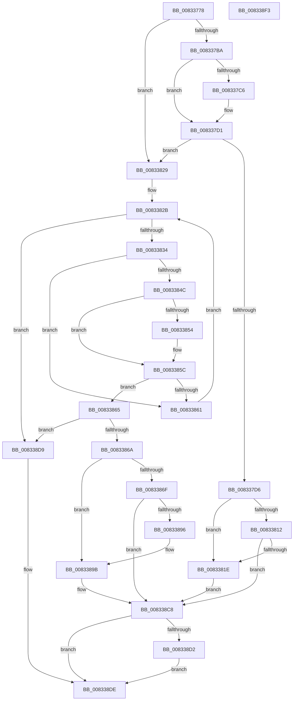

# DrvDbGetDriverFileMappedProperty

- RVA: `0x00833778`–`0x008338F4` (길이 `380` bytes)
- VA: `0x0000000140833778`
- 실행 섹션: `PAGE`
- PDB 이름 있음: `예`; PDB Function 태그: `아니요`
- unwind 정보 RVA: `0x000CCE24`
- 디코드: `103`개 명령, `380/380` bytes 표시
- 미해석 바이트: `0` (있으면 어셈블리에 `.byte`로 보존)

> 이 문서는 커널 이미지의 기계어와 PDB 기호를 분석해 생성했습니다. 4번과 5번은 함수 원형과 자료형을 바이너리 사용 방식에서 추정한 C 해석이며 원본 소스 복구 결과는 아닙니다.

## 1. Dependencies

- 직접 호출 지점: **4**; 고유 호출 대상: **4**
- 직접 호출자로 확인된 함수: **1**
- RIP 상대 이미지 참조: **3**

### Outgoing calls
- `0x008337FF` → [DrvDbGetObjectDatabaseNodeName](../92/DrvDbGetObjectDatabaseNodeName_function_0092FAC4.md) (function, `0x0092FAC4`)
- `0x0083388B` → [DrvDbOpenDriverFileRegKey](DrvDbOpenDriverFileRegKey_function_00833FCC.md) (function, `0x00833FCC`)
- `0x008338C1` → [DrvDbGetRegValueMappedProperty](../92/DrvDbGetRegValueMappedProperty_function_0092FB80.md) (function, `0x0092FB80`)
- `0x008338D2` → [ZwClose](../../text/6A/ZwClose_function_006AD2B0.md) (function, `0x006AD2B0`)

### Direct callers
- [DrvDbDispatchDriverFile](../AC/DrvDbDispatchDriverFile_function_00AC8880.md) at `0x00AC89B6`

### Static image references
- `0x008337BD` → RVA `0x00011F10` (`.rdata`; read)
- `0x008337CA` → RVA `0x00011F18` (`.rdata`; read)
- `0x00833838` → RVA `0x0000C600` (`.rdata`; read)

## 2. Other-region calls and transfers

- 다른 실행 섹션으로 향하는 call: **1**
  - `0x008338D2` → [ZwClose](../../text/6A/ZwClose_function_006AD2B0.md) (`PAGE` → `.text`)
- 별도 외부 분기/꼬리 이동을 확인하지 못했습니다.

## 3. Assembly (complete function range)

```asm
00833778  48 89 5C 24 08                  mov qword ptr [rsp + 8], rbx
0083377D  48 89 6C 24 10                  mov qword ptr [rsp + 0x10], rbp
00833782  56                              push rsi
00833783  57                              push rdi
00833784  41 56                           push r14
00833786  48 83 EC 40                     sub rsp, 0x40
0083378A  4C 8B B4 24 80 00 00 00         mov r14, qword ptr [rsp + 0x80]
00833792  4D 8B D0                        mov r10, r8
00833795  48 8B BC 24 98 00 00 00         mov rdi, qword ptr [rsp + 0x98]
0083379D  48 8B DA                        mov rbx, rdx
008337A0  48 83 64 24 78 00               and qword ptr [rsp + 0x78], 0
008337A6  48 8B E9                        mov rbp, rcx
008337A9  41 83 26 00                     and dword ptr [r14], 0
008337AD  83 27 00                        and dword ptr [rdi], 0
008337B0  45 8B 59 10                     mov r11d, dword ptr [r9 + 0x10]
008337B4  41 83 FB 02                     cmp r11d, 2
008337B8  75 6F                           jne 0x140833829
008337BA  49 8B 01                        mov rax, qword ptr [r9]
008337BD  48 2B 05 4C E7 7D FF            sub rax, qword ptr [rip - 0x8218b4]
008337C4  75 0B                           jne 0x1408337d1
008337C6  49 8B 41 08                     mov rax, qword ptr [r9 + 8]
008337CA  48 2B 05 47 E7 7D FF            sub rax, qword ptr [rip - 0x8218b9]
008337D1  48 85 C0                        test rax, rax
008337D4  75 53                           jne 0x140833829
008337D6  8B 84 24 90 00 00 00            mov eax, dword ptr [rsp + 0x90]
008337DD  4C 8B C3                        mov r8, rbx
008337E0  4C 8B 8C 24 88 00 00 00         mov r9, qword ptr [rsp + 0x88]
008337E8  BA 04 00 00 00                  mov edx, 4
008337ED  D1 E8                           shr eax, 1
008337EF  48 89 7C 24 28                  mov qword ptr [rsp + 0x28], rdi
008337F4  89 44 24 20                     mov dword ptr [rsp + 0x20], eax
008337F8  41 C7 06 12 00 00 00            mov dword ptr [r14], 0x12
008337FF  E8 C0 C2 0F 00                  call 0x14092fac4
00833804  8B D8                           mov ebx, eax
00833806  B8 00 00 00 80                  mov eax, 0x80000000
0083380B  8D 0C 03                        lea ecx, [rbx + rax]
0083380E  85 C8                           test eax, ecx
00833810  75 0C                           jne 0x14083381e
00833812  81 FB 23 00 00 C0               cmp ebx, 0xc0000023
00833818  0F 85 AA 00 00 00               jne 0x1408338c8
0083381E  8B 0F                           mov ecx, dword ptr [rdi]
00833820  03 C9                           add ecx, ecx
00833822  89 0F                           mov dword ptr [rdi], ecx
00833824  E9 9F 00 00 00                  jmp 0x1408338c8
00833829  33 D2                           xor edx, edx
0083382B  83 FA 02                        cmp edx, 2
0083382E  0F 83 A5 00 00 00               jae 0x1408338d9
00833834  48 8D 0C 92                     lea rcx, [rdx + rdx*4]
00833838  48 8D 05 C1 8D 7D FF            lea rax, [rip - 0x82723f]
0083383F  48 8D 34 C8                     lea rsi, [rax + rcx*8]
00833843  4C 8B 06                        mov r8, qword ptr [rsi]
00833846  45 39 58 10                     cmp dword ptr [r8 + 0x10], r11d
0083384A  75 15                           jne 0x140833861
0083384C  49 8B 08                        mov rcx, qword ptr [r8]
0083384F  49 2B 09                        sub rcx, qword ptr [r9]
00833852  75 08                           jne 0x14083385c
00833854  49 8B 48 08                     mov rcx, qword ptr [r8 + 8]
00833858  49 2B 49 08                     sub rcx, qword ptr [r9 + 8]
0083385C  48 85 C9                        test rcx, rcx
0083385F  74 04                           je 0x140833865
00833861  FF C2                           inc edx
00833863  EB C6                           jmp 0x14083382b
00833865  48 85 F6                        test rsi, rsi
00833868  74 6F                           je 0x1408338d9
0083386A  4D 85 D2                        test r10, r10
0083386D  75 2C                           jne 0x14083389b
0083386F  4C 21 54 24 28                  and qword ptr [rsp + 0x28], r10
00833874  48 8D 44 24 78                  lea rax, [rsp + 0x78]
00833879  45 33 C9                        xor r9d, r9d
0083387C  48 89 44 24 20                  mov qword ptr [rsp + 0x20], rax
00833881  45 8D 42 01                     lea r8d, [r10 + 1]
00833885  48 8B D3                        mov rdx, rbx
00833888  48 8B CD                        mov rcx, rbp
0083388B  E8 3C 07 00 00                  call 0x140833fcc
00833890  8B D8                           mov ebx, eax
00833892  85 C0                           test eax, eax
00833894  78 32                           js 0x1408338c8
00833896  4C 8B 54 24 78                  mov r10, qword ptr [rsp + 0x78]
0083389B  8B 84 24 90 00 00 00            mov eax, dword ptr [rsp + 0x90]
008338A2  4D 8B CE                        mov r9, r14
008338A5  48 89 7C 24 30                  mov qword ptr [rsp + 0x30], rdi
008338AA  4C 8B C6                        mov r8, rsi
008338AD  89 44 24 28                     mov dword ptr [rsp + 0x28], eax
008338B1  49 8B D2                        mov rdx, r10
008338B4  48 8B 84 24 88 00 00 00         mov rax, qword ptr [rsp + 0x88]
008338BC  48 89 44 24 20                  mov qword ptr [rsp + 0x20], rax
008338C1  E8 BA C2 0F 00                  call 0x14092fb80
008338C6  8B D8                           mov ebx, eax
008338C8  48 8B 4C 24 78                  mov rcx, qword ptr [rsp + 0x78]
008338CD  48 85 C9                        test rcx, rcx
008338D0  74 0C                           je 0x1408338de
008338D2  E8 D9 99 E7 FF                  call 0x1406ad2b0
008338D7  EB 05                           jmp 0x1408338de
008338D9  BB 16 00 00 C0                  mov ebx, 0xc0000016
008338DE  48 8B 6C 24 68                  mov rbp, qword ptr [rsp + 0x68]
008338E3  8B C3                           mov eax, ebx
008338E5  48 8B 5C 24 60                  mov rbx, qword ptr [rsp + 0x60]
008338EA  48 83 C4 40                     add rsp, 0x40
008338EE  41 5E                           pop r14
008338F0  5F                              pop rdi
008338F1  5E                              pop rsi
008338F2  C3                              ret
008338F3  CC                              int3
```

## 4. C-style interpretation (structured pseudocode)

```c
__int64 __fastcall DrvDbGetDriverFileMappedProperty(__int64 a1, __int64 a2, __int64 a3, __int64 a4, __int64 a5, __int64 a6, unsigned int a7, __int64 a8)
{
    __int64 result;
    __int64 v_rsp;
    unsigned __int64 v_stack_m28;
    unsigned __int64 v_stack_m30;
    unsigned int v_stack_m38;
    unsigned __int64 v_stack_p10;
    unsigned __int64 v_stack_p20;
    unsigned __int64 v_stack_p8;

    v_stack_p8 = v_rbx;
    v_stack_p10 = v_rbp;
    v_rsp = (v_rsp) - (64);
    if (((unsigned int)((unsigned int)(*(unsigned int *)(a4 + 16)))) != 2) goto loc_00833829;
    result = (*(unsigned __int64 *)(a4)) - (*(unsigned __int64 *)(v_rip - 8526004));
    if (!(condition_is_not_equal)) {
        result = *(unsigned __int64 *)(a4 + 8);
        result = (result) - (*(unsigned __int64 *)(v_rip - 8526009));
    }
    if (result != 0) goto loc_00833829;
    result = (unsigned int)(((unsigned int)(a7)) >> (1));
    v_stack_m30 = a8;
    v_stack_m38 = (unsigned int)(result);
    *(unsigned int *)(a5) = 18;
    result = DrvDbGetObjectDatabaseNodeName(a1, 4, a2, a6);
    if ((((unsigned int)((unsigned int)(0x80000000ULL))) & ((unsigned int)((unsigned int)((unsigned int)(result)) + (unsigned int)(0x80000000ULL) * 1))) != 0) goto loc_0083381E;
    if (((unsigned int)((unsigned int)((unsigned int)(result)))) != 0xC0000023ULL) goto loc_008338C8;
loc_0083381E:
    a1 = (unsigned int)(((unsigned int)(*(unsigned int *)(a8))) + ((unsigned int)((unsigned int)(*(unsigned int *)(a8)))));
    *(unsigned int *)(a8) = (unsigned int)(a1);
    goto loc_008338C8;
loc_00833829:
    a2 = 0;
loc_0083382B:
    if (0 >= 2) goto loc_008338D9;
    if ((*(unsigned int *)(*(unsigned __int64 *)(v_rip - 8548927 + a2 + a2 * 4 * 8) + 16)) != ((unsigned int)((unsigned int)(*(unsigned int *)(a4 + 16))))) goto loc_00833861;
    a1 = (*(unsigned __int64 *)(*(unsigned __int64 *)(v_rip - 8548927 + a2 + a2 * 4 * 8))) - (*(unsigned __int64 *)(a6));
    if (!(condition_is_not_equal)) {
        a1 = *(unsigned __int64 *)(*(unsigned __int64 *)(v_rip - 8548927 + a2 + a2 * 4 * 8) + 8);
        a1 = (a1) - (*(unsigned __int64 *)(a6 + 8));
    }
    if (a1 == 0) goto loc_00833865;
loc_00833861:
    a2 = (unsigned int)((a2) + 1);
    goto loc_0083382B;
loc_00833865:
    if (v_rip - 8548927 + a2 + a2 * 4 * 8 == 0) goto loc_008338D9;
    if (a3 != 0) goto loc_0083389B;
    a4 = 0;
    v_stack_m38 = v_stack_p20;
    result = DrvDbOpenDriverFileRegKey(a1, (unsigned int)((unsigned int)(result)), a3 + 1, a4);
    if (sign_flag) goto loc_008338C8;
loc_0083389B:
    v_stack_m28 = a8;
    v_stack_m30 = (unsigned int)((unsigned int)(a7));
    v_stack_m38 = a6;
    result = DrvDbGetRegValueMappedProperty(a1, v_stack_p20, v_rip - 8548927 + a2 + a2 * 4 * 8, a5);
loc_008338C8:
    if (v_stack_p20 == 0) goto loc_008338DE;
    result = ZwClose(v_stack_p20, v_stack_p20, v_rip - 8548927 + a2 + a2 * 4 * 8, a5);
    goto loc_008338DE;
loc_008338D9:
loc_008338DE:
    v_rsp = (v_rsp) + (64);
    return (unsigned int)((unsigned int)((unsigned int)(0xC0000016ULL)));
}
```

## 5. (Beta) C Style

```c
int64_t DrvDbGetDriverFileMappedProperty(int64_t Arg1, int64_t Arg2, int64_t Arg3, void *Arg4, void *Arg5, int64_t Arg6, uint32_t Arg7, void *Arg8)
{
    uint8_t *arg4 = (uint8_t *)Arg4;
    uint8_t *arg5 = (uint8_t *)Arg5;
    uint8_t *arg8 = (uint8_t *)Arg8;

    int64_t result;
    int64_t local_rsp;
    uint64_t v_stack_m28;
    uint64_t v_stack_m30;
    uint32_t v_stack_m38;
    uint64_t v_stack_p10;
    uint64_t v_stack_p20;
    uint64_t v_stack_p8;

    v_stack_p8 = local_rbx;
    v_stack_p10 = local_rbp;
    local_rsp = (local_rsp) - (64);
    if (((uint32_t)((uint32_t)(*(uint32_t *)(arg4 + 0x10)))) != 2) goto loc_00833829;
    result = (*(uint64_t *)(arg4)) - (*(uint64_t *)(v_rip - 0x8218B4));
    if (!(condition_is_not_equal)) {
        result = *(uint64_t *)(arg4 + 0x8);
        result = (result) - (*(uint64_t *)(v_rip - 0x8218B9));
    }
    if (result != 0) goto loc_00833829;
    result = (uint32_t)(((uint32_t)(Arg7)) >> (1));
    v_stack_m30 = Arg8;
    v_stack_m38 = (uint32_t)(result);
    *(uint32_t *)(arg5) = 18;
    result = DrvDbGetObjectDatabaseNodeName(Arg1, 4, Arg2, Arg6);
    if ((((uint32_t)((uint32_t)(0x80000000ULL))) & ((uint32_t)((uint32_t)((uint32_t)(result)) + (uint32_t)(0x80000000ULL) * 1))) != 0) goto loc_0083381E;
    if (((uint32_t)((uint32_t)((uint32_t)(result)))) != 0xC0000023ULL) goto loc_008338C8;
loc_0083381E:
    Arg1 = (uint32_t)(((uint32_t)(*(uint32_t *)(arg8))) + ((uint32_t)((uint32_t)(*(uint32_t *)(arg8)))));
    *(uint32_t *)(arg8) = (uint32_t)(Arg1);
    goto loc_008338C8;
loc_00833829:
    Arg2 = 0;
loc_0083382B:
    if (0 >= 2) goto loc_008338D9;
    if ((*(uint32_t *)(*(uint64_t *)(v_rip - 0x82723F + Arg2 + Arg2 * 4 * 8) + 0x10)) != ((uint32_t)((uint32_t)(*(uint32_t *)(arg4 + 0x10))))) goto loc_00833861;
    Arg1 = (*(uint64_t *)(*(uint64_t *)(v_rip - 0x82723F + Arg2 + Arg2 * 4 * 8))) - (*(uint64_t *)(Arg6));
    if (!(condition_is_not_equal)) {
        Arg1 = *(uint64_t *)(*(uint64_t *)(v_rip - 0x82723F + Arg2 + Arg2 * 4 * 8) + 0x8);
        Arg1 = (Arg1) - (*(uint64_t *)(Arg6 + 0x8));
    }
    if (Arg1 == 0) goto loc_00833865;
loc_00833861:
    Arg2 = (uint32_t)((Arg2) + 1);
    goto loc_0083382B;
loc_00833865:
    if (v_rip - 8548927 + Arg2 + Arg2 * 4 * 8 == 0) goto loc_008338D9;
    if (Arg3 != 0) goto loc_0083389B;
    Arg4 = 0;
    v_stack_m38 = v_stack_p20;
    result = DrvDbOpenDriverFileRegKey(Arg1, (uint32_t)((uint32_t)(result)), Arg3 + 1, Arg4);
    if (sign_flag) goto loc_008338C8;
loc_0083389B:
    v_stack_m28 = Arg8;
    v_stack_m30 = (uint32_t)((uint32_t)(Arg7));
    v_stack_m38 = Arg6;
    result = DrvDbGetRegValueMappedProperty(Arg1, v_stack_p20, v_rip - 8548927 + Arg2 + Arg2 * 4 * 8, Arg5);
loc_008338C8:
    if (v_stack_p20 == 0) goto loc_008338DE;
    result = ZwClose(v_stack_p20, v_stack_p20, v_rip - 8548927 + Arg2 + Arg2 * 4 * 8, Arg5);
    goto loc_008338DE;
loc_008338D9:
loc_008338DE:
    local_rsp = (local_rsp) + (64);
    return (uint32_t)((uint32_t)((uint32_t)(0xC0000016ULL)));
}
```

### 관측된 메모리 오프셋

구조체 형식이 확인되지 않은 접근은 인자 기준의 오프셋으로만 기록했습니다.

| 기준 인자 | 오프셋 표현 | 폭 (bit) | 접근 |
|---|---:|---:|---|
| `Arg4` | `+ 0x0` | `64` | `R` |
| `Arg4` | `+ 0x8` | `64` | `R` |
| `Arg4` | `+ 0x10` | `32` | `R` |
| `Arg5` | `+ 0x0` | `32` | `R/W` |
| `Arg5` | `+ 0x0` | `32` | `W` |
| `Arg8` | `+ 0x0` | `32` | `R` |
| `Arg8` | `+ 0x0` | `32` | `R/W` |
| `Arg8` | `+ 0x0` | `32` | `W` |

## 6. Execution-region graph

[열기: 2D/3D 그래프와 함수 탐색 컨트롤 패널](../../../control-panel.html?section=page&rva=0x00833778&view=graph)

- 2D 그래프는 위에서 아래로 흐르고, 3D 그래프는 빈 공간을 드래그해 회전합니다. Shift+드래그는 이동, 휠은 확대·축소, 함수 노드 선택은 대상 보고서 이동입니다.

### Static fallback


