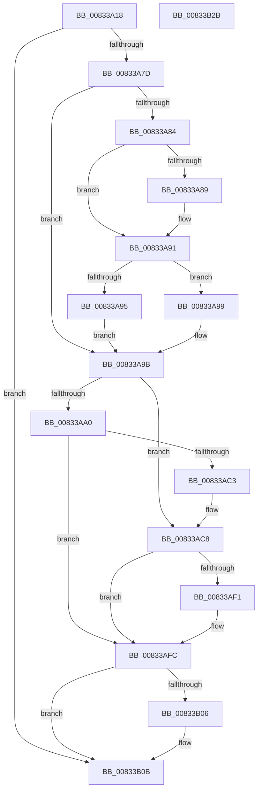

# DrvDbGetDriverInfFileMappedPropertyKeys

- RVA: `0x00833A18`–`0x00833B2C` (길이 `276` bytes)
- VA: `0x0000000140833A18`
- 실행 섹션: `PAGE`
- PDB 이름 있음: `예`; PDB Function 태그: `아니요`
- unwind 정보 RVA: `0x000C3AF8`
- 디코드: `82`개 명령, `276/276` bytes 표시
- 미해석 바이트: `0` (있으면 어셈블리에 `.byte`로 보존)

> 이 문서는 커널 이미지의 기계어와 PDB 기호를 분석해 생성했습니다. 4번과 5번은 함수 원형과 자료형을 바이너리 사용 방식에서 추정한 C 해석이며 원본 소스 복구 결과는 아닙니다.

## 1. Dependencies

- 직접 호출 지점: **4**; 고유 호출 대상: **4**
- 직접 호출자로 확인된 함수: **1**
- RIP 상대 이미지 참조: **2**

### Outgoing calls
- `0x00833A6E` → [DrvDbGetCompositeMappedPropertyKeys](DrvDbGetCompositeMappedPropertyKeys_function_008332EC.md) (function, `0x008332EC`)
- `0x00833AB8` → [DrvDbOpenDriverInfFileRegKey](../93/DrvDbOpenDriverInfFileRegKey_function_00930354.md) (function, `0x00930354`)
- `0x00833AE6` → [DrvDbGetRegValueMappedPropertyKeys](DrvDbGetRegValueMappedPropertyKeys_function_00833EEC.md) (function, `0x00833EEC`)
- `0x00833B06` → [ZwClose](../../text/6A/ZwClose_function_006AD2B0.md) (function, `0x006AD2B0`)

### Direct callers
- [DrvDbDispatchDriverInfFile](../92/DrvDbDispatchDriverInfFile_function_0092FE10.md) at `0x0092FF62`

### Static image references
- `0x00833A46` → RVA `0x00E0A450` (`.data`; read)
- `0x00833ACD` → RVA `0x00002110` (`.rdata`; read)

## 2. Other-region calls and transfers

- 다른 실행 섹션으로 향하는 call: **1**
  - `0x00833B06` → [ZwClose](../../text/6A/ZwClose_function_006AD2B0.md) (`PAGE` → `.text`)
- 별도 외부 분기/꼬리 이동을 확인하지 못했습니다.

## 3. Assembly (complete function range)

```asm
00833A18  48 8B C4                        mov rax, rsp
00833A1B  48 89 58 08                     mov qword ptr [rax + 8], rbx
00833A1F  48 89 68 10                     mov qword ptr [rax + 0x10], rbp
00833A23  48 89 70 18                     mov qword ptr [rax + 0x18], rsi
00833A27  57                              push rdi
00833A28  41 54                           push r12
00833A2A  41 55                           push r13
00833A2C  41 56                           push r14
00833A2E  41 57                           push r15
00833A30  48 83 EC 50                     sub rsp, 0x50
00833A34  4C 8B B4 24 A8 00 00 00         mov r14, qword ptr [rsp + 0xa8]
00833A3C  4C 8B E2                        mov r12, rdx
00833A3F  8B AC 24 A0 00 00 00            mov ebp, dword ptr [rsp + 0xa0]
00833A46  48 8D 15 03 6A 5D 00            lea rdx, [rip + 0x5d6a03]
00833A4D  48 83 60 C8 00                  and qword ptr [rax - 0x38], 0
00833A52  4D 8B F8                        mov r15, r8
00833A55  4C 89 70 B0                     mov qword ptr [rax - 0x50], r14
00833A59  41 B8 01 00 00 00               mov r8d, 1
00833A5F  41 83 26 00                     and dword ptr [r14], 0
00833A63  49 8B F1                        mov rsi, r9
00833A66  4C 8B E9                        mov r13, rcx
00833A69  89 68 A8                        mov dword ptr [rax - 0x58], ebp
00833A6C  8B FD                           mov edi, ebp
00833A6E  E8 79 F8 FF FF                  call 0x1408332ec
00833A73  8B D8                           mov ebx, eax
00833A75  85 C0                           test eax, eax
00833A77  0F 88 8E 00 00 00               js 0x140833b0b
00833A7D  41 8B 16                        mov edx, dword ptr [r14]
00833A80  85 D2                           test edx, edx
00833A82  74 17                           je 0x140833a9b
00833A84  4D 85 C9                        test r9, r9
00833A87  74 08                           je 0x140833a91
00833A89  48 8D 0C 92                     lea rcx, [rdx + rdx*4]
00833A8D  49 8D 34 89                     lea rsi, [r9 + rcx*4]
00833A91  3B D5                           cmp edx, ebp
00833A93  76 04                           jbe 0x140833a99
00833A95  33 FF                           xor edi, edi
00833A97  EB 02                           jmp 0x140833a9b
00833A99  2B FA                           sub edi, edx
00833A9B  4D 85 FF                        test r15, r15
00833A9E  75 28                           jne 0x140833ac8
00833AA0  4C 21 7C 24 28                  and qword ptr [rsp + 0x28], r15
00833AA5  48 8D 44 24 40                  lea rax, [rsp + 0x40]
00833AAA  45 33 C9                        xor r9d, r9d
00833AAD  48 89 44 24 20                  mov qword ptr [rsp + 0x20], rax
00833AB2  49 8B D4                        mov rdx, r12
00833AB5  49 8B CD                        mov rcx, r13
00833AB8  E8 97 C8 0F 00                  call 0x140930354
00833ABD  8B D8                           mov ebx, eax
00833ABF  85 C0                           test eax, eax
00833AC1  78 39                           js 0x140833afc
00833AC3  4C 8B 7C 24 40                  mov r15, qword ptr [rsp + 0x40]
00833AC8  4C 89 74 24 30                  mov qword ptr [rsp + 0x30], r14
00833ACD  4C 8D 05 3C E6 7C FF            lea r8, [rip - 0x8319c4]
00833AD4  89 7C 24 28                     mov dword ptr [rsp + 0x28], edi
00833AD8  41 B9 04 00 00 00               mov r9d, 4
00833ADE  49 8B D7                        mov rdx, r15
00833AE1  48 89 74 24 20                  mov qword ptr [rsp + 0x20], rsi
00833AE6  E8 01 04 00 00                  call 0x140833eec
00833AEB  8B D8                           mov ebx, eax
00833AED  85 C0                           test eax, eax
00833AEF  78 0B                           js 0x140833afc
00833AF1  41 3B 2E                        cmp ebp, dword ptr [r14]
00833AF4  B8 23 00 00 C0                  mov eax, 0xc0000023
00833AF9  0F 42 D8                        cmovb ebx, eax
00833AFC  48 8B 4C 24 40                  mov rcx, qword ptr [rsp + 0x40]
00833B01  48 85 C9                        test rcx, rcx
00833B04  74 05                           je 0x140833b0b
00833B06  E8 A5 97 E7 FF                  call 0x1406ad2b0
00833B0B  4C 8D 5C 24 50                  lea r11, [rsp + 0x50]
00833B10  8B C3                           mov eax, ebx
00833B12  49 8B 5B 30                     mov rbx, qword ptr [r11 + 0x30]
00833B16  49 8B 6B 38                     mov rbp, qword ptr [r11 + 0x38]
00833B1A  49 8B 73 40                     mov rsi, qword ptr [r11 + 0x40]
00833B1E  49 8B E3                        mov rsp, r11
00833B21  41 5F                           pop r15
00833B23  41 5E                           pop r14
00833B25  41 5D                           pop r13
00833B27  41 5C                           pop r12
00833B29  5F                              pop rdi
00833B2A  C3                              ret
00833B2B  CC                              int3
```

## 4. C-style interpretation (structured pseudocode)

```c
__int64 __fastcall DrvDbGetDriverInfFileMappedPropertyKeys(__int64 a1, __int64 a2, __int64 a3, __int64 a4, unsigned int a5, __int64 a6)
{
    __int64 result;
    __int64 v_rbx;
    __int64 v_rdi;
    __int64 v_rsi;
    __int64 v_rsp;
    unsigned __int64 v_stack_m28;
    unsigned __int64 v_stack_m38;
    unsigned __int64 v_stack_m48;
    unsigned __int64 v_stack_m50;
    unsigned __int64 v_stack_m58;

    *(unsigned __int64 *)(v_rsp + 8) = v_rbx;
    *(unsigned __int64 *)(v_rsp + 16) = v_rbp;
    *(unsigned __int64 *)(v_rsp + 24) = v_rsi;
    v_rsp = (v_rsp) - (80);
    *(unsigned __int64 *)(v_rsp - 80) = a6;
    *(unsigned int *)(v_rsp - 88) = (unsigned int)((unsigned int)(a5));
    result = DrvDbGetCompositeMappedPropertyKeys(a1, v_rip + 6121987, 1, a4);
    if (sign_flag) goto loc_00833B0B;
    if ((unsigned int)((unsigned int)(*(unsigned int *)(a6))) == 0) goto loc_00833A9B;
    v_rsi = a4;
    if (a4 != 0) {
        a1 = (unsigned int)(*(unsigned int *)(a6)) + (unsigned int)(*(unsigned int *)(a6)) * 4;
        v_rsi = a4 + a1 * 4;
    }
    if (((unsigned int)((unsigned int)(*(unsigned int *)(a6)))) <= ((unsigned int)((unsigned int)(a5)))) goto loc_00833A99;
    v_rdi = 0;
    goto loc_00833A9B;
loc_00833A99:
    v_rdi = (unsigned int)((v_rdi) - ((unsigned int)((unsigned int)(*(unsigned int *)(a6)))));
loc_00833A9B:
    if (a3 != 0) goto loc_00833AC8;
    a4 = 0;
    v_stack_m58 = v_stack_m38;
    result = DrvDbOpenDriverInfFileRegKey(a1, a2, 1, a4);
    if (sign_flag) goto loc_00833AFC;
loc_00833AC8:
    v_stack_m48 = a6;
    v_stack_m50 = (unsigned int)(v_rdi);
    v_stack_m58 = v_rsi;
    result = DrvDbGetRegValueMappedPropertyKeys(a1, v_stack_m38, v_rip - 8591812, 4);
    v_rbx = (unsigned int)((unsigned int)(result));
    if (!(sign_flag)) {
        result = 0xC0000023ULL;
        v_rbx = (unsigned int)((unsigned int)(result));
        if (((unsigned int)((unsigned int)(a5))) < (*(unsigned int *)(a6))) { v_rbx = (unsigned int)(result); }
    }
    if (v_stack_m38 != 0) {
        result = ZwClose(v_stack_m38, v_stack_m38, v_rip - 8591812, 4);
    }
    return (unsigned int)((unsigned int)(v_rbx));
}
```

## 5. (Beta) C Style

```c
int64_t DrvDbGetDriverInfFileMappedPropertyKeys(int64_t Arg1, int64_t Arg2, int64_t Arg3, int64_t Arg4, uint32_t Arg5, void *Arg6)
{
    uint8_t *arg6 = (uint8_t *)Arg6;

    int64_t result;
    int64_t local_rbx;
    int64_t local_rdi;
    int64_t local_rsi;
    int64_t local_rsp;
    uint64_t v_stack_m28;
    uint64_t v_stack_m38;
    uint64_t v_stack_m48;
    uint64_t v_stack_m50;
    uint64_t v_stack_m58;

    *(uint64_t *)(local_rsp + 0x8) = local_rbx;
    *(uint64_t *)(local_rsp + 0x10) = local_rbp;
    *(uint64_t *)(local_rsp + 0x18) = local_rsi;
    local_rsp = (local_rsp) - (80);
    *(void **)(local_rsp - 0x50) = Arg6;
    *(uint32_t *)(local_rsp - 0x58) = (uint32_t)((uint32_t)(Arg5));
    result = DrvDbGetCompositeMappedPropertyKeys(Arg1, v_rip + 6121987, 1, Arg4);
    if (sign_flag) goto loc_00833B0B;
    if ((uint32_t)((uint32_t)(*(uint32_t *)(arg6))) == 0) goto loc_00833A9B;
    local_rsi = Arg4;
    if (Arg4 != 0) {
        Arg1 = (uint32_t)(*(uint32_t *)(arg6)) + (uint32_t)(*(uint32_t *)(arg6)) * 4;
        local_rsi = Arg4 + Arg1 * 4;
    }
    if (((uint32_t)((uint32_t)(*(uint32_t *)(arg6)))) <= ((uint32_t)((uint32_t)(Arg5)))) goto loc_00833A99;
    local_rdi = 0;
    goto loc_00833A9B;
loc_00833A99:
    local_rdi = (uint32_t)((local_rdi) - ((uint32_t)((uint32_t)(*(uint32_t *)(arg6)))));
loc_00833A9B:
    if (Arg3 != 0) goto loc_00833AC8;
    Arg4 = 0;
    v_stack_m58 = v_stack_m38;
    result = DrvDbOpenDriverInfFileRegKey(Arg1, Arg2, 1, Arg4);
    if (sign_flag) goto loc_00833AFC;
loc_00833AC8:
    v_stack_m48 = Arg6;
    v_stack_m50 = (uint32_t)(local_rdi);
    v_stack_m58 = local_rsi;
    result = DrvDbGetRegValueMappedPropertyKeys(Arg1, v_stack_m38, v_rip - 8591812, 4);
    local_rbx = (uint32_t)((uint32_t)(result));
    if (!(sign_flag)) {
        result = 0xC0000023ULL;
        local_rbx = (uint32_t)((uint32_t)(result));
        if (((uint32_t)((uint32_t)(Arg5))) < (*(uint32_t *)(arg6))) { local_rbx = (uint32_t)(result); }
    }
    if (v_stack_m38 != 0) {
        result = ZwClose(v_stack_m38, v_stack_m38, v_rip - 8591812, 4);
    }
    return (uint32_t)((uint32_t)(local_rbx));
}
```

### 관측된 메모리 오프셋

구조체 형식이 확인되지 않은 접근은 인자 기준의 오프셋으로만 기록했습니다.

| 기준 인자 | 오프셋 표현 | 폭 (bit) | 접근 |
|---|---:|---:|---|
| `Arg6` | `+ 0x0` | `32` | `R` |
| `Arg6` | `+ 0x0` | `32` | `R/W` |

## 6. Execution-region graph

[열기: 2D/3D 그래프와 함수 탐색 컨트롤 패널](../../../control-panel.html?section=page&rva=0x00833A18&view=graph)

- 2D 그래프는 위에서 아래로 흐르고, 3D 그래프는 빈 공간을 드래그해 회전합니다. Shift+드래그는 이동, 휠은 확대·축소, 함수 노드 선택은 대상 보고서 이동입니다.

### Static fallback


