# DrvDbGetDriverPackageMappedPropertyKeys

- RVA: `0x00833B34`–`0x00833E1E` (길이 `746` bytes)
- VA: `0x0000000140833B34`
- 실행 섹션: `PAGE`
- PDB 이름 있음: `예`; PDB Function 태그: `아니요`
- unwind 정보 RVA: `0x000CC16C`
- 디코드: `210`개 명령, `746/746` bytes 표시
- 미해석 바이트: `0` (있으면 어셈블리에 `.byte`로 보존)

> 이 문서는 커널 이미지의 기계어와 PDB 기호를 분석해 생성했습니다. 4번과 5번은 함수 원형과 자료형을 바이너리 사용 방식에서 추정한 C 해석이며 원본 소스 복구 결과는 아닙니다.

## 1. Dependencies

- 직접 호출 지점: **6**; 고유 호출 대상: **6**
- 직접 호출자로 확인된 함수: **1**
- RIP 상대 이미지 참조: **4**

### Outgoing calls
- `0x00833B91` → [DrvDbGetCompositeMappedPropertyKeys](DrvDbGetCompositeMappedPropertyKeys_function_008332EC.md) (function, `0x008332EC`)
- `0x00833BE5` → [DrvDbOpenDriverPackageRegKey](../93/DrvDbOpenDriverPackageRegKey_function_00931014.md) (function, `0x00931014`)
- `0x00833C49` → [DrvDbGetDriverPackageMappedProperty](../93/DrvDbGetDriverPackageMappedProperty_function_009305BC.md) (function, `0x009305BC`)
- `0x00833D04` → [PnpCtxRegQueryValue](../99/PnpCtxRegQueryValue_function_009940FC.md) (function, `0x009940FC`)
- `0x00833D6A` → [DrvDbGetDriverPackageSignerScore](../92/DrvDbGetDriverPackageSignerScore_function_0092F428.md) (function, `0x0092F428`)
- `0x00833DFE` → [ZwClose](../../text/6A/ZwClose_function_006AD2B0.md) (function, `0x006AD2B0`)

### Direct callers
- [DrvDbDispatchDriverPackage](../93/DrvDbDispatchDriverPackage_function_009303A0.md) at `0x00930549`

### Static image references
- `0x00833B6A` → RVA `0x00E0A4C0` (`.data`; read)
- `0x00833BFB` → RVA `0x00000000` (`image boundary/outside`; read)
- `0x00833D32` → RVA `0x00022AA0` (`.rdata`; read)
- `0x00833D3F` → RVA `0x00022AA8` (`.rdata`; read)

## 2. Other-region calls and transfers

- 다른 실행 섹션으로 향하는 call: **1**
  - `0x00833DFE` → [ZwClose](../../text/6A/ZwClose_function_006AD2B0.md) (`PAGE` → `.text`)
- 별도 외부 분기/꼬리 이동을 확인하지 못했습니다.

## 3. Assembly (complete function range)

```asm
00833B34  4C 8B DC                        mov r11, rsp
00833B37  49 89 5B 20                     mov qword ptr [r11 + 0x20], rbx
00833B3B  4D 89 43 18                     mov qword ptr [r11 + 0x18], r8
00833B3F  49 89 53 10                     mov qword ptr [r11 + 0x10], rdx
00833B43  49 89 4B 08                     mov qword ptr [r11 + 8], rcx
00833B47  55                              push rbp
00833B48  56                              push rsi
00833B49  57                              push rdi
00833B4A  41 54                           push r12
00833B4C  41 55                           push r13
00833B4E  41 56                           push r14
00833B50  41 57                           push r15
00833B52  48 8B EC                        mov rbp, rsp
00833B55  48 83 EC 60                     sub rsp, 0x60
00833B59  48 8B 7D 68                     mov rdi, qword ptr [rbp + 0x68]
00833B5D  33 C0                           xor eax, eax
00833B5F  44 8B 6D 60                     mov r13d, dword ptr [rbp + 0x60]
00833B63  4C 8B FA                        mov r15, rdx
00833B66  49 89 7B 90                     mov qword ptr [r11 - 0x70], rdi
00833B6A  48 8D 15 4F 69 5D 00            lea rdx, [rip + 0x5d694f]
00833B71  49 8B F1                        mov rsi, r9
00833B74  48 89 45 E8                     mov qword ptr [rbp - 0x18], rax
00833B78  44 8D 40 10                     lea r8d, [rax + 0x10]
00833B7C  89 45 E0                        mov dword ptr [rbp - 0x20], eax
00833B7F  89 45 E4                        mov dword ptr [rbp - 0x1c], eax
00833B82  44 8B E0                        mov r12d, eax
00833B85  89 45 68                        mov dword ptr [rbp + 0x68], eax
00833B88  45 8B F5                        mov r14d, r13d
00833B8B  89 07                           mov dword ptr [rdi], eax
00833B8D  45 89 6B 88                     mov dword ptr [r11 - 0x78], r13d
00833B91  E8 56 F7 FF FF                  call 0x1408332ec
00833B96  8B D8                           mov ebx, eax
00833B98  85 C0                           test eax, eax
00833B9A  0F 88 63 02 00 00               js 0x140833e03
00833BA0  8B 07                           mov eax, dword ptr [rdi]
00833BA2  85 C0                           test eax, eax
00833BA4  74 1A                           je 0x140833bc0
00833BA6  4D 85 C9                        test r9, r9
00833BA9  74 08                           je 0x140833bb3
00833BAB  48 8D 14 80                     lea rdx, [rax + rax*4]
00833BAF  49 8D 34 91                     lea rsi, [r9 + rdx*4]
00833BB3  41 3B C5                        cmp eax, r13d
00833BB6  76 05                           jbe 0x140833bbd
00833BB8  45 33 F6                        xor r14d, r14d
00833BBB  EB 03                           jmp 0x140833bc0
00833BBD  44 2B F0                        sub r14d, eax
00833BC0  48 8B 45 50                     mov rax, qword ptr [rbp + 0x50]
00833BC4  48 85 C0                        test rax, rax
00833BC7  75 2F                           jne 0x140833bf8
00833BC9  4C 21 64 24 28                  and qword ptr [rsp + 0x28], r12
00833BCE  48 8D 45 E8                     lea rax, [rbp - 0x18]
00833BD2  48 8B 4D 40                     mov rcx, qword ptr [rbp + 0x40]
00833BD6  45 33 C9                        xor r9d, r9d
00833BD9  49 8B D7                        mov rdx, r15
00833BDC  48 89 44 24 20                  mov qword ptr [rsp + 0x20], rax
00833BE1  45 8D 41 01                     lea r8d, [r9 + 1]
00833BE5  E8 2A D4 0F 00                  call 0x140931014
00833BEA  8B D8                           mov ebx, eax
00833BEC  85 C0                           test eax, eax
00833BEE  0F 88 01 02 00 00               js 0x140833df5
00833BF4  48 8B 45 50                     mov rax, qword ptr [rbp + 0x50]
00833BF8  45 33 FF                        xor r15d, r15d
00833BFB  4C 8D 15 FE C3 7C FF            lea r10, [rip - 0x833c02]
00833C02  B9 23 00 00 C0                  mov ecx, 0xc0000023
00833C07  41 83 FF 04                     cmp r15d, 4
00833C0B  0F 83 B1 00 00 00               jae 0x140833cc2
00833C11  4C 8B 45 E8                     mov r8, qword ptr [rbp - 0x18]
00833C15  48 8D 4D E0                     lea rcx, [rbp - 0x20]
00833C19  4F 8B 8C FA 50 C6 00 00         mov r9, qword ptr [r10 + r15*8 + 0xc650]
00833C21  48 85 C0                        test rax, rax
00833C24  48 8B 55 48                     mov rdx, qword ptr [rbp + 0x48]
00833C28  48 89 4C 24 38                  mov qword ptr [rsp + 0x38], rcx
00833C2D  4C 0F 45 C0                     cmovne r8, rax
00833C31  83 64 24 30 00                  and dword ptr [rsp + 0x30], 0
00833C36  48 8D 4D E4                     lea rcx, [rbp - 0x1c]
00833C3A  48 83 64 24 28 00               and qword ptr [rsp + 0x28], 0
00833C40  48 89 4C 24 20                  mov qword ptr [rsp + 0x20], rcx
00833C45  48 8B 4D 40                     mov rcx, qword ptr [rbp + 0x40]
00833C49  E8 6E C9 0F 00                  call 0x1409305bc
00833C4E  8B D8                           mov ebx, eax
00833C50  3D 25 02 00 C0                  cmp eax, 0xc0000225
00833C55  74 4B                           je 0x140833ca2
00833C57  85 C0                           test eax, eax
00833C59  74 09                           je 0x140833c64
00833C5B  B9 23 00 00 C0                  mov ecx, 0xc0000023
00833C60  3B C1                           cmp eax, ecx
00833C62  75 4A                           jne 0x140833cae
00833C64  4C 8D 15 95 C3 7C FF            lea r10, [rip - 0x833c6b]
00833C6B  48 85 F6                        test rsi, rsi
00833C6E  74 25                           je 0x140833c95
00833C70  45 3B E6                        cmp r12d, r14d
00833C73  73 20                           jae 0x140833c95
00833C75  4B 8B 94 FA 50 C6 00 00         mov rdx, qword ptr [r10 + r15*8 + 0xc650]
00833C7D  41 8B C4                        mov eax, r12d
00833C80  41 FF C4                        inc r12d
00833C83  0F 10 02                        movups xmm0, xmmword ptr [rdx]
00833C86  48 8D 0C 80                     lea rcx, [rax + rax*4]
00833C8A  0F 11 04 8E                     movups xmmword ptr [rsi + rcx*4], xmm0
00833C8E  8B 42 10                        mov eax, dword ptr [rdx + 0x10]
00833C91  89 44 8E 10                     mov dword ptr [rsi + rcx*4 + 0x10], eax
00833C95  8B 07                           mov eax, dword ptr [rdi]
00833C97  8D 48 01                        lea ecx, [rax + 1]
00833C9A  3B C8                           cmp ecx, eax
00833C9C  72 19                           jb 0x140833cb7
00833C9E  89 0F                           mov dword ptr [rdi], ecx
00833CA0  33 DB                           xor ebx, ebx
00833CA2  48 8B 45 50                     mov rax, qword ptr [rbp + 0x50]
00833CA6  41 FF C7                        inc r15d
00833CA9  E9 4D FF FF FF                  jmp 0x140833bfb
00833CAE  4C 8D 15 4B C3 7C FF            lea r10, [rip - 0x833cb5]
00833CB5  EB 0B                           jmp 0x140833cc2
00833CB7  83 27 00                        and dword ptr [rdi], 0
00833CBA  BB 95 00 00 C0                  mov ebx, 0xc0000095
00833CBF  8D 4B 8E                        lea ecx, [rbx - 0x72]
00833CC2  45 33 FF                        xor r15d, r15d
00833CC5  41 83 FF 29                     cmp r15d, 0x29
00833CC9  0F 83 1C 01 00 00               jae 0x140833deb
00833CCF  48 8B 4D 50                     mov rcx, qword ptr [rbp + 0x50]
00833CD3  4B 8D 04 BF                     lea rax, [r15 + r15*4]
00833CD7  83 65 60 00                     and dword ptr [rbp + 0x60], 0
00833CDB  48 8B 55 E8                     mov rdx, qword ptr [rbp - 0x18]
00833CDF  48 85 C9                        test rcx, rcx
00833CE2  4D 8B 84 C2 80 C6 00 00         mov r8, qword ptr [r10 + rax*8 + 0xc680]
00833CEA  48 0F 45 D1                     cmovne rdx, rcx
00833CEE  48 89 45 F0                     mov qword ptr [rbp - 0x10], rax
00833CF2  48 8D 4D 60                     lea rcx, [rbp + 0x60]
00833CF6  45 33 C9                        xor r9d, r9d
00833CF9  48 89 4C 24 28                  mov qword ptr [rsp + 0x28], rcx
00833CFE  48 83 64 24 20 00               and qword ptr [rsp + 0x20], 0
00833D04  E8 F3 03 16 00                  call 0x1409940fc
00833D09  8B D8                           mov ebx, eax
00833D0B  3D 34 00 00 C0                  cmp eax, 0xc0000034
00833D10  75 73                           jne 0x140833d85
00833D12  48 8B 5D F0                     mov rbx, qword ptr [rbp - 0x10]
00833D16  4C 8D 15 E3 C2 7C FF            lea r10, [rip - 0x833d1d]
00833D1D  49 8B 8C DA 70 C6 00 00         mov rcx, qword ptr [r10 + rbx*8 + 0xc670]
00833D25  83 79 10 07                     cmp dword ptr [rcx + 0x10], 7
00833D29  0F 85 A3 00 00 00               jne 0x140833dd2
00833D2F  48 8B 01                        mov rax, qword ptr [rcx]
00833D32  48 2B 05 67 ED 7E FF            sub rax, qword ptr [rip - 0x811299]
00833D39  75 0B                           jne 0x140833d46
00833D3B  48 8B 41 08                     mov rax, qword ptr [rcx + 8]
00833D3F  48 2B 05 62 ED 7E FF            sub rax, qword ptr [rip - 0x81129e]
00833D46  48 85 C0                        test rax, rax
00833D49  0F 85 83 00 00 00               jne 0x140833dd2
00833D4F  48 8B 45 50                     mov rax, qword ptr [rbp + 0x50]
00833D53  4C 8D 4D 68                     lea r9, [rbp + 0x68]
00833D57  4C 8B 45 E8                     mov r8, qword ptr [rbp - 0x18]
00833D5B  48 85 C0                        test rax, rax
00833D5E  48 8B 55 48                     mov rdx, qword ptr [rbp + 0x48]
00833D62  48 8B 4D 40                     mov rcx, qword ptr [rbp + 0x40]
00833D66  4C 0F 45 C0                     cmovne r8, rax
00833D6A  E8 B9 B6 0F 00                  call 0x14092f428
00833D6F  85 C0                           test eax, eax
00833D71  78 09                           js 0x140833d7c
00833D73  81 7D 68 03 00 00 0D            cmp dword ptr [rbp + 0x68], 0xd000003
00833D7A  74 1A                           je 0x140833d96
00833D7C  4C 8D 15 7D C2 7C FF            lea r10, [rip - 0x833d83]
00833D83  EB 4D                           jmp 0x140833dd2
00833D85  85 C0                           test eax, eax
00833D87  74 09                           je 0x140833d92
00833D89  B9 23 00 00 C0                  mov ecx, 0xc0000023
00833D8E  3B C1                           cmp eax, ecx
00833D90  75 59                           jne 0x140833deb
00833D92  48 8B 5D F0                     mov rbx, qword ptr [rbp - 0x10]
00833D96  4C 8D 15 63 C2 7C FF            lea r10, [rip - 0x833d9d]
00833D9D  48 85 F6                        test rsi, rsi
00833DA0  74 25                           je 0x140833dc7
00833DA2  45 3B E6                        cmp r12d, r14d
00833DA5  73 20                           jae 0x140833dc7
00833DA7  49 8B 94 DA 70 C6 00 00         mov rdx, qword ptr [r10 + rbx*8 + 0xc670]
00833DAF  41 8B C4                        mov eax, r12d
00833DB2  41 FF C4                        inc r12d
00833DB5  0F 10 02                        movups xmm0, xmmword ptr [rdx]
00833DB8  48 8D 0C 80                     lea rcx, [rax + rax*4]
00833DBC  0F 11 04 8E                     movups xmmword ptr [rsi + rcx*4], xmm0
00833DC0  8B 42 10                        mov eax, dword ptr [rdx + 0x10]
00833DC3  89 44 8E 10                     mov dword ptr [rsi + rcx*4 + 0x10], eax
00833DC7  8B 07                           mov eax, dword ptr [rdi]
00833DC9  8D 48 01                        lea ecx, [rax + 1]
00833DCC  3B C8                           cmp ecx, eax
00833DCE  72 11                           jb 0x140833de1
00833DD0  89 0F                           mov dword ptr [rdi], ecx
00833DD2  33 DB                           xor ebx, ebx
00833DD4  B9 23 00 00 C0                  mov ecx, 0xc0000023
00833DD9  41 FF C7                        inc r15d
00833DDC  E9 E4 FE FF FF                  jmp 0x140833cc5
00833DE1  83 27 00                        and dword ptr [rdi], 0
00833DE4  BB 95 00 00 C0                  mov ebx, 0xc0000095
00833DE9  EB 0A                           jmp 0x140833df5
00833DEB  85 DB                           test ebx, ebx
00833DED  78 06                           js 0x140833df5
00833DEF  44 3B 2F                        cmp r13d, dword ptr [rdi]
00833DF2  0F 42 D9                        cmovb ebx, ecx
00833DF5  48 8B 4D E8                     mov rcx, qword ptr [rbp - 0x18]
00833DF9  48 85 C9                        test rcx, rcx
00833DFC  74 05                           je 0x140833e03
00833DFE  E8 AD 94 E7 FF                  call 0x1406ad2b0
00833E03  8B C3                           mov eax, ebx
00833E05  48 8B 9C 24 B8 00 00 00         mov rbx, qword ptr [rsp + 0xb8]
00833E0D  48 83 C4 60                     add rsp, 0x60
00833E11  41 5F                           pop r15
00833E13  41 5E                           pop r14
00833E15  41 5D                           pop r13
00833E17  41 5C                           pop r12
00833E19  5F                              pop rdi
00833E1A  5E                              pop rsi
00833E1B  5D                              pop rbp
00833E1C  C3                              ret
00833E1D  CC                              int3
```

## 4. C-style interpretation (structured pseudocode)

```c
__int64 __fastcall DrvDbGetDriverPackageMappedPropertyKeys(__int64 a1, __int64 a2, __int64 a3, __int64 a4, unsigned int a5, unsigned int a6)
{
    __int64 result;
    __int64 v_r12;
    __int64 v_r14;
    __int64 v_r15;
    __int64 v_rbx;
    __int64 v_rsi;
    __int64 v_rsp;
    unsigned __int64 v_stack_m48;
    unsigned __int64 v_stack_m50;
    unsigned int v_stack_m54;
    unsigned int v_stack_m58;
    unsigned __int64 v_stack_m60;
    unsigned int v_stack_m68;
    unsigned __int64 v_stack_m70;
    unsigned __int64 v_stack_m78;
    unsigned __int64 v_stack_p10;
    unsigned __int64 v_stack_p18;
    unsigned __int64 v_stack_p20;
    unsigned int v_stack_p30;
    unsigned __int64 v_stack_p8;

    *(unsigned __int64 *)(v_rsp + 32) = v_rbx;
    *(unsigned __int64 *)(v_rsp + 24) = a3;
    *(unsigned __int64 *)(v_rsp + 16) = a2;
    *(unsigned __int64 *)(v_rsp + 8) = a1;
    v_rsp = (v_rsp) - (96);
    result = 0;
    *(unsigned __int64 *)(v_rsp - 112) = a6;
    v_stack_m50 = 0;
    v_stack_m58 = 0;
    v_stack_m54 = 0;
    v_stack_p30 = 0;
    *(unsigned int *)(a6) = 0;
    *(unsigned int *)(v_rsp - 120) = (unsigned int)((unsigned int)(a5));
    result = DrvDbGetCompositeMappedPropertyKeys(a1, v_rip + 6121807, result + 16, a4);
    if (sign_flag) goto loc_00833E03;
    if ((unsigned int)((unsigned int)(*(unsigned int *)(a6))) == 0) goto loc_00833BC0;
    v_rsi = a4;
    if (a4 != 0) {
        a2 = (unsigned int)(*(unsigned int *)(a6)) + (unsigned int)(*(unsigned int *)(a6)) * 4;
        v_rsi = a4 + a2 * 4;
    }
    if (((unsigned int)((unsigned int)(*(unsigned int *)(a6)))) <= ((unsigned int)((unsigned int)(a5)))) goto loc_00833BBD;
    v_r14 = 0;
    goto loc_00833BC0;
loc_00833BBD:
    v_r14 = (unsigned int)((v_r14) - ((unsigned int)((unsigned int)(*(unsigned int *)(a6)))));
loc_00833BC0:
    if (v_stack_p18 != 0) goto loc_00833BF8;
    a4 = 0;
    v_stack_m78 = v_stack_m50;
    result = DrvDbOpenDriverPackageRegKey(v_stack_p8, a2, a4 + 1, a4);
    if (sign_flag) goto loc_00833DF5;
loc_00833BF8:
    v_r15 = 0;
loc_00833BFB:
    if (0 >= 4) goto loc_00833CC2;
    v_stack_m60 = v_stack_m58;
    a3 = v_stack_m50;
    if (v_stack_p18 != 0) { a3 = v_stack_p18; }
    v_stack_m78 = v_stack_m54;
    result = DrvDbGetDriverPackageMappedProperty(v_stack_p8, v_stack_p10, a3, *(unsigned __int64 *)(v_rip - 8600578 + v_r15 * 8 + 50768));
    if (((unsigned int)(result)) == 0xC0000225ULL) goto loc_00833CA2;
    if ((unsigned int)(result) == 0) goto loc_00833C64;
    if (((unsigned int)(result)) != ((unsigned int)((unsigned int)(0xC0000023ULL)))) goto loc_00833CAE;
loc_00833C64:
    if (v_rsi == 0) goto loc_00833C95;
    v_r12 = 0;
    if (0 < ((unsigned int)(v_r14))) {
        a2 = *(unsigned __int64 *)(v_rip - 8600683 + v_r15 * 8 + 50768);
        result = 0;
        v_r12 = (unsigned int)((0) + 1);
        a1 = result + result * 4;
        *(unsigned __int64 *)(v_rsi + a1 * 4) = v_xmm0;
        result = *(unsigned int *)(a2 + 16);
        *(unsigned int *)(v_rsi + a1 * 4 + 16) = (unsigned int)(result);
    }
    if (((unsigned int)((unsigned int)(*(unsigned int *)(a6)) + 1)) < ((unsigned int)((unsigned int)(*(unsigned int *)(a6))))) goto loc_00833CB7;
    *(unsigned int *)(a6) = (unsigned int)((unsigned int)(*(unsigned int *)(a6)) + 1);
    v_rbx = 0;
loc_00833CA2:
    v_r15 = (unsigned int)((v_r15) + 1);
    goto loc_00833BFB;
loc_00833CAE:
    goto loc_00833CC2;
loc_00833CB7:
loc_00833CC2:
    v_r15 = 0;
loc_00833CC5:
    if (0 >= 41) goto loc_00833DEB;
    a2 = v_stack_m50;
    if (v_stack_p18 != 0) { a2 = v_stack_p18; }
    v_stack_m48 = v_r15 + v_r15 * 4;
    a4 = 0;
    v_stack_m70 = a5;
    result = PnpCtxRegQueryValue(a5, a2, *(unsigned __int64 *)(v_rip - 8600757 + v_r15 + v_r15 * 4 * 8 + 50816), a4);
    if (((unsigned int)(result)) != 0xC0000034ULL) goto loc_00833D85;
    if ((*(unsigned int *)(*(unsigned __int64 *)(v_rip - 8600861 + v_stack_m48 * 8 + 50800) + 16)) != 7) goto loc_00833DD2;
    result = (*(unsigned __int64 *)(*(unsigned __int64 *)(v_rip - 8600861 + v_stack_m48 * 8 + 50800))) - (*(unsigned __int64 *)(v_rip - 8458905));
    if (!(condition_is_not_equal)) {
        result = *(unsigned __int64 *)(*(unsigned __int64 *)(v_rip - 8600861 + v_stack_m48 * 8 + 50800) + 8);
        result = (result) - (*(unsigned __int64 *)(v_rip - 8458910));
    }
    if (result != 0) goto loc_00833DD2;
    a3 = v_stack_m50;
    if (v_stack_p18 != 0) { a3 = v_stack_p18; }
    result = DrvDbGetDriverPackageSignerScore(v_stack_p8, v_stack_p10, a3, a6);
    if (sign_flag) goto loc_00833D7C;
    if (a6 == 0xD000003ULL) goto loc_00833D96;
loc_00833D7C:
    goto loc_00833DD2;
loc_00833D85:
    if ((unsigned int)(result) == 0) goto loc_00833D92;
    if (((unsigned int)(result)) != ((unsigned int)((unsigned int)(0xC0000023ULL)))) goto loc_00833DEB;
loc_00833D92:
loc_00833D96:
    if (v_rsi == 0) goto loc_00833DC7;
    if (((unsigned int)(v_r12)) < ((unsigned int)(v_r14))) {
        a2 = *(unsigned __int64 *)(v_rip - 8600989 + v_stack_m48 * 8 + 50800);
        result = (unsigned int)(v_r12);
        v_r12 = (unsigned int)((v_r12) + 1);
        a1 = result + result * 4;
        *(unsigned __int64 *)(v_rsi + a1 * 4) = v_xmm0;
        result = *(unsigned int *)(a2 + 16);
        *(unsigned int *)(v_rsi + a1 * 4 + 16) = (unsigned int)(result);
    }
    if (((unsigned int)((unsigned int)(*(unsigned int *)(a6)) + 1)) < ((unsigned int)((unsigned int)(*(unsigned int *)(a6))))) goto loc_00833DE1;
    *(unsigned int *)(a6) = (unsigned int)((unsigned int)(*(unsigned int *)(a6)) + 1);
loc_00833DD2:
    v_rbx = 0;
    v_r15 = (unsigned int)((v_r15) + 1);
    goto loc_00833CC5;
loc_00833DE1:
    goto loc_00833DF5;
loc_00833DEB:
    v_rbx = (unsigned int)(0xC0000095ULL);
    if (!(sign_flag)) {
        v_rbx = (unsigned int)(0xC0000095ULL);
        if (((unsigned int)((unsigned int)(a5))) < (*(unsigned int *)(a6))) { v_rbx = (unsigned int)((unsigned int)(0xC0000023ULL)); }
    }
    result = (unsigned int)(*(unsigned int *)(a6));
    if (v_stack_m50 != 0) {
        result = ZwClose(v_stack_m50, a2, a3, a6);
    }
    v_rsp = (v_rsp) + (96);
    return (unsigned int)((unsigned int)(v_rbx));
}
```

## 5. (Beta) C Style

```c
int64_t DrvDbGetDriverPackageMappedPropertyKeys(int64_t Arg1, int64_t Arg2, int64_t Arg3, int64_t Arg4, uint32_t Arg5, void *Arg6)
{
    uint8_t *arg6 = (uint8_t *)Arg6;

    int64_t result;
    int64_t local_r12;
    int64_t local_r14;
    int64_t local_r15;
    int64_t local_rbx;
    int64_t local_rsi;
    int64_t local_rsp;
    uint64_t v_stack_m48;
    uint64_t v_stack_m50;
    uint32_t v_stack_m54;
    uint32_t v_stack_m58;
    uint64_t v_stack_m60;
    uint32_t v_stack_m68;
    uint64_t v_stack_m70;
    uint64_t v_stack_m78;
    uint64_t v_stack_p10;
    uint64_t v_stack_p18;
    uint64_t v_stack_p20;
    uint32_t v_stack_p30;
    uint64_t v_stack_p8;

    *(uint64_t *)(local_rsp + 0x20) = local_rbx;
    *(uint64_t *)(local_rsp + 0x18) = Arg3;
    *(uint64_t *)(local_rsp + 0x10) = Arg2;
    *(uint64_t *)(local_rsp + 0x8) = Arg1;
    local_rsp = (local_rsp) - (96);
    result = 0;
    *(void **)(local_rsp - 0x70) = Arg6;
    v_stack_m50 = 0;
    v_stack_m58 = 0;
    v_stack_m54 = 0;
    v_stack_p30 = 0;
    *(uint32_t *)(arg6) = 0;
    *(uint32_t *)(local_rsp - 0x78) = (uint32_t)((uint32_t)(Arg5));
    result = DrvDbGetCompositeMappedPropertyKeys(Arg1, v_rip + 6121807, result + 16, Arg4);
    if (sign_flag) goto loc_00833E03;
    if ((uint32_t)((uint32_t)(*(uint32_t *)(arg6))) == 0) goto loc_00833BC0;
    local_rsi = Arg4;
    if (Arg4 != 0) {
        Arg2 = (uint32_t)(*(uint32_t *)(arg6)) + (uint32_t)(*(uint32_t *)(arg6)) * 4;
        local_rsi = Arg4 + Arg2 * 4;
    }
    if (((uint32_t)((uint32_t)(*(uint32_t *)(arg6)))) <= ((uint32_t)((uint32_t)(Arg5)))) goto loc_00833BBD;
    local_r14 = 0;
    goto loc_00833BC0;
loc_00833BBD:
    local_r14 = (uint32_t)((local_r14) - ((uint32_t)((uint32_t)(*(uint32_t *)(arg6)))));
loc_00833BC0:
    if (v_stack_p18 != 0) goto loc_00833BF8;
    Arg4 = 0;
    v_stack_m78 = v_stack_m50;
    result = DrvDbOpenDriverPackageRegKey(v_stack_p8, Arg2, Arg4 + 1, Arg4);
    if (sign_flag) goto loc_00833DF5;
loc_00833BF8:
    local_r15 = 0;
loc_00833BFB:
    if (0 >= 4) goto loc_00833CC2;
    v_stack_m60 = v_stack_m58;
    Arg3 = v_stack_m50;
    if (v_stack_p18 != 0) { Arg3 = v_stack_p18; }
    v_stack_m78 = v_stack_m54;
    result = DrvDbGetDriverPackageMappedProperty(v_stack_p8, v_stack_p10, Arg3, *(uint64_t *)(v_rip - 0x833C02 + local_r15 * 8 + 0xC650));
    if (((uint32_t)(result)) == 0xC0000225ULL) goto loc_00833CA2;
    if ((uint32_t)(result) == 0) goto loc_00833C64;
    if (((uint32_t)(result)) != ((uint32_t)((uint32_t)(0xC0000023ULL)))) goto loc_00833CAE;
loc_00833C64:
    if (local_rsi == 0) goto loc_00833C95;
    local_r12 = 0;
    if (0 < ((uint32_t)(local_r14))) {
        Arg2 = *(uint64_t *)(v_rip - 0x833C6B + local_r15 * 8 + 0xC650);
        result = 0;
        local_r12 = (uint32_t)((0) + 1);
        Arg1 = result + result * 4;
        *(uint64_t *)(local_rsi + Arg1 * 4) = v_xmm0;
        result = *(uint32_t *)(Arg2 + 0x10);
        *(uint32_t *)(local_rsi + Arg1 * 4 + 0x10) = (uint32_t)(result);
    }
    if (((uint32_t)((uint32_t)(*(uint32_t *)(arg6)) + 1)) < ((uint32_t)((uint32_t)(*(uint32_t *)(arg6))))) goto loc_00833CB7;
    *(uint32_t *)(arg6) = (uint32_t)((uint32_t)(*(uint32_t *)(arg6)) + 1);
    local_rbx = 0;
loc_00833CA2:
    local_r15 = (uint32_t)((local_r15) + 1);
    goto loc_00833BFB;
loc_00833CAE:
    goto loc_00833CC2;
loc_00833CB7:
loc_00833CC2:
    local_r15 = 0;
loc_00833CC5:
    if (0 >= 41) goto loc_00833DEB;
    Arg2 = v_stack_m50;
    if (v_stack_p18 != 0) { Arg2 = v_stack_p18; }
    v_stack_m48 = local_r15 + local_r15 * 4;
    Arg4 = 0;
    v_stack_m70 = Arg5;
    result = PnpCtxRegQueryValue(Arg5, Arg2, *(uint64_t *)(v_rip - 0x833CB5 + local_r15 + local_r15 * 4 * 8 + 0xC680), Arg4);
    if (((uint32_t)(result)) != 0xC0000034ULL) goto loc_00833D85;
    if ((*(uint32_t *)(*(uint64_t *)(v_rip - 0x833D1D + v_stack_m48 * 8 + 0xC670) + 0x10)) != 7) goto loc_00833DD2;
    result = (*(uint64_t *)(*(uint64_t *)(v_rip - 0x833D1D + v_stack_m48 * 8 + 0xC670))) - (*(uint64_t *)(v_rip - 0x811299));
    if (!(condition_is_not_equal)) {
        result = *(uint64_t *)(*(uint64_t *)(v_rip - 0x833D1D + v_stack_m48 * 8 + 0xC670) + 0x8);
        result = (result) - (*(uint64_t *)(v_rip - 0x81129E));
    }
    if (result != 0) goto loc_00833DD2;
    Arg3 = v_stack_m50;
    if (v_stack_p18 != 0) { Arg3 = v_stack_p18; }
    result = DrvDbGetDriverPackageSignerScore(v_stack_p8, v_stack_p10, Arg3, Arg6);
    if (sign_flag) goto loc_00833D7C;
    if (Arg6 == 0xD000003ULL) goto loc_00833D96;
loc_00833D7C:
    goto loc_00833DD2;
loc_00833D85:
    if ((uint32_t)(result) == 0) goto loc_00833D92;
    if (((uint32_t)(result)) != ((uint32_t)((uint32_t)(0xC0000023ULL)))) goto loc_00833DEB;
loc_00833D92:
loc_00833D96:
    if (local_rsi == 0) goto loc_00833DC7;
    if (((uint32_t)(local_r12)) < ((uint32_t)(local_r14))) {
        Arg2 = *(uint64_t *)(v_rip - 0x833D9D + v_stack_m48 * 8 + 0xC670);
        result = (uint32_t)(local_r12);
        local_r12 = (uint32_t)((local_r12) + 1);
        Arg1 = result + result * 4;
        *(uint64_t *)(local_rsi + Arg1 * 4) = v_xmm0;
        result = *(uint32_t *)(Arg2 + 0x10);
        *(uint32_t *)(local_rsi + Arg1 * 4 + 0x10) = (uint32_t)(result);
    }
    if (((uint32_t)((uint32_t)(*(uint32_t *)(arg6)) + 1)) < ((uint32_t)((uint32_t)(*(uint32_t *)(arg6))))) goto loc_00833DE1;
    *(uint32_t *)(arg6) = (uint32_t)((uint32_t)(*(uint32_t *)(arg6)) + 1);
loc_00833DD2:
    local_rbx = 0;
    local_r15 = (uint32_t)((local_r15) + 1);
    goto loc_00833CC5;
loc_00833DE1:
    goto loc_00833DF5;
loc_00833DEB:
    local_rbx = (uint32_t)(0xC0000095ULL);
    if (!(sign_flag)) {
        local_rbx = (uint32_t)(0xC0000095ULL);
        if (((uint32_t)((uint32_t)(Arg5))) < (*(uint32_t *)(arg6))) { local_rbx = (uint32_t)((uint32_t)(0xC0000023ULL)); }
    }
    result = (uint32_t)(*(uint32_t *)(arg6));
    if (v_stack_m50 != 0) {
        result = ZwClose(v_stack_m50, Arg2, Arg3, Arg6);
    }
    local_rsp = (local_rsp) + (96);
    return (uint32_t)((uint32_t)(local_rbx));
}
```

### 관측된 메모리 오프셋

구조체 형식이 확인되지 않은 접근은 인자 기준의 오프셋으로만 기록했습니다.

| 기준 인자 | 오프셋 표현 | 폭 (bit) | 접근 |
|---|---:|---:|---|
| `Arg6` | `+ 0x0` | `32` | `R` |
| `Arg6` | `+ 0x0` | `32` | `R/W` |
| `Arg6` | `+ 0x0` | `32` | `W` |

## 6. Execution-region graph

[열기: 2D/3D 그래프와 함수 탐색 컨트롤 패널](../../../control-panel.html?section=page&rva=0x00833B34&view=graph)

- 2D 그래프는 위에서 아래로 흐르고, 3D 그래프는 빈 공간을 드래그해 회전합니다. Shift+드래그는 이동, 휠은 확대·축소, 함수 노드 선택은 대상 보고서 이동입니다.

### Static fallback

```mermaid
flowchart TD
  bb_00833B34[BB_00833B34]
  bb_00833BA0[BB_00833BA0]
  bb_00833BA6[BB_00833BA6]
  bb_00833BAB[BB_00833BAB]
  bb_00833BB3[BB_00833BB3]
  bb_00833BB8[BB_00833BB8]
  bb_00833BBD[BB_00833BBD]
  bb_00833BC0[BB_00833BC0]
  bb_00833BC9[BB_00833BC9]
  bb_00833BF4[BB_00833BF4]
  bb_00833BF8[BB_00833BF8]
  bb_00833BFB[BB_00833BFB]
  bb_00833C11[BB_00833C11]
  bb_00833C57[BB_00833C57]
  bb_00833C5B[BB_00833C5B]
  bb_00833C64[BB_00833C64]
  bb_00833C70[BB_00833C70]
  bb_00833C75[BB_00833C75]
  bb_00833C95[BB_00833C95]
  bb_00833C9E[BB_00833C9E]
  bb_00833CA2[BB_00833CA2]
  bb_00833CAE[BB_00833CAE]
  bb_00833CB7[BB_00833CB7]
  bb_00833CC2[BB_00833CC2]
  bb_00833CC5[BB_00833CC5]
  bb_00833CCF[BB_00833CCF]
  bb_00833D12[BB_00833D12]
  bb_00833D2F[BB_00833D2F]
  bb_00833D3B[BB_00833D3B]
  bb_00833D46[BB_00833D46]
  bb_00833D4F[BB_00833D4F]
  bb_00833D73[BB_00833D73]
  bb_00833D7C[BB_00833D7C]
  bb_00833D85[BB_00833D85]
  bb_00833D89[BB_00833D89]
  bb_00833D92[BB_00833D92]
  bb_00833D96[BB_00833D96]
  bb_00833DA2[BB_00833DA2]
  bb_00833DA7[BB_00833DA7]
  bb_00833DC7[BB_00833DC7]
  bb_00833DD0[BB_00833DD0]
  bb_00833DD2[BB_00833DD2]
  bb_00833DE1[BB_00833DE1]
  bb_00833DEB[BB_00833DEB]
  bb_00833DEF[BB_00833DEF]
  bb_00833DF5[BB_00833DF5]
  bb_00833DFE[BB_00833DFE]
  bb_00833E03[BB_00833E03]
  bb_00833E1D[BB_00833E1D]
  bb_00833B34 -->|branch| bb_00833E03
  bb_00833B34 -->|fallthrough| bb_00833BA0
  bb_00833BA0 -->|branch| bb_00833BC0
  bb_00833BA0 -->|fallthrough| bb_00833BA6
  bb_00833BA6 -->|branch| bb_00833BB3
  bb_00833BA6 -->|fallthrough| bb_00833BAB
  bb_00833BAB -->|flow| bb_00833BB3
  bb_00833BB3 -->|branch| bb_00833BBD
  bb_00833BB3 -->|fallthrough| bb_00833BB8
  bb_00833BB8 -->|branch| bb_00833BC0
  bb_00833BBD -->|flow| bb_00833BC0
  bb_00833BC0 -->|branch| bb_00833BF8
  bb_00833BC0 -->|fallthrough| bb_00833BC9
  bb_00833BC9 -->|branch| bb_00833DF5
  bb_00833BC9 -->|fallthrough| bb_00833BF4
  bb_00833BF4 -->|flow| bb_00833BF8
  bb_00833BF8 -->|flow| bb_00833BFB
  bb_00833BFB -->|branch| bb_00833CC2
  bb_00833BFB -->|fallthrough| bb_00833C11
  bb_00833C11 -->|branch| bb_00833CA2
  bb_00833C11 -->|fallthrough| bb_00833C57
  bb_00833C57 -->|branch| bb_00833C64
  bb_00833C57 -->|fallthrough| bb_00833C5B
  bb_00833C5B -->|branch| bb_00833CAE
  bb_00833C5B -->|fallthrough| bb_00833C64
  bb_00833C64 -->|branch| bb_00833C95
  bb_00833C64 -->|fallthrough| bb_00833C70
  bb_00833C70 -->|branch| bb_00833C95
  bb_00833C70 -->|fallthrough| bb_00833C75
  bb_00833C75 -->|flow| bb_00833C95
  bb_00833C95 -->|branch| bb_00833CB7
  bb_00833C95 -->|fallthrough| bb_00833C9E
  bb_00833C9E -->|flow| bb_00833CA2
  bb_00833CA2 -->|branch| bb_00833BFB
  bb_00833CAE -->|branch| bb_00833CC2
  bb_00833CB7 -->|flow| bb_00833CC2
  bb_00833CC2 -->|flow| bb_00833CC5
  bb_00833CC5 -->|branch| bb_00833DEB
  bb_00833CC5 -->|fallthrough| bb_00833CCF
  bb_00833CCF -->|branch| bb_00833D85
  bb_00833CCF -->|fallthrough| bb_00833D12
  bb_00833D12 -->|branch| bb_00833DD2
  bb_00833D12 -->|fallthrough| bb_00833D2F
  bb_00833D2F -->|branch| bb_00833D46
  bb_00833D2F -->|fallthrough| bb_00833D3B
  bb_00833D3B -->|flow| bb_00833D46
  bb_00833D46 -->|branch| bb_00833DD2
  bb_00833D46 -->|fallthrough| bb_00833D4F
  bb_00833D4F -->|branch| bb_00833D7C
  bb_00833D4F -->|fallthrough| bb_00833D73
  bb_00833D73 -->|branch| bb_00833D96
  bb_00833D73 -->|fallthrough| bb_00833D7C
  bb_00833D7C -->|branch| bb_00833DD2
  bb_00833D85 -->|branch| bb_00833D92
  bb_00833D85 -->|fallthrough| bb_00833D89
  bb_00833D89 -->|branch| bb_00833DEB
  bb_00833D89 -->|fallthrough| bb_00833D92
  bb_00833D92 -->|flow| bb_00833D96
  bb_00833D96 -->|branch| bb_00833DC7
  bb_00833D96 -->|fallthrough| bb_00833DA2
  bb_00833DA2 -->|branch| bb_00833DC7
  bb_00833DA2 -->|fallthrough| bb_00833DA7
  bb_00833DA7 -->|flow| bb_00833DC7
  bb_00833DC7 -->|branch| bb_00833DE1
  bb_00833DC7 -->|fallthrough| bb_00833DD0
  bb_00833DD0 -->|flow| bb_00833DD2
  bb_00833DD2 -->|branch| bb_00833CC5
  bb_00833DE1 -->|branch| bb_00833DF5
  bb_00833DEB -->|branch| bb_00833DF5
  bb_00833DEB -->|fallthrough| bb_00833DEF
  bb_00833DEF -->|flow| bb_00833DF5
  bb_00833DF5 -->|branch| bb_00833E03
  bb_00833DF5 -->|fallthrough| bb_00833DFE
  bb_00833DFE -->|flow| bb_00833E03
```


