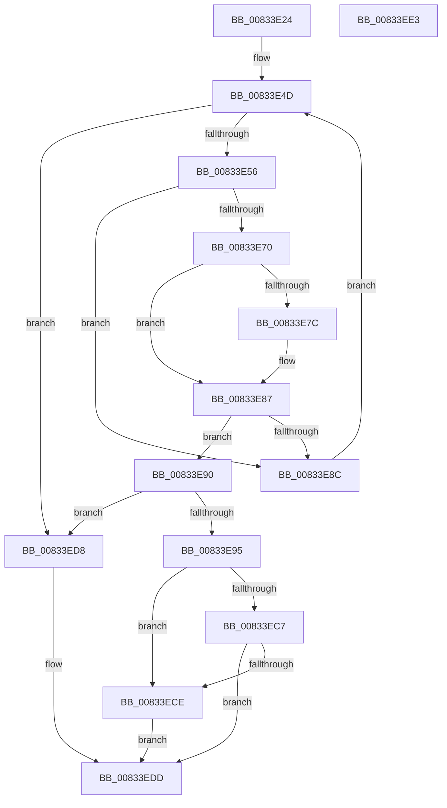

# DrvDbGetDriverPackageSignerName

- RVA: `0x00833E24`–`0x00833EE4` (길이 `192` bytes)
- VA: `0x0000000140833E24`
- 실행 섹션: `PAGE`
- PDB 이름 있음: `예`; PDB Function 태그: `아니요`
- unwind 정보 RVA: `0x000DAB94`
- 디코드: `56`개 명령, `192/192` bytes 표시
- 미해석 바이트: `0` (있으면 어셈블리에 `.byte`로 보존)

> 이 문서는 커널 이미지의 기계어와 PDB 기호를 분석해 생성했습니다. 4번과 5번은 함수 원형과 자료형을 바이너리 사용 방식에서 추정한 C 해석이며 원본 소스 복구 결과는 아닙니다.

## 1. Dependencies

- 직접 호출 지점: **1**; 고유 호출 대상: **1**
- 직접 호출자로 확인된 함수: **1**
- RIP 상대 이미지 참조: **3**

### Outgoing calls
- `0x00833EB6` → [DrvDbGetRegValueMappedProperty](../92/DrvDbGetRegValueMappedProperty_function_0092FB80.md) (function, `0x0092FB80`)

### Direct callers
- [DrvDbSetDriverPackageMappedProperty](DrvDbSetDriverPackageMappedProperty_function_00834848.md) at `0x00834BD3`
- [DrvDbSetDriverPackageMappedProperty](DrvDbSetDriverPackageMappedProperty_function_00834848.md) at `0x00834C30`
- [DrvDbSetDriverPackageMappedProperty](DrvDbSetDriverPackageMappedProperty_function_00834848.md) at `0x00834D21`

### Static image references
- `0x00833E5C` → RVA `0x0000C670` (`.rdata`; read)
- `0x00833E73` → RVA `0x00022AA0` (`.rdata`; read)
- `0x00833E80` → RVA `0x00022AA8` (`.rdata`; read)

## 2. Other-region calls and transfers

- 다른 실행 섹션으로 향하는 call: **0**
- 별도 외부 분기/꼬리 이동을 확인하지 못했습니다.

## 3. Assembly (complete function range)

```asm
00833E24  48 8B C4                        mov rax, rsp
00833E27  48 89 50 10                     mov qword ptr [rax + 0x10], rdx
00833E2B  48 89 48 08                     mov qword ptr [rax + 8], rcx
00833E2F  53                              push rbx
00833E30  48 83 EC 40                     sub rsp, 0x40
00833E34  48 8B 5C 24 78                  mov rbx, qword ptr [rsp + 0x78]
00833E39  45 33 DB                        xor r11d, r11d
00833E3C  4D 8B D0                        mov r10, r8
00833E3F  44 89 58 08                     mov dword ptr [rax + 8], r11d
00833E43  44 89 58 10                     mov dword ptr [rax + 0x10], r11d
00833E47  41 8B D3                        mov edx, r11d
00833E4A  44 89 1B                        mov dword ptr [rbx], r11d
00833E4D  83 FA 29                        cmp edx, 0x29
00833E50  0F 83 82 00 00 00               jae 0x140833ed8
00833E56  8B C2                           mov eax, edx
00833E58  48 8D 0C 80                     lea rcx, [rax + rax*4]
00833E5C  48 8D 05 0D 88 7D FF            lea rax, [rip - 0x8277f3]
00833E63  4C 8D 04 C8                     lea r8, [rax + rcx*8]
00833E67  49 8B 08                        mov rcx, qword ptr [r8]
00833E6A  83 79 10 07                     cmp dword ptr [rcx + 0x10], 7
00833E6E  75 1C                           jne 0x140833e8c
00833E70  48 8B 01                        mov rax, qword ptr [rcx]
00833E73  48 2B 05 26 EC 7E FF            sub rax, qword ptr [rip - 0x8113da]
00833E7A  75 0B                           jne 0x140833e87
00833E7C  48 8B 41 08                     mov rax, qword ptr [rcx + 8]
00833E80  48 2B 05 21 EC 7E FF            sub rax, qword ptr [rip - 0x8113df]
00833E87  48 85 C0                        test rax, rax
00833E8A  74 04                           je 0x140833e90
00833E8C  FF C2                           inc edx
00833E8E  EB BD                           jmp 0x140833e4d
00833E90  4D 85 C0                        test r8, r8
00833E93  74 43                           je 0x140833ed8
00833E95  8B 44 24 70                     mov eax, dword ptr [rsp + 0x70]
00833E99  48 8D 4C 24 58                  lea rcx, [rsp + 0x58]
00833E9E  48 89 4C 24 30                  mov qword ptr [rsp + 0x30], rcx
00833EA3  03 C0                           add eax, eax
00833EA5  89 44 24 28                     mov dword ptr [rsp + 0x28], eax
00833EA9  49 8B D2                        mov rdx, r10
00833EAC  4C 89 4C 24 20                  mov qword ptr [rsp + 0x20], r9
00833EB1  4C 8D 4C 24 50                  lea r9, [rsp + 0x50]
00833EB6  E8 C5 BC 0F 00                  call 0x14092fb80
00833EBB  BA 00 00 00 80                  mov edx, 0x80000000
00833EC0  8D 0C 10                        lea ecx, [rax + rdx]
00833EC3  85 CA                           test edx, ecx
00833EC5  75 07                           jne 0x140833ece
00833EC7  3D 23 00 00 C0                  cmp eax, 0xc0000023
00833ECC  75 0F                           jne 0x140833edd
00833ECE  8B 4C 24 58                     mov ecx, dword ptr [rsp + 0x58]
00833ED2  D1 E9                           shr ecx, 1
00833ED4  89 0B                           mov dword ptr [rbx], ecx
00833ED6  EB 05                           jmp 0x140833edd
00833ED8  B8 E5 00 00 C0                  mov eax, 0xc00000e5
00833EDD  48 83 C4 40                     add rsp, 0x40
00833EE1  5B                              pop rbx
00833EE2  C3                              ret
00833EE3  CC                              int3
```

## 4. C-style interpretation (structured pseudocode)

```c
__int64 __fastcall DrvDbGetDriverPackageSignerName(__int64 a1, __int64 a2, __int64 a3, __int64 a4, unsigned int a5, __int64 a6)
{
    __int64 result;
    __int64 v_r11;
    __int64 v_rsp;
    unsigned __int64 v_stack_m18;
    unsigned int v_stack_m20;
    unsigned __int64 v_stack_m28;
    unsigned __int64 v_stack_p10;
    unsigned __int64 v_stack_p8;

    *(unsigned __int64 *)(v_rsp + 16) = a2;
    *(unsigned __int64 *)(v_rsp + 8) = a1;
    v_rsp = (v_rsp) - (64);
    v_r11 = 0;
    *(unsigned int *)(v_rsp + 8) = 0;
    *(unsigned int *)(v_rsp + 16) = 0;
    *(unsigned int *)(a6) = 0;
loc_00833E4D:
    if (0 >= 41) goto loc_00833ED8;
    if ((*(unsigned int *)(*(unsigned __int64 *)(v_rip - 8550387 + 0 + 0 * 4 * 8) + 16)) != 7) goto loc_00833E8C;
    result = (*(unsigned __int64 *)(*(unsigned __int64 *)(v_rip - 8550387 + 0 + 0 * 4 * 8))) - (*(unsigned __int64 *)(v_rip - 8459226));
    if (!(condition_is_not_equal)) {
        result = *(unsigned __int64 *)(*(unsigned __int64 *)(v_rip - 8550387 + 0 + 0 * 4 * 8) + 8);
        result = (result) - (*(unsigned __int64 *)(v_rip - 8459231));
    }
    if (result == 0) goto loc_00833E90;
loc_00833E8C:
    a2 = (unsigned int)((0) + 1);
    goto loc_00833E4D;
loc_00833E90:
    if (v_rip - 8550387 + 0 + 0 * 4 * 8 == 0) goto loc_00833ED8;
    v_stack_m18 = v_stack_p10;
    result = (unsigned int)(((unsigned int)(a5)) + ((unsigned int)((unsigned int)(a5))));
    v_stack_m20 = (unsigned int)(result);
    v_stack_m28 = a4;
    result = DrvDbGetRegValueMappedProperty(v_stack_p10, a3, v_rip - 8550387 + 0 + 0 * 4 * 8, v_stack_p8);
    if ((((unsigned int)((unsigned int)(0x80000000ULL))) & ((unsigned int)(result + (unsigned int)(0x80000000ULL) * 1))) != 0) goto loc_00833ECE;
    if (((unsigned int)(result)) != 0xC0000023ULL) goto loc_00833EDD;
loc_00833ECE:
    a1 = (unsigned int)(((unsigned int)(v_stack_p10)) >> (1));
    *(unsigned int *)(a6) = (unsigned int)(a1);
    goto loc_00833EDD;
loc_00833ED8:
loc_00833EDD:
    v_rsp = (v_rsp) + (64);
    return (unsigned int)(0xC00000E5ULL);
}
```

## 5. (Beta) C Style

```c
int64_t DrvDbGetDriverPackageSignerName(int64_t Arg1, int64_t Arg2, int64_t Arg3, int64_t Arg4, uint32_t Arg5, void *Arg6)
{
    uint8_t *arg6 = (uint8_t *)Arg6;

    int64_t result;
    int64_t local_r11;
    int64_t local_rsp;
    uint64_t v_stack_m18;
    uint32_t v_stack_m20;
    uint64_t v_stack_m28;
    uint64_t v_stack_p10;
    uint64_t v_stack_p8;

    *(uint64_t *)(local_rsp + 0x10) = Arg2;
    *(uint64_t *)(local_rsp + 0x8) = Arg1;
    local_rsp = (local_rsp) - (64);
    local_r11 = 0;
    *(uint32_t *)(local_rsp + 0x8) = 0;
    *(uint32_t *)(local_rsp + 0x10) = 0;
    *(uint32_t *)(arg6) = 0;
loc_00833E4D:
    if (0 >= 41) goto loc_00833ED8;
    if ((*(uint32_t *)(*(uint64_t *)(v_rip - 0x8277F3 + 0x0 + 0x0 * 4 * 8) + 0x10)) != 7) goto loc_00833E8C;
    result = (*(uint64_t *)(*(uint64_t *)(v_rip - 0x8277F3 + 0x0 + 0x0 * 4 * 8))) - (*(uint64_t *)(v_rip - 0x8113DA));
    if (!(condition_is_not_equal)) {
        result = *(uint64_t *)(*(uint64_t *)(v_rip - 0x8277F3 + 0x0 + 0x0 * 4 * 8) + 0x8);
        result = (result) - (*(uint64_t *)(v_rip - 0x8113DF));
    }
    if (result == 0) goto loc_00833E90;
loc_00833E8C:
    Arg2 = (uint32_t)((0) + 1);
    goto loc_00833E4D;
loc_00833E90:
    if (v_rip - 8550387 + 0 + 0 * 4 * 8 == 0) goto loc_00833ED8;
    v_stack_m18 = v_stack_p10;
    result = (uint32_t)(((uint32_t)(Arg5)) + ((uint32_t)((uint32_t)(Arg5))));
    v_stack_m20 = (uint32_t)(result);
    v_stack_m28 = Arg4;
    result = DrvDbGetRegValueMappedProperty(v_stack_p10, Arg3, v_rip - 8550387 + 0 + 0 * 4 * 8, v_stack_p8);
    if ((((uint32_t)((uint32_t)(0x80000000ULL))) & ((uint32_t)(result + (uint32_t)(0x80000000ULL) * 1))) != 0) goto loc_00833ECE;
    if (((uint32_t)(result)) != 0xC0000023ULL) goto loc_00833EDD;
loc_00833ECE:
    Arg1 = (uint32_t)(((uint32_t)(v_stack_p10)) >> (1));
    *(uint32_t *)(arg6) = (uint32_t)(Arg1);
    goto loc_00833EDD;
loc_00833ED8:
loc_00833EDD:
    local_rsp = (local_rsp) + (64);
    return (uint32_t)(0xC00000E5ULL);
}
```

### 관측된 메모리 오프셋

구조체 형식이 확인되지 않은 접근은 인자 기준의 오프셋으로만 기록했습니다.

| 기준 인자 | 오프셋 표현 | 폭 (bit) | 접근 |
|---|---:|---:|---|
| `Arg6` | `+ 0x0` | `32` | `W` |

## 6. Execution-region graph

[열기: 2D/3D 그래프와 함수 탐색 컨트롤 패널](../../../control-panel.html?section=page&rva=0x00833E24&view=graph)

- 2D 그래프는 위에서 아래로 흐르고, 3D 그래프는 빈 공간을 드래그해 회전합니다. Shift+드래그는 이동, 휠은 확대·축소, 함수 노드 선택은 대상 보고서 이동입니다.

### Static fallback


