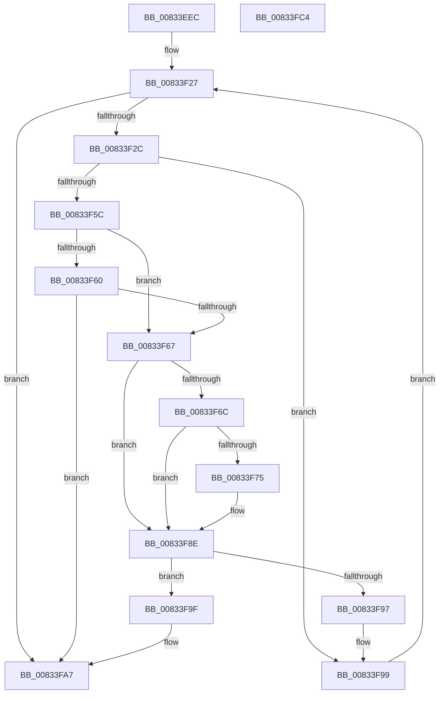

# DrvDbGetRegValueMappedPropertyKeys

- RVA: `0x00833EEC`–`0x00833FC5` (길이 `217` bytes)
- VA: `0x0000000140833EEC`
- 실행 섹션: `PAGE`
- PDB 이름 있음: `예`; PDB Function 태그: `아니요`
- unwind 정보 RVA: `0x0008C20C`
- 디코드: `66`개 명령, `217/217` bytes 표시
- 미해석 바이트: `0` (있으면 어셈블리에 `.byte`로 보존)

> 이 문서는 커널 이미지의 기계어와 PDB 기호를 분석해 생성했습니다. 4번과 5번은 함수 원형과 자료형을 바이너리 사용 방식에서 추정한 C 해석이며 원본 소스 복구 결과는 아닙니다.

## 1. Dependencies

- 직접 호출 지점: **1**; 고유 호출 대상: **1**
- 직접 호출자로 확인된 함수: **3**
- RIP 상대 이미지 참조: **0**

### Outgoing calls
- `0x00833F50` → [PnpCtxRegQueryValue](../99/PnpCtxRegQueryValue_function_009940FC.md) (function, `0x009940FC`)

### Direct callers
- [DrvDbGetDriverDatabaseMappedPropertyKeys](DrvDbGetDriverDatabaseMappedPropertyKeys_function_0083355C.md) at `0x008336A1`
- [DrvDbGetDriverDatabaseMappedPropertyKeys](DrvDbGetDriverDatabaseMappedPropertyKeys_function_0083355C.md) at `0x0083371F`
- [DrvDbGetDriverFileMappedPropertyKeys](DrvDbGetDriverFileMappedPropertyKeys_function_008338FC.md) at `0x008339CA`
- [DrvDbGetDriverInfFileMappedPropertyKeys](DrvDbGetDriverInfFileMappedPropertyKeys_function_00833A18.md) at `0x00833AE6`

### Static image references
- 디코드된 RIP-relative 메모리 참조가 없습니다.

## 2. Other-region calls and transfers

- 다른 실행 섹션으로 향하는 call: **0**
- 별도 외부 분기/꼬리 이동을 확인하지 못했습니다.

## 3. Assembly (complete function range)

```asm
00833EEC  48 89 5C 24 08                  mov qword ptr [rsp + 8], rbx
00833EF1  48 89 6C 24 10                  mov qword ptr [rsp + 0x10], rbp
00833EF6  48 89 74 24 18                  mov qword ptr [rsp + 0x18], rsi
00833EFB  57                              push rdi
00833EFC  41 54                           push r12
00833EFE  41 55                           push r13
00833F00  41 56                           push r14
00833F02  41 57                           push r15
00833F04  48 83 EC 30                     sub rsp, 0x30
00833F08  48 8B BC 24 90 00 00 00         mov rdi, qword ptr [rsp + 0x90]
00833F10  33 C0                           xor eax, eax
00833F12  48 8B AC 24 80 00 00 00         mov rbp, qword ptr [rsp + 0x80]
00833F1A  33 F6                           xor esi, esi
00833F1C  33 DB                           xor ebx, ebx
00833F1E  45 8B E1                        mov r12d, r9d
00833F21  4D 8B F8                        mov r15, r8
00833F24  4C 8B EA                        mov r13, rdx
00833F27  41 3B DC                        cmp ebx, r12d
00833F2A  73 7B                           jae 0x140833fa7
00833F2C  83 64 24 78 00                  and dword ptr [rsp + 0x78], 0
00833F31  48 8D 44 24 78                  lea rax, [rsp + 0x78]
00833F36  48 89 44 24 28                  mov qword ptr [rsp + 0x28], rax
00833F3B  4C 8D 34 9B                     lea r14, [rbx + rbx*4]
00833F3F  4F 8B 44 F7 10                  mov r8, qword ptr [r15 + r14*8 + 0x10]
00833F44  45 33 C9                        xor r9d, r9d
00833F47  48 83 64 24 20 00               and qword ptr [rsp + 0x20], 0
00833F4D  49 8B D5                        mov rdx, r13
00833F50  E8 A7 01 16 00                  call 0x1409940fc
00833F55  3D 34 00 00 C0                  cmp eax, 0xc0000034
00833F5A  74 3D                           je 0x140833f99
00833F5C  85 C0                           test eax, eax
00833F5E  74 07                           je 0x140833f67
00833F60  3D 23 00 00 C0                  cmp eax, 0xc0000023
00833F65  75 40                           jne 0x140833fa7
00833F67  48 85 ED                        test rbp, rbp
00833F6A  74 22                           je 0x140833f8e
00833F6C  3B B4 24 88 00 00 00            cmp esi, dword ptr [rsp + 0x88]
00833F73  73 19                           jae 0x140833f8e
00833F75  4B 8B 14 F7                     mov rdx, qword ptr [r15 + r14*8]
00833F79  48 8D 0C B6                     lea rcx, [rsi + rsi*4]
00833F7D  FF C6                           inc esi
00833F7F  0F 10 02                        movups xmm0, xmmword ptr [rdx]
00833F82  0F 11 44 8D 00                  movups xmmword ptr [rbp + rcx*4], xmm0
00833F87  8B 42 10                        mov eax, dword ptr [rdx + 0x10]
00833F8A  89 44 8D 10                     mov dword ptr [rbp + rcx*4 + 0x10], eax
00833F8E  8B 07                           mov eax, dword ptr [rdi]
00833F90  8D 48 01                        lea ecx, [rax + 1]
00833F93  3B C8                           cmp ecx, eax
00833F95  72 08                           jb 0x140833f9f
00833F97  89 0F                           mov dword ptr [rdi], ecx
00833F99  33 C0                           xor eax, eax
00833F9B  FF C3                           inc ebx
00833F9D  EB 88                           jmp 0x140833f27
00833F9F  83 27 00                        and dword ptr [rdi], 0
00833FA2  B8 95 00 00 C0                  mov eax, 0xc0000095
00833FA7  48 8B 5C 24 60                  mov rbx, qword ptr [rsp + 0x60]
00833FAC  48 8B 6C 24 68                  mov rbp, qword ptr [rsp + 0x68]
00833FB1  48 8B 74 24 70                  mov rsi, qword ptr [rsp + 0x70]
00833FB6  48 83 C4 30                     add rsp, 0x30
00833FBA  41 5F                           pop r15
00833FBC  41 5E                           pop r14
00833FBE  41 5D                           pop r13
00833FC0  41 5C                           pop r12
00833FC2  5F                              pop rdi
00833FC3  C3                              ret
00833FC4  CC                              int3
```

## 4. C-style interpretation (structured pseudocode)

```c
__int64 __fastcall DrvDbGetRegValueMappedPropertyKeys(__int64 a1, __int64 a2, __int64 a3, int a4, __int64 a5, unsigned int a6, __int64 a7)
{
    __int64 result;
    __int64 v_rbx;
    __int64 v_rsi;
    __int64 v_rsp;
    unsigned __int64 v_stack_m30;
    unsigned __int64 v_stack_m38;
    unsigned __int64 v_stack_p10;
    unsigned __int64 v_stack_p18;
    unsigned int v_stack_p20;
    unsigned __int64 v_stack_p8;

    v_stack_p8 = v_rbx;
    v_stack_p10 = v_rbp;
    v_stack_p18 = v_rsi;
    v_rsp = (v_rsp) - (48);
    result = 0;
    v_rsi = 0;
    v_rbx = 0;
loc_00833F27:
    if (0 >= ((unsigned int)((unsigned int)(a4)))) goto loc_00833FA7;
    v_stack_m30 = v_stack_p20;
    a4 = 0;
    result = PnpCtxRegQueryValue(a1, a2, *(unsigned __int64 *)(a3 + v_rbx + v_rbx * 4 * 8 + 16), a4);
    if (((unsigned int)(result)) == 0xC0000034ULL) goto loc_00833F99;
    if ((unsigned int)(result) == 0) goto loc_00833F67;
    if (((unsigned int)(result)) != 0xC0000023ULL) goto loc_00833FA7;
loc_00833F67:
    if (a5 == 0) goto loc_00833F8E;
    if (0 < a6) {
        a2 = *(unsigned __int64 *)(a3 + v_rbx + v_rbx * 4 * 8);
        a1 = v_rsi + v_rsi * 4;
        v_rsi = (unsigned int)((v_rsi) + 1);
        *(unsigned __int64 *)(a5 + a1 * 4) = v_xmm0;
        result = *(unsigned int *)(a2 + 16);
        *(unsigned int *)(a5 + a1 * 4 + 16) = (unsigned int)(result);
    }
    if (((unsigned int)((unsigned int)(*(unsigned int *)(a7)) + 1)) < ((unsigned int)((unsigned int)(*(unsigned int *)(a7))))) goto loc_00833F9F;
    *(unsigned int *)(a7) = (unsigned int)((unsigned int)(*(unsigned int *)(a7)) + 1);
loc_00833F99:
    result = 0;
    v_rbx = (unsigned int)((v_rbx) + 1);
    goto loc_00833F27;
loc_00833F9F:
loc_00833FA7:
    v_rsp = (v_rsp) + (48);
    return (unsigned int)(0xC0000095ULL);
}
```

## 5. (Beta) C Style

```c
int64_t DrvDbGetRegValueMappedPropertyKeys(int64_t Arg1, int64_t Arg2, void *Arg3, int32_t Arg4, int64_t Arg5, uint32_t Arg6, void *Arg7)
{
    uint8_t *arg3 = (uint8_t *)Arg3;
    uint8_t *arg7 = (uint8_t *)Arg7;

    int64_t result;
    int64_t local_rbx;
    int64_t local_rsi;
    int64_t local_rsp;
    uint64_t v_stack_m30;
    uint64_t v_stack_m38;
    uint64_t v_stack_p10;
    uint64_t v_stack_p18;
    uint32_t v_stack_p20;
    uint64_t v_stack_p8;

    v_stack_p8 = local_rbx;
    v_stack_p10 = local_rbp;
    v_stack_p18 = local_rsi;
    local_rsp = (local_rsp) - (48);
    result = 0;
    local_rsi = 0;
    local_rbx = 0;
loc_00833F27:
    if (0 >= ((uint32_t)((uint32_t)(Arg4)))) goto loc_00833FA7;
    v_stack_m30 = v_stack_p20;
    Arg4 = 0;
    result = PnpCtxRegQueryValue(Arg1, Arg2, *(uint64_t *)(arg3 + local_rbx + local_rbx * 4 * 8 + 0x10), Arg4);
    if (((uint32_t)(result)) == 0xC0000034ULL) goto loc_00833F99;
    if ((uint32_t)(result) == 0) goto loc_00833F67;
    if (((uint32_t)(result)) != 0xC0000023ULL) goto loc_00833FA7;
loc_00833F67:
    if (Arg5 == 0) goto loc_00833F8E;
    if (0 < Arg6) {
        Arg2 = *(uint64_t *)(arg3 + local_rbx + local_rbx * 4 * 8);
        Arg1 = local_rsi + local_rsi * 4;
        local_rsi = (uint32_t)((local_rsi) + 1);
        *(uint64_t *)(Arg5 + Arg1 * 4) = v_xmm0;
        result = *(uint32_t *)(Arg2 + 0x10);
        *(uint32_t *)(Arg5 + Arg1 * 4 + 0x10) = (uint32_t)(result);
    }
    if (((uint32_t)((uint32_t)(*(uint32_t *)(arg7)) + 1)) < ((uint32_t)((uint32_t)(*(uint32_t *)(arg7))))) goto loc_00833F9F;
    *(uint32_t *)(arg7) = (uint32_t)((uint32_t)(*(uint32_t *)(arg7)) + 1);
loc_00833F99:
    result = 0;
    local_rbx = (uint32_t)((local_rbx) + 1);
    goto loc_00833F27;
loc_00833F9F:
loc_00833FA7:
    local_rsp = (local_rsp) + (48);
    return (uint32_t)(0xC0000095ULL);
}
```

### 관측된 메모리 오프셋

구조체 형식이 확인되지 않은 접근은 인자 기준의 오프셋으로만 기록했습니다.

| 기준 인자 | 오프셋 표현 | 폭 (bit) | 접근 |
|---|---:|---:|---|
| `Arg3` | `+ 0x0 + r14*8` | `64` | `R` |
| `Arg3` | `+ 0x10 + r14*8` | `64` | `R` |
| `Arg7` | `+ 0x0` | `32` | `R` |
| `Arg7` | `+ 0x0` | `32` | `R/W` |
| `Arg7` | `+ 0x0` | `32` | `W` |

## 6. Execution-region graph

[열기: 2D/3D 그래프와 함수 탐색 컨트롤 패널](../../../control-panel.html?section=page&rva=0x00833EEC&view=graph)

- 2D 그래프는 위에서 아래로 흐르고, 3D 그래프는 빈 공간을 드래그해 회전합니다. Shift+드래그는 이동, 휠은 확대·축소, 함수 노드 선택은 대상 보고서 이동입니다.

### Static fallback


