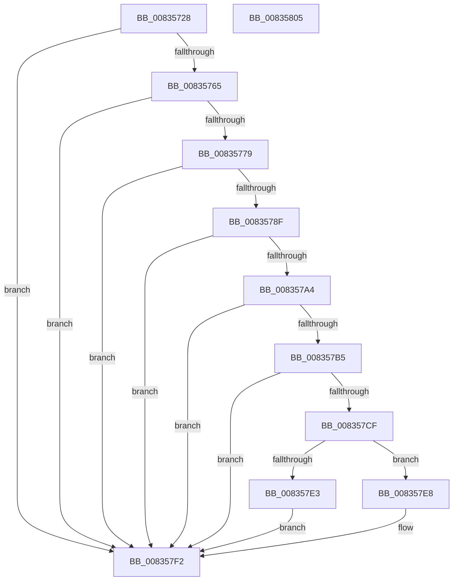

# DrvDbGetRegistrarSecurityDescriptor

- RVA: `0x00835728`–`0x00835806` (길이 `222` bytes)
- VA: `0x0000000140835728`
- 실행 섹션: `PAGE`
- PDB 이름 있음: `예`; PDB Function 태그: `아니요`
- unwind 정보 RVA: `0x000CC2F0`
- 디코드: `66`개 명령, `222/222` bytes 표시
- 미해석 바이트: `0` (있으면 어셈블리에 `.byte`로 보존)

> 이 문서는 커널 이미지의 기계어와 PDB 기호를 분석해 생성했습니다. 4번과 5번은 함수 원형과 자료형을 바이너리 사용 방식에서 추정한 C 해석이며 원본 소스 복구 결과는 아닙니다.

## 1. Dependencies

- 직접 호출 지점: **8**; 고유 호출 대상: **8**
- 직접 호출자로 확인된 함수: **3**
- RIP 상대 이미지 참조: **0**

### Outgoing calls
- `0x00835758` → [RtlCreateSecurityDescriptor](../9F/RtlCreateSecurityDescriptor_function_009F1DF0.md) (function, `0x009F1DF0`)
- `0x00835770` → [RtlCreateAcl](../91/RtlCreateAcl_function_00916F00.md) (function, `0x00916F00`)
- `0x00835786` → [RtlSetDaclSecurityDescriptor](../9E/RtlSetDaclSecurityDescriptor_function_009EC210.md) (function, `0x009EC210`)
- `0x0083579B` → [RtlSetControlSecurityDescriptor](../78/RtlSetControlSecurityDescriptor_function_0078E9F0.md) (function, `0x0078E9F0`)
- `0x008357A8` → [RtlLengthSecurityDescriptor](../8B/RtlLengthSecurityDescriptor_function_008BC870.md) (function, `0x008BC870`)
- `0x008357C2` → [ExAllocatePool2](../../poolcode/B8/ExAllocatePool2_function_00B820F0.md) (function, `0x00B820F0`)
- `0x008357DA` → [RtlAbsoluteToSelfRelativeSD](../A1/RtlAbsoluteToSelfRelativeSD_function_00A119B0.md) (function, `0x00A119B0`)
- `0x008357ED` → [ExFreePoolWithTag](../../poolcode/B8/ExFreePoolWithTag_function_00B82870.md) (function, `0x00B82870`)

### Direct callers
- [sub_00930F5A](../93/Unknown_function_00930F5A.md) at `0x00930FD0`
- [sub_00930F5A](../93/Unknown_function_00930F5A.md) at `0x00930FE6`
- [sub_00931420](../93/Unknown_function_00931420.md) at `0x0093161E`
- [sub_00B24164](../B2/Unknown_function_00B24164.md) at `0x00B24186`

### Static image references
- 디코드된 RIP-relative 메모리 참조가 없습니다.

## 2. Other-region calls and transfers

- 다른 실행 섹션으로 향하는 call: **2**
  - `0x008357C2` → [ExAllocatePool2](../../poolcode/B8/ExAllocatePool2_function_00B820F0.md) (`PAGE` → `POOLCODE`)
  - `0x008357ED` → [ExFreePoolWithTag](../../poolcode/B8/ExFreePoolWithTag_function_00B82870.md) (`PAGE` → `POOLCODE`)
- 별도 외부 분기/꼬리 이동을 확인하지 못했습니다.

## 3. Assembly (complete function range)

```asm
00835728  48 89 5C 24 18                  mov qword ptr [rsp + 0x18], rbx
0083572D  48 89 7C 24 20                  mov qword ptr [rsp + 0x20], rdi
00835732  55                              push rbp
00835733  48 8B EC                        mov rbp, rsp
00835736  48 83 EC 50                     sub rsp, 0x50
0083573A  0F 57 C0                        xorps xmm0, xmm0
0083573D  48 8D 4D D0                     lea rcx, [rbp - 0x30]
00835741  33 DB                           xor ebx, ebx
00835743  33 C0                           xor eax, eax
00835745  48 89 5D 18                     mov qword ptr [rbp + 0x18], rbx
00835749  0F 11 45 D0                     movups xmmword ptr [rbp - 0x30], xmm0
0083574D  48 89 45 F0                     mov qword ptr [rbp - 0x10], rax
00835751  8D 53 01                        lea edx, [rbx + 1]
00835754  0F 11 45 E0                     movups xmmword ptr [rbp - 0x20], xmm0
00835758  E8 93 C6 1B 00                  call 0x1409f1df0
0083575D  85 C0                           test eax, eax
0083575F  0F 88 8D 00 00 00               js 0x1408357f2
00835765  8D 53 08                        lea edx, [rbx + 8]
00835768  44 8D 43 02                     lea r8d, [rbx + 2]
0083576C  48 8D 4D 18                     lea rcx, [rbp + 0x18]
00835770  E8 8B 17 0E 00                  call 0x140916f00
00835775  85 C0                           test eax, eax
00835777  78 79                           js 0x1408357f2
00835779  45 33 C9                        xor r9d, r9d
0083577C  4C 8D 45 18                     lea r8, [rbp + 0x18]
00835780  B2 01                           mov dl, 1
00835782  48 8D 4D D0                     lea rcx, [rbp - 0x30]
00835786  E8 85 6A 1B 00                  call 0x1409ec210
0083578B  85 C0                           test eax, eax
0083578D  78 63                           js 0x1408357f2
0083578F  BA 00 10 00 00                  mov edx, 0x1000
00835794  48 8D 4D D0                     lea rcx, [rbp - 0x30]
00835798  44 8B C2                        mov r8d, edx
0083579B  E8 50 92 F5 FF                  call 0x14078e9f0
008357A0  85 C0                           test eax, eax
008357A2  78 4E                           js 0x1408357f2
008357A4  48 8D 4D D0                     lea rcx, [rbp - 0x30]
008357A8  E8 C3 70 08 00                  call 0x1408bc870
008357AD  89 45 10                        mov dword ptr [rbp + 0x10], eax
008357B0  83 F8 28                        cmp eax, 0x28
008357B3  72 3D                           jb 0x1408357f2
008357B5  8B D0                           mov edx, eax
008357B7  B9 00 01 00 00                  mov ecx, 0x100
008357BC  41 B8 50 44 44 42               mov r8d, 0x42444450
008357C2  E8 29 C9 34 00                  call 0x140b820f0
008357C7  48 8B F8                        mov rdi, rax
008357CA  48 85 C0                        test rax, rax
008357CD  74 23                           je 0x1408357f2
008357CF  4C 8D 45 10                     lea r8, [rbp + 0x10]
008357D3  48 8B D0                        mov rdx, rax
008357D6  48 8D 4D D0                     lea rcx, [rbp - 0x30]
008357DA  E8 D1 C1 1D 00                  call 0x140a119b0
008357DF  85 C0                           test eax, eax
008357E1  78 05                           js 0x1408357e8
008357E3  48 8B DF                        mov rbx, rdi
008357E6  EB 0A                           jmp 0x1408357f2
008357E8  33 D2                           xor edx, edx
008357EA  48 8B CF                        mov rcx, rdi
008357ED  E8 7E D0 34 00                  call 0x140b82870
008357F2  48 8B 7C 24 78                  mov rdi, qword ptr [rsp + 0x78]
008357F7  48 8B C3                        mov rax, rbx
008357FA  48 8B 5C 24 70                  mov rbx, qword ptr [rsp + 0x70]
008357FF  48 83 C4 50                     add rsp, 0x50
00835803  5D                              pop rbp
00835804  C3                              ret
00835805  CC                              int3
```

## 4. C-style interpretation (structured pseudocode)

```c
__int64 __fastcall DrvDbGetRegistrarSecurityDescriptor(__int64 a1, __int64 a2, __int64 a3, int a4)
{
    __int64 result;
    __int64 v_rbx;
    __int64 v_rsp;
    unsigned __int64 v_stack_m18;
    unsigned __int64 v_stack_m28;
    unsigned __int64 v_stack_m38;
    unsigned __int64 v_stack_p10;
    unsigned __int64 v_stack_p18;
    unsigned __int64 v_stack_p20;
    unsigned int v_stack_p8;

    v_stack_p18 = v_rbx;
    v_stack_p20 = v_rdi;
    v_rsp = (v_rsp) - (80);
    v_rbx = 0;
    result = 0;
    v_stack_p10 = 0;
    v_stack_m38 = v_xmm0;
    v_stack_m18 = 0;
    v_stack_m28 = v_xmm0;
    result = RtlCreateSecurityDescriptor(v_stack_m38, v_rbx + 1, a3, a4);
    if (sign_flag) goto loc_008357F2;
    result = RtlCreateAcl(v_stack_p10, v_rbx + 8, v_rbx + 2, a4);
    if (sign_flag) goto loc_008357F2;
    a4 = 0;
    result = RtlSetDaclSecurityDescriptor(v_stack_m38, 1, v_stack_p10, a4);
    if (sign_flag) goto loc_008357F2;
    result = RtlSetControlSecurityDescriptor(v_stack_m38, (unsigned int)(0x1000ULL), (unsigned int)((unsigned int)((unsigned int)(0x1000ULL))), a4);
    if (sign_flag) goto loc_008357F2;
    result = RtlLengthSecurityDescriptor(v_stack_m38, (unsigned int)(0x1000ULL), (unsigned int)((unsigned int)((unsigned int)(0x1000ULL))), a4);
    v_stack_p8 = (unsigned int)(result);
    if (((unsigned int)(result)) < 40) goto loc_008357F2;
    result = ExAllocatePool2(256, (unsigned int)((unsigned int)(result)), (unsigned int)(0x42444450ULL), a4);
    if (result == 0) goto loc_008357F2;
    result = RtlAbsoluteToSelfRelativeSD(v_stack_m38, result, v_stack_p8, a4);
    if (sign_flag) goto loc_008357E8;
    goto loc_008357F2;
loc_008357E8:
    a2 = 0;
    result = ExFreePoolWithTag(result, a2, v_stack_p8, a4);
loc_008357F2:
    v_rsp = (v_rsp) + (80);
    return result;
}
```

## 5. (Beta) C Style

```c
int64_t DrvDbGetRegistrarSecurityDescriptor(int64_t Arg1, int64_t Arg2, int64_t Arg3, int32_t Arg4)
{
    int64_t result;
    int64_t local_rbx;
    int64_t local_rsp;
    uint64_t v_stack_m18;
    uint64_t v_stack_m28;
    uint64_t v_stack_m38;
    uint64_t v_stack_p10;
    uint64_t v_stack_p18;
    uint64_t v_stack_p20;
    uint32_t v_stack_p8;

    v_stack_p18 = local_rbx;
    v_stack_p20 = local_rdi;
    local_rsp = (local_rsp) - (80);
    local_rbx = 0;
    result = 0;
    v_stack_p10 = 0;
    v_stack_m38 = v_xmm0;
    v_stack_m18 = 0;
    v_stack_m28 = v_xmm0;
    result = RtlCreateSecurityDescriptor(v_stack_m38, local_rbx + 1, Arg3, Arg4);
    if (sign_flag) goto loc_008357F2;
    result = RtlCreateAcl(v_stack_p10, local_rbx + 8, local_rbx + 2, Arg4);
    if (sign_flag) goto loc_008357F2;
    Arg4 = 0;
    result = RtlSetDaclSecurityDescriptor(v_stack_m38, 1, v_stack_p10, Arg4);
    if (sign_flag) goto loc_008357F2;
    result = RtlSetControlSecurityDescriptor(v_stack_m38, (uint32_t)(0x1000ULL), (uint32_t)((uint32_t)((uint32_t)(0x1000ULL))), Arg4);
    if (sign_flag) goto loc_008357F2;
    result = RtlLengthSecurityDescriptor(v_stack_m38, (uint32_t)(0x1000ULL), (uint32_t)((uint32_t)((uint32_t)(0x1000ULL))), Arg4);
    v_stack_p8 = (uint32_t)(result);
    if (((uint32_t)(result)) < 40) goto loc_008357F2;
    result = ExAllocatePool2(256, (uint32_t)((uint32_t)(result)), (uint32_t)(0x42444450ULL), Arg4);
    if (result == 0) goto loc_008357F2;
    result = RtlAbsoluteToSelfRelativeSD(v_stack_m38, result, v_stack_p8, Arg4);
    if (sign_flag) goto loc_008357E8;
    goto loc_008357F2;
loc_008357E8:
    Arg2 = 0;
    result = ExFreePoolWithTag(result, Arg2, v_stack_p8, Arg4);
loc_008357F2:
    local_rsp = (local_rsp) + (80);
    return result;
}
```

## 6. Execution-region graph

[열기: 2D/3D 그래프와 함수 탐색 컨트롤 패널](../../../control-panel.html?section=page&rva=0x00835728&view=graph)

- 2D 그래프는 위에서 아래로 흐르고, 3D 그래프는 빈 공간을 드래그해 회전합니다. Shift+드래그는 이동, 휠은 확대·축소, 함수 노드 선택은 대상 보고서 이동입니다.

### Static fallback


