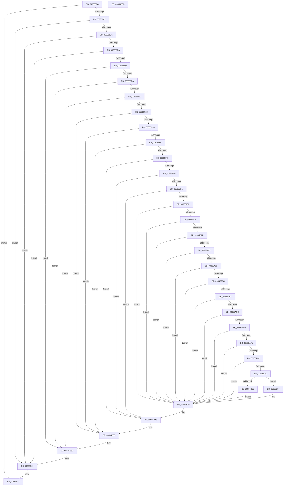

# DrvDbGetSecurityDescriptor

- RVA: `0x0083580C`–`0x00835B8D` (길이 `897` bytes)
- VA: `0x000000014083580C`
- 실행 섹션: `PAGE`
- PDB 이름 있음: `예`; PDB Function 태그: `아니요`
- unwind 정보 RVA: `0x000C3D64`
- 디코드: `249`개 명령, `897/897` bytes 표시
- 미해석 바이트: `0` (있으면 어셈블리에 `.byte`로 보존)

> 이 문서는 커널 이미지의 기계어와 PDB 기호를 분석해 생성했습니다. 4번과 5번은 함수 원형과 자료형을 바이너리 사용 방식에서 추정한 C 해석이며 원본 소스 복구 결과는 아닙니다.

## 1. Dependencies

- 직접 호출 지점: **41**; 고유 호출 대상: **16**
- 직접 호출자로 확인된 함수: **1**
- RIP 상대 이미지 참조: **0**

### Outgoing calls
- `0x00835858` → [RtlLengthRequiredSid](../9C/RtlLengthRequiredSid_function_009CA4D0.md) (function, `0x009CA4D0`)
- `0x00835872` → [ExAllocatePool2](../../poolcode/B8/ExAllocatePool2_function_00B820F0.md) (function, `0x00B820F0`)
- `0x0083588D` → [RtlInitializeSid](../9E/RtlInitializeSid_function_009EB720.md) (function, `0x009EB720`)
- `0x0083589F` → [RtlSubAuthoritySid](../../text/45/RtlSubAuthoritySid_function_00456D10.md) (function, `0x00456D10`)
- `0x008358AD` → [RtlValidSid](../92/RtlValidSid_function_00929710.md) (function, `0x00929710`)
- `0x008358C2` → [ExAllocatePool2](../../poolcode/B8/ExAllocatePool2_function_00B820F0.md) (function, `0x00B820F0`)
- `0x008358DD` → [RtlInitializeSid](../9E/RtlInitializeSid_function_009EB720.md) (function, `0x009EB720`)
- `0x008358EF` → [RtlSubAuthoritySid](../../text/45/RtlSubAuthoritySid_function_00456D10.md) (function, `0x00456D10`)
- `0x008358FD` → [RtlValidSid](../92/RtlValidSid_function_00929710.md) (function, `0x00929710`)
- `0x00835912` → [ExAllocatePool2](../../poolcode/B8/ExAllocatePool2_function_00B820F0.md) (function, `0x00B820F0`)
- `0x0083592D` → [RtlInitializeSid](../9E/RtlInitializeSid_function_009EB720.md) (function, `0x009EB720`)
- `0x0083593F` → [RtlSubAuthoritySid](../../text/45/RtlSubAuthoritySid_function_00456D10.md) (function, `0x00456D10`)
- `0x00835949` → [RtlValidSid](../92/RtlValidSid_function_00929710.md) (function, `0x00929710`)
- `0x00835959` → [RtlLengthRequiredSid](../9C/RtlLengthRequiredSid_function_009CA4D0.md) (function, `0x009CA4D0`)
- `0x00835968` → [ExAllocatePool2](../../poolcode/B8/ExAllocatePool2_function_00B820F0.md) (function, `0x00B820F0`)
- `0x00835983` → [RtlInitializeSid](../9E/RtlInitializeSid_function_009EB720.md) (function, `0x009EB720`)
- `0x00835995` → [RtlSubAuthoritySid](../../text/45/RtlSubAuthoritySid_function_00456D10.md) (function, `0x00456D10`)
- `0x008359A6` → [RtlSubAuthoritySid](../../text/45/RtlSubAuthoritySid_function_00456D10.md) (function, `0x00456D10`)
- `0x008359B4` → [RtlValidSid](../92/RtlValidSid_function_00929710.md) (function, `0x00929710`)
- `0x008359C4` → [RtlLengthSid](../../text/45/RtlLengthSid_function_0045D270.md) (function, `0x0045D270`)
- `0x008359CE` → [RtlLengthSid](../../text/45/RtlLengthSid_function_0045D270.md) (function, `0x0045D270`)
- `0x008359D8` → [RtlLengthSid](../../text/45/RtlLengthSid_function_0045D270.md) (function, `0x0045D270`)
- `0x008359EF` → [ExAllocatePool2](../../poolcode/B8/ExAllocatePool2_function_00B820F0.md) (function, `0x00B820F0`)
- `0x00835A09` → [RtlCreateAcl](../91/RtlCreateAcl_function_00916F00.md) (function, `0x00916F00`)
- `0x00835A31` → [RtlpAddKnownAce](../92/RtlpAddKnownAce_function_00929A20.md) (function, `0x00929A20`)
- `0x00835A56` → [RtlpAddKnownAce](../92/RtlpAddKnownAce_function_00929A20.md) (function, `0x00929A20`)
- `0x00835A7B` → [RtlpAddKnownAce](../92/RtlpAddKnownAce_function_00929A20.md) (function, `0x00929A20`)
- `0x00835A8F` → [RtlCreateSecurityDescriptor](../9F/RtlCreateSecurityDescriptor_function_009F1DF0.md) (function, `0x009F1DF0`)
- `0x00835AA8` → [RtlSetDaclSecurityDescriptor](../9E/RtlSetDaclSecurityDescriptor_function_009EC210.md) (function, `0x009EC210`)
- `0x00835ABF` → [RtlSetOwnerSecurityDescriptor](../91/RtlSetOwnerSecurityDescriptor_function_00916F90.md) (function, `0x00916F90`)
- `0x00835AD2` → [RtlSetGroupSecurityDescriptor](../A2/RtlSetGroupSecurityDescriptor_function_00A2EB10.md) (function, `0x00A2EB10`)
- `0x00835AE8` → [RtlValidSecurityDescriptor](../8B/RtlValidSecurityDescriptor_function_008BD3F0.md) (function, `0x008BD3F0`)
- `0x00835AF5` → [RtlLengthSecurityDescriptor](../8B/RtlLengthSecurityDescriptor_function_008BC870.md) (function, `0x008BC870`)
- `0x00835B0F` → [ExAllocatePool2](../../poolcode/B8/ExAllocatePool2_function_00B820F0.md) (function, `0x00B820F0`)
- `0x00835B27` → [RtlAbsoluteToSelfRelativeSD](../A1/RtlAbsoluteToSelfRelativeSD_function_00A119B0.md) (function, `0x00A119B0`)
- `0x00835B3A` → [ExFreePoolWithTag](../../poolcode/B8/ExFreePoolWithTag_function_00B82870.md) (function, `0x00B82870`)
- `0x00835B44` → [ExFreePoolWithTag](../../poolcode/B8/ExFreePoolWithTag_function_00B82870.md) (function, `0x00B82870`)
- `0x00835B4E` → [ExFreePoolWithTag](../../poolcode/B8/ExFreePoolWithTag_function_00B82870.md) (function, `0x00B82870`)
- `0x00835B58` → [ExFreePoolWithTag](../../poolcode/B8/ExFreePoolWithTag_function_00B82870.md) (function, `0x00B82870`)
- `0x00835B62` → [ExFreePoolWithTag](../../poolcode/B8/ExFreePoolWithTag_function_00B82870.md) (function, `0x00B82870`)
- `0x00835B6C` → [ExFreePoolWithTag](../../poolcode/B8/ExFreePoolWithTag_function_00B82870.md) (function, `0x00B82870`)

### Direct callers
- [sub_00B24270](../B2/Unknown_function_00B24270.md) at `0x00B242C6`

### Static image references
- 디코드된 RIP-relative 메모리 참조가 없습니다.

## 2. Other-region calls and transfers

- 다른 실행 섹션으로 향하는 call: **20**
  - `0x00835872` → [ExAllocatePool2](../../poolcode/B8/ExAllocatePool2_function_00B820F0.md) (`PAGE` → `POOLCODE`)
  - `0x0083589F` → [RtlSubAuthoritySid](../../text/45/RtlSubAuthoritySid_function_00456D10.md) (`PAGE` → `.text`)
  - `0x008358C2` → [ExAllocatePool2](../../poolcode/B8/ExAllocatePool2_function_00B820F0.md) (`PAGE` → `POOLCODE`)
  - `0x008358EF` → [RtlSubAuthoritySid](../../text/45/RtlSubAuthoritySid_function_00456D10.md) (`PAGE` → `.text`)
  - `0x00835912` → [ExAllocatePool2](../../poolcode/B8/ExAllocatePool2_function_00B820F0.md) (`PAGE` → `POOLCODE`)
  - `0x0083593F` → [RtlSubAuthoritySid](../../text/45/RtlSubAuthoritySid_function_00456D10.md) (`PAGE` → `.text`)
  - `0x00835968` → [ExAllocatePool2](../../poolcode/B8/ExAllocatePool2_function_00B820F0.md) (`PAGE` → `POOLCODE`)
  - `0x00835995` → [RtlSubAuthoritySid](../../text/45/RtlSubAuthoritySid_function_00456D10.md) (`PAGE` → `.text`)
  - `0x008359A6` → [RtlSubAuthoritySid](../../text/45/RtlSubAuthoritySid_function_00456D10.md) (`PAGE` → `.text`)
  - `0x008359C4` → [RtlLengthSid](../../text/45/RtlLengthSid_function_0045D270.md) (`PAGE` → `.text`)
  - `0x008359CE` → [RtlLengthSid](../../text/45/RtlLengthSid_function_0045D270.md) (`PAGE` → `.text`)
  - `0x008359D8` → [RtlLengthSid](../../text/45/RtlLengthSid_function_0045D270.md) (`PAGE` → `.text`)
  - `0x008359EF` → [ExAllocatePool2](../../poolcode/B8/ExAllocatePool2_function_00B820F0.md) (`PAGE` → `POOLCODE`)
  - `0x00835B0F` → [ExAllocatePool2](../../poolcode/B8/ExAllocatePool2_function_00B820F0.md) (`PAGE` → `POOLCODE`)
  - `0x00835B3A` → [ExFreePoolWithTag](../../poolcode/B8/ExFreePoolWithTag_function_00B82870.md) (`PAGE` → `POOLCODE`)
  - `0x00835B44` → [ExFreePoolWithTag](../../poolcode/B8/ExFreePoolWithTag_function_00B82870.md) (`PAGE` → `POOLCODE`)
  - `0x00835B4E` → [ExFreePoolWithTag](../../poolcode/B8/ExFreePoolWithTag_function_00B82870.md) (`PAGE` → `POOLCODE`)
  - `0x00835B58` → [ExFreePoolWithTag](../../poolcode/B8/ExFreePoolWithTag_function_00B82870.md) (`PAGE` → `POOLCODE`)
  - `0x00835B62` → [ExFreePoolWithTag](../../poolcode/B8/ExFreePoolWithTag_function_00B82870.md) (`PAGE` → `POOLCODE`)
  - `0x00835B6C` → [ExFreePoolWithTag](../../poolcode/B8/ExFreePoolWithTag_function_00B82870.md) (`PAGE` → `POOLCODE`)
- 별도 외부 분기/꼬리 이동을 확인하지 못했습니다.

## 3. Assembly (complete function range)

```asm
0083580C  48 89 5C 24 20                  mov qword ptr [rsp + 0x20], rbx
00835811  55                              push rbp
00835812  56                              push rsi
00835813  57                              push rdi
00835814  41 54                           push r12
00835816  41 55                           push r13
00835818  41 56                           push r14
0083581A  41 57                           push r15
0083581C  48 8B EC                        mov rbp, rsp
0083581F  48 83 EC 60                     sub rsp, 0x60
00835823  33 FF                           xor edi, edi
00835825  66 C7 45 44 00 05               mov word ptr [rbp + 0x44], 0x500
0083582B  0F 57 C0                        xorps xmm0, xmm0
0083582E  89 7D 40                        mov dword ptr [rbp + 0x40], edi
00835831  33 C0                           xor eax, eax
00835833  89 7D 48                        mov dword ptr [rbp + 0x48], edi
00835836  66 C7 45 4C 00 03               mov word ptr [rbp + 0x4c], 0x300
0083583C  44 8D 67 01                     lea r12d, [rdi + 1]
00835840  89 7D 50                        mov dword ptr [rbp + 0x50], edi
00835843  41 8B CC                        mov ecx, r12d
00835846  66 C7 45 54 00 01               mov word ptr [rbp + 0x54], 0x100
0083584C  0F 11 45 D0                     movups xmmword ptr [rbp - 0x30], xmm0
00835850  48 89 45 F0                     mov qword ptr [rbp - 0x10], rax
00835854  0F 11 45 E0                     movups xmmword ptr [rbp - 0x20], xmm0
00835858  E8 73 4C 19 00                  call 0x1409ca4d0
0083585D  BE 50 44 44 42                  mov esi, 0x42444450
00835862  8B D0                           mov edx, eax
00835864  41 BE 00 01 00 00               mov r14d, 0x100
0083586A  8B D8                           mov ebx, eax
0083586C  44 8B C6                        mov r8d, esi
0083586F  41 8B CE                        mov ecx, r14d
00835872  E8 79 C8 34 00                  call 0x140b820f0
00835877  4C 8B E8                        mov r13, rax
0083587A  48 85 C0                        test rax, rax
0083587D  0F 84 EE 02 00 00               je 0x140835b71
00835883  45 8A C4                        mov r8b, r12b
00835886  48 8D 55 40                     lea rdx, [rbp + 0x40]
0083588A  48 8B C8                        mov rcx, rax
0083588D  E8 8E 5E 1B 00                  call 0x1409eb720
00835892  85 C0                           test eax, eax
00835894  0F 88 CD 02 00 00               js 0x140835b67
0083589A  33 D2                           xor edx, edx
0083589C  49 8B CD                        mov rcx, r13
0083589F  E8 6C 14 C2 FF                  call 0x140456d10
008358A4  49 8B CD                        mov rcx, r13
008358A7  C7 00 12 00 00 00               mov dword ptr [rax], 0x12
008358AD  E8 5E 3E 0F 00                  call 0x140929710
008358B2  84 C0                           test al, al
008358B4  0F 84 AD 02 00 00               je 0x140835b67
008358BA  44 8B C6                        mov r8d, esi
008358BD  8B D3                           mov edx, ebx
008358BF  41 8B CE                        mov ecx, r14d
008358C2  E8 29 C8 34 00                  call 0x140b820f0
008358C7  4C 8B F8                        mov r15, rax
008358CA  48 85 C0                        test rax, rax
008358CD  0F 84 94 02 00 00               je 0x140835b67
008358D3  45 8A C4                        mov r8b, r12b
008358D6  48 8D 55 48                     lea rdx, [rbp + 0x48]
008358DA  48 8B C8                        mov rcx, rax
008358DD  E8 3E 5E 1B 00                  call 0x1409eb720
008358E2  85 C0                           test eax, eax
008358E4  0F 88 73 02 00 00               js 0x140835b5d
008358EA  33 D2                           xor edx, edx
008358EC  49 8B CF                        mov rcx, r15
008358EF  E8 1C 14 C2 FF                  call 0x140456d10
008358F4  49 8B CF                        mov rcx, r15
008358F7  C7 00 04 00 00 00               mov dword ptr [rax], 4
008358FD  E8 0E 3E 0F 00                  call 0x140929710
00835902  84 C0                           test al, al
00835904  0F 84 53 02 00 00               je 0x140835b5d
0083590A  44 8B C6                        mov r8d, esi
0083590D  8B D3                           mov edx, ebx
0083590F  41 8B CE                        mov ecx, r14d
00835912  E8 D9 C7 34 00                  call 0x140b820f0
00835917  4C 8B F0                        mov r14, rax
0083591A  48 85 C0                        test rax, rax
0083591D  0F 84 3A 02 00 00               je 0x140835b5d
00835923  45 8A C4                        mov r8b, r12b
00835926  48 8D 55 50                     lea rdx, [rbp + 0x50]
0083592A  48 8B C8                        mov rcx, rax
0083592D  E8 EE 5D 1B 00                  call 0x1409eb720
00835932  85 C0                           test eax, eax
00835934  0F 88 19 02 00 00               js 0x140835b53
0083593A  33 D2                           xor edx, edx
0083593C  49 8B CE                        mov rcx, r14
0083593F  E8 CC 13 C2 FF                  call 0x140456d10
00835944  49 8B CE                        mov rcx, r14
00835947  89 38                           mov dword ptr [rax], edi
00835949  E8 C2 3D 0F 00                  call 0x140929710
0083594E  84 C0                           test al, al
00835950  0F 84 FD 01 00 00               je 0x140835b53
00835956  8D 4F 02                        lea ecx, [rdi + 2]
00835959  E8 72 4B 19 00                  call 0x1409ca4d0
0083595E  8B D0                           mov edx, eax
00835960  44 8B C6                        mov r8d, esi
00835963  B9 00 01 00 00                  mov ecx, 0x100
00835968  E8 83 C7 34 00                  call 0x140b820f0
0083596D  48 8B F0                        mov rsi, rax
00835970  48 85 C0                        test rax, rax
00835973  0F 84 DA 01 00 00               je 0x140835b53
00835979  41 B0 02                        mov r8b, 2
0083597C  48 8D 55 40                     lea rdx, [rbp + 0x40]
00835980  48 8B C8                        mov rcx, rax
00835983  E8 98 5D 1B 00                  call 0x1409eb720
00835988  85 C0                           test eax, eax
0083598A  0F 88 B9 01 00 00               js 0x140835b49
00835990  33 D2                           xor edx, edx
00835992  48 8B CE                        mov rcx, rsi
00835995  E8 76 13 C2 FF                  call 0x140456d10
0083599A  41 8B D4                        mov edx, r12d
0083599D  48 8B CE                        mov rcx, rsi
008359A0  C7 00 20 00 00 00               mov dword ptr [rax], 0x20
008359A6  E8 65 13 C2 FF                  call 0x140456d10
008359AB  48 8B CE                        mov rcx, rsi
008359AE  C7 00 20 02 00 00               mov dword ptr [rax], 0x220
008359B4  E8 57 3D 0F 00                  call 0x140929710
008359B9  84 C0                           test al, al
008359BB  0F 84 88 01 00 00               je 0x140835b49
008359C1  49 8B CE                        mov rcx, r14
008359C4  E8 A7 78 C2 FF                  call 0x14045d270
008359C9  49 8B CF                        mov rcx, r15
008359CC  8B D8                           mov ebx, eax
008359CE  E8 9D 78 C2 FF                  call 0x14045d270
008359D3  49 8B CD                        mov rcx, r13
008359D6  03 D8                           add ebx, eax
008359D8  E8 93 78 C2 FF                  call 0x14045d270
008359DD  83 C0 20                        add eax, 0x20
008359E0  B9 00 01 00 00                  mov ecx, 0x100
008359E5  03 D8                           add ebx, eax
008359E7  41 B8 50 44 44 42               mov r8d, 0x42444450
008359ED  8B D3                           mov edx, ebx
008359EF  E8 FC C6 34 00                  call 0x140b820f0
008359F4  4C 8B E0                        mov r12, rax
008359F7  48 85 C0                        test rax, rax
008359FA  0F 84 49 01 00 00               je 0x140835b49
00835A00  44 8D 47 02                     lea r8d, [rdi + 2]
00835A04  8B D3                           mov edx, ebx
00835A06  48 8B C8                        mov rcx, rax
00835A09  E8 F2 14 0E 00                  call 0x140916f00
00835A0E  85 C0                           test eax, eax
00835A10  0F 88 29 01 00 00               js 0x140835b3f
00835A16  8D 5F 02                        lea ebx, [rdi + 2]
00835A19  40 88 7C 24 28                  mov byte ptr [rsp + 0x28], dil
00835A1E  44 8B C3                        mov r8d, ebx
00835A21  4C 89 6C 24 20                  mov qword ptr [rsp + 0x20], r13
00835A26  8B D3                           mov edx, ebx
00835A28  41 B9 3F 00 0F 00               mov r9d, 0xf003f
00835A2E  49 8B CC                        mov rcx, r12
00835A31  E8 EA 3F 0F 00                  call 0x140929a20
00835A36  85 C0                           test eax, eax
00835A38  0F 88 01 01 00 00               js 0x140835b3f
00835A3E  40 88 7C 24 28                  mov byte ptr [rsp + 0x28], dil
00835A43  41 B9 00 00 02 00               mov r9d, 0x20000
00835A49  44 8B C3                        mov r8d, ebx
00835A4C  4C 89 7C 24 20                  mov qword ptr [rsp + 0x20], r15
00835A51  8B D3                           mov edx, ebx
00835A53  49 8B CC                        mov rcx, r12
00835A56  E8 C5 3F 0F 00                  call 0x140929a20
00835A5B  85 C0                           test eax, eax
00835A5D  0F 88 DC 00 00 00               js 0x140835b3f
00835A63  40 88 7C 24 28                  mov byte ptr [rsp + 0x28], dil
00835A68  41 B9 19 00 02 00               mov r9d, 0x20019
00835A6E  44 8B C3                        mov r8d, ebx
00835A71  4C 89 74 24 20                  mov qword ptr [rsp + 0x20], r14
00835A76  8B D3                           mov edx, ebx
00835A78  49 8B CC                        mov rcx, r12
00835A7B  E8 A0 3F 0F 00                  call 0x140929a20
00835A80  85 C0                           test eax, eax
00835A82  0F 88 B7 00 00 00               js 0x140835b3f
00835A88  8D 57 01                        lea edx, [rdi + 1]
00835A8B  48 8D 4D D0                     lea rcx, [rbp - 0x30]
00835A8F  E8 5C C3 1B 00                  call 0x1409f1df0
00835A94  85 C0                           test eax, eax
00835A96  0F 88 A3 00 00 00               js 0x140835b3f
00835A9C  45 33 C9                        xor r9d, r9d
00835A9F  48 8D 4D D0                     lea rcx, [rbp - 0x30]
00835AA3  4D 8B C4                        mov r8, r12
00835AA6  B2 01                           mov dl, 1
00835AA8  E8 63 67 1B 00                  call 0x1409ec210
00835AAD  85 C0                           test eax, eax
00835AAF  0F 88 8A 00 00 00               js 0x140835b3f
00835AB5  41 B0 01                        mov r8b, 1
00835AB8  48 8D 4D D0                     lea rcx, [rbp - 0x30]
00835ABC  48 8B D6                        mov rdx, rsi
00835ABF  E8 CC 14 0E 00                  call 0x140916f90
00835AC4  85 C0                           test eax, eax
00835AC6  78 77                           js 0x140835b3f
00835AC8  41 B0 01                        mov r8b, 1
00835ACB  48 8D 4D D0                     lea rcx, [rbp - 0x30]
00835ACF  48 8B D6                        mov rdx, rsi
00835AD2  E8 39 90 1F 00                  call 0x140a2eb10
00835AD7  85 C0                           test eax, eax
00835AD9  78 64                           js 0x140835b3f
00835ADB  B8 00 14 00 00                  mov eax, 0x1400
00835AE0  48 8D 4D D0                     lea rcx, [rbp - 0x30]
00835AE4  66 09 45 D2                     or word ptr [rbp - 0x2e], ax
00835AE8  E8 03 79 08 00                  call 0x1408bd3f0
00835AED  84 C0                           test al, al
00835AEF  74 4E                           je 0x140835b3f
00835AF1  48 8D 4D D0                     lea rcx, [rbp - 0x30]
00835AF5  E8 76 6D 08 00                  call 0x1408bc870
00835AFA  89 45 40                        mov dword ptr [rbp + 0x40], eax
00835AFD  83 F8 28                        cmp eax, 0x28
00835B00  72 3D                           jb 0x140835b3f
00835B02  8B D0                           mov edx, eax
00835B04  B9 00 01 00 00                  mov ecx, 0x100
00835B09  41 B8 50 44 44 42               mov r8d, 0x42444450
00835B0F  E8 DC C5 34 00                  call 0x140b820f0
00835B14  48 8B D8                        mov rbx, rax
00835B17  48 85 C0                        test rax, rax
00835B1A  74 23                           je 0x140835b3f
00835B1C  4C 8D 45 40                     lea r8, [rbp + 0x40]
00835B20  48 8B D0                        mov rdx, rax
00835B23  48 8D 4D D0                     lea rcx, [rbp - 0x30]
00835B27  E8 84 BE 1D 00                  call 0x140a119b0
00835B2C  85 C0                           test eax, eax
00835B2E  78 05                           js 0x140835b35
00835B30  48 8B FB                        mov rdi, rbx
00835B33  EB 0A                           jmp 0x140835b3f
00835B35  33 D2                           xor edx, edx
00835B37  48 8B CB                        mov rcx, rbx
00835B3A  E8 31 CD 34 00                  call 0x140b82870
00835B3F  33 D2                           xor edx, edx
00835B41  49 8B CC                        mov rcx, r12
00835B44  E8 27 CD 34 00                  call 0x140b82870
00835B49  33 D2                           xor edx, edx
00835B4B  48 8B CE                        mov rcx, rsi
00835B4E  E8 1D CD 34 00                  call 0x140b82870
00835B53  33 D2                           xor edx, edx
00835B55  49 8B CE                        mov rcx, r14
00835B58  E8 13 CD 34 00                  call 0x140b82870
00835B5D  33 D2                           xor edx, edx
00835B5F  49 8B CF                        mov rcx, r15
00835B62  E8 09 CD 34 00                  call 0x140b82870
00835B67  33 D2                           xor edx, edx
00835B69  49 8B CD                        mov rcx, r13
00835B6C  E8 FF CC 34 00                  call 0x140b82870
00835B71  48 8B 9C 24 B8 00 00 00         mov rbx, qword ptr [rsp + 0xb8]
00835B79  48 8B C7                        mov rax, rdi
00835B7C  48 83 C4 60                     add rsp, 0x60
00835B80  41 5F                           pop r15
00835B82  41 5E                           pop r14
00835B84  41 5D                           pop r13
00835B86  41 5C                           pop r12
00835B88  5F                              pop rdi
00835B89  5E                              pop rsi
00835B8A  5D                              pop rbp
00835B8B  C3                              ret
00835B8C  CC                              int3
```

## 4. C-style interpretation (structured pseudocode)

```c
__int64 __fastcall DrvDbGetSecurityDescriptor(void)
{
    __int64 result;
    __int64 v_rbx;
    __int64 v_rdi;
    __int64 v_rsp;
    unsigned __int64 v_stack_m48;
    unsigned __int64 v_stack_m58;
    unsigned __int16 v_stack_m66;
    unsigned __int64 v_stack_m68;
    unsigned __int8 v_stack_m70;
    unsigned __int64 v_stack_m78;
    unsigned int v_stack_p10;
    unsigned __int16 v_stack_p14;
    unsigned int v_stack_p18;
    unsigned __int16 v_stack_p1C;
    unsigned __int64 v_stack_p20;
    unsigned int v_stack_p8;
    unsigned __int16 v_stack_pC;

    v_stack_p20 = v_rbx;
    v_rsp = (v_rsp) - (96);
    v_rdi = 0;
    v_stack_pC = 0x500ULL;
    v_stack_p8 = 0;
    result = 0;
    v_stack_p10 = 0;
    v_stack_p14 = 768;
    v_stack_p18 = 0;
    v_stack_p1C = 256;
    v_stack_m68 = v_xmm0;
    v_stack_m48 = 0;
    v_stack_m58 = v_xmm0;
    result = RtlLengthRequiredSid((unsigned int)((unsigned int)(v_rdi + 1)), a2, a3, a4);
    result = ExAllocatePool2(256, (unsigned int)((unsigned int)(result)), (unsigned int)((unsigned int)((unsigned int)(0x42444450ULL))), a4);
    if (result == 0) goto loc_00835B71;
    result = RtlInitializeSid(result, v_stack_p8, (unsigned __int8)(v_rdi + 1), a4);
    if (sign_flag) goto loc_00835B67;
    a2 = 0;
    result = RtlSubAuthoritySid(result, a2, (unsigned __int8)(v_rdi + 1), a4);
    *(unsigned int *)(result) = 18;
    result = RtlValidSid(result, a2, (unsigned __int8)(v_rdi + 1), a4);
    if ((unsigned __int8)(result) == 0) goto loc_00835B67;
    result = ExAllocatePool2(256, (unsigned int)((unsigned int)((unsigned int)((unsigned int)(result)))), (unsigned int)((unsigned int)((unsigned int)(0x42444450ULL))), a4);
    if (result == 0) goto loc_00835B67;
    result = RtlInitializeSid(result, v_stack_p10, (unsigned __int8)(v_rdi + 1), a4);
    if (sign_flag) goto loc_00835B5D;
    a2 = 0;
    result = RtlSubAuthoritySid(result, a2, (unsigned __int8)(v_rdi + 1), a4);
    *(unsigned int *)(result) = 4;
    result = RtlValidSid(result, a2, (unsigned __int8)(v_rdi + 1), a4);
    if ((unsigned __int8)(result) == 0) goto loc_00835B5D;
    result = ExAllocatePool2(256, (unsigned int)((unsigned int)((unsigned int)((unsigned int)(result)))), (unsigned int)((unsigned int)((unsigned int)(0x42444450ULL))), a4);
    if (result == 0) goto loc_00835B5D;
    result = RtlInitializeSid(result, v_stack_p18, (unsigned __int8)(v_rdi + 1), a4);
    if (sign_flag) goto loc_00835B53;
    a2 = 0;
    result = RtlSubAuthoritySid(result, a2, (unsigned __int8)(v_rdi + 1), a4);
    *(unsigned int *)(result) = 0;
    result = RtlValidSid(result, a2, (unsigned __int8)(v_rdi + 1), a4);
    if ((unsigned __int8)(result) == 0) goto loc_00835B53;
    result = RtlLengthRequiredSid(v_rdi + 2, a2, (unsigned __int8)(v_rdi + 1), a4);
    result = ExAllocatePool2(256, (unsigned int)((unsigned int)(result)), (unsigned int)((unsigned int)((unsigned int)(0x42444450ULL))), a4);
    if (result == 0) goto loc_00835B53;
    result = RtlInitializeSid(result, v_stack_p8, 2, a4);
    if (sign_flag) goto loc_00835B49;
    a2 = 0;
    result = RtlSubAuthoritySid(result, a2, 2, a4);
    *(unsigned int *)(result) = 32;
    result = RtlSubAuthoritySid(result, (unsigned int)((unsigned int)(v_rdi + 1)), 2, a4);
    *(unsigned int *)(result) = 544;
    result = RtlValidSid(result, (unsigned int)((unsigned int)(v_rdi + 1)), 2, a4);
    if ((unsigned __int8)(result) == 0) goto loc_00835B49;
    result = RtlLengthSid(result, (unsigned int)((unsigned int)(v_rdi + 1)), 2, a4);
    result = RtlLengthSid(result, (unsigned int)((unsigned int)(v_rdi + 1)), 2, a4);
    v_rbx = (unsigned int)(((unsigned int)((unsigned int)(result))) + ((unsigned int)(result)));
    result = RtlLengthSid(result, (unsigned int)((unsigned int)(v_rdi + 1)), 2, a4);
    result = (unsigned int)((result) + (32));
    v_rbx = (unsigned int)((v_rbx) + ((unsigned int)(result)));
    result = ExAllocatePool2(256, (unsigned int)((unsigned int)(v_rbx)), (unsigned int)(0x42444450ULL), a4);
    if (result == 0) goto loc_00835B49;
    result = RtlCreateAcl(result, (unsigned int)((unsigned int)(v_rbx)), v_rdi + 2, a4);
    if (sign_flag) goto loc_00835B3F;
    v_stack_m70 = 0;
    v_stack_m78 = result;
    result = RtlpAddKnownAce(result, (unsigned int)((unsigned int)(v_rdi + 2)), (unsigned int)((unsigned int)(v_rdi + 2)), (unsigned int)(0xF003FULL));
    if (sign_flag) goto loc_00835B3F;
    v_stack_m70 = 0;
    v_stack_m78 = result;
    result = RtlpAddKnownAce(result, (unsigned int)((unsigned int)(v_rdi + 2)), (unsigned int)((unsigned int)(v_rdi + 2)), (unsigned int)(0x20000ULL));
    if (sign_flag) goto loc_00835B3F;
    v_stack_m70 = 0;
    v_stack_m78 = result;
    result = RtlpAddKnownAce(result, (unsigned int)((unsigned int)(v_rdi + 2)), (unsigned int)((unsigned int)(v_rdi + 2)), (unsigned int)(0x20019ULL));
    if (sign_flag) goto loc_00835B3F;
    result = RtlCreateSecurityDescriptor(v_stack_m68, v_rdi + 1, (unsigned int)((unsigned int)(v_rdi + 2)), (unsigned int)(0x20019ULL));
    if (sign_flag) goto loc_00835B3F;
    a4 = 0;
    result = RtlSetDaclSecurityDescriptor(v_stack_m68, 1, result, a4);
    if (sign_flag) goto loc_00835B3F;
    result = RtlSetOwnerSecurityDescriptor(v_stack_m68, result, 1, a4);
    if (sign_flag) goto loc_00835B3F;
    result = RtlSetGroupSecurityDescriptor(v_stack_m68, result, 1, a4);
    if (sign_flag) goto loc_00835B3F;
    result = RtlValidSecurityDescriptor(v_stack_m68, result, 1, a4);
    if ((unsigned __int8)(result) == 0) goto loc_00835B3F;
    result = RtlLengthSecurityDescriptor(v_stack_m68, result, 1, a4);
    v_stack_p8 = (unsigned int)(result);
    if (((unsigned int)(result)) < 40) goto loc_00835B3F;
    result = ExAllocatePool2(256, (unsigned int)((unsigned int)(result)), (unsigned int)(0x42444450ULL), a4);
    if (result == 0) goto loc_00835B3F;
    result = RtlAbsoluteToSelfRelativeSD(v_stack_m68, result, v_stack_p8, a4);
    if (sign_flag) goto loc_00835B35;
    goto loc_00835B3F;
loc_00835B35:
    a2 = 0;
    result = ExFreePoolWithTag(result, a2, v_stack_p8, a4);
loc_00835B3F:
    a2 = 0;
    result = ExFreePoolWithTag(result, a2, v_stack_p8, a4);
loc_00835B49:
    a2 = 0;
    result = ExFreePoolWithTag(result, a2, v_stack_p8, a4);
loc_00835B53:
    a2 = 0;
    result = ExFreePoolWithTag(result, a2, v_stack_p8, a4);
loc_00835B5D:
    a2 = 0;
    result = ExFreePoolWithTag(result, a2, v_stack_p8, a4);
loc_00835B67:
    a2 = 0;
    result = ExFreePoolWithTag(result, a2, v_stack_p8, a4);
loc_00835B71:
    v_rsp = (v_rsp) + (96);
    return result;
}
```

## 5. (Beta) C Style

```c
void DrvDbGetSecurityDescriptor(void)
{
    int64_t result;
    int64_t local_rbx;
    int64_t local_rdi;
    int64_t local_rsp;
    uint64_t v_stack_m48;
    uint64_t v_stack_m58;
    uint16_t v_stack_m66;
    uint64_t v_stack_m68;
    uint8_t v_stack_m70;
    uint64_t v_stack_m78;
    uint32_t v_stack_p10;
    uint16_t v_stack_p14;
    uint32_t v_stack_p18;
    uint16_t v_stack_p1C;
    uint64_t v_stack_p20;
    uint32_t v_stack_p8;
    uint16_t v_stack_pC;

    v_stack_p20 = local_rbx;
    local_rsp = (local_rsp) - (96);
    local_rdi = 0;
    v_stack_pC = 0x500ULL;
    v_stack_p8 = 0;
    result = 0;
    v_stack_p10 = 0;
    v_stack_p14 = 768;
    v_stack_p18 = 0;
    v_stack_p1C = 256;
    v_stack_m68 = v_xmm0;
    v_stack_m48 = 0;
    v_stack_m58 = v_xmm0;
    result = RtlLengthRequiredSid((uint32_t)((uint32_t)(local_rdi + 1)), a2, a3, a4);
    result = ExAllocatePool2(256, (uint32_t)((uint32_t)(result)), (uint32_t)((uint32_t)((uint32_t)(0x42444450ULL))), a4);
    if (result == 0) goto loc_00835B71;
    result = RtlInitializeSid(result, v_stack_p8, (uint8_t)(local_rdi + 1), a4);
    if (sign_flag) goto loc_00835B67;
    a2 = 0;
    result = RtlSubAuthoritySid(result, a2, (uint8_t)(local_rdi + 1), a4);
    *(uint32_t *)(result) = 18;
    result = RtlValidSid(result, a2, (uint8_t)(local_rdi + 1), a4);
    if ((uint8_t)(result) == 0) goto loc_00835B67;
    result = ExAllocatePool2(256, (uint32_t)((uint32_t)((uint32_t)((uint32_t)(result)))), (uint32_t)((uint32_t)((uint32_t)(0x42444450ULL))), a4);
    if (result == 0) goto loc_00835B67;
    result = RtlInitializeSid(result, v_stack_p10, (uint8_t)(local_rdi + 1), a4);
    if (sign_flag) goto loc_00835B5D;
    a2 = 0;
    result = RtlSubAuthoritySid(result, a2, (uint8_t)(local_rdi + 1), a4);
    *(uint32_t *)(result) = 4;
    result = RtlValidSid(result, a2, (uint8_t)(local_rdi + 1), a4);
    if ((uint8_t)(result) == 0) goto loc_00835B5D;
    result = ExAllocatePool2(256, (uint32_t)((uint32_t)((uint32_t)((uint32_t)(result)))), (uint32_t)((uint32_t)((uint32_t)(0x42444450ULL))), a4);
    if (result == 0) goto loc_00835B5D;
    result = RtlInitializeSid(result, v_stack_p18, (uint8_t)(local_rdi + 1), a4);
    if (sign_flag) goto loc_00835B53;
    a2 = 0;
    result = RtlSubAuthoritySid(result, a2, (uint8_t)(local_rdi + 1), a4);
    *(uint32_t *)(result) = 0;
    result = RtlValidSid(result, a2, (uint8_t)(local_rdi + 1), a4);
    if ((uint8_t)(result) == 0) goto loc_00835B53;
    result = RtlLengthRequiredSid(local_rdi + 2, a2, (uint8_t)(local_rdi + 1), a4);
    result = ExAllocatePool2(256, (uint32_t)((uint32_t)(result)), (uint32_t)((uint32_t)((uint32_t)(0x42444450ULL))), a4);
    if (result == 0) goto loc_00835B53;
    result = RtlInitializeSid(result, v_stack_p8, 2, a4);
    if (sign_flag) goto loc_00835B49;
    a2 = 0;
    result = RtlSubAuthoritySid(result, a2, 2, a4);
    *(uint32_t *)(result) = 32;
    result = RtlSubAuthoritySid(result, (uint32_t)((uint32_t)(local_rdi + 1)), 2, a4);
    *(uint32_t *)(result) = 544;
    result = RtlValidSid(result, (uint32_t)((uint32_t)(local_rdi + 1)), 2, a4);
    if ((uint8_t)(result) == 0) goto loc_00835B49;
    result = RtlLengthSid(result, (uint32_t)((uint32_t)(local_rdi + 1)), 2, a4);
    result = RtlLengthSid(result, (uint32_t)((uint32_t)(local_rdi + 1)), 2, a4);
    local_rbx = (uint32_t)(((uint32_t)((uint32_t)(result))) + ((uint32_t)(result)));
    result = RtlLengthSid(result, (uint32_t)((uint32_t)(local_rdi + 1)), 2, a4);
    result = (uint32_t)((result) + (32));
    local_rbx = (uint32_t)((local_rbx) + ((uint32_t)(result)));
    result = ExAllocatePool2(256, (uint32_t)((uint32_t)(local_rbx)), (uint32_t)(0x42444450ULL), a4);
    if (result == 0) goto loc_00835B49;
    result = RtlCreateAcl(result, (uint32_t)((uint32_t)(local_rbx)), local_rdi + 2, a4);
    if (sign_flag) goto loc_00835B3F;
    v_stack_m70 = 0;
    v_stack_m78 = result;
    result = RtlpAddKnownAce(result, (uint32_t)((uint32_t)(local_rdi + 2)), (uint32_t)((uint32_t)(local_rdi + 2)), (uint32_t)(0xF003FULL));
    if (sign_flag) goto loc_00835B3F;
    v_stack_m70 = 0;
    v_stack_m78 = result;
    result = RtlpAddKnownAce(result, (uint32_t)((uint32_t)(local_rdi + 2)), (uint32_t)((uint32_t)(local_rdi + 2)), (uint32_t)(0x20000ULL));
    if (sign_flag) goto loc_00835B3F;
    v_stack_m70 = 0;
    v_stack_m78 = result;
    result = RtlpAddKnownAce(result, (uint32_t)((uint32_t)(local_rdi + 2)), (uint32_t)((uint32_t)(local_rdi + 2)), (uint32_t)(0x20019ULL));
    if (sign_flag) goto loc_00835B3F;
    result = RtlCreateSecurityDescriptor(v_stack_m68, local_rdi + 1, (uint32_t)((uint32_t)(local_rdi + 2)), (uint32_t)(0x20019ULL));
    if (sign_flag) goto loc_00835B3F;
    a4 = 0;
    result = RtlSetDaclSecurityDescriptor(v_stack_m68, 1, result, a4);
    if (sign_flag) goto loc_00835B3F;
    result = RtlSetOwnerSecurityDescriptor(v_stack_m68, result, 1, a4);
    if (sign_flag) goto loc_00835B3F;
    result = RtlSetGroupSecurityDescriptor(v_stack_m68, result, 1, a4);
    if (sign_flag) goto loc_00835B3F;
    result = RtlValidSecurityDescriptor(v_stack_m68, result, 1, a4);
    if ((uint8_t)(result) == 0) goto loc_00835B3F;
    result = RtlLengthSecurityDescriptor(v_stack_m68, result, 1, a4);
    v_stack_p8 = (uint32_t)(result);
    if (((uint32_t)(result)) < 40) goto loc_00835B3F;
    result = ExAllocatePool2(256, (uint32_t)((uint32_t)(result)), (uint32_t)(0x42444450ULL), a4);
    if (result == 0) goto loc_00835B3F;
    result = RtlAbsoluteToSelfRelativeSD(v_stack_m68, result, v_stack_p8, a4);
    if (sign_flag) goto loc_00835B35;
    goto loc_00835B3F;
loc_00835B35:
    a2 = 0;
    result = ExFreePoolWithTag(result, a2, v_stack_p8, a4);
loc_00835B3F:
    a2 = 0;
    result = ExFreePoolWithTag(result, a2, v_stack_p8, a4);
loc_00835B49:
    a2 = 0;
    result = ExFreePoolWithTag(result, a2, v_stack_p8, a4);
loc_00835B53:
    a2 = 0;
    result = ExFreePoolWithTag(result, a2, v_stack_p8, a4);
loc_00835B5D:
    a2 = 0;
    result = ExFreePoolWithTag(result, a2, v_stack_p8, a4);
loc_00835B67:
    a2 = 0;
    result = ExFreePoolWithTag(result, a2, v_stack_p8, a4);
loc_00835B71:
    local_rsp = (local_rsp) + (96);
    return result;
}
```

## 6. Execution-region graph

[열기: 2D/3D 그래프와 함수 탐색 컨트롤 패널](../../../control-panel.html?section=page&rva=0x0083580C&view=graph)

- 2D 그래프는 위에서 아래로 흐르고, 3D 그래프는 빈 공간을 드래그해 회전합니다. Shift+드래그는 이동, 휠은 확대·축소, 함수 노드 선택은 대상 보고서 이동입니다.

### Static fallback


