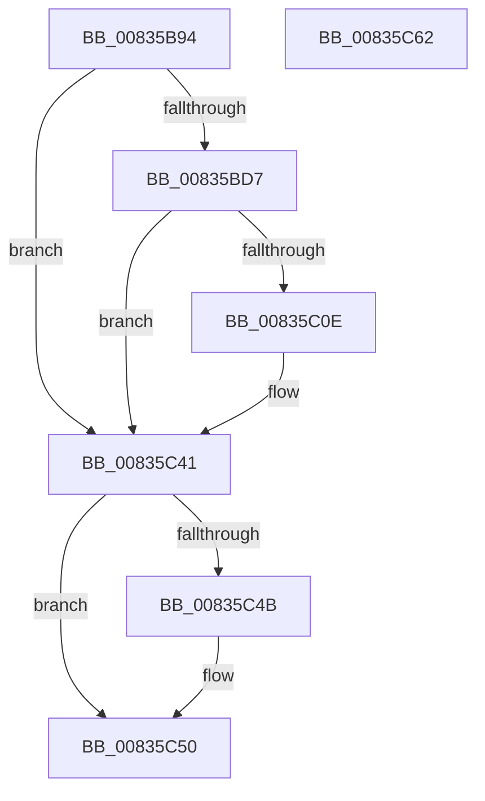

# DrvDbInitializeDatabaseNodeVersion

- RVA: `0x00835B94`–`0x00835C63` (길이 `207` bytes)
- VA: `0x0000000140835B94`
- 실행 섹션: `PAGE`
- PDB 이름 있음: `예`; PDB Function 태그: `아니요`
- unwind 정보 RVA: `0x000937EC`
- 디코드: `52`개 명령, `207/207` bytes 표시
- 미해석 바이트: `0` (있으면 어셈블리에 `.byte`로 보존)

> 이 문서는 커널 이미지의 기계어와 PDB 기호를 분석해 생성했습니다. 4번과 5번은 함수 원형과 자료형을 바이너리 사용 방식에서 추정한 C 해석이며 원본 소스 복구 결과는 아닙니다.

## 1. Dependencies

- 직접 호출 지점: **4**; 고유 호출 대상: **3**
- 직접 호출자로 확인된 함수: **1**
- RIP 상대 이미지 참조: **2**

### Outgoing calls
- `0x00835BCC` → [PnpCtxRegOpenKey](../8E/PnpCtxRegOpenKey_function_008EF7B8.md) (function, `0x008EF7B8`)
- `0x00835C03` → [DrvDbSetDriverDatabaseMappedProperty](DrvDbSetDriverDatabaseMappedProperty_function_00834014.md) (function, `0x00834014`)
- `0x00835C3A` → [DrvDbSetDriverDatabaseMappedProperty](DrvDbSetDriverDatabaseMappedProperty_function_00834014.md) (function, `0x00834014`)
- `0x00835C4B` → [ZwClose](../../text/6A/ZwClose_function_006AD2B0.md) (function, `0x006AD2B0`)

### Direct callers
- [sub_00B24270](../B2/Unknown_function_00B24270.md) at `0x00B24316`
- [sub_00B24270](../B2/Unknown_function_00B24270.md) at `0x00B24391`

### Static image references
- `0x00835BE4` → RVA `0x000218B0` (`.rdata`; read)
- `0x00835C1B` → RVA `0x00022680` (`.rdata`; read)

## 2. Other-region calls and transfers

- 다른 실행 섹션으로 향하는 call: **1**
  - `0x00835C4B` → [ZwClose](../../text/6A/ZwClose_function_006AD2B0.md) (`PAGE` → `.text`)
- 별도 외부 분기/꼬리 이동을 확인하지 못했습니다.

## 3. Assembly (complete function range)

```asm
00835B94  4C 8B DC                        mov r11, rsp
00835B97  49 89 5B 10                     mov qword ptr [r11 + 0x10], rbx
00835B9B  49 89 73 18                     mov qword ptr [r11 + 0x18], rsi
00835B9F  57                              push rdi
00835BA0  48 83 EC 40                     sub rsp, 0x40
00835BA4  49 83 63 08 00                  and qword ptr [r11 + 8], 0
00835BA9  49 8D 43 08                     lea rax, [r11 + 8]
00835BAD  48 8B FA                        mov rdi, rdx
00835BB0  49 89 43 E0                     mov qword ptr [r11 - 0x20], rax
00835BB4  48 8B 52 60                     mov rdx, qword ptr [rdx + 0x60]
00835BB8  48 8B F1                        mov rsi, rcx
00835BBB  48 8B 09                        mov rcx, qword ptr [rcx]
00835BBE  45 33 C9                        xor r9d, r9d
00835BC1  45 33 C0                        xor r8d, r8d
00835BC4  C7 44 24 20 02 00 00 00         mov dword ptr [rsp + 0x20], 2
00835BCC  E8 E7 9B 0B 00                  call 0x1408ef7b8
00835BD1  8B D8                           mov ebx, eax
00835BD3  85 C0                           test eax, eax
00835BD5  78 6A                           js 0x140835c41
00835BD7  4C 8B 44 24 50                  mov r8, qword ptr [rsp + 0x50]
00835BDC  48 8D 47 44                     lea rax, [rdi + 0x44]
00835BE0  48 8B 57 18                     mov rdx, qword ptr [rdi + 0x18]
00835BE4  4C 8D 0D C5 BC 7E FF            lea r9, [rip - 0x81433b]
00835BEB  C7 44 24 30 04 00 00 00         mov dword ptr [rsp + 0x30], 4
00835BF3  48 8B CE                        mov rcx, rsi
00835BF6  48 89 44 24 28                  mov qword ptr [rsp + 0x28], rax
00835BFB  C7 44 24 20 07 00 00 00         mov dword ptr [rsp + 0x20], 7
00835C03  E8 0C E4 FF FF                  call 0x140834014
00835C08  8B D8                           mov ebx, eax
00835C0A  85 C0                           test eax, eax
00835C0C  78 33                           js 0x140835c41
00835C0E  4C 8B 44 24 50                  mov r8, qword ptr [rsp + 0x50]
00835C13  48 8D 47 48                     lea rax, [rdi + 0x48]
00835C17  48 8B 57 18                     mov rdx, qword ptr [rdi + 0x18]
00835C1B  4C 8D 0D 5E CA 7E FF            lea r9, [rip - 0x8135a2]
00835C22  C7 44 24 30 04 00 00 00         mov dword ptr [rsp + 0x30], 4
00835C2A  48 8B CE                        mov rcx, rsi
00835C2D  48 89 44 24 28                  mov qword ptr [rsp + 0x28], rax
00835C32  C7 44 24 20 07 00 00 00         mov dword ptr [rsp + 0x20], 7
00835C3A  E8 D5 E3 FF FF                  call 0x140834014
00835C3F  8B D8                           mov ebx, eax
00835C41  48 8B 4C 24 50                  mov rcx, qword ptr [rsp + 0x50]
00835C46  48 85 C9                        test rcx, rcx
00835C49  74 05                           je 0x140835c50
00835C4B  E8 60 76 E7 FF                  call 0x1406ad2b0
00835C50  48 8B 74 24 60                  mov rsi, qword ptr [rsp + 0x60]
00835C55  8B C3                           mov eax, ebx
00835C57  48 8B 5C 24 58                  mov rbx, qword ptr [rsp + 0x58]
00835C5C  48 83 C4 40                     add rsp, 0x40
00835C60  5F                              pop rdi
00835C61  C3                              ret
00835C62  CC                              int3
```

## 4. C-style interpretation (structured pseudocode)

```c
__int64 __fastcall DrvDbInitializeDatabaseNodeVersion(__int64 a1, __int64 a2, int a3, int a4)
{
    __int64 result;
    __int64 v_rbx;
    __int64 v_rsp;
    unsigned int v_stack_m18;
    unsigned __int64 v_stack_m20;
    unsigned int v_stack_m28;
    unsigned __int64 v_stack_p10;
    unsigned __int64 v_stack_p18;
    unsigned __int64 v_stack_p8;

    *(unsigned __int64 *)(v_rsp + 16) = v_rbx;
    *(unsigned __int64 *)(v_rsp + 24) = v_rsi;
    v_rsp = (v_rsp) - (64);
    *(unsigned __int64 *)(v_rsp - 32) = v_rsp + 8;
    a4 = 0;
    a3 = 0;
    v_stack_m28 = 2;
    result = PnpCtxRegOpenKey(*(unsigned __int64 *)(a1), *(unsigned __int64 *)(a2 + 96), a3, a4);
    if (sign_flag) goto loc_00835C41;
    v_stack_m18 = 4;
    v_stack_m20 = a2 + 68;
    v_stack_m28 = 7;
    result = DrvDbSetDriverDatabaseMappedProperty(a1, *(unsigned __int64 *)(a2 + 24), v_stack_p8, v_rip - 8471355);
    v_rbx = (unsigned int)((unsigned int)(result));
    if (!(sign_flag)) {
        a3 = v_stack_p8;
        result = a2 + 72;
        a2 = *(unsigned __int64 *)(a2 + 24);
        a4 = v_rip - 8467874;
        v_stack_m18 = 4;
        a1 = a1;
        v_stack_m20 = result;
        v_stack_m28 = 7;
        result = DrvDbSetDriverDatabaseMappedProperty(a1, a2, a3, a4);
        v_rbx = (unsigned int)(result);
    }
    if (v_stack_p8 != 0) {
        result = ZwClose(v_stack_p8, a2, a3, a4);
    }
    v_rsp = (v_rsp) + (64);
    return (unsigned int)((unsigned int)(v_rbx));
}
```

## 5. (Beta) C Style

```c
int64_t DrvDbInitializeDatabaseNodeVersion(void *Arg1, void *Arg2, int32_t Arg3, int32_t Arg4)
{
    uint8_t *arg1 = (uint8_t *)Arg1;
    uint8_t *arg2 = (uint8_t *)Arg2;

    int64_t result;
    int64_t local_rbx;
    int64_t local_rsp;
    uint32_t v_stack_m18;
    uint64_t v_stack_m20;
    uint32_t v_stack_m28;
    uint64_t v_stack_p10;
    uint64_t v_stack_p18;
    uint64_t v_stack_p8;

    *(uint64_t *)(local_rsp + 0x10) = local_rbx;
    *(uint64_t *)(local_rsp + 0x18) = local_rsi;
    local_rsp = (local_rsp) - (64);
    *(uint64_t *)(local_rsp - 0x20) = local_rsp + 8;
    Arg4 = 0;
    Arg3 = 0;
    v_stack_m28 = 2;
    result = PnpCtxRegOpenKey(*(uint64_t *)(arg1), *(uint64_t *)(arg2 + 0x60), Arg3, Arg4);
    if (sign_flag) goto loc_00835C41;
    v_stack_m18 = 4;
    v_stack_m20 = Arg2 + 68;
    v_stack_m28 = 7;
    result = DrvDbSetDriverDatabaseMappedProperty(Arg1, *(uint64_t *)(arg2 + 0x18), v_stack_p8, v_rip - 8471355);
    local_rbx = (uint32_t)((uint32_t)(result));
    if (!(sign_flag)) {
        Arg3 = v_stack_p8;
        result = Arg2 + 72;
        Arg2 = *(uint64_t *)(arg2 + 0x18);
        Arg4 = v_rip - 8467874;
        v_stack_m18 = 4;
        Arg1 = Arg1;
        v_stack_m20 = result;
        v_stack_m28 = 7;
        result = DrvDbSetDriverDatabaseMappedProperty(Arg1, Arg2, Arg3, Arg4);
        local_rbx = (uint32_t)(result);
    }
    if (v_stack_p8 != 0) {
        result = ZwClose(v_stack_p8, Arg2, Arg3, Arg4);
    }
    local_rsp = (local_rsp) + (64);
    return (uint32_t)((uint32_t)(local_rbx));
}
```

### 관측된 메모리 오프셋

구조체 형식이 확인되지 않은 접근은 인자 기준의 오프셋으로만 기록했습니다.

| 기준 인자 | 오프셋 표현 | 폭 (bit) | 접근 |
|---|---:|---:|---|
| `Arg1` | `+ 0x0` | `64` | `R` |
| `Arg2` | `+ 0x18` | `64` | `R` |
| `Arg2` | `+ 0x44` | `64` | `R` |
| `Arg2` | `+ 0x48` | `64` | `R` |
| `Arg2` | `+ 0x60` | `64` | `R` |

## 6. Execution-region graph

[열기: 2D/3D 그래프와 함수 탐색 컨트롤 패널](../../../control-panel.html?section=page&rva=0x00835B94&view=graph)

- 2D 그래프는 위에서 아래로 흐르고, 3D 그래프는 빈 공간을 드래그해 회전합니다. Shift+드래그는 이동, 휠은 확대·축소, 함수 노드 선택은 대상 보고서 이동입니다.

### Static fallback


