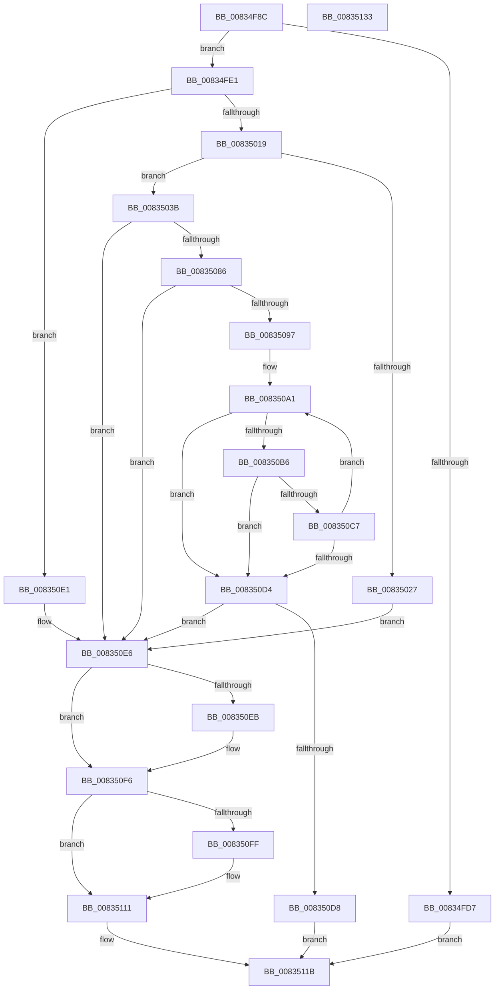

# DrvDbOpenContext

- RVA: `0x00834F8C`–`0x00835134` (길이 `424` bytes)
- VA: `0x0000000140834F8C`
- 실행 섹션: `PAGE`
- PDB 이름 있음: `예`; PDB Function 태그: `아니요`
- unwind 정보 RVA: `0x000DAC1C`
- 디코드: `114`개 명령, `424/424` bytes 표시
- 미해석 바이트: `0` (있으면 어셈블리에 `.byte`로 보존)

> 이 문서는 커널 이미지의 기계어와 PDB 기호를 분석해 생성했습니다. 4번과 5번은 함수 원형과 자료형을 바이너리 사용 방식에서 추정한 C 해석이며 원본 소스 복구 결과는 아닙니다.

## 1. Dependencies

- 직접 호출 지점: **12**; 고유 호출 대상: **9**
- 직접 호출자로 확인된 함수: **1**
- RIP 상대 이미지 참조: **6**

### Outgoing calls
- `0x00834FCA` → [ExAllocatePool2](../../poolcode/B8/ExAllocatePool2_function_00B820F0.md) (function, `0x00B820F0`)
- `0x00835007` → [ExAllocatePool2](../../poolcode/B8/ExAllocatePool2_function_00B820F0.md) (function, `0x00B820F0`)
- `0x0083501C` → [ExInitializeResourceLite](../../text/41/ExInitializeResourceLite_function_0041F9A0.md) (function, `0x0041F9A0`)
- `0x0083502D` → [ExFreePoolWithTag](../../poolcode/B8/ExFreePoolWithTag_function_00B82870.md) (function, `0x00B82870`)
- `0x00835076` → [DrvDbCreateDatabaseNode](DrvDbCreateDatabaseNode_function_0083533C.md) (function, `0x0083533C`)
- `0x0083508C` → [DrvDbLoadDatabaseNode](../93/DrvDbLoadDatabaseNode_function_00931668.md) (function, `0x00931668`)
- `0x008350AB` → [PnpCtxSetObjectDispatchCallback](../82/PnpCtxSetObjectDispatchCallback_function_008294B0.md) (function, `0x008294B0`)
- `0x008350BC` → [PnpCtxSetObjectContext](../82/PnpCtxSetObjectContext_function_00829484.md) (function, `0x00829484`)
- `0x008350F1` → [DrvDbDestroyDatabaseNode](DrvDbDestroyDatabaseNode_function_00835674.md) (function, `0x00835674`)
- `0x00835102` → [ExDeleteResourceLite](../../text/38/ExDeleteResourceLite_function_0038BA60.md) (function, `0x0038BA60`)
- `0x0083510C` → [ExFreePoolWithTag](../../poolcode/B8/ExFreePoolWithTag_function_00B82870.md) (function, `0x00B82870`)
- `0x00835116` → [ExFreePoolWithTag](../../poolcode/B8/ExFreePoolWithTag_function_00B82870.md) (function, `0x00B82870`)

### Direct callers
- [PiDrvDbInit](../74/PiDrvDbInit_function_0074130C.md) at `0x00741339`

### Static image references
- `0x00834FA5` → RVA `0x00E66398` (`.data`; read)
- `0x00834FAE` → RVA `0x00E663D0` (`.data`; read/write)
- `0x0083504B` → RVA `0x00AFF500` (` ?? ::NNGAKEGL::`string'`; read)
- `0x00835057` → RVA `0x00B00330` (` ?? ::NNGAKEGL::`string'`; read)
- `0x0083509A` → RVA `0x00009AA0` (`.rdata`; read)
- `0x008350D8` → RVA `0x00E663D0` (`.data`; write)

## 2. Other-region calls and transfers

- 다른 실행 섹션으로 향하는 call: **7**
  - `0x00834FCA` → [ExAllocatePool2](../../poolcode/B8/ExAllocatePool2_function_00B820F0.md) (`PAGE` → `POOLCODE`)
  - `0x00835007` → [ExAllocatePool2](../../poolcode/B8/ExAllocatePool2_function_00B820F0.md) (`PAGE` → `POOLCODE`)
  - `0x0083501C` → [ExInitializeResourceLite](../../text/41/ExInitializeResourceLite_function_0041F9A0.md) (`PAGE` → `.text`)
  - `0x0083502D` → [ExFreePoolWithTag](../../poolcode/B8/ExFreePoolWithTag_function_00B82870.md) (`PAGE` → `POOLCODE`)
  - `0x00835102` → [ExDeleteResourceLite](../../text/38/ExDeleteResourceLite_function_0038BA60.md) (`PAGE` → `.text`)
  - `0x0083510C` → [ExFreePoolWithTag](../../poolcode/B8/ExFreePoolWithTag_function_00B82870.md) (`PAGE` → `POOLCODE`)
  - `0x00835116` → [ExFreePoolWithTag](../../poolcode/B8/ExFreePoolWithTag_function_00B82870.md) (`PAGE` → `POOLCODE`)
- 별도 외부 분기/꼬리 이동을 확인하지 못했습니다.

## 3. Assembly (complete function range)

```asm
00834F8C  48 8B C4                        mov rax, rsp
00834F8F  48 89 58 08                     mov qword ptr [rax + 8], rbx
00834F93  48 89 70 18                     mov qword ptr [rax + 0x18], rsi
00834F97  48 89 78 20                     mov qword ptr [rax + 0x20], rdi
00834F9B  48 89 50 10                     mov qword ptr [rax + 0x10], rdx
00834F9F  41 56                           push r14
00834FA1  48 83 EC 50                     sub rsp, 0x50
00834FA5  4C 8B 35 EC 13 63 00            mov r14, qword ptr [rip + 0x6313ec]
00834FAC  33 F6                           xor esi, esi
00834FAE  48 21 35 1B 14 63 00            and qword ptr [rip + 0x63141b], rsi
00834FB5  B9 00 01 00 00                  mov ecx, 0x100
00834FBA  41 B8 50 44 44 42               mov r8d, 0x42444450
00834FC0  48 89 70 10                     mov qword ptr [rax + 0x10], rsi
00834FC4  41 8B 1E                        mov ebx, dword ptr [r14]
00834FC7  8D 56 40                        lea edx, [rsi + 0x40]
00834FCA  E8 21 D1 34 00                  call 0x140b820f0
00834FCF  48 8B F8                        mov rdi, rax
00834FD2  48 85 C0                        test rax, rax
00834FD5  75 0A                           jne 0x140834fe1
00834FD7  BB 17 00 00 C0                  mov ebx, 0xc0000017
00834FDC  E9 3A 01 00 00                  jmp 0x14083511b
00834FE1  4C 89 30                        mov qword ptr [rax], r14
00834FE4  BA 68 00 00 00                  mov edx, 0x68
00834FE9  89 58 08                        mov dword ptr [rax + 8], ebx
00834FEC  41 B8 50 44 44 42               mov r8d, 0x42444450
00834FF2  C7 40 0C 00 00 00 D0            mov dword ptr [rax + 0xc], 0xd0000000
00834FF9  48 83 C0 10                     add rax, 0x10
00834FFD  8D 4A D8                        lea ecx, [rdx - 0x28]
00835000  48 89 40 08                     mov qword ptr [rax + 8], rax
00835004  48 89 00                        mov qword ptr [rax], rax
00835007  E8 E4 D0 34 00                  call 0x140b820f0
0083500C  48 89 47 38                     mov qword ptr [rdi + 0x38], rax
00835010  48 85 C0                        test rax, rax
00835013  0F 84 C8 00 00 00               je 0x1408350e1
00835019  48 8B C8                        mov rcx, rax
0083501C  E8 7F A9 BE FF                  call 0x14041f9a0
00835021  8B D8                           mov ebx, eax
00835023  85 C0                           test eax, eax
00835025  79 14                           jns 0x14083503b
00835027  48 8B 4F 38                     mov rcx, qword ptr [rdi + 0x38]
0083502B  33 D2                           xor edx, edx
0083502D  E8 3E D8 34 00                  call 0x140b82870
00835032  48 21 77 38                     and qword ptr [rdi + 0x38], rsi
00835036  E9 AB 00 00 00                  jmp 0x1408350e6
0083503B  48 8D 44 24 68                  lea rax, [rsp + 0x68]
00835040  41 B9 01 00 00 00               mov r9d, 1
00835046  48 89 44 24 40                  mov qword ptr [rsp + 0x40], rax
0083504B  48 8D 15 AE A4 2C 00            lea rdx, [rip + 0x2ca4ae]
00835052  48 21 74 24 38                  and qword ptr [rsp + 0x38], rsi
00835057  48 8D 05 D2 B2 2C 00            lea rax, [rip + 0x2cb2d2]
0083505E  48 21 74 24 30                  and qword ptr [rsp + 0x30], rsi
00835063  45 33 C0                        xor r8d, r8d
00835066  C7 44 24 28 03 00 00 00         mov dword ptr [rsp + 0x28], 3
0083506E  48 8B CF                        mov rcx, rdi
00835071  48 89 44 24 20                  mov qword ptr [rsp + 0x20], rax
00835076  E8 C1 02 00 00                  call 0x14083533c
0083507B  48 8B 74 24 68                  mov rsi, qword ptr [rsp + 0x68]
00835080  8B D8                           mov ebx, eax
00835082  85 C0                           test eax, eax
00835084  78 60                           js 0x1408350e6
00835086  48 8B D6                        mov rdx, rsi
00835089  48 8B CF                        mov rcx, rdi
0083508C  E8 D7 C5 0F 00                  call 0x140931668
00835091  8B D8                           mov ebx, eax
00835093  85 C0                           test eax, eax
00835095  78 4F                           js 0x1408350e6
00835097  45 33 DB                        xor r11d, r11d
0083509A  4C 8D 15 FF 49 7D FF            lea r10, [rip - 0x82b601]
008350A1  4D 8B 42 08                     mov r8, qword ptr [r10 + 8]
008350A5  49 8B CE                        mov rcx, r14
008350A8  41 8B 12                        mov edx, dword ptr [r10]
008350AB  E8 00 44 FF FF                  call 0x1408294b0
008350B0  8B D8                           mov ebx, eax
008350B2  85 C0                           test eax, eax
008350B4  78 1E                           js 0x1408350d4
008350B6  41 8B 12                        mov edx, dword ptr [r10]
008350B9  4C 8B C7                        mov r8, rdi
008350BC  E8 C3 43 FF FF                  call 0x140829484
008350C1  8B D8                           mov ebx, eax
008350C3  85 C0                           test eax, eax
008350C5  78 0D                           js 0x1408350d4
008350C7  41 FF C3                        inc r11d
008350CA  49 83 C2 10                     add r10, 0x10
008350CE  41 83 FB 05                     cmp r11d, 5
008350D2  72 CD                           jb 0x1408350a1
008350D4  85 DB                           test ebx, ebx
008350D6  78 0E                           js 0x1408350e6
008350D8  48 89 3D F1 12 63 00            mov qword ptr [rip + 0x6312f1], rdi
008350DF  EB 3A                           jmp 0x14083511b
008350E1  BB 9A 00 00 C0                  mov ebx, 0xc000009a
008350E6  48 85 F6                        test rsi, rsi
008350E9  74 0B                           je 0x1408350f6
008350EB  48 8B D6                        mov rdx, rsi
008350EE  48 8B CF                        mov rcx, rdi
008350F1  E8 7E 05 00 00                  call 0x140835674
008350F6  48 8B 77 38                     mov rsi, qword ptr [rdi + 0x38]
008350FA  48 85 F6                        test rsi, rsi
008350FD  74 12                           je 0x140835111
008350FF  48 8B CE                        mov rcx, rsi
00835102  E8 59 69 B5 FF                  call 0x14038ba60
00835107  33 D2                           xor edx, edx
00835109  48 8B CE                        mov rcx, rsi
0083510C  E8 5F D7 34 00                  call 0x140b82870
00835111  33 D2                           xor edx, edx
00835113  48 8B CF                        mov rcx, rdi
00835116  E8 55 D7 34 00                  call 0x140b82870
0083511B  48 8B 74 24 70                  mov rsi, qword ptr [rsp + 0x70]
00835120  8B C3                           mov eax, ebx
00835122  48 8B 5C 24 60                  mov rbx, qword ptr [rsp + 0x60]
00835127  48 8B 7C 24 78                  mov rdi, qword ptr [rsp + 0x78]
0083512C  48 83 C4 50                     add rsp, 0x50
00835130  41 5E                           pop r14
00835132  C3                              ret
00835133  CC                              int3
```

## 4. C-style interpretation (structured pseudocode)

```c
__int64 __fastcall DrvDbOpenContext(__int64 a1, __int64 a2)
{
    __int64 result;
    __int64 v_r10;
    __int64 v_r11;
    __int64 v_rsi;
    __int64 v_rsp;
    unsigned __int64 v_stack_m18;
    unsigned __int64 v_stack_m20;
    unsigned __int64 v_stack_m28;
    unsigned int v_stack_m30;
    unsigned __int64 v_stack_m38;
    unsigned __int64 v_stack_p10;
    unsigned __int64 v_stack_p18;
    unsigned __int64 v_stack_p20;
    unsigned __int64 v_stack_p8;

    *(unsigned __int64 *)(v_rsp + 8) = v_rbx;
    *(unsigned __int64 *)(v_rsp + 24) = v_rsi;
    *(unsigned __int64 *)(v_rsp + 32) = v_rdi;
    *(unsigned __int64 *)(v_rsp + 16) = a2;
    v_rsp = (v_rsp) - (80);
    v_rsi = 0;
    *(unsigned __int64 *)(v_rsp + 16) = 0;
    result = ExAllocatePool2(256, v_rsi + 64, (unsigned int)(0x42444450ULL), a4);
    if (result != 0) goto loc_00834FE1;
    goto loc_0083511B;
loc_00834FE1:
    *(unsigned __int64 *)(result) = *(unsigned __int64 *)(v_rip + 6493164);
    *(unsigned int *)(result + 8) = (unsigned int)((unsigned int)(0xC0000017ULL));
    *(unsigned int *)(result + 12) = 0xD0000000ULL;
    result = (result) + (16);
    *(unsigned __int64 *)(result + 8) = result;
    *(unsigned __int64 *)(result) = result;
    result = ExAllocatePool2(104 - 40, 104, (unsigned int)(0x42444450ULL), a4);
    *(unsigned __int64 *)(result + 56) = result;
    if (result == 0) goto loc_008350E1;
    result = ExInitializeResourceLite(result, 104, (unsigned int)(0x42444450ULL), a4);
    if (!sign_flag) goto loc_0083503B;
    a2 = 0;
    result = ExFreePoolWithTag(*(unsigned __int64 *)(result + 56), a2, (unsigned int)(0x42444450ULL), a4);
    goto loc_008350E6;
loc_0083503B:
    v_stack_m18 = v_stack_p10;
    a3 = 0;
    v_stack_m30 = 3;
    v_stack_m38 = v_rip + 2929362;
    result = DrvDbCreateDatabaseNode(result, v_rip + 2925742, a3, 1);
    if (sign_flag) goto loc_008350E6;
    result = DrvDbLoadDatabaseNode(result, v_stack_p10, a3, 1);
    if (sign_flag) goto loc_008350E6;
    v_r11 = 0;
loc_008350A1:
    result = PnpCtxSetObjectDispatchCallback(*(unsigned __int64 *)(v_rip + 6493164), (unsigned int)(*(unsigned int *)(v_rip - 8566273)), *(unsigned __int64 *)(v_rip - 8566273 + 8), 1);
    if (sign_flag) goto loc_008350D4;
    result = PnpCtxSetObjectContext(*(unsigned __int64 *)(v_rip + 6493164), (unsigned int)(*(unsigned int *)(v_rip - 8566273)), result, 1);
    if (sign_flag) goto loc_008350D4;
    v_r11 = (unsigned int)((v_r11) + 1);
    v_r10 = (v_rip - 8566273) + (16);
    if (((unsigned int)(v_r11)) < 5) goto loc_008350A1;
loc_008350D4:
    if (sign_flag) goto loc_008350E6;
    *(unsigned __int64 *)(v_rip + 6492913) = result;
    goto loc_0083511B;
loc_008350E1:
loc_008350E6:
    if (v_stack_p10 != 0) {
        a2 = v_stack_p10;
        a1 = result;
        result = DrvDbDestroyDatabaseNode(a1, a2, result, 1);
    }
    if (*(unsigned __int64 *)(result + 56) != 0) {
        a1 = *(unsigned __int64 *)(result + 56);
        result = ExDeleteResourceLite(a1, a2, result, 1);
        a2 = 0;
        a1 = *(unsigned __int64 *)(result + 56);
        result = ExFreePoolWithTag(a1, a2, result, 1);
    }
    a2 = 0;
    result = ExFreePoolWithTag(result, a2, result, 1);
loc_0083511B:
    v_rsp = (v_rsp) + (80);
    return (unsigned int)((unsigned int)((unsigned int)(0xC000009AULL)));
}
```

## 5. (Beta) C Style

```c
int64_t DrvDbOpenContext(int64_t Arg1, int64_t Arg2)
{
    int64_t result;
    int64_t local_r10;
    int64_t local_r11;
    int64_t local_rsi;
    int64_t local_rsp;
    uint64_t v_stack_m18;
    uint64_t v_stack_m20;
    uint64_t v_stack_m28;
    uint32_t v_stack_m30;
    uint64_t v_stack_m38;
    uint64_t v_stack_p10;
    uint64_t v_stack_p18;
    uint64_t v_stack_p20;
    uint64_t v_stack_p8;

    *(uint64_t *)(local_rsp + 0x8) = local_rbx;
    *(uint64_t *)(local_rsp + 0x18) = local_rsi;
    *(uint64_t *)(local_rsp + 0x20) = local_rdi;
    *(uint64_t *)(local_rsp + 0x10) = Arg2;
    local_rsp = (local_rsp) - (80);
    local_rsi = 0;
    *(uint64_t *)(local_rsp + 0x10) = 0;
    result = ExAllocatePool2(256, local_rsi + 64, (uint32_t)(0x42444450ULL), a4);
    if (result != 0) goto loc_00834FE1;
    goto loc_0083511B;
loc_00834FE1:
    *(uint64_t *)(result) = *(uint64_t *)(v_rip + 0x6313EC);
    *(uint32_t *)(result + 0x8) = (uint32_t)((uint32_t)(0xC0000017ULL));
    *(uint32_t *)(result + 0xC) = 0xD0000000ULL;
    result = (result) + (16);
    *(uint64_t *)(result + 0x8) = result;
    *(uint64_t *)(result) = result;
    result = ExAllocatePool2(104 - 40, 104, (uint32_t)(0x42444450ULL), a4);
    *(uint64_t *)(result + 0x38) = result;
    if (result == 0) goto loc_008350E1;
    result = ExInitializeResourceLite(result, 104, (uint32_t)(0x42444450ULL), a4);
    if (!sign_flag) goto loc_0083503B;
    Arg2 = 0;
    result = ExFreePoolWithTag(*(uint64_t *)(result + 0x38), Arg2, (uint32_t)(0x42444450ULL), a4);
    goto loc_008350E6;
loc_0083503B:
    v_stack_m18 = v_stack_p10;
    a3 = 0;
    v_stack_m30 = 3;
    v_stack_m38 = v_rip + 2929362;
    result = DrvDbCreateDatabaseNode(result, v_rip + 2925742, a3, 1);
    if (sign_flag) goto loc_008350E6;
    result = DrvDbLoadDatabaseNode(result, v_stack_p10, a3, 1);
    if (sign_flag) goto loc_008350E6;
    local_r11 = 0;
loc_008350A1:
    result = PnpCtxSetObjectDispatchCallback(*(uint64_t *)(v_rip + 0x6313EC), (uint32_t)(*(uint32_t *)(v_rip - 0x82B601)), *(uint64_t *)(v_rip - 0x82B601 + 0x8), 1);
    if (sign_flag) goto loc_008350D4;
    result = PnpCtxSetObjectContext(*(uint64_t *)(v_rip + 0x6313EC), (uint32_t)(*(uint32_t *)(v_rip - 0x82B601)), result, 1);
    if (sign_flag) goto loc_008350D4;
    local_r11 = (uint32_t)((local_r11) + 1);
    local_r10 = (v_rip - 8566273) + (16);
    if (((uint32_t)(local_r11)) < 5) goto loc_008350A1;
loc_008350D4:
    if (sign_flag) goto loc_008350E6;
    *(uint64_t *)(v_rip + 0x6312F1) = result;
    goto loc_0083511B;
loc_008350E1:
loc_008350E6:
    if (v_stack_p10 != 0) {
        Arg2 = v_stack_p10;
        Arg1 = result;
        result = DrvDbDestroyDatabaseNode(Arg1, Arg2, result, 1);
    }
    if (*(uint64_t *)(result + 0x38) != 0) {
        Arg1 = *(uint64_t *)(result + 0x38);
        result = ExDeleteResourceLite(Arg1, Arg2, result, 1);
        Arg2 = 0;
        Arg1 = *(uint64_t *)(result + 0x38);
        result = ExFreePoolWithTag(Arg1, Arg2, result, 1);
    }
    Arg2 = 0;
    result = ExFreePoolWithTag(result, Arg2, result, 1);
loc_0083511B:
    local_rsp = (local_rsp) + (80);
    return (uint32_t)((uint32_t)((uint32_t)(0xC000009AULL)));
}
```

## 6. Execution-region graph

[열기: 2D/3D 그래프와 함수 탐색 컨트롤 패널](../../../control-panel.html?section=page&rva=0x00834F8C&view=graph)

- 2D 그래프는 위에서 아래로 흐르고, 3D 그래프는 빈 공간을 드래그해 회전합니다. Shift+드래그는 이동, 휠은 확대·축소, 함수 노드 선택은 대상 보고서 이동입니다.

### Static fallback


