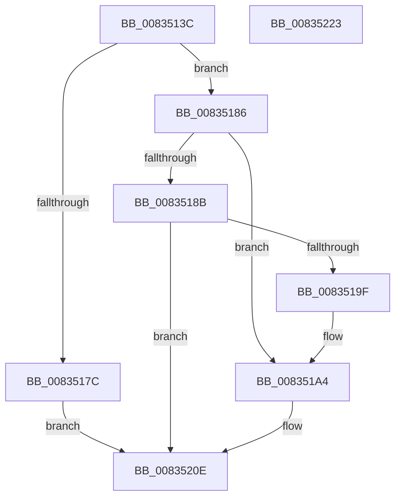

# DrvDbRegisterDatabase

- RVA: `0x0083513C`–`0x00835224` (길이 `232` bytes)
- VA: `0x000000014083513C`
- 실행 섹션: `PAGE`
- PDB 이름 있음: `예`; PDB Function 태그: `아니요`
- unwind 정보 RVA: `0x000DA7EC`
- 디코드: `57`개 명령, `232/232` bytes 표시
- 미해석 바이트: `0` (있으면 어셈블리에 `.byte`로 보존)

> 이 문서는 커널 이미지의 기계어와 PDB 기호를 분석해 생성했습니다. 4번과 5번은 함수 원형과 자료형을 바이너리 사용 방식에서 추정한 C 해석이며 원본 소스 복구 결과는 아닙니다.

## 1. Dependencies

- 직접 호출 지점: **3**; 고유 호출 대상: **2**
- 직접 호출자로 확인된 함수: **1**
- RIP 상대 이미지 참조: **2**

### Outgoing calls
- `0x00835173` → [DrvDbFindDatabaseNode](../93/DrvDbFindDatabaseNode_function_00932628.md) (function, `0x00932628`)
- `0x00835196` → [DrvDbFindDatabaseNode](../93/DrvDbFindDatabaseNode_function_00932628.md) (function, `0x00932628`)
- `0x00835209` → [DrvDbCreateDatabaseNode](DrvDbCreateDatabaseNode_function_0083533C.md) (function, `0x0083533C`)

### Direct callers
- [PiDrvDbRegisterNode](../74/PiDrvDbRegisterNode_function_00742658.md) at `0x00742797`

### Static image references
- `0x00835154` → RVA `0x00E663D0` (`.data`; read)
- `0x008351D4` → RVA `0x00931980` (`PiDrvDbNodeActionCallback`; read)

## 2. Other-region calls and transfers

- 다른 실행 섹션으로 향하는 call: **0**
- 별도 외부 분기/꼬리 이동을 확인하지 못했습니다.

## 3. Assembly (complete function range)

```asm
0083513C  48 8B C4                        mov rax, rsp
0083513F  48 89 58 10                     mov qword ptr [rax + 0x10], rbx
00835143  48 89 68 18                     mov qword ptr [rax + 0x18], rbp
00835147  48 89 70 20                     mov qword ptr [rax + 0x20], rsi
0083514B  48 89 48 08                     mov qword ptr [rax + 8], rcx
0083514F  57                              push rdi
00835150  48 83 EC 50                     sub rsp, 0x50
00835154  48 8B 35 75 12 63 00            mov rsi, qword ptr [rip + 0x631275]
0083515B  49 8B D8                        mov rbx, r8
0083515E  48 83 60 38 00                  and qword ptr [rax + 0x38], 0
00835163  4C 8D 40 38                     lea r8, [rax + 0x38]
00835167  33 FF                           xor edi, edi
00835169  48 8B CE                        mov rcx, rsi
0083516C  48 8B EA                        mov rbp, rdx
0083516F  48 89 78 08                     mov qword ptr [rax + 8], rdi
00835173  E8 B0 D4 0F 00                  call 0x140932628
00835178  85 C0                           test eax, eax
0083517A  78 0A                           js 0x140835186
0083517C  B8 00 00 00 40                  mov eax, 0x40000000
00835181  E9 88 00 00 00                  jmp 0x14083520e
00835186  48 85 DB                        test rbx, rbx
00835189  74 19                           je 0x1408351a4
0083518B  4C 8D 44 24 60                  lea r8, [rsp + 0x60]
00835190  48 8B D3                        mov rdx, rbx
00835193  48 8B CE                        mov rcx, rsi
00835196  E8 8D D4 0F 00                  call 0x140932628
0083519B  85 C0                           test eax, eax
0083519D  78 6F                           js 0x14083520e
0083519F  48 8B 7C 24 60                  mov rdi, qword ptr [rsp + 0x60]
008351A4  44 8B 8C 24 88 00 00 00         mov r9d, dword ptr [rsp + 0x88]
008351AC  48 8D 84 24 90 00 00 00         lea rax, [rsp + 0x90]
008351B4  48 89 44 24 40                  mov qword ptr [rsp + 0x40], rax
008351B9  41 83 E1 02                     and r9d, 2
008351BD  48 8B 84 24 98 00 00 00         mov rax, qword ptr [rsp + 0x98]
008351C5  4C 8B C7                        mov r8, rdi
008351C8  48 89 44 24 38                  mov qword ptr [rsp + 0x38], rax
008351CD  48 8B CE                        mov rcx, rsi
008351D0  41 C1 E1 03                     shl r9d, 3
008351D4  48 8D 05 A5 C7 0F 00            lea rax, [rip + 0xfc7a5]
008351DB  41 8B D1                        mov edx, r9d
008351DE  48 89 44 24 30                  mov qword ptr [rsp + 0x30], rax
008351E3  48 8B 84 24 80 00 00 00         mov rax, qword ptr [rsp + 0x80]
008351EB  83 CA 20                        or edx, 0x20
008351EE  F6 84 24 88 00 00 00 01         test byte ptr [rsp + 0x88], 1
008351F6  41 0F 44 D1                     cmove edx, r9d
008351FA  45 33 C9                        xor r9d, r9d
008351FD  89 54 24 28                     mov dword ptr [rsp + 0x28], edx
00835201  48 8B D5                        mov rdx, rbp
00835204  48 89 44 24 20                  mov qword ptr [rsp + 0x20], rax
00835209  E8 2E 01 00 00                  call 0x14083533c
0083520E  48 8B 5C 24 68                  mov rbx, qword ptr [rsp + 0x68]
00835213  48 8B 6C 24 70                  mov rbp, qword ptr [rsp + 0x70]
00835218  48 8B 74 24 78                  mov rsi, qword ptr [rsp + 0x78]
0083521D  48 83 C4 50                     add rsp, 0x50
00835221  5F                              pop rdi
00835222  C3                              ret
00835223  CC                              int3
```

## 4. C-style interpretation (structured pseudocode)

```c
__int64 __fastcall DrvDbRegisterDatabase(__int64 a1, __int64 a2, __int64 a3, __int64 a4, __int64 a5, unsigned __int8 a6, __int64 a7, __int64 a8)
{
    __int64 result;
    __int64 v_rdi;
    __int64 v_rsp;
    unsigned __int64 v_stack_m18;
    unsigned __int64 v_stack_m20;
    unsigned __int64 v_stack_m28;
    unsigned int v_stack_m30;
    unsigned __int64 v_stack_m38;
    unsigned __int64 v_stack_p10;
    unsigned __int64 v_stack_p18;
    unsigned __int64 v_stack_p20;
    unsigned __int64 v_stack_p8;

    *(unsigned __int64 *)(v_rsp + 16) = v_rbx;
    *(unsigned __int64 *)(v_rsp + 24) = v_rbp;
    *(unsigned __int64 *)(v_rsp + 32) = v_rsi;
    *(unsigned __int64 *)(v_rsp + 8) = a1;
    v_rsp = (v_rsp) - (80);
    v_rdi = 0;
    *(unsigned __int64 *)(v_rsp + 8) = 0;
    result = DrvDbFindDatabaseNode(*(unsigned __int64 *)(v_rip + 6492789), a2, v_rsp + 56, a4);
    if (sign_flag) goto loc_00835186;
    goto loc_0083520E;
loc_00835186:
    if (a3 == 0) goto loc_008351A4;
    result = DrvDbFindDatabaseNode(*(unsigned __int64 *)(v_rip + 6492789), a3, v_stack_p8, a4);
    if (sign_flag) goto loc_0083520E;
loc_008351A4:
    v_stack_m18 = a7;
    a4 = (unsigned int)(((unsigned int)(a6)) & (2));
    v_stack_m20 = a8;
    a4 = (unsigned int)((a4) << (3));
    v_stack_m28 = v_rip + 1034149;
    a2 = (unsigned int)(((unsigned int)((unsigned int)(a4))) | (32));
    if (((a6) & (1)) == 0) { a2 = (unsigned int)(a4); }
    a4 = 0;
    v_stack_m30 = (unsigned int)(a2);
    v_stack_m38 = a5;
    result = DrvDbCreateDatabaseNode(*(unsigned __int64 *)(v_rip + 6492789), a2, v_stack_p8, a4);
loc_0083520E:
    v_rsp = (v_rsp) + (80);
    return result;
}
```

## 5. (Beta) C Style

```c
int64_t DrvDbRegisterDatabase(int64_t Arg1, int64_t Arg2, int64_t Arg3, int64_t Arg4, int64_t Arg5, uint8_t Arg6, int64_t Arg7, int64_t Arg8)
{
    int64_t result;
    int64_t local_rdi;
    int64_t local_rsp;
    uint64_t v_stack_m18;
    uint64_t v_stack_m20;
    uint64_t v_stack_m28;
    uint32_t v_stack_m30;
    uint64_t v_stack_m38;
    uint64_t v_stack_p10;
    uint64_t v_stack_p18;
    uint64_t v_stack_p20;
    uint64_t v_stack_p8;

    *(uint64_t *)(local_rsp + 0x10) = local_rbx;
    *(uint64_t *)(local_rsp + 0x18) = local_rbp;
    *(uint64_t *)(local_rsp + 0x20) = local_rsi;
    *(uint64_t *)(local_rsp + 0x8) = Arg1;
    local_rsp = (local_rsp) - (80);
    local_rdi = 0;
    *(uint64_t *)(local_rsp + 0x8) = 0;
    result = DrvDbFindDatabaseNode(*(uint64_t *)(v_rip + 0x631275), Arg2, local_rsp + 56, Arg4);
    if (sign_flag) goto loc_00835186;
    goto loc_0083520E;
loc_00835186:
    if (Arg3 == 0) goto loc_008351A4;
    result = DrvDbFindDatabaseNode(*(uint64_t *)(v_rip + 0x631275), Arg3, v_stack_p8, Arg4);
    if (sign_flag) goto loc_0083520E;
loc_008351A4:
    v_stack_m18 = Arg7;
    Arg4 = (uint32_t)(((uint32_t)(Arg6)) & (2));
    v_stack_m20 = Arg8;
    Arg4 = (uint32_t)((Arg4) << (3));
    v_stack_m28 = v_rip + 1034149;
    Arg2 = (uint32_t)(((uint32_t)((uint32_t)(Arg4))) | (32));
    if (((Arg6) & (1)) == 0) { Arg2 = (uint32_t)(Arg4); }
    Arg4 = 0;
    v_stack_m30 = (uint32_t)(Arg2);
    v_stack_m38 = Arg5;
    result = DrvDbCreateDatabaseNode(*(uint64_t *)(v_rip + 0x631275), Arg2, v_stack_p8, Arg4);
loc_0083520E:
    local_rsp = (local_rsp) + (80);
    return result;
}
```

## 6. Execution-region graph

[열기: 2D/3D 그래프와 함수 탐색 컨트롤 패널](../../../control-panel.html?section=page&rva=0x0083513C&view=graph)

- 2D 그래프는 위에서 아래로 흐르고, 3D 그래프는 빈 공간을 드래그해 회전합니다. Shift+드래그는 이동, 휠은 확대·축소, 함수 노드 선택은 대상 보고서 이동입니다.

### Static fallback


