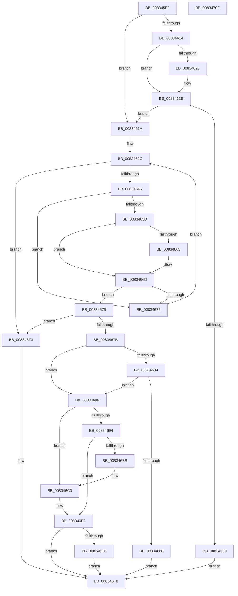

# DrvDbSetDriverFileMappedProperty

- RVA: `0x008345E8`–`0x00834710` (길이 `296` bytes)
- VA: `0x00000001408345E8`
- 실행 섹션: `PAGE`
- PDB 이름 있음: `예`; PDB Function 태그: `아니요`
- unwind 정보 RVA: `0x00066400`
- 디코드: `86`개 명령, `296/296` bytes 표시
- 미해석 바이트: `0` (있으면 어셈블리에 `.byte`로 보존)

> 이 문서는 커널 이미지의 기계어와 PDB 기호를 분석해 생성했습니다. 4번과 5번은 함수 원형과 자료형을 바이너리 사용 방식에서 추정한 C 해석이며 원본 소스 복구 결과는 아닙니다.

## 1. Dependencies

- 직접 호출 지점: **3**; 고유 호출 대상: **3**
- 직접 호출자로 확인된 함수: **1**
- RIP 상대 이미지 참조: **3**

### Outgoing calls
- `0x008346B0` → [DrvDbOpenDriverFileRegKey](DrvDbOpenDriverFileRegKey_function_00833FCC.md) (function, `0x00833FCC`)
- `0x008346DB` → [DrvDbSetRegValueMappedProperty](DrvDbSetRegValueMappedProperty_function_00834DC8.md) (function, `0x00834DC8`)
- `0x008346EC` → [ZwClose](../../text/6A/ZwClose_function_006AD2B0.md) (function, `0x006AD2B0`)

### Direct callers
- [DrvDbDispatchDriverFile](../AC/DrvDbDispatchDriverFile_function_00AC8880.md) at `0x00AC8980`

### Static image references
- `0x00834617` → RVA `0x00011F10` (`.rdata`; read)
- `0x00834624` → RVA `0x00011F18` (`.rdata`; read)
- `0x00834649` → RVA `0x0000C600` (`.rdata`; read)

## 2. Other-region calls and transfers

- 다른 실행 섹션으로 향하는 call: **1**
  - `0x008346EC` → [ZwClose](../../text/6A/ZwClose_function_006AD2B0.md) (`PAGE` → `.text`)
- 별도 외부 분기/꼬리 이동을 확인하지 못했습니다.

## 3. Assembly (complete function range)

```asm
008345E8  48 8B C4                        mov rax, rsp
008345EB  48 89 58 08                     mov qword ptr [rax + 8], rbx
008345EF  48 89 68 10                     mov qword ptr [rax + 0x10], rbp
008345F3  48 89 70 18                     mov qword ptr [rax + 0x18], rsi
008345F7  57                              push rdi
008345F8  48 83 EC 30                     sub rsp, 0x30
008345FC  48 83 60 20 00                  and qword ptr [rax + 0x20], 0
00834601  4D 8B D0                        mov r10, r8
00834604  45 8B 59 10                     mov r11d, dword ptr [r9 + 0x10]
00834608  48 8B DA                        mov rbx, rdx
0083460B  48 8B E9                        mov rbp, rcx
0083460E  41 83 FB 02                     cmp r11d, 2
00834612  75 26                           jne 0x14083463a
00834614  49 8B 01                        mov rax, qword ptr [r9]
00834617  48 2B 05 F2 D8 7D FF            sub rax, qword ptr [rip - 0x82270e]
0083461E  75 0B                           jne 0x14083462b
00834620  49 8B 41 08                     mov rax, qword ptr [r9 + 8]
00834624  48 2B 05 ED D8 7D FF            sub rax, qword ptr [rip - 0x822713]
0083462B  48 85 C0                        test rax, rax
0083462E  75 0A                           jne 0x14083463a
00834630  BB 22 00 00 C0                  mov ebx, 0xc0000022
00834635  E9 BE 00 00 00                  jmp 0x1408346f8
0083463A  33 D2                           xor edx, edx
0083463C  83 FA 02                        cmp edx, 2
0083463F  0F 83 AE 00 00 00               jae 0x1408346f3
00834645  48 8D 0C 92                     lea rcx, [rdx + rdx*4]
00834649  48 8D 05 B0 7F 7D FF            lea rax, [rip - 0x828050]
00834650  48 8D 34 C8                     lea rsi, [rax + rcx*8]
00834654  4C 8B 06                        mov r8, qword ptr [rsi]
00834657  45 39 58 10                     cmp dword ptr [r8 + 0x10], r11d
0083465B  75 15                           jne 0x140834672
0083465D  49 8B 08                        mov rcx, qword ptr [r8]
00834660  49 2B 09                        sub rcx, qword ptr [r9]
00834663  75 08                           jne 0x14083466d
00834665  49 8B 48 08                     mov rcx, qword ptr [r8 + 8]
00834669  49 2B 49 08                     sub rcx, qword ptr [r9 + 8]
0083466D  48 85 C9                        test rcx, rcx
00834670  74 04                           je 0x140834676
00834672  FF C2                           inc edx
00834674  EB C6                           jmp 0x14083463c
00834676  48 85 F6                        test rsi, rsi
00834679  74 78                           je 0x1408346f3
0083467B  8B 7C 24 60                     mov edi, dword ptr [rsp + 0x60]
0083467F  3B 7E 08                        cmp edi, dword ptr [rsi + 8]
00834682  74 0B                           je 0x14083468f
00834684  85 FF                           test edi, edi
00834686  74 07                           je 0x14083468f
00834688  BB 0D 00 00 C0                  mov ebx, 0xc000000d
0083468D  EB 69                           jmp 0x1408346f8
0083468F  4D 85 D2                        test r10, r10
00834692  75 2C                           jne 0x1408346c0
00834694  4C 21 54 24 28                  and qword ptr [rsp + 0x28], r10
00834699  48 8D 44 24 58                  lea rax, [rsp + 0x58]
0083469E  45 33 C9                        xor r9d, r9d
008346A1  48 89 44 24 20                  mov qword ptr [rsp + 0x20], rax
008346A6  45 8D 42 02                     lea r8d, [r10 + 2]
008346AA  48 8B D3                        mov rdx, rbx
008346AD  48 8B CD                        mov rcx, rbp
008346B0  E8 17 F9 FF FF                  call 0x140833fcc
008346B5  8B D8                           mov ebx, eax
008346B7  85 C0                           test eax, eax
008346B9  78 27                           js 0x1408346e2
008346BB  4C 8B 54 24 58                  mov r10, qword ptr [rsp + 0x58]
008346C0  8B 44 24 70                     mov eax, dword ptr [rsp + 0x70]
008346C4  44 8B CF                        mov r9d, edi
008346C7  89 44 24 28                     mov dword ptr [rsp + 0x28], eax
008346CB  4C 8B C6                        mov r8, rsi
008346CE  48 8B 44 24 68                  mov rax, qword ptr [rsp + 0x68]
008346D3  49 8B D2                        mov rdx, r10
008346D6  48 89 44 24 20                  mov qword ptr [rsp + 0x20], rax
008346DB  E8 E8 06 00 00                  call 0x140834dc8
008346E0  8B D8                           mov ebx, eax
008346E2  48 8B 4C 24 58                  mov rcx, qword ptr [rsp + 0x58]
008346E7  48 85 C9                        test rcx, rcx
008346EA  74 0C                           je 0x1408346f8
008346EC  E8 BF 8B E7 FF                  call 0x1406ad2b0
008346F1  EB 05                           jmp 0x1408346f8
008346F3  BB 16 00 00 C0                  mov ebx, 0xc0000016
008346F8  48 8B 6C 24 48                  mov rbp, qword ptr [rsp + 0x48]
008346FD  8B C3                           mov eax, ebx
008346FF  48 8B 5C 24 40                  mov rbx, qword ptr [rsp + 0x40]
00834704  48 8B 74 24 50                  mov rsi, qword ptr [rsp + 0x50]
00834709  48 83 C4 30                     add rsp, 0x30
0083470D  5F                              pop rdi
0083470E  C3                              ret
0083470F  CC                              int3
```

## 4. C-style interpretation (structured pseudocode)

```c
__int64 __fastcall DrvDbSetDriverFileMappedProperty(__int64 a1, __int64 a2, __int64 a3, __int64 a4, unsigned int a5, __int64 a6, unsigned int a7)
{
    __int64 result;
    __int64 v_rsp;
    unsigned __int64 v_stack_m10;
    unsigned __int64 v_stack_m18;
    unsigned __int64 v_stack_p10;
    unsigned __int64 v_stack_p18;
    unsigned __int64 v_stack_p20;
    unsigned __int64 v_stack_p8;

    *(unsigned __int64 *)(v_rsp + 8) = v_rbx;
    *(unsigned __int64 *)(v_rsp + 16) = v_rbp;
    *(unsigned __int64 *)(v_rsp + 24) = v_rsi;
    v_rsp = (v_rsp) - (48);
    if (((unsigned int)((unsigned int)(*(unsigned int *)(a4 + 16)))) != 2) goto loc_0083463A;
    result = (*(unsigned __int64 *)(a4)) - (*(unsigned __int64 *)(v_rip - 8529678));
    if (!(condition_is_not_equal)) {
        result = *(unsigned __int64 *)(a4 + 8);
        result = (result) - (*(unsigned __int64 *)(v_rip - 8529683));
    }
    if (result != 0) goto loc_0083463A;
    goto loc_008346F8;
loc_0083463A:
    a2 = 0;
loc_0083463C:
    if (0 >= 2) goto loc_008346F3;
    if ((*(unsigned int *)(*(unsigned __int64 *)(v_rip - 8552528 + a2 + a2 * 4 * 8) + 16)) != ((unsigned int)((unsigned int)(*(unsigned int *)(a4 + 16))))) goto loc_00834672;
    a1 = (*(unsigned __int64 *)(*(unsigned __int64 *)(v_rip - 8552528 + a2 + a2 * 4 * 8))) - (*(unsigned __int64 *)(a4));
    if (!(condition_is_not_equal)) {
        a1 = *(unsigned __int64 *)(*(unsigned __int64 *)(v_rip - 8552528 + a2 + a2 * 4 * 8) + 8);
        a1 = (a1) - (*(unsigned __int64 *)(a4 + 8));
    }
    if (a1 == 0) goto loc_00834676;
loc_00834672:
    a2 = (unsigned int)((a2) + 1);
    goto loc_0083463C;
loc_00834676:
    if (v_rip - 8552528 + a2 + a2 * 4 * 8 == 0) goto loc_008346F3;
    if (((unsigned int)((unsigned int)(a5))) == (*(unsigned int *)(v_rip - 8552528 + a2 + a2 * 4 * 8 + 8))) goto loc_0083468F;
    if ((unsigned int)((unsigned int)(a5)) == 0) goto loc_0083468F;
    goto loc_008346F8;
loc_0083468F:
    if (a3 != 0) goto loc_008346C0;
    a4 = 0;
    v_stack_m18 = v_stack_p20;
    result = DrvDbOpenDriverFileRegKey(a1, (unsigned int)(0xC000000DULL), a3 + 2, a4);
    if (sign_flag) goto loc_008346E2;
loc_008346C0:
    v_stack_m10 = (unsigned int)((unsigned int)(a7));
    v_stack_m18 = a6;
    result = DrvDbSetRegValueMappedProperty(a1, v_stack_p20, v_rip - 8552528 + a2 + a2 * 4 * 8, (unsigned int)((unsigned int)((unsigned int)(a5))));
loc_008346E2:
    if (v_stack_p20 == 0) goto loc_008346F8;
    result = ZwClose(v_stack_p20, v_stack_p20, v_rip - 8552528 + a2 + a2 * 4 * 8, (unsigned int)((unsigned int)((unsigned int)(a5))));
    goto loc_008346F8;
loc_008346F3:
loc_008346F8:
    v_rsp = (v_rsp) + (48);
    return (unsigned int)((unsigned int)((unsigned int)(0xC0000016ULL)));
}
```

## 5. (Beta) C Style

```c
int64_t DrvDbSetDriverFileMappedProperty(int64_t Arg1, int64_t Arg2, int64_t Arg3, void *Arg4, uint32_t Arg5, int64_t Arg6, uint32_t Arg7)
{
    uint8_t *arg4 = (uint8_t *)Arg4;

    int64_t result;
    int64_t local_rsp;
    uint64_t v_stack_m10;
    uint64_t v_stack_m18;
    uint64_t v_stack_p10;
    uint64_t v_stack_p18;
    uint64_t v_stack_p20;
    uint64_t v_stack_p8;

    *(uint64_t *)(local_rsp + 0x8) = local_rbx;
    *(uint64_t *)(local_rsp + 0x10) = local_rbp;
    *(uint64_t *)(local_rsp + 0x18) = local_rsi;
    local_rsp = (local_rsp) - (48);
    if (((uint32_t)((uint32_t)(*(uint32_t *)(arg4 + 0x10)))) != 2) goto loc_0083463A;
    result = (*(uint64_t *)(arg4)) - (*(uint64_t *)(v_rip - 0x82270E));
    if (!(condition_is_not_equal)) {
        result = *(uint64_t *)(arg4 + 0x8);
        result = (result) - (*(uint64_t *)(v_rip - 0x822713));
    }
    if (result != 0) goto loc_0083463A;
    goto loc_008346F8;
loc_0083463A:
    Arg2 = 0;
loc_0083463C:
    if (0 >= 2) goto loc_008346F3;
    if ((*(uint32_t *)(*(uint64_t *)(v_rip - 0x828050 + Arg2 + Arg2 * 4 * 8) + 0x10)) != ((uint32_t)((uint32_t)(*(uint32_t *)(arg4 + 0x10))))) goto loc_00834672;
    Arg1 = (*(uint64_t *)(*(uint64_t *)(v_rip - 0x828050 + Arg2 + Arg2 * 4 * 8))) - (*(uint64_t *)(arg4));
    if (!(condition_is_not_equal)) {
        Arg1 = *(uint64_t *)(*(uint64_t *)(v_rip - 0x828050 + Arg2 + Arg2 * 4 * 8) + 0x8);
        Arg1 = (Arg1) - (*(uint64_t *)(arg4 + 0x8));
    }
    if (Arg1 == 0) goto loc_00834676;
loc_00834672:
    Arg2 = (uint32_t)((Arg2) + 1);
    goto loc_0083463C;
loc_00834676:
    if (v_rip - 8552528 + Arg2 + Arg2 * 4 * 8 == 0) goto loc_008346F3;
    if (((uint32_t)((uint32_t)(Arg5))) == (*(uint32_t *)(v_rip - 0x828050 + Arg2 + Arg2 * 4 * 8 + 0x8))) goto loc_0083468F;
    if ((uint32_t)((uint32_t)(Arg5)) == 0) goto loc_0083468F;
    goto loc_008346F8;
loc_0083468F:
    if (Arg3 != 0) goto loc_008346C0;
    Arg4 = 0;
    v_stack_m18 = v_stack_p20;
    result = DrvDbOpenDriverFileRegKey(Arg1, (uint32_t)(0xC000000DULL), Arg3 + 2, Arg4);
    if (sign_flag) goto loc_008346E2;
loc_008346C0:
    v_stack_m10 = (uint32_t)((uint32_t)(Arg7));
    v_stack_m18 = Arg6;
    result = DrvDbSetRegValueMappedProperty(Arg1, v_stack_p20, v_rip - 8552528 + Arg2 + Arg2 * 4 * 8, (uint32_t)((uint32_t)((uint32_t)(Arg5))));
loc_008346E2:
    if (v_stack_p20 == 0) goto loc_008346F8;
    result = ZwClose(v_stack_p20, v_stack_p20, v_rip - 8552528 + Arg2 + Arg2 * 4 * 8, (uint32_t)((uint32_t)((uint32_t)(Arg5))));
    goto loc_008346F8;
loc_008346F3:
loc_008346F8:
    local_rsp = (local_rsp) + (48);
    return (uint32_t)((uint32_t)((uint32_t)(0xC0000016ULL)));
}
```

### 관측된 메모리 오프셋

구조체 형식이 확인되지 않은 접근은 인자 기준의 오프셋으로만 기록했습니다.

| 기준 인자 | 오프셋 표현 | 폭 (bit) | 접근 |
|---|---:|---:|---|
| `Arg4` | `+ 0x0` | `64` | `R` |
| `Arg4` | `+ 0x8` | `64` | `R` |
| `Arg4` | `+ 0x10` | `32` | `R` |

## 6. Execution-region graph

[열기: 2D/3D 그래프와 함수 탐색 컨트롤 패널](../../../control-panel.html?section=page&rva=0x008345E8&view=graph)

- 2D 그래프는 위에서 아래로 흐르고, 3D 그래프는 빈 공간을 드래그해 회전합니다. Shift+드래그는 이동, 휠은 확대·축소, 함수 노드 선택은 대상 보고서 이동입니다.

### Static fallback


