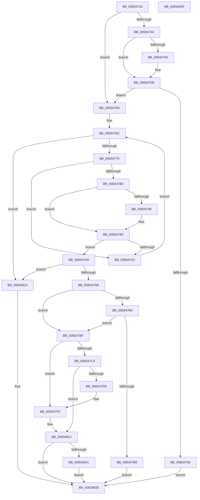

# DrvDbSetDriverInfFileMappedProperty

- RVA: `0x00834718`–`0x00834840` (길이 `296` bytes)
- VA: `0x0000000140834718`
- 실행 섹션: `PAGE`
- PDB 이름 있음: `예`; PDB Function 태그: `아니요`
- unwind 정보 RVA: `0x00066400`
- 디코드: `86`개 명령, `296/296` bytes 표시
- 미해석 바이트: `0` (있으면 어셈블리에 `.byte`로 보존)

> 이 문서는 커널 이미지의 기계어와 PDB 기호를 분석해 생성했습니다. 4번과 5번은 함수 원형과 자료형을 바이너리 사용 방식에서 추정한 C 해석이며 원본 소스 복구 결과는 아닙니다.

## 1. Dependencies

- 직접 호출 지점: **3**; 고유 호출 대상: **3**
- 직접 호출자로 확인된 함수: **1**
- RIP 상대 이미지 참조: **3**

### Outgoing calls
- `0x008347E0` → [DrvDbOpenDriverInfFileRegKey](../93/DrvDbOpenDriverInfFileRegKey_function_00930354.md) (function, `0x00930354`)
- `0x0083480B` → [DrvDbSetRegValueMappedProperty](DrvDbSetRegValueMappedProperty_function_00834DC8.md) (function, `0x00834DC8`)
- `0x0083481C` → [ZwClose](../../text/6A/ZwClose_function_006AD2B0.md) (function, `0x006AD2B0`)

### Direct callers
- [DrvDbDispatchDriverInfFile](../92/DrvDbDispatchDriverInfFile_function_0092FE10.md) at `0x0092FF3E`

### Static image references
- `0x00834747` → RVA `0x00011F10` (`.rdata`; read)
- `0x00834754` → RVA `0x00011F18` (`.rdata`; read)
- `0x00834779` → RVA `0x00002110` (`.rdata`; read)

## 2. Other-region calls and transfers

- 다른 실행 섹션으로 향하는 call: **1**
  - `0x0083481C` → [ZwClose](../../text/6A/ZwClose_function_006AD2B0.md) (`PAGE` → `.text`)
- 별도 외부 분기/꼬리 이동을 확인하지 못했습니다.

## 3. Assembly (complete function range)

```asm
00834718  48 8B C4                        mov rax, rsp
0083471B  48 89 58 08                     mov qword ptr [rax + 8], rbx
0083471F  48 89 68 10                     mov qword ptr [rax + 0x10], rbp
00834723  48 89 70 18                     mov qword ptr [rax + 0x18], rsi
00834727  57                              push rdi
00834728  48 83 EC 30                     sub rsp, 0x30
0083472C  48 83 60 20 00                  and qword ptr [rax + 0x20], 0
00834731  4D 8B D0                        mov r10, r8
00834734  45 8B 59 10                     mov r11d, dword ptr [r9 + 0x10]
00834738  48 8B DA                        mov rbx, rdx
0083473B  48 8B E9                        mov rbp, rcx
0083473E  41 83 FB 02                     cmp r11d, 2
00834742  75 26                           jne 0x14083476a
00834744  49 8B 01                        mov rax, qword ptr [r9]
00834747  48 2B 05 C2 D7 7D FF            sub rax, qword ptr [rip - 0x82283e]
0083474E  75 0B                           jne 0x14083475b
00834750  49 8B 41 08                     mov rax, qword ptr [r9 + 8]
00834754  48 2B 05 BD D7 7D FF            sub rax, qword ptr [rip - 0x822843]
0083475B  48 85 C0                        test rax, rax
0083475E  75 0A                           jne 0x14083476a
00834760  BB 22 00 00 C0                  mov ebx, 0xc0000022
00834765  E9 BE 00 00 00                  jmp 0x140834828
0083476A  33 D2                           xor edx, edx
0083476C  83 FA 04                        cmp edx, 4
0083476F  0F 83 AE 00 00 00               jae 0x140834823
00834775  48 8D 0C 92                     lea rcx, [rdx + rdx*4]
00834779  48 8D 05 90 D9 7C FF            lea rax, [rip - 0x832670]
00834780  48 8D 34 C8                     lea rsi, [rax + rcx*8]
00834784  4C 8B 06                        mov r8, qword ptr [rsi]
00834787  45 39 58 10                     cmp dword ptr [r8 + 0x10], r11d
0083478B  75 15                           jne 0x1408347a2
0083478D  49 8B 08                        mov rcx, qword ptr [r8]
00834790  49 2B 09                        sub rcx, qword ptr [r9]
00834793  75 08                           jne 0x14083479d
00834795  49 8B 48 08                     mov rcx, qword ptr [r8 + 8]
00834799  49 2B 49 08                     sub rcx, qword ptr [r9 + 8]
0083479D  48 85 C9                        test rcx, rcx
008347A0  74 04                           je 0x1408347a6
008347A2  FF C2                           inc edx
008347A4  EB C6                           jmp 0x14083476c
008347A6  48 85 F6                        test rsi, rsi
008347A9  74 78                           je 0x140834823
008347AB  8B 7C 24 60                     mov edi, dword ptr [rsp + 0x60]
008347AF  3B 7E 08                        cmp edi, dword ptr [rsi + 8]
008347B2  74 0B                           je 0x1408347bf
008347B4  85 FF                           test edi, edi
008347B6  74 07                           je 0x1408347bf
008347B8  BB 0D 00 00 C0                  mov ebx, 0xc000000d
008347BD  EB 69                           jmp 0x140834828
008347BF  4D 85 D2                        test r10, r10
008347C2  75 2C                           jne 0x1408347f0
008347C4  4C 21 54 24 28                  and qword ptr [rsp + 0x28], r10
008347C9  48 8D 44 24 58                  lea rax, [rsp + 0x58]
008347CE  45 33 C9                        xor r9d, r9d
008347D1  48 89 44 24 20                  mov qword ptr [rsp + 0x20], rax
008347D6  45 8D 42 02                     lea r8d, [r10 + 2]
008347DA  48 8B D3                        mov rdx, rbx
008347DD  48 8B CD                        mov rcx, rbp
008347E0  E8 6F BB 0F 00                  call 0x140930354
008347E5  8B D8                           mov ebx, eax
008347E7  85 C0                           test eax, eax
008347E9  78 27                           js 0x140834812
008347EB  4C 8B 54 24 58                  mov r10, qword ptr [rsp + 0x58]
008347F0  8B 44 24 70                     mov eax, dword ptr [rsp + 0x70]
008347F4  44 8B CF                        mov r9d, edi
008347F7  89 44 24 28                     mov dword ptr [rsp + 0x28], eax
008347FB  4C 8B C6                        mov r8, rsi
008347FE  48 8B 44 24 68                  mov rax, qword ptr [rsp + 0x68]
00834803  49 8B D2                        mov rdx, r10
00834806  48 89 44 24 20                  mov qword ptr [rsp + 0x20], rax
0083480B  E8 B8 05 00 00                  call 0x140834dc8
00834810  8B D8                           mov ebx, eax
00834812  48 8B 4C 24 58                  mov rcx, qword ptr [rsp + 0x58]
00834817  48 85 C9                        test rcx, rcx
0083481A  74 0C                           je 0x140834828
0083481C  E8 8F 8A E7 FF                  call 0x1406ad2b0
00834821  EB 05                           jmp 0x140834828
00834823  BB 16 00 00 C0                  mov ebx, 0xc0000016
00834828  48 8B 6C 24 48                  mov rbp, qword ptr [rsp + 0x48]
0083482D  8B C3                           mov eax, ebx
0083482F  48 8B 5C 24 40                  mov rbx, qword ptr [rsp + 0x40]
00834834  48 8B 74 24 50                  mov rsi, qword ptr [rsp + 0x50]
00834839  48 83 C4 30                     add rsp, 0x30
0083483D  5F                              pop rdi
0083483E  C3                              ret
0083483F  CC                              int3
```

## 4. C-style interpretation (structured pseudocode)

```c
__int64 __fastcall DrvDbSetDriverInfFileMappedProperty(__int64 a1, __int64 a2, __int64 a3, __int64 a4, unsigned int a5, __int64 a6, unsigned int a7)
{
    __int64 result;
    __int64 v_rsp;
    unsigned __int64 v_stack_m10;
    unsigned __int64 v_stack_m18;
    unsigned __int64 v_stack_p10;
    unsigned __int64 v_stack_p18;
    unsigned __int64 v_stack_p20;
    unsigned __int64 v_stack_p8;

    *(unsigned __int64 *)(v_rsp + 8) = v_rbx;
    *(unsigned __int64 *)(v_rsp + 16) = v_rbp;
    *(unsigned __int64 *)(v_rsp + 24) = v_rsi;
    v_rsp = (v_rsp) - (48);
    if (((unsigned int)((unsigned int)(*(unsigned int *)(a4 + 16)))) != 2) goto loc_0083476A;
    result = (*(unsigned __int64 *)(a4)) - (*(unsigned __int64 *)(v_rip - 8529982));
    if (!(condition_is_not_equal)) {
        result = *(unsigned __int64 *)(a4 + 8);
        result = (result) - (*(unsigned __int64 *)(v_rip - 8529987));
    }
    if (result != 0) goto loc_0083476A;
    goto loc_00834828;
loc_0083476A:
    a2 = 0;
loc_0083476C:
    if (0 >= 4) goto loc_00834823;
    if ((*(unsigned int *)(*(unsigned __int64 *)(v_rip - 8595056 + a2 + a2 * 4 * 8) + 16)) != ((unsigned int)((unsigned int)(*(unsigned int *)(a4 + 16))))) goto loc_008347A2;
    a1 = (*(unsigned __int64 *)(*(unsigned __int64 *)(v_rip - 8595056 + a2 + a2 * 4 * 8))) - (*(unsigned __int64 *)(a4));
    if (!(condition_is_not_equal)) {
        a1 = *(unsigned __int64 *)(*(unsigned __int64 *)(v_rip - 8595056 + a2 + a2 * 4 * 8) + 8);
        a1 = (a1) - (*(unsigned __int64 *)(a4 + 8));
    }
    if (a1 == 0) goto loc_008347A6;
loc_008347A2:
    a2 = (unsigned int)((a2) + 1);
    goto loc_0083476C;
loc_008347A6:
    if (v_rip - 8595056 + a2 + a2 * 4 * 8 == 0) goto loc_00834823;
    if (((unsigned int)((unsigned int)(a5))) == (*(unsigned int *)(v_rip - 8595056 + a2 + a2 * 4 * 8 + 8))) goto loc_008347BF;
    if ((unsigned int)((unsigned int)(a5)) == 0) goto loc_008347BF;
    goto loc_00834828;
loc_008347BF:
    if (a3 != 0) goto loc_008347F0;
    a4 = 0;
    v_stack_m18 = v_stack_p20;
    result = DrvDbOpenDriverInfFileRegKey(a1, (unsigned int)(0xC000000DULL), a3 + 2, a4);
    if (sign_flag) goto loc_00834812;
loc_008347F0:
    v_stack_m10 = (unsigned int)((unsigned int)(a7));
    v_stack_m18 = a6;
    result = DrvDbSetRegValueMappedProperty(a1, v_stack_p20, v_rip - 8595056 + a2 + a2 * 4 * 8, (unsigned int)((unsigned int)((unsigned int)(a5))));
loc_00834812:
    if (v_stack_p20 == 0) goto loc_00834828;
    result = ZwClose(v_stack_p20, v_stack_p20, v_rip - 8595056 + a2 + a2 * 4 * 8, (unsigned int)((unsigned int)((unsigned int)(a5))));
    goto loc_00834828;
loc_00834823:
loc_00834828:
    v_rsp = (v_rsp) + (48);
    return (unsigned int)((unsigned int)((unsigned int)(0xC0000016ULL)));
}
```

## 5. (Beta) C Style

```c
int64_t DrvDbSetDriverInfFileMappedProperty(int64_t Arg1, int64_t Arg2, int64_t Arg3, void *Arg4, uint32_t Arg5, int64_t Arg6, uint32_t Arg7)
{
    uint8_t *arg4 = (uint8_t *)Arg4;

    int64_t result;
    int64_t local_rsp;
    uint64_t v_stack_m10;
    uint64_t v_stack_m18;
    uint64_t v_stack_p10;
    uint64_t v_stack_p18;
    uint64_t v_stack_p20;
    uint64_t v_stack_p8;

    *(uint64_t *)(local_rsp + 0x8) = local_rbx;
    *(uint64_t *)(local_rsp + 0x10) = local_rbp;
    *(uint64_t *)(local_rsp + 0x18) = local_rsi;
    local_rsp = (local_rsp) - (48);
    if (((uint32_t)((uint32_t)(*(uint32_t *)(arg4 + 0x10)))) != 2) goto loc_0083476A;
    result = (*(uint64_t *)(arg4)) - (*(uint64_t *)(v_rip - 0x82283E));
    if (!(condition_is_not_equal)) {
        result = *(uint64_t *)(arg4 + 0x8);
        result = (result) - (*(uint64_t *)(v_rip - 0x822843));
    }
    if (result != 0) goto loc_0083476A;
    goto loc_00834828;
loc_0083476A:
    Arg2 = 0;
loc_0083476C:
    if (0 >= 4) goto loc_00834823;
    if ((*(uint32_t *)(*(uint64_t *)(v_rip - 0x832670 + Arg2 + Arg2 * 4 * 8) + 0x10)) != ((uint32_t)((uint32_t)(*(uint32_t *)(arg4 + 0x10))))) goto loc_008347A2;
    Arg1 = (*(uint64_t *)(*(uint64_t *)(v_rip - 0x832670 + Arg2 + Arg2 * 4 * 8))) - (*(uint64_t *)(arg4));
    if (!(condition_is_not_equal)) {
        Arg1 = *(uint64_t *)(*(uint64_t *)(v_rip - 0x832670 + Arg2 + Arg2 * 4 * 8) + 0x8);
        Arg1 = (Arg1) - (*(uint64_t *)(arg4 + 0x8));
    }
    if (Arg1 == 0) goto loc_008347A6;
loc_008347A2:
    Arg2 = (uint32_t)((Arg2) + 1);
    goto loc_0083476C;
loc_008347A6:
    if (v_rip - 8595056 + Arg2 + Arg2 * 4 * 8 == 0) goto loc_00834823;
    if (((uint32_t)((uint32_t)(Arg5))) == (*(uint32_t *)(v_rip - 0x832670 + Arg2 + Arg2 * 4 * 8 + 0x8))) goto loc_008347BF;
    if ((uint32_t)((uint32_t)(Arg5)) == 0) goto loc_008347BF;
    goto loc_00834828;
loc_008347BF:
    if (Arg3 != 0) goto loc_008347F0;
    Arg4 = 0;
    v_stack_m18 = v_stack_p20;
    result = DrvDbOpenDriverInfFileRegKey(Arg1, (uint32_t)(0xC000000DULL), Arg3 + 2, Arg4);
    if (sign_flag) goto loc_00834812;
loc_008347F0:
    v_stack_m10 = (uint32_t)((uint32_t)(Arg7));
    v_stack_m18 = Arg6;
    result = DrvDbSetRegValueMappedProperty(Arg1, v_stack_p20, v_rip - 8595056 + Arg2 + Arg2 * 4 * 8, (uint32_t)((uint32_t)((uint32_t)(Arg5))));
loc_00834812:
    if (v_stack_p20 == 0) goto loc_00834828;
    result = ZwClose(v_stack_p20, v_stack_p20, v_rip - 8595056 + Arg2 + Arg2 * 4 * 8, (uint32_t)((uint32_t)((uint32_t)(Arg5))));
    goto loc_00834828;
loc_00834823:
loc_00834828:
    local_rsp = (local_rsp) + (48);
    return (uint32_t)((uint32_t)((uint32_t)(0xC0000016ULL)));
}
```

### 관측된 메모리 오프셋

구조체 형식이 확인되지 않은 접근은 인자 기준의 오프셋으로만 기록했습니다.

| 기준 인자 | 오프셋 표현 | 폭 (bit) | 접근 |
|---|---:|---:|---|
| `Arg4` | `+ 0x0` | `64` | `R` |
| `Arg4` | `+ 0x8` | `64` | `R` |
| `Arg4` | `+ 0x10` | `32` | `R` |

## 6. Execution-region graph

[열기: 2D/3D 그래프와 함수 탐색 컨트롤 패널](../../../control-panel.html?section=page&rva=0x00834718&view=graph)

- 2D 그래프는 위에서 아래로 흐르고, 3D 그래프는 빈 공간을 드래그해 회전합니다. Shift+드래그는 이동, 휠은 확대·축소, 함수 노드 선택은 대상 보고서 이동입니다.

### Static fallback


