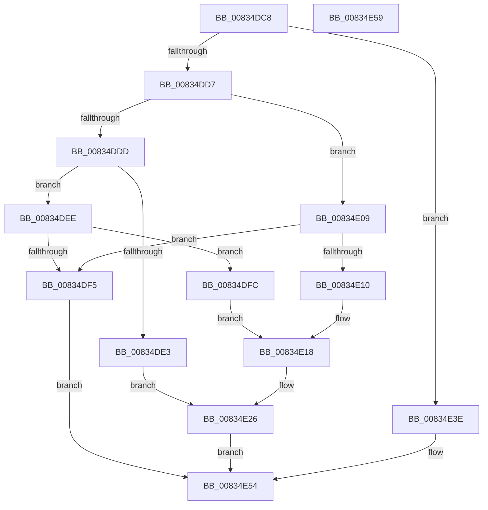

# DrvDbSetRegValueMappedProperty

- RVA: `0x00834DC8`–`0x00834E5A` (길이 `146` bytes)
- VA: `0x0000000140834DC8`
- 실행 섹션: `PAGE`
- PDB 이름 있음: `예`; PDB Function 태그: `아니요`
- unwind 정보 RVA: `0x0005D2F4`
- 디코드: `41`개 명령, `146/146` bytes 표시
- 미해석 바이트: `0` (있으면 어셈블리에 `.byte`로 보존)

> 이 문서는 커널 이미지의 기계어와 PDB 기호를 분석해 생성했습니다. 4번과 5번은 함수 원형과 자료형을 바이너리 사용 방식에서 추정한 C 해석이며 원본 소스 복구 결과는 아닙니다.

## 1. Dependencies

- 직접 호출 지점: **2**; 고유 호출 대상: **2**
- 직접 호출자로 확인된 함수: **5**
- RIP 상대 이미지 참조: **0**

### Outgoing calls
- `0x00834E37` → [PnpCtxRegSetValue](../99/PnpCtxRegSetValue_function_00991B8C.md) (function, `0x00991B8C`)
- `0x00834E42` → [PnpCtxRegDeleteValue](../8F/PnpCtxRegDeleteValue_function_008FE5E0.md) (function, `0x008FE5E0`)

### Direct callers
- [DrvDbSetDriverDatabaseMappedProperty](DrvDbSetDriverDatabaseMappedProperty_function_00834014.md) at `0x008344D8`
- [DrvDbSetDriverFileMappedProperty](DrvDbSetDriverFileMappedProperty_function_008345E8.md) at `0x008346DB`
- [DrvDbSetDriverInfFileMappedProperty](DrvDbSetDriverInfFileMappedProperty_function_00834718.md) at `0x0083480B`
- [DrvDbSetDriverPackageMappedProperty](DrvDbSetDriverPackageMappedProperty_function_00834848.md) at `0x00834B4C`
- [DrvDbSetDriverPackageMappedProperty](DrvDbSetDriverPackageMappedProperty_function_00834848.md) at `0x00834CA6`
- [DrvDbSetDriverPackageMappedProperty](DrvDbSetDriverPackageMappedProperty_function_00834848.md) at `0x00834D4C`
- [sub_00B23350](../B2/Unknown_function_00B23350.md) at `0x00B233D1`

### Static image references
- 디코드된 RIP-relative 메모리 참조가 없습니다.

## 2. Other-region calls and transfers

- 다른 실행 섹션으로 향하는 call: **0**
- 별도 외부 분기/꼬리 이동을 확인하지 못했습니다.

## 3. Assembly (complete function range)

```asm
00834DC8  48 83 EC 38                     sub rsp, 0x38
00834DCC  33 C9                           xor ecx, ecx
00834DCE  89 4C 24 58                     mov dword ptr [rsp + 0x58], ecx
00834DD2  45 85 C9                        test r9d, r9d
00834DD5  74 67                           je 0x140834e3e
00834DD7  41 83 F9 05                     cmp r9d, 5
00834DDB  74 2C                           je 0x140834e09
00834DDD  41 83 F9 11                     cmp r9d, 0x11
00834DE1  74 0B                           je 0x140834dee
00834DE3  48 8B 4C 24 60                  mov rcx, qword ptr [rsp + 0x60]
00834DE8  8B 44 24 68                     mov eax, dword ptr [rsp + 0x68]
00834DEC  EB 38                           jmp 0x140834e26
00834DEE  83 7C 24 68 01                  cmp dword ptr [rsp + 0x68], 1
00834DF3  74 07                           je 0x140834dfc
00834DF5  B8 0D 00 00 C0                  mov eax, 0xc000000d
00834DFA  EB 58                           jmp 0x140834e54
00834DFC  48 8B 44 24 60                  mov rax, qword ptr [rsp + 0x60]
00834E01  80 38 FF                        cmp byte ptr [rax], 0xff
00834E04  0F 94 C1                        sete cl
00834E07  EB 0F                           jmp 0x140834e18
00834E09  83 7C 24 68 02                  cmp dword ptr [rsp + 0x68], 2
00834E0E  75 E5                           jne 0x140834df5
00834E10  48 8B 44 24 60                  mov rax, qword ptr [rsp + 0x60]
00834E15  0F B7 08                        movzx ecx, word ptr [rax]
00834E18  89 4C 24 58                     mov dword ptr [rsp + 0x58], ecx
00834E1C  B8 04 00 00 00                  mov eax, 4
00834E21  48 8D 4C 24 58                  lea rcx, [rsp + 0x58]
00834E26  45 8B 48 18                     mov r9d, dword ptr [r8 + 0x18]
00834E2A  4D 8B 40 10                     mov r8, qword ptr [r8 + 0x10]
00834E2E  89 44 24 28                     mov dword ptr [rsp + 0x28], eax
00834E32  48 89 4C 24 20                  mov qword ptr [rsp + 0x20], rcx
00834E37  E8 50 CD 15 00                  call 0x140991b8c
00834E3C  EB 16                           jmp 0x140834e54
00834E3E  4D 8B 40 10                     mov r8, qword ptr [r8 + 0x10]
00834E42  E8 99 97 0C 00                  call 0x1408fe5e0
00834E47  3D 34 00 00 C0                  cmp eax, 0xc0000034
00834E4C  B9 25 02 00 C0                  mov ecx, 0xc0000225
00834E51  0F 44 C1                        cmove eax, ecx
00834E54  48 83 C4 38                     add rsp, 0x38
00834E58  C3                              ret
00834E59  CC                              int3
```

## 4. C-style interpretation (structured pseudocode)

```c
__int64 __fastcall DrvDbSetRegValueMappedProperty(int a1, __int64 a2, __int64 a3, int a4, __int64 a5, unsigned int a6)
{
    __int64 result;
    __int64 v_rsp;
    unsigned int v_stack_m10;
    unsigned __int64 v_stack_m18;
    unsigned int v_stack_p20;

    v_rsp = (v_rsp) - (56);
    a1 = 0;
    v_stack_p20 = 0;
    if (a4 == 0) goto loc_00834E3E;
    if (a4 == 5) goto loc_00834E09;
    if (a4 == 17) goto loc_00834DEE;
    goto loc_00834E26;
loc_00834DEE:
    if (a6 == 1) goto loc_00834DFC;
loc_00834DF5:
    goto loc_00834E54;
loc_00834DFC:
    a1 = ((*(unsigned __int8 *)(a5)) == 255) ? 1 : 0;
    goto loc_00834E18;
loc_00834E09:
    if (a6 != 2) goto loc_00834DF5;
loc_00834E18:
    v_stack_p20 = (unsigned int)(*(unsigned __int16 *)(a5));
loc_00834E26:
    v_stack_m10 = 4;
    v_stack_m18 = v_stack_p20;
    result = PnpCtxRegSetValue(v_stack_p20, a2, *(unsigned __int64 *)(a3 + 16), (unsigned int)(*(unsigned int *)(a3 + 24)));
    goto loc_00834E54;
loc_00834E3E:
    result = PnpCtxRegDeleteValue(v_stack_p20, a2, *(unsigned __int64 *)(*(unsigned __int64 *)(a3 + 16) + 16), (unsigned int)(*(unsigned int *)(a3 + 24)));
    if (((unsigned int)(result)) == 0xC0000034ULL) { result = (unsigned int)((unsigned int)(0xC0000225ULL)); }
loc_00834E54:
    v_rsp = (v_rsp) + (56);
    return result;
}
```

## 5. (Beta) C Style

```c
int64_t DrvDbSetRegValueMappedProperty(int32_t Arg1, int64_t Arg2, void *Arg3, int32_t Arg4, void *Arg5, uint32_t Arg6)
{
    uint8_t *arg3 = (uint8_t *)Arg3;
    uint8_t *arg5 = (uint8_t *)Arg5;

    int64_t result;
    int64_t local_rsp;
    uint32_t v_stack_m10;
    uint64_t v_stack_m18;
    uint32_t v_stack_p20;

    local_rsp = (local_rsp) - (56);
    Arg1 = 0;
    v_stack_p20 = 0;
    if (Arg4 == 0) goto loc_00834E3E;
    if (Arg4 == 5) goto loc_00834E09;
    if (Arg4 == 17) goto loc_00834DEE;
    goto loc_00834E26;
loc_00834DEE:
    if (Arg6 == 1) goto loc_00834DFC;
loc_00834DF5:
    goto loc_00834E54;
loc_00834DFC:
    Arg1 = ((*(uint8_t *)(arg5)) == 255) ? 1 : 0;
    goto loc_00834E18;
loc_00834E09:
    if (Arg6 != 2) goto loc_00834DF5;
loc_00834E18:
    v_stack_p20 = (uint32_t)(*(uint16_t *)(arg5));
loc_00834E26:
    v_stack_m10 = 4;
    v_stack_m18 = v_stack_p20;
    result = PnpCtxRegSetValue(v_stack_p20, Arg2, *(uint64_t *)(arg3 + 0x10), (uint32_t)(*(uint32_t *)(arg3 + 0x18)));
    goto loc_00834E54;
loc_00834E3E:
    result = PnpCtxRegDeleteValue(v_stack_p20, Arg2, *(uint64_t *)(*(uint64_t *)(arg3 + 0x10) + 0x10), (uint32_t)(*(uint32_t *)(arg3 + 0x18)));
    if (((uint32_t)(result)) == 0xC0000034ULL) { result = (uint32_t)((uint32_t)(0xC0000225ULL)); }
loc_00834E54:
    local_rsp = (local_rsp) + (56);
    return result;
}
```

### 관측된 메모리 오프셋

구조체 형식이 확인되지 않은 접근은 인자 기준의 오프셋으로만 기록했습니다.

| 기준 인자 | 오프셋 표현 | 폭 (bit) | 접근 |
|---|---:|---:|---|
| `Arg3` | `+ 0x10` | `64` | `R` |
| `Arg3` | `+ 0x18` | `32` | `R` |
| `Arg5` | `+ 0x0` | `8` | `R` |
| `Arg5` | `+ 0x0` | `16` | `R` |

## 6. Execution-region graph

[열기: 2D/3D 그래프와 함수 탐색 컨트롤 패널](../../../control-panel.html?section=page&rva=0x00834DC8&view=graph)

- 2D 그래프는 위에서 아래로 흐르고, 3D 그래프는 빈 공간을 드래그해 회전합니다. Shift+드래그는 이동, 휠은 확대·축소, 함수 노드 선택은 대상 보고서 이동입니다.

### Static fallback


