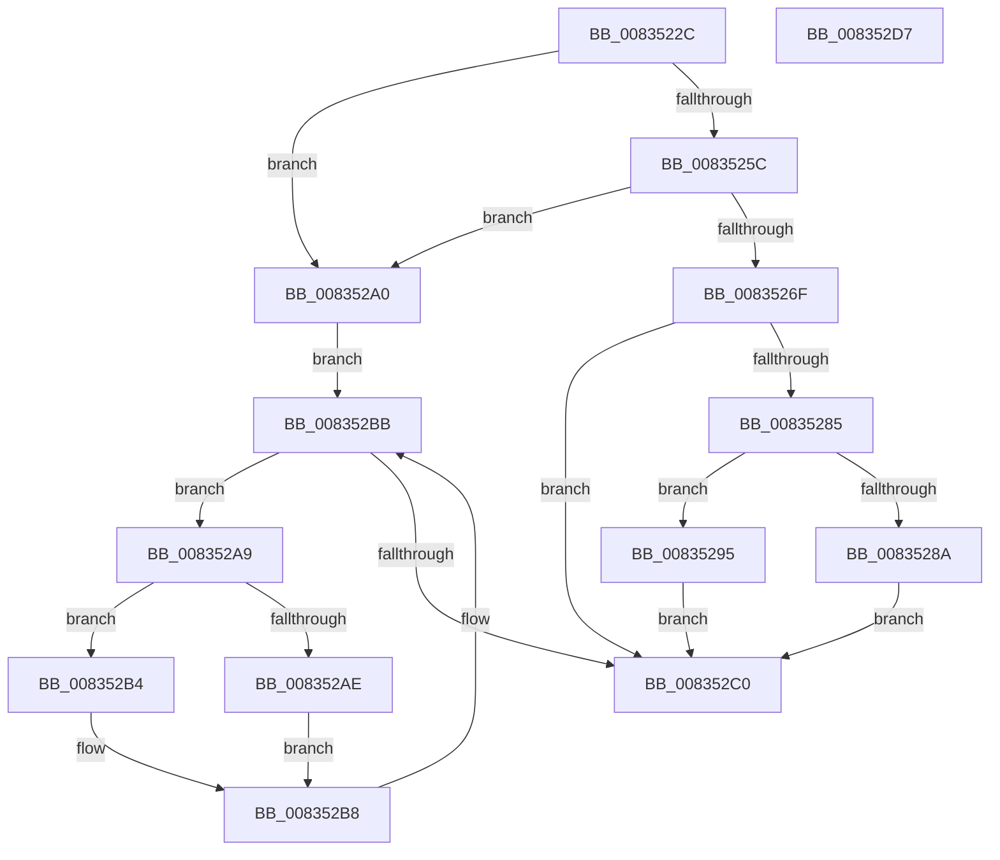

# DrvDbSuspendDatabase

- RVA: `0x0083522C`–`0x008352D8` (길이 `172` bytes)
- VA: `0x000000014083522C`
- 실행 섹션: `PAGE`
- PDB 이름 있음: `예`; PDB Function 태그: `아니요`
- unwind 정보 RVA: `0x000C55E8`
- 디코드: `53`개 명령, `172/172` bytes 표시
- 미해석 바이트: `0` (있으면 어셈블리에 `.byte`로 보존)

> 이 문서는 커널 이미지의 기계어와 PDB 기호를 분석해 생성했습니다. 4번과 5번은 함수 원형과 자료형을 바이너리 사용 방식에서 추정한 C 해석이며 원본 소스 복구 결과는 아닙니다.

## 1. Dependencies

- 직접 호출 지점: **2**; 고유 호출 대상: **2**
- 직접 호출자로 확인된 함수: **1**
- RIP 상대 이미지 참조: **2**

### Outgoing calls
- `0x00835266` → [wcsicmp](../../text/50/wcsicmp_function_00500080.md) (function, `0x00500080`)
- `0x0083527A` → [DrvDbFindDatabaseNode](../93/DrvDbFindDatabaseNode_function_00932628.md) (function, `0x00932628`)

### Direct callers
- [PiDrvDbSuspendNodes](../74/PiDrvDbSuspendNodes_function_00743E98.md) at `0x00743ECA`

### Static image references
- `0x00835244` → RVA `0x00E663D0` (`.data`; read)
- `0x0083525C` → RVA `0x00AFD260` (` ?? ::NNGAKEGL::`string'`; read)

## 2. Other-region calls and transfers

- 다른 실행 섹션으로 향하는 call: **1**
  - `0x00835266` → [wcsicmp](../../text/50/wcsicmp_function_00500080.md) (`PAGE` → `.text`)
- 별도 외부 분기/꼬리 이동을 확인하지 못했습니다.

## 3. Assembly (complete function range)

```asm
0083522C  48 8B C4                        mov rax, rsp
0083522F  48 89 58 10                     mov qword ptr [rax + 0x10], rbx
00835233  48 89 68 18                     mov qword ptr [rax + 0x18], rbp
00835237  48 89 70 20                     mov qword ptr [rax + 0x20], rsi
0083523B  48 89 48 08                     mov qword ptr [rax + 8], rcx
0083523F  57                              push rdi
00835240  48 83 EC 20                     sub rsp, 0x20
00835244  48 8B 35 85 11 63 00            mov rsi, qword ptr [rip + 0x631185]
0083524B  33 FF                           xor edi, edi
0083524D  48 21 78 08                     and qword ptr [rax + 8], rdi
00835251  41 8A E8                        mov bpl, r8b
00835254  48 8B DA                        mov rbx, rdx
00835257  48 85 D2                        test rdx, rdx
0083525A  74 44                           je 0x1408352a0
0083525C  48 8D 15 FD 7F 2C 00            lea rdx, [rip + 0x2c7ffd]
00835263  48 8B CB                        mov rcx, rbx
00835266  E8 15 AE CC FF                  call 0x140500080
0083526B  85 C0                           test eax, eax
0083526D  74 31                           je 0x1408352a0
0083526F  4C 8D 44 24 30                  lea r8, [rsp + 0x30]
00835274  48 8B D3                        mov rdx, rbx
00835277  48 8B CE                        mov rcx, rsi
0083527A  E8 A9 D3 0F 00                  call 0x140932628
0083527F  8B F8                           mov edi, eax
00835281  85 C0                           test eax, eax
00835283  78 3B                           js 0x1408352c0
00835285  40 84 ED                        test bpl, bpl
00835288  74 0B                           je 0x140835295
0083528A  48 8B 4C 24 30                  mov rcx, qword ptr [rsp + 0x30]
0083528F  83 49 40 04                     or dword ptr [rcx + 0x40], 4
00835293  EB 2B                           jmp 0x1408352c0
00835295  48 8B 44 24 30                  mov rax, qword ptr [rsp + 0x30]
0083529A  83 60 40 FB                     and dword ptr [rax + 0x40], 0xfffffffb
0083529E  EB 20                           jmp 0x1408352c0
008352A0  48 8D 56 10                     lea rdx, [rsi + 0x10]
008352A4  48 8B 0A                        mov rcx, qword ptr [rdx]
008352A7  EB 12                           jmp 0x1408352bb
008352A9  40 84 ED                        test bpl, bpl
008352AC  74 06                           je 0x1408352b4
008352AE  83 49 40 04                     or dword ptr [rcx + 0x40], 4
008352B2  EB 04                           jmp 0x1408352b8
008352B4  83 61 40 FB                     and dword ptr [rcx + 0x40], 0xfffffffb
008352B8  48 8B 09                        mov rcx, qword ptr [rcx]
008352BB  48 3B CA                        cmp rcx, rdx
008352BE  75 E9                           jne 0x1408352a9
008352C0  48 8B 5C 24 38                  mov rbx, qword ptr [rsp + 0x38]
008352C5  8B C7                           mov eax, edi
008352C7  48 8B 6C 24 40                  mov rbp, qword ptr [rsp + 0x40]
008352CC  48 8B 74 24 48                  mov rsi, qword ptr [rsp + 0x48]
008352D1  48 83 C4 20                     add rsp, 0x20
008352D5  5F                              pop rdi
008352D6  C3                              ret
008352D7  CC                              int3
```

## 4. C-style interpretation (structured pseudocode)

```c
__int64 __fastcall DrvDbSuspendDatabase(__int64 a1, __int64 a2, unsigned __int8 a3)
{
    __int64 result;
    __int64 v_rdi;
    __int64 v_rsp;
    unsigned __int64 v_stack_p10;
    unsigned __int64 v_stack_p18;
    unsigned __int64 v_stack_p20;
    unsigned __int64 v_stack_p8;

    *(unsigned __int64 *)(v_rsp + 16) = v_rbx;
    *(unsigned __int64 *)(v_rsp + 24) = v_rbp;
    *(unsigned __int64 *)(v_rsp + 32) = v_rsi;
    *(unsigned __int64 *)(v_rsp + 8) = a1;
    v_rsp = (v_rsp) - (32);
    v_rdi = 0;
    if (a2 == 0) goto loc_008352A0;
    result = wcsicmp(a2, v_rip + 2916349, a3, a4);
    if ((unsigned int)(result) == 0) goto loc_008352A0;
    result = DrvDbFindDatabaseNode(*(unsigned __int64 *)(v_rip + 6492549), a2, v_stack_p8, a4);
    if (sign_flag) goto loc_008352C0;
    if (a3 == 0) goto loc_00835295;
    goto loc_008352C0;
loc_00835295:
    goto loc_008352C0;
loc_008352A0:
    goto loc_008352BB;
loc_008352A9:
    if (a3 == 0) goto loc_008352B4;
    goto loc_008352B8;
loc_008352B4:
loc_008352B8:
loc_008352BB:
    if ((*(unsigned __int64 *)(*(unsigned __int64 *)(*(unsigned __int64 *)(v_rip + 6492549) + 16))) != (*(unsigned __int64 *)(v_rip + 6492549) + 16)) goto loc_008352A9;
loc_008352C0:
    v_rsp = (v_rsp) + (32);
    return (unsigned int)((unsigned int)((unsigned int)((unsigned int)(result))));
}
```

## 5. (Beta) C Style

```c
int64_t DrvDbSuspendDatabase(int64_t Arg1, int64_t Arg2, uint8_t Arg3)
{
    int64_t result;
    int64_t local_rdi;
    int64_t local_rsp;
    uint64_t v_stack_p10;
    uint64_t v_stack_p18;
    uint64_t v_stack_p20;
    uint64_t v_stack_p8;

    *(uint64_t *)(local_rsp + 0x10) = local_rbx;
    *(uint64_t *)(local_rsp + 0x18) = local_rbp;
    *(uint64_t *)(local_rsp + 0x20) = local_rsi;
    *(uint64_t *)(local_rsp + 0x8) = Arg1;
    local_rsp = (local_rsp) - (32);
    local_rdi = 0;
    if (Arg2 == 0) goto loc_008352A0;
    result = wcsicmp(Arg2, v_rip + 2916349, Arg3, a4);
    if ((uint32_t)(result) == 0) goto loc_008352A0;
    result = DrvDbFindDatabaseNode(*(uint64_t *)(v_rip + 0x631185), Arg2, v_stack_p8, a4);
    if (sign_flag) goto loc_008352C0;
    if (Arg3 == 0) goto loc_00835295;
    goto loc_008352C0;
loc_00835295:
    goto loc_008352C0;
loc_008352A0:
    goto loc_008352BB;
loc_008352A9:
    if (Arg3 == 0) goto loc_008352B4;
    goto loc_008352B8;
loc_008352B4:
loc_008352B8:
loc_008352BB:
    if ((*(uint64_t *)(*(uint64_t *)(*(uint64_t *)(v_rip + 0x631185) + 0x10))) != (*(uint64_t *)(v_rip + 0x631185) + 16)) goto loc_008352A9;
loc_008352C0:
    local_rsp = (local_rsp) + (32);
    return (uint32_t)((uint32_t)((uint32_t)((uint32_t)(result))));
}
```

## 6. Execution-region graph

[열기: 2D/3D 그래프와 함수 탐색 컨트롤 패널](../../../control-panel.html?section=page&rva=0x0083522C&view=graph)

- 2D 그래프는 위에서 아래로 흐르고, 3D 그래프는 빈 공간을 드래그해 회전합니다. Shift+드래그는 이동, 휠은 확대·축소, 함수 노드 선택은 대상 보고서 이동입니다.

### Static fallback


