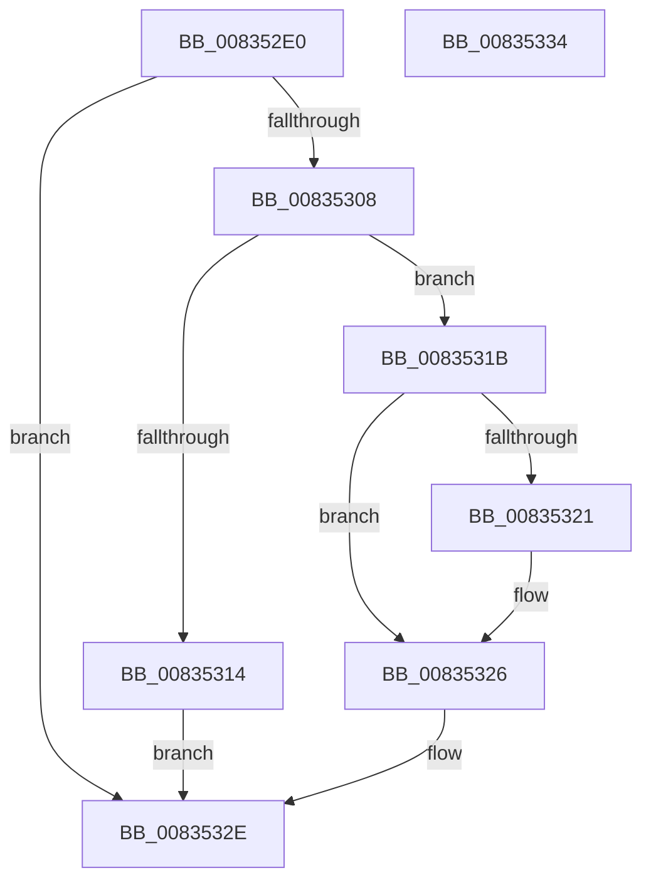

# DrvDbUnregisterDatabase

- RVA: `0x008352E0`–`0x00835335` (길이 `85` bytes)
- VA: `0x00000001408352E0`
- 실행 섹션: `PAGE`
- PDB 이름 있음: `예`; PDB Function 태그: `아니요`
- unwind 정보 RVA: `0x000805BC`
- 디코드: `25`개 명령, `85/85` bytes 표시
- 미해석 바이트: `0` (있으면 어셈블리에 `.byte`로 보존)

> 이 문서는 커널 이미지의 기계어와 PDB 기호를 분석해 생성했습니다. 4번과 5번은 함수 원형과 자료형을 바이너리 사용 방식에서 추정한 C 해석이며 원본 소스 복구 결과는 아닙니다.

## 1. Dependencies

- 직접 호출 지점: **2**; 고유 호출 대상: **2**
- 직접 호출자로 확인된 함수: **2**
- RIP 상대 이미지 참조: **1**

### Outgoing calls
- `0x008352FF` → [DrvDbFindDatabaseNode](../93/DrvDbFindDatabaseNode_function_00932628.md) (function, `0x00932628`)
- `0x00835329` → [DrvDbDestroyDatabaseNode](DrvDbDestroyDatabaseNode_function_00835674.md) (function, `0x00835674`)

### Direct callers
- [PiDrvDbRegisterNode](../74/PiDrvDbRegisterNode_function_00742658.md) at `0x00742AC7`
- [PiDrvDbUnregisterNode](../74/PiDrvDbUnregisterNode_function_00743EF8.md) at `0x00743FEE`

### Static image references
- `0x008352EA` → RVA `0x00E663D0` (`.data`; read)

## 2. Other-region calls and transfers

- 다른 실행 섹션으로 향하는 call: **0**
- 별도 외부 분기/꼬리 이동을 확인하지 못했습니다.

## 3. Assembly (complete function range)

```asm
008352E0  48 89 4C 24 08                  mov qword ptr [rsp + 8], rcx
008352E5  53                              push rbx
008352E6  48 83 EC 20                     sub rsp, 0x20
008352EA  48 8B 1D DF 10 63 00            mov rbx, qword ptr [rip + 0x6310df]
008352F1  4C 8D 44 24 30                  lea r8, [rsp + 0x30]
008352F6  48 83 64 24 30 00               and qword ptr [rsp + 0x30], 0
008352FC  48 8B CB                        mov rcx, rbx
008352FF  E8 24 D3 0F 00                  call 0x140932628
00835304  85 C0                           test eax, eax
00835306  78 26                           js 0x14083532e
00835308  48 8B 54 24 30                  mov rdx, qword ptr [rsp + 0x30]
0083530D  8B 42 40                        mov eax, dword ptr [rdx + 0x40]
00835310  A8 01                           test al, 1
00835312  74 07                           je 0x14083531b
00835314  B8 0D 00 00 C0                  mov eax, 0xc000000d
00835319  EB 13                           jmp 0x14083532e
0083531B  48 39 53 30                     cmp qword ptr [rbx + 0x30], rdx
0083531F  75 05                           jne 0x140835326
00835321  48 83 63 30 00                  and qword ptr [rbx + 0x30], 0
00835326  48 8B CB                        mov rcx, rbx
00835329  E8 46 03 00 00                  call 0x140835674
0083532E  48 83 C4 20                     add rsp, 0x20
00835332  5B                              pop rbx
00835333  C3                              ret
00835334  CC                              int3
```

## 4. C-style interpretation (structured pseudocode)

```c
__int64 __fastcall DrvDbUnregisterDatabase(__int64 a1)
{
    __int64 result;
    __int64 v_rsp;
    unsigned __int64 v_stack_p8;

    v_stack_p8 = a1;
    v_rsp = (v_rsp) - (32);
    result = DrvDbFindDatabaseNode(*(unsigned __int64 *)(v_rip + 6492383), a2, v_stack_p8, a4);
    if (sign_flag) goto loc_0083532E;
    if ((((unsigned __int8)((unsigned int)(*(unsigned int *)(v_stack_p8 + 64)))) & (1)) == 0) goto loc_0083531B;
    goto loc_0083532E;
loc_0083531B:
    if ((*(unsigned __int64 *)(*(unsigned __int64 *)(v_rip + 6492383) + 48)) == v_stack_p8) {
    }
    result = DrvDbDestroyDatabaseNode(*(unsigned __int64 *)(v_rip + 6492383), v_stack_p8, v_stack_p8, a4);
loc_0083532E:
    v_rsp = (v_rsp) + (32);
    return result;
}
```

## 5. (Beta) C Style

```c
int64_t DrvDbUnregisterDatabase(int64_t Arg1)
{
    int64_t result;
    int64_t local_rsp;
    uint64_t v_stack_p8;

    v_stack_p8 = Arg1;
    local_rsp = (local_rsp) - (32);
    result = DrvDbFindDatabaseNode(*(uint64_t *)(v_rip + 0x6310DF), a2, v_stack_p8, a4);
    if (sign_flag) goto loc_0083532E;
    if ((((uint8_t)((uint32_t)(*(uint32_t *)(v_stack_p8 + 0x40)))) & (1)) == 0) goto loc_0083531B;
    goto loc_0083532E;
loc_0083531B:
    if ((*(uint64_t *)(*(uint64_t *)(v_rip + 0x6310DF) + 0x30)) == v_stack_p8) {
    }
    result = DrvDbDestroyDatabaseNode(*(uint64_t *)(v_rip + 0x6310DF), v_stack_p8, v_stack_p8, a4);
loc_0083532E:
    local_rsp = (local_rsp) + (32);
    return result;
}
```

## 6. Execution-region graph

[열기: 2D/3D 그래프와 함수 탐색 컨트롤 패널](../../../control-panel.html?section=page&rva=0x008352E0&view=graph)

- 2D 그래프는 위에서 아래로 흐르고, 3D 그래프는 빈 공간을 드래그해 회전합니다. Shift+드래그는 이동, 휠은 확대·축소, 함수 노드 선택은 대상 보고서 이동입니다.

### Static fallback


