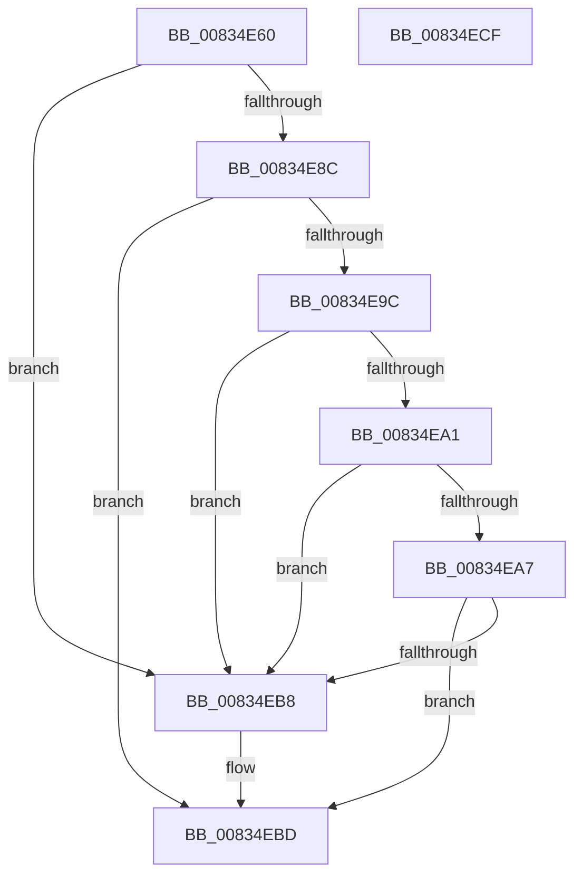

# DrvDbValidateDeviceIdName

- RVA: `0x00834E60`–`0x00834ED0` (길이 `112` bytes)
- VA: `0x0000000140834E60`
- 실행 섹션: `PAGE`
- PDB 이름 있음: `예`; PDB Function 태그: `아니요`
- unwind 정보 RVA: `0x0005FD94`
- 디코드: `35`개 명령, `112/112` bytes 표시
- 미해석 바이트: `0` (있으면 어셈블리에 `.byte`로 보존)

> 이 문서는 커널 이미지의 기계어와 PDB 기호를 분석해 생성했습니다. 4번과 5번은 함수 원형과 자료형을 바이너리 사용 방식에서 추정한 C 해석이며 원본 소스 복구 결과는 아닙니다.

## 1. Dependencies

- 직접 호출 지점: **3**; 고유 호출 대상: **2**
- 직접 호출자로 확인된 함수: **1**
- RIP 상대 이미지 참조: **0**

### Outgoing calls
- `0x00834E7F` → [RtlUnalignedStringCchLengthW](../../text/40/RtlUnalignedStringCchLengthW_function_0040DE30.md) (function, `0x0040DE30`)
- `0x00834E92` → [wcschr](../../text/50/wcschr_function_00501A60.md) (function, `0x00501A60`)
- `0x00834EAE` → [wcschr](../../text/50/wcschr_function_00501A60.md) (function, `0x00501A60`)

### Direct callers
- [DrvDbDispatchDeviceId](../92/DrvDbDispatchDeviceId_function_0092F490.md) at `0x0092F680`

### Static image references
- 디코드된 RIP-relative 메모리 참조가 없습니다.

## 2. Other-region calls and transfers

- 다른 실행 섹션으로 향하는 call: **3**
  - `0x00834E7F` → [RtlUnalignedStringCchLengthW](../../text/40/RtlUnalignedStringCchLengthW_function_0040DE30.md) (`PAGE` → `.text`)
  - `0x00834E92` → [wcschr](../../text/50/wcschr_function_00501A60.md) (`PAGE` → `.text`)
  - `0x00834EAE` → [wcschr](../../text/50/wcschr_function_00501A60.md) (`PAGE` → `.text`)
- 별도 외부 분기/꼬리 이동을 확인하지 못했습니다.

## 3. Assembly (complete function range)

```asm
00834E60  48 89 5C 24 10                  mov qword ptr [rsp + 0x10], rbx
00834E65  48 89 74 24 18                  mov qword ptr [rsp + 0x18], rsi
00834E6A  57                              push rdi
00834E6B  48 83 EC 20                     sub rsp, 0x20
00834E6F  48 8B FA                        mov rdi, rdx
00834E72  4C 8D 44 24 30                  lea r8, [rsp + 0x30]
00834E77  48 8B CF                        mov rcx, rdi
00834E7A  BA C8 00 00 00                  mov edx, 0xc8
00834E7F  E8 AC 8F BD FF                  call 0x14040de30
00834E84  33 F6                           xor esi, esi
00834E86  8B D8                           mov ebx, eax
00834E88  85 C0                           test eax, eax
00834E8A  78 2C                           js 0x140834eb8
00834E8C  8D 56 5C                        lea edx, [rsi + 0x5c]
00834E8F  48 8B CF                        mov rcx, rdi
00834E92  E8 C9 CB CC FF                  call 0x140501a60
00834E97  48 85 C0                        test rax, rax
00834E9A  74 21                           je 0x140834ebd
00834E9C  48 3B C7                        cmp rax, rdi
00834E9F  74 17                           je 0x140834eb8
00834EA1  66 39 70 02                     cmp word ptr [rax + 2], si
00834EA5  74 11                           je 0x140834eb8
00834EA7  8D 56 5C                        lea edx, [rsi + 0x5c]
00834EAA  48 8D 48 02                     lea rcx, [rax + 2]
00834EAE  E8 AD CB CC FF                  call 0x140501a60
00834EB3  48 85 C0                        test rax, rax
00834EB6  74 05                           je 0x140834ebd
00834EB8  BB 33 00 00 C0                  mov ebx, 0xc0000033
00834EBD  48 8B 74 24 40                  mov rsi, qword ptr [rsp + 0x40]
00834EC2  8B C3                           mov eax, ebx
00834EC4  48 8B 5C 24 38                  mov rbx, qword ptr [rsp + 0x38]
00834EC9  48 83 C4 20                     add rsp, 0x20
00834ECD  5F                              pop rdi
00834ECE  C3                              ret
00834ECF  CC                              int3
```

## 4. C-style interpretation (structured pseudocode)

```c
__int64 __fastcall DrvDbValidateDeviceIdName(__int64 a1, __int64 a2)
{
    __int64 result;
    __int64 v_rbx;
    __int64 v_rsi;
    __int64 v_rsp;
    unsigned __int64 v_stack_p10;
    unsigned __int64 v_stack_p18;
    unsigned __int64 v_stack_p8;

    v_stack_p10 = v_rbx;
    v_stack_p18 = v_rsi;
    v_rsp = (v_rsp) - (32);
    result = RtlUnalignedStringCchLengthW(a2, 200, v_stack_p8, a4);
    v_rsi = 0;
    if (sign_flag) goto loc_00834EB8;
    result = wcschr(a2, v_rsi + 92, v_stack_p8, a4);
    if (result == 0) goto loc_00834EBD;
    if (result == a2) goto loc_00834EB8;
    if ((*(unsigned __int16 *)(result + 2)) == 0) goto loc_00834EB8;
    result = wcschr(result + 2, v_rsi + 92, v_stack_p8, a4);
    v_rbx = (unsigned int)((unsigned int)(result));
    if (result != 0) {
        v_rbx = 0xC0000033ULL;
    }
    v_rsp = (v_rsp) + (32);
    return (unsigned int)((unsigned int)(v_rbx));
}
```

## 5. (Beta) C Style

```c
int64_t DrvDbValidateDeviceIdName(int64_t Arg1, int64_t Arg2)
{
    int64_t result;
    int64_t local_rbx;
    int64_t local_rsi;
    int64_t local_rsp;
    uint64_t v_stack_p10;
    uint64_t v_stack_p18;
    uint64_t v_stack_p8;

    v_stack_p10 = local_rbx;
    v_stack_p18 = local_rsi;
    local_rsp = (local_rsp) - (32);
    result = RtlUnalignedStringCchLengthW(Arg2, 200, v_stack_p8, a4);
    local_rsi = 0;
    if (sign_flag) goto loc_00834EB8;
    result = wcschr(Arg2, local_rsi + 92, v_stack_p8, a4);
    if (result == 0) goto loc_00834EBD;
    if (result == Arg2) goto loc_00834EB8;
    if ((*(uint16_t *)(result + 0x2)) == 0) goto loc_00834EB8;
    result = wcschr(result + 2, local_rsi + 92, v_stack_p8, a4);
    local_rbx = (uint32_t)((uint32_t)(result));
    if (result != 0) {
        local_rbx = 0xC0000033ULL;
    }
    local_rsp = (local_rsp) + (32);
    return (uint32_t)((uint32_t)(local_rbx));
}
```

## 6. Execution-region graph

[열기: 2D/3D 그래프와 함수 탐색 컨트롤 패널](../../../control-panel.html?section=page&rva=0x00834E60&view=graph)

- 2D 그래프는 위에서 아래로 흐르고, 3D 그래프는 빈 공간을 드래그해 회전합니다. Shift+드래그는 이동, 휠은 확대·축소, 함수 노드 선택은 대상 보고서 이동입니다.

### Static fallback


