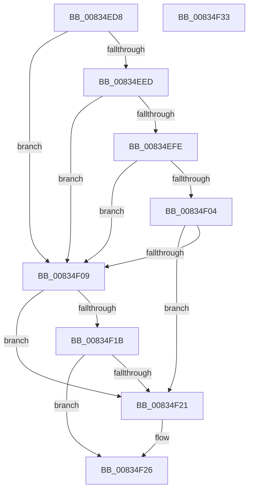

# DrvDbValidateDriverDatabaseName

- RVA: `0x00834ED8`–`0x00834F34` (길이 `92` bytes)
- VA: `0x0000000140834ED8`
- 실행 섹션: `PAGE`
- PDB 이름 있음: `예`; PDB Function 태그: `아니요`
- unwind 정보 RVA: `0x0005CAAC`
- 디코드: `30`개 명령, `92/92` bytes 표시
- 미해석 바이트: `0` (있으면 어셈블리에 `.byte`로 보존)

> 이 문서는 커널 이미지의 기계어와 PDB 기호를 분석해 생성했습니다. 4번과 5번은 함수 원형과 자료형을 바이너리 사용 방식에서 추정한 C 해석이며 원본 소스 복구 결과는 아닙니다.

## 1. Dependencies

- 직접 호출 지점: **2**; 고유 호출 대상: **1**
- 직접 호출자로 확인된 함수: **1**
- RIP 상대 이미지 참조: **0**

### Outgoing calls
- `0x00834EF4` → [wcschr](../../text/50/wcschr_function_00501A60.md) (function, `0x00501A60`)
- `0x00834F11` → [wcschr](../../text/50/wcschr_function_00501A60.md) (function, `0x00501A60`)

### Direct callers
- [DrvDbDispatchDriverDatabase](../8E/DrvDbDispatchDriverDatabase_function_008E6EC0.md) at `0x008E7043`

### Static image references
- 디코드된 RIP-relative 메모리 참조가 없습니다.

## 2. Other-region calls and transfers

- 다른 실행 섹션으로 향하는 call: **2**
  - `0x00834EF4` → [wcschr](../../text/50/wcschr_function_00501A60.md) (`PAGE` → `.text`)
  - `0x00834F11` → [wcschr](../../text/50/wcschr_function_00501A60.md) (`PAGE` → `.text`)
- 별도 외부 분기/꼬리 이동을 확인하지 못했습니다.

## 3. Assembly (complete function range)

```asm
00834ED8  48 89 5C 24 08                  mov qword ptr [rsp + 8], rbx
00834EDD  57                              push rdi
00834EDE  48 83 EC 20                     sub rsp, 0x20
00834EE2  33 FF                           xor edi, edi
00834EE4  48 8B DA                        mov rbx, rdx
00834EE7  66 83 3A 40                     cmp word ptr [rdx], 0x40
00834EEB  75 1C                           jne 0x140834f09
00834EED  8D 57 3A                        lea edx, [rdi + 0x3a]
00834EF0  48 8D 4B 02                     lea rcx, [rbx + 2]
00834EF4  E8 67 CB CC FF                  call 0x140501a60
00834EF9  48 85 C0                        test rax, rax
00834EFC  74 0B                           je 0x140834f09
00834EFE  48 83 C0 02                     add rax, 2
00834F02  74 05                           je 0x140834f09
00834F04  48 3B C3                        cmp rax, rbx
00834F07  75 18                           jne 0x140834f21
00834F09  BA 5C 00 00 00                  mov edx, 0x5c
00834F0E  48 8B CB                        mov rcx, rbx
00834F11  E8 4A CB CC FF                  call 0x140501a60
00834F16  48 85 C0                        test rax, rax
00834F19  75 06                           jne 0x140834f21
00834F1B  66 83 3B 40                     cmp word ptr [rbx], 0x40
00834F1F  75 05                           jne 0x140834f26
00834F21  BF 33 00 00 C0                  mov edi, 0xc0000033
00834F26  48 8B 5C 24 30                  mov rbx, qword ptr [rsp + 0x30]
00834F2B  8B C7                           mov eax, edi
00834F2D  48 83 C4 20                     add rsp, 0x20
00834F31  5F                              pop rdi
00834F32  C3                              ret
00834F33  CC                              int3
```

## 4. C-style interpretation (structured pseudocode)

```c
__int64 __fastcall DrvDbValidateDriverDatabaseName(__int64 a1, __int64 a2)
{
    __int64 result;
    __int64 v_rdi;
    __int64 v_rsp;
    unsigned __int64 v_stack_p8;

    v_stack_p8 = v_rbx;
    v_rsp = (v_rsp) - (32);
    v_rdi = 0;
    if ((*(unsigned __int16 *)(a2)) != 64) goto loc_00834F09;
    result = wcschr(a2 + 2, v_rdi + 58, a3, a4);
    if (result == 0) goto loc_00834F09;
    result = (result) + (2);
    if (condition_is_equal) goto loc_00834F09;
    if (result != a2) goto loc_00834F21;
loc_00834F09:
    result = wcschr(a2, 92, a3, a4);
    if (result != 0) goto loc_00834F21;
    if ((*(unsigned __int16 *)(a2)) == 64) {
        v_rdi = 0xC0000033ULL;
    }
    v_rsp = (v_rsp) + (32);
    return (unsigned int)((unsigned int)(v_rdi));
}
```

## 5. (Beta) C Style

```c
int64_t DrvDbValidateDriverDatabaseName(int64_t Arg1, void *Arg2)
{
    uint8_t *arg2 = (uint8_t *)Arg2;

    int64_t result;
    int64_t local_rdi;
    int64_t local_rsp;
    uint64_t v_stack_p8;

    v_stack_p8 = local_rbx;
    local_rsp = (local_rsp) - (32);
    local_rdi = 0;
    if ((*(uint16_t *)(arg2)) != 64) goto loc_00834F09;
    result = wcschr(Arg2 + 2, local_rdi + 58, a3, a4);
    if (result == 0) goto loc_00834F09;
    result = (result) + (2);
    if (condition_is_equal) goto loc_00834F09;
    if (result != Arg2) goto loc_00834F21;
loc_00834F09:
    result = wcschr(Arg2, 92, a3, a4);
    if (result != 0) goto loc_00834F21;
    if ((*(uint16_t *)(arg2)) == 64) {
        local_rdi = 0xC0000033ULL;
    }
    local_rsp = (local_rsp) + (32);
    return (uint32_t)((uint32_t)(local_rdi));
}
```

### 관측된 메모리 오프셋

구조체 형식이 확인되지 않은 접근은 인자 기준의 오프셋으로만 기록했습니다.

| 기준 인자 | 오프셋 표현 | 폭 (bit) | 접근 |
|---|---:|---:|---|
| `Arg2` | `+ 0x0` | `16` | `R` |
| `Arg2` | `+ 0x2` | `64` | `R` |

## 6. Execution-region graph

[열기: 2D/3D 그래프와 함수 탐색 컨트롤 패널](../../../control-panel.html?section=page&rva=0x00834ED8&view=graph)

- 2D 그래프는 위에서 아래로 흐르고, 3D 그래프는 빈 공간을 드래그해 회전합니다. Shift+드래그는 이동, 휠은 확대·축소, 함수 노드 선택은 대상 보고서 이동입니다.

### Static fallback


