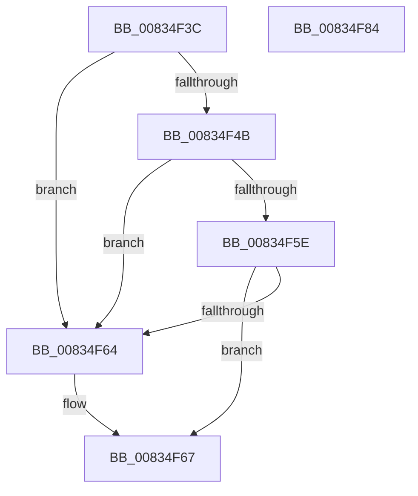

# DrvDbValidateDriverFileName

- RVA: `0x00834F3C`–`0x00834F85` (길이 `73` bytes)
- VA: `0x0000000140834F3C`
- 실행 섹션: `PAGE`
- PDB 이름 있음: `예`; PDB Function 태그: `아니요`
- unwind 정보 RVA: `0x0005CF00`
- 디코드: `23`개 명령, `73/73` bytes 표시
- 미해석 바이트: `0` (있으면 어셈블리에 `.byte`로 보존)

> 이 문서는 커널 이미지의 기계어와 PDB 기호를 분석해 생성했습니다. 4번과 5번은 함수 원형과 자료형을 바이너리 사용 방식에서 추정한 C 해석이며 원본 소스 복구 결과는 아닙니다.

## 1. Dependencies

- 직접 호출 지점: **2**; 고유 호출 대상: **1**
- 직접 호출자로 확인된 함수: **3**
- RIP 상대 이미지 참조: **0**

### Outgoing calls
- `0x00834F54` → [wcschr](../../text/50/wcschr_function_00501A60.md) (function, `0x00501A60`)
- `0x00834F6F` → [wcschr](../../text/50/wcschr_function_00501A60.md) (function, `0x00501A60`)

### Direct callers
- [DrvDbDispatchDriverInfFile](../92/DrvDbDispatchDriverInfFile_function_0092FE10.md) at `0x0092FFFA`
- [DrvDbDispatchDriverPackage](../93/DrvDbDispatchDriverPackage_function_009303A0.md) at `0x009305AA`
- [DrvDbDispatchDriverFile](../AC/DrvDbDispatchDriverFile_function_00AC8880.md) at `0x00AC8A8A`

### Static image references
- 디코드된 RIP-relative 메모리 참조가 없습니다.

## 2. Other-region calls and transfers

- 다른 실행 섹션으로 향하는 call: **2**
  - `0x00834F54` → [wcschr](../../text/50/wcschr_function_00501A60.md) (`PAGE` → `.text`)
  - `0x00834F6F` → [wcschr](../../text/50/wcschr_function_00501A60.md) (`PAGE` → `.text`)
- 별도 외부 분기/꼬리 이동을 확인하지 못했습니다.

## 3. Assembly (complete function range)

```asm
00834F3C  40 53                           push rbx
00834F3E  48 83 EC 20                     sub rsp, 0x20
00834F42  66 83 3A 40                     cmp word ptr [rdx], 0x40
00834F46  48 8B DA                        mov rbx, rdx
00834F49  75 19                           jne 0x140834f64
00834F4B  BA 3A 00 00 00                  mov edx, 0x3a
00834F50  48 8D 4B 02                     lea rcx, [rbx + 2]
00834F54  E8 07 CB CC FF                  call 0x140501a60
00834F59  48 85 C0                        test rax, rax
00834F5C  74 06                           je 0x140834f64
00834F5E  48 83 C0 02                     add rax, 2
00834F62  75 03                           jne 0x140834f67
00834F64  48 8B C3                        mov rax, rbx
00834F67  BA 5C 00 00 00                  mov edx, 0x5c
00834F6C  48 8B C8                        mov rcx, rax
00834F6F  E8 EC CA CC FF                  call 0x140501a60
00834F74  48 F7 D8                        neg rax
00834F77  1B C0                           sbb eax, eax
00834F79  25 33 00 00 C0                  and eax, 0xc0000033
00834F7E  48 83 C4 20                     add rsp, 0x20
00834F82  5B                              pop rbx
00834F83  C3                              ret
00834F84  CC                              int3
```

## 4. C-style interpretation (structured pseudocode)

```c
__int64 __fastcall DrvDbValidateDriverFileName(__int64 a1, __int64 a2)
{
    __int64 result;
    __int64 v_rsp;

    v_rsp = (v_rsp) - (32);
    if ((*(unsigned __int16 *)(a2)) != 64) goto loc_00834F64;
    result = wcschr(a2 + 2, 58, a3, a4);
    if (result == 0) goto loc_00834F64;
    result = (result) + (2);
    if (!(condition_is_not_equal)) {
        result = a2;
    }
    result = wcschr(result, 92, a3, a4);
    result = -(result);
    result = (unsigned int)((result) & (0xC0000033ULL));
    v_rsp = (v_rsp) + (32);
    return result;
}
```

## 5. (Beta) C Style

```c
int64_t DrvDbValidateDriverFileName(int64_t Arg1, void *Arg2)
{
    uint8_t *arg2 = (uint8_t *)Arg2;

    int64_t result;
    int64_t local_rsp;

    local_rsp = (local_rsp) - (32);
    if ((*(uint16_t *)(arg2)) != 64) goto loc_00834F64;
    result = wcschr(Arg2 + 2, 58, a3, a4);
    if (result == 0) goto loc_00834F64;
    result = (result) + (2);
    if (!(condition_is_not_equal)) {
        result = Arg2;
    }
    result = wcschr(result, 92, a3, a4);
    result = -(result);
    result = (uint32_t)((result) & (0xC0000033ULL));
    local_rsp = (local_rsp) + (32);
    return result;
}
```

### 관측된 메모리 오프셋

구조체 형식이 확인되지 않은 접근은 인자 기준의 오프셋으로만 기록했습니다.

| 기준 인자 | 오프셋 표현 | 폭 (bit) | 접근 |
|---|---:|---:|---|
| `Arg2` | `+ 0x0` | `16` | `R` |
| `Arg2` | `+ 0x2` | `64` | `R` |

## 6. Execution-region graph

[열기: 2D/3D 그래프와 함수 탐색 컨트롤 패널](../../../control-panel.html?section=page&rva=0x00834F3C&view=graph)

- 2D 그래프는 위에서 아래로 흐르고, 3D 그래프는 빈 공간을 드래그해 회전합니다. Shift+드래그는 이동, 휠은 확대·축소, 함수 노드 선택은 대상 보고서 이동입니다.

### Static fallback


