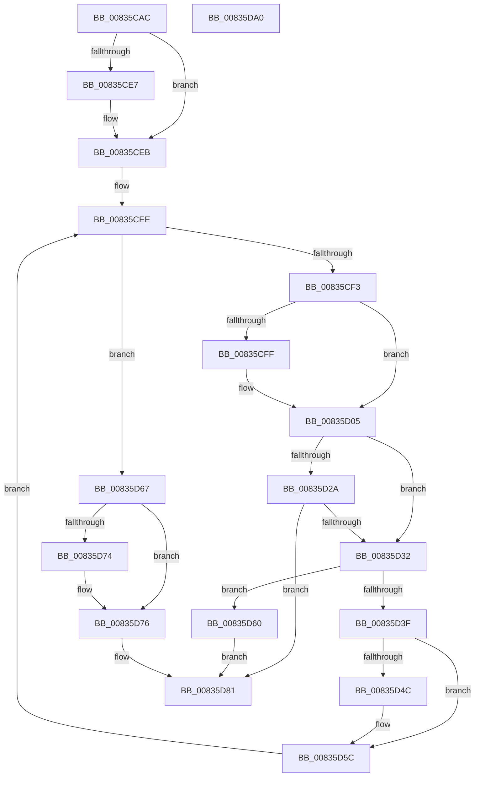

# FilterConvertToString

- RVA: `0x00835CAC`–`0x00835DA1` (길이 `245` bytes)
- VA: `0x0000000140835CAC`
- 실행 섹션: `PAGE`
- PDB 이름 있음: `예`; PDB Function 태그: `아니요`
- unwind 정보 RVA: `0x0005D79C`
- 디코드: `82`개 명령, `245/245` bytes 표시
- 미해석 바이트: `0` (있으면 어셈블리에 `.byte`로 보존)

> 이 문서는 커널 이미지의 기계어와 PDB 기호를 분석해 생성했습니다. 4번과 5번은 함수 원형과 자료형을 바이너리 사용 방식에서 추정한 C 해석이며 원본 소스 복구 결과는 아닙니다.

## 1. Dependencies

- 직접 호출 지점: **2**; 고유 호출 대상: **2**
- 직접 호출자로 확인된 함수: **1**
- RIP 상대 이미지 참조: **0**

### Outgoing calls
- `0x00835CF3` → [Feature_DeviceFilter_FilterConvertToString__private_IsEnabledDeviceUsageNoInline](../../text/6A/Feature_DeviceFilter_FilterConvertToString__private_IsEnabledDeviceUsageNoInline_function_006A30FC.md) (function, `0x006A30FC`)
- `0x00835D15` → [ExpressionConvertToString](../AD/ExpressionConvertToString_function_00AD83F8.md) (function, `0x00AD83F8`)

### Direct callers
- [sub_00B1C93A](../B1/Unknown_function_00B1C93A.md) at `0x00B1CC17`
- [sub_00B1C93A](../B1/Unknown_function_00B1C93A.md) at `0x00B1CC67`

### Static image references
- 디코드된 RIP-relative 메모리 참조가 없습니다.

## 2. Other-region calls and transfers

- 다른 실행 섹션으로 향하는 call: **1**
  - `0x00835CF3` → [Feature_DeviceFilter_FilterConvertToString__private_IsEnabledDeviceUsageNoInline](../../text/6A/Feature_DeviceFilter_FilterConvertToString__private_IsEnabledDeviceUsageNoInline_function_006A30FC.md) (`PAGE` → `.text`)
- 별도 외부 분기/꼬리 이동을 확인하지 못했습니다.

## 3. Assembly (complete function range)

```asm
00835CAC  48 8B C4                        mov rax, rsp
00835CAF  48 89 58 10                     mov qword ptr [rax + 0x10], rbx
00835CB3  48 89 68 18                     mov qword ptr [rax + 0x18], rbp
00835CB7  48 89 70 20                     mov qword ptr [rax + 0x20], rsi
00835CBB  57                              push rdi
00835CBC  41 54                           push r12
00835CBE  41 55                           push r13
00835CC0  41 56                           push r14
00835CC2  41 57                           push r15
00835CC4  48 83 EC 20                     sub rsp, 0x20
00835CC8  45 33 ED                        xor r13d, r13d
00835CCB  49 8B F1                        mov rsi, r9
00835CCE  41 8B D8                        mov ebx, r8d
00835CD1  44 89 68 08                     mov dword ptr [rax + 8], r13d
00835CD5  4C 8B E2                        mov r12, rdx
00835CD8  44 8B F9                        mov r15d, ecx
00835CDB  45 8B F0                        mov r14d, r8d
00835CDE  41 8D 7D 02                     lea edi, [r13 + 2]
00835CE2  44 3B C7                        cmp r8d, edi
00835CE5  72 04                           jb 0x140835ceb
00835CE7  66 45 89 29                     mov word ptr [r9], r13w
00835CEB  41 8B ED                        mov ebp, r13d
00835CEE  41 3B EF                        cmp ebp, r15d
00835CF1  73 74                           jae 0x140835d67
00835CF3  E8 04 D4 E6 FF                  call 0x1406a30fc
00835CF8  4C 8B C6                        mov r8, rsi
00835CFB  85 C0                           test eax, eax
00835CFD  74 06                           je 0x140835d05
00835CFF  85 DB                           test ebx, ebx
00835D01  4D 0F 44 C5                     cmove r8, r13
00835D05  8B C5                           mov eax, ebp
00835D07  4C 8D 4C 24 50                  lea r9, [rsp + 0x50]
00835D0C  48 6B C8 38                     imul rcx, rax, 0x38
00835D10  8B D3                           mov edx, ebx
00835D12  49 03 CC                        add rcx, r12
00835D15  E8 DE 26 2A 00                  call 0x140ad83f8
00835D1A  41 B8 00 00 00 80               mov r8d, 0x80000000
00835D20  8B C8                           mov ecx, eax
00835D22  41 03 C0                        add eax, r8d
00835D25  41 85 C0                        test r8d, eax
00835D28  75 08                           jne 0x140835d32
00835D2A  81 F9 23 00 00 C0               cmp ecx, 0xc0000023
00835D30  75 4F                           jne 0x140835d81
00835D32  8B 54 24 50                     mov edx, dword ptr [rsp + 0x50]
00835D36  8D 42 FE                        lea eax, [rdx - 2]
00835D39  03 C7                           add eax, edi
00835D3B  3B C7                           cmp eax, edi
00835D3D  72 21                           jb 0x140835d60
00835D3F  8B F8                           mov edi, eax
00835D41  48 8D 4A FE                     lea rcx, [rdx - 2]
00835D45  8B C3                           mov eax, ebx
00835D47  48 3B C1                        cmp rax, rcx
00835D4A  72 10                           jb 0x140835d5c
00835D4C  B8 02 00 00 00                  mov eax, 2
00835D51  2B C2                           sub eax, edx
00835D53  03 D8                           add ebx, eax
00835D55  48 D1 E9                        shr rcx, 1
00835D58  48 8D 34 4E                     lea rsi, [rsi + rcx*2]
00835D5C  FF C5                           inc ebp
00835D5E  EB 8E                           jmp 0x140835cee
00835D60  B9 95 00 00 C0                  mov ecx, 0xc0000095
00835D65  EB 1A                           jmp 0x140835d81
00835D67  48 8B 44 24 70                  mov rax, qword ptr [rsp + 0x70]
00835D6C  41 8B CD                        mov ecx, r13d
00835D6F  48 85 C0                        test rax, rax
00835D72  74 02                           je 0x140835d76
00835D74  89 38                           mov dword ptr [rax], edi
00835D76  41 3B FE                        cmp edi, r14d
00835D79  B8 23 00 00 C0                  mov eax, 0xc0000023
00835D7E  0F 47 C8                        cmova ecx, eax
00835D81  48 8B 5C 24 58                  mov rbx, qword ptr [rsp + 0x58]
00835D86  8B C1                           mov eax, ecx
00835D88  48 8B 6C 24 60                  mov rbp, qword ptr [rsp + 0x60]
00835D8D  48 8B 74 24 68                  mov rsi, qword ptr [rsp + 0x68]
00835D92  48 83 C4 20                     add rsp, 0x20
00835D96  41 5F                           pop r15
00835D98  41 5E                           pop r14
00835D9A  41 5D                           pop r13
00835D9C  41 5C                           pop r12
00835D9E  5F                              pop rdi
00835D9F  C3                              ret
00835DA0  CC                              int3
```

## 4. C-style interpretation (structured pseudocode)

```c
__int64 __fastcall FilterConvertToString(int a1, __int64 a2, int a3, __int64 a4, __int64 a5)
{
    __int64 result;
    __int64 v_r13;
    __int64 v_rbp;
    __int64 v_rbx;
    __int64 v_rsi;
    __int64 v_rsp;
    unsigned __int64 v_stack_p10;
    unsigned __int64 v_stack_p18;
    unsigned __int64 v_stack_p20;
    unsigned __int64 v_stack_p8;

    *(unsigned __int64 *)(v_rsp + 16) = v_rbx;
    *(unsigned __int64 *)(v_rsp + 24) = v_rbp;
    *(unsigned __int64 *)(v_rsp + 32) = v_rsi;
    v_rsp = (v_rsp) - (32);
    v_r13 = 0;
    *(unsigned int *)(v_rsp + 8) = 0;
    if (a3 >= ((unsigned int)(v_r13 + 2))) {
        *(unsigned __int16 *)(a4) = 0;
    }
loc_00835CEE:
    if (0 >= ((unsigned int)((unsigned int)(a1)))) goto loc_00835D67;
    result = Feature_DeviceFilter_FilterConvertToString__private_IsEnabledDeviceUsageNoInline(a1, a2, a3, a4);
    if ((unsigned int)(result) != 0) {
        if ((unsigned int)((unsigned int)(a3)) == 0) { a4 = 0; }
    }
    a1 = (a1) * (0);
    a1 = (a1) + (a2);
    result = ExpressionConvertToString(a1, (unsigned int)((unsigned int)((unsigned int)(a3))), a4, v_stack_p8);
    result = (unsigned int)((result) + ((unsigned int)((unsigned int)(0x80000000ULL))));
    if ((((unsigned int)((unsigned int)(0x80000000ULL))) & ((unsigned int)(result))) != 0) goto loc_00835D32;
    if (((unsigned int)((unsigned int)((unsigned int)(result)))) != 0xC0000023ULL) goto loc_00835D81;
loc_00835D32:
    result = (unsigned int)(((unsigned int)(v_stack_p8) - 2) + ((unsigned int)(v_r13 + 2)));
    if (((unsigned int)(result)) < ((unsigned int)(v_r13 + 2))) goto loc_00835D60;
    result = (unsigned int)((unsigned int)((unsigned int)(a3)));
    v_rbx = (unsigned int)(a3);
    v_rsi = a4;
    if (((unsigned int)((unsigned int)((unsigned int)(a3)))) >= ((unsigned int)(v_stack_p8) - 2)) {
        result = 2;
        result = (unsigned int)((result) - ((unsigned int)((unsigned int)(v_stack_p8))));
        v_rbx = (unsigned int)(((unsigned int)(a3)) + ((unsigned int)(result)));
        a1 = ((unsigned int)(v_stack_p8) - 2) >> (1);
        v_rsi = a4 + a1 * 2;
    }
    v_rbp = (unsigned int)((0) + 1);
    goto loc_00835CEE;
loc_00835D60:
    goto loc_00835D81;
loc_00835D67:
    if (a5 != 0) {
        *(unsigned int *)(a5) = (unsigned int)((unsigned int)((unsigned int)(result)));
    }
    a1 = 0;
    if (((unsigned int)((unsigned int)((unsigned int)(result)))) > ((unsigned int)((unsigned int)(a3)))) { a1 = (unsigned int)((unsigned int)(0xC0000023ULL)); }
loc_00835D81:
    v_rsp = (v_rsp) + (32);
    return (unsigned int)(a1);
}
```

## 5. (Beta) C Style

```c
int64_t FilterConvertToString(int32_t Arg1, int64_t Arg2, int32_t Arg3, void *Arg4, int64_t Arg5)
{
    uint8_t *arg4 = (uint8_t *)Arg4;

    int64_t result;
    int64_t local_r13;
    int64_t local_rbp;
    int64_t local_rbx;
    int64_t local_rsi;
    int64_t local_rsp;
    uint64_t v_stack_p10;
    uint64_t v_stack_p18;
    uint64_t v_stack_p20;
    uint64_t v_stack_p8;

    *(uint64_t *)(local_rsp + 0x10) = local_rbx;
    *(uint64_t *)(local_rsp + 0x18) = local_rbp;
    *(uint64_t *)(local_rsp + 0x20) = local_rsi;
    local_rsp = (local_rsp) - (32);
    local_r13 = 0;
    *(uint32_t *)(local_rsp + 0x8) = 0;
    if (Arg3 >= ((uint32_t)(local_r13 + 2))) {
        *(uint16_t *)(arg4) = 0;
    }
loc_00835CEE:
    if (0 >= ((uint32_t)((uint32_t)(Arg1)))) goto loc_00835D67;
    result = Feature_DeviceFilter_FilterConvertToString__private_IsEnabledDeviceUsageNoInline(Arg1, Arg2, Arg3, Arg4);
    if ((uint32_t)(result) != 0) {
        if ((uint32_t)((uint32_t)(Arg3)) == 0) { Arg4 = 0; }
    }
    Arg1 = (Arg1) * (0);
    Arg1 = (Arg1) + (Arg2);
    result = ExpressionConvertToString(Arg1, (uint32_t)((uint32_t)((uint32_t)(Arg3))), Arg4, v_stack_p8);
    result = (uint32_t)((result) + ((uint32_t)((uint32_t)(0x80000000ULL))));
    if ((((uint32_t)((uint32_t)(0x80000000ULL))) & ((uint32_t)(result))) != 0) goto loc_00835D32;
    if (((uint32_t)((uint32_t)((uint32_t)(result)))) != 0xC0000023ULL) goto loc_00835D81;
loc_00835D32:
    result = (uint32_t)(((uint32_t)(v_stack_p8) - 2) + ((uint32_t)(local_r13 + 2)));
    if (((uint32_t)(result)) < ((uint32_t)(local_r13 + 2))) goto loc_00835D60;
    result = (uint32_t)((uint32_t)((uint32_t)(Arg3)));
    local_rbx = (uint32_t)(Arg3);
    local_rsi = Arg4;
    if (((uint32_t)((uint32_t)((uint32_t)(Arg3)))) >= ((uint32_t)(v_stack_p8) - 2)) {
        result = 2;
        result = (uint32_t)((result) - ((uint32_t)((uint32_t)(v_stack_p8))));
        local_rbx = (uint32_t)(((uint32_t)(Arg3)) + ((uint32_t)(result)));
        Arg1 = ((uint32_t)(v_stack_p8) - 2) >> (1);
        local_rsi = Arg4 + Arg1 * 2;
    }
    local_rbp = (uint32_t)((0) + 1);
    goto loc_00835CEE;
loc_00835D60:
    goto loc_00835D81;
loc_00835D67:
    if (Arg5 != 0) {
        *(uint32_t *)(Arg5) = (uint32_t)((uint32_t)((uint32_t)(result)));
    }
    Arg1 = 0;
    if (((uint32_t)((uint32_t)((uint32_t)(result)))) > ((uint32_t)((uint32_t)(Arg3)))) { Arg1 = (uint32_t)((uint32_t)(0xC0000023ULL)); }
loc_00835D81:
    local_rsp = (local_rsp) + (32);
    return (uint32_t)(Arg1);
}
```

### 관측된 메모리 오프셋

구조체 형식이 확인되지 않은 접근은 인자 기준의 오프셋으로만 기록했습니다.

| 기준 인자 | 오프셋 표현 | 폭 (bit) | 접근 |
|---|---:|---:|---|
| `Arg4` | `+ 0x0` | `16` | `W` |
| `Arg4` | `+ 0x0 + rcx*2` | `64` | `R` |

## 6. Execution-region graph

[열기: 2D/3D 그래프와 함수 탐색 컨트롤 패널](../../../control-panel.html?section=page&rva=0x00835CAC&view=graph)

- 2D 그래프는 위에서 아래로 흐르고, 3D 그래프는 빈 공간을 드래그해 회전합니다. Shift+드래그는 이동, 휠은 확대·축소, 함수 노드 선택은 대상 보고서 이동입니다.

### Static fallback


