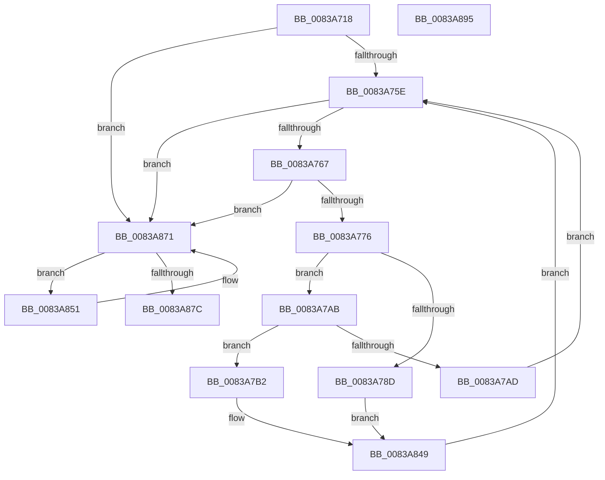

# FsepInitializeOverridesViewForGovernedFeatures

- RVA: `0x0083A718`–`0x0083A896` (길이 `382` bytes)
- VA: `0x000000014083A718`
- 실행 섹션: `PAGE`
- PDB 이름 있음: `예`; PDB Function 태그: `아니요`
- unwind 정보 RVA: `0x000BE9E8`
- 디코드: `114`개 명령, `382/382` bytes 표시
- 미해석 바이트: `0` (있으면 어셈블리에 `.byte`로 보존)

> 이 문서는 커널 이미지의 기계어와 PDB 기호를 분석해 생성했습니다. 4번과 5번은 함수 원형과 자료형을 바이너리 사용 방식에서 추정한 C 해석이며 원본 소스 복구 결과는 아닙니다.

## 1. Dependencies

- 직접 호출 지점: **0**; 고유 호출 대상: **0**
- 직접 호출자로 확인된 함수: **1**
- RIP 상대 이미지 참조: **0**

### Outgoing calls
- 직접 디코드된 call 명령이 없습니다.

### Direct callers
- [FseInitializeGovernedFeaturesEffectiveStates](../AC/FseInitializeGovernedFeaturesEffectiveStates_function_00AC0DAC.md) at `0x00AC0E00`

### Static image references
- 디코드된 RIP-relative 메모리 참조가 없습니다.

## 2. Other-region calls and transfers

- 다른 실행 섹션으로 향하는 call: **0**
- 별도 외부 분기/꼬리 이동을 확인하지 못했습니다.

## 3. Assembly (complete function range)

```asm
0083A718  48 8B C4                        mov rax, rsp
0083A71B  48 89 58 08                     mov qword ptr [rax + 8], rbx
0083A71F  48 89 68 10                     mov qword ptr [rax + 0x10], rbp
0083A723  48 89 70 18                     mov qword ptr [rax + 0x18], rsi
0083A727  48 89 78 20                     mov qword ptr [rax + 0x20], rdi
0083A72B  41 56                           push r14
0083A72D  41 57                           push r15
0083A72F  48 8B 71 08                     mov rsi, qword ptr [rcx + 8]
0083A733  4C 8D 4A 04                     lea r9, [rdx + 4]
0083A737  48 8B C2                        mov rax, rdx
0083A73A  49 8B D8                        mov rbx, r8
0083A73D  48 F7 D8                        neg rax
0083A740  48 8B FA                        mov rdi, rdx
0083A743  4C 8B D1                        mov r10, rcx
0083A746  4D 1B F6                        sbb r14, r14
0083A749  48 03 F1                        add rsi, rcx
0083A74C  4D 23 F1                        and r14, r9
0083A74F  45 33 DB                        xor r11d, r11d
0083A752  45 33 C0                        xor r8d, r8d
0083A755  48 85 D2                        test rdx, rdx
0083A758  0F 84 13 01 00 00               je 0x14083a871
0083A75E  44 3B 1F                        cmp r11d, dword ptr [rdi]
0083A761  0F 83 0A 01 00 00               jae 0x14083a871
0083A767  41 8B 02                        mov eax, dword ptr [r10]
0083A76A  0F B7 C8                        movzx ecx, ax
0083A76D  44 3B C1                        cmp r8d, ecx
0083A770  0F 83 FB 00 00 00               jae 0x14083a871
0083A776  41 8B C3                        mov eax, r11d
0083A779  48 C1 E0 04                     shl rax, 4
0083A77D  45 8B C8                        mov r9d, r8d
0083A780  4D 03 C9                        add r9, r9
0083A783  41 8B 0C 06                     mov ecx, dword ptr [r14 + rax]
0083A787  42 3B 0C CE                     cmp ecx, dword ptr [rsi + r9*8]
0083A78B  76 1E                           jbe 0x14083a7ab
0083A78D  42 83 24 83 81                  and dword ptr [rbx + r8*4], 0xffffff81
0083A792  42 8B 44 CE 0C                  mov eax, dword ptr [rsi + r9*8 + 0xc]
0083A797  25 80 FF 7F FF                  and eax, 0xff7fff80
0083A79C  0D 80 FF 7F 00                  or eax, 0x7fff80
0083A7A1  42 89 44 CE 0C                  mov dword ptr [rsi + r9*8 + 0xc], eax
0083A7A6  E9 9E 00 00 00                  jmp 0x14083a849
0083A7AB  73 05                           jae 0x14083a7b2
0083A7AD  41 FF C3                        inc r11d
0083A7B0  EB AC                           jmp 0x14083a75e
0083A7B2  42 8B 14 83                     mov edx, dword ptr [rbx + r8*4]
0083A7B6  48 8D 4F 08                     lea rcx, [rdi + 8]
0083A7BA  83 CA 01                        or edx, 1
0083A7BD  41 BF 04 00 00 00               mov r15d, 4
0083A7C3  42 89 14 83                     mov dword ptr [rbx + r8*4], edx
0083A7C7  48 85 FF                        test rdi, rdi
0083A7CA  49 0F 44 CF                     cmove rcx, r15
0083A7CE  48 03 C8                        add rcx, rax
0083A7D1  8B 01                           mov eax, dword ptr [rcx]
0083A7D3  03 C0                           add eax, eax
0083A7D5  33 C2                           xor eax, edx
0083A7D7  83 E0 1E                        and eax, 0x1e
0083A7DA  33 D0                           xor edx, eax
0083A7DC  42 89 14 83                     mov dword ptr [rbx + r8*4], edx
0083A7E0  8B 01                           mov eax, dword ptr [rcx]
0083A7E2  03 C0                           add eax, eax
0083A7E4  33 C2                           xor eax, edx
0083A7E6  83 E0 60                        and eax, 0x60
0083A7E9  33 D0                           xor edx, eax
0083A7EB  42 89 14 83                     mov dword ptr [rbx + r8*4], edx
0083A7EF  8B 01                           mov eax, dword ptr [rcx]
0083A7F1  03 C0                           add eax, eax
0083A7F3  33 C2                           xor eax, edx
0083A7F5  25 80 00 00 00                  and eax, 0x80
0083A7FA  33 C2                           xor eax, edx
0083A7FC  42 89 04 83                     mov dword ptr [rbx + r8*4], eax
0083A800  8B 11                           mov edx, dword ptr [rcx]
0083A802  42 8B 44 CE 0C                  mov eax, dword ptr [rsi + r9*8 + 0xc]
0083A807  83 C8 01                        or eax, 1
0083A80A  8D 0C D5 00 00 00 00            lea ecx, [rdx*8]
0083A811  33 C8                           xor ecx, eax
0083A813  83 E1 78                        and ecx, 0x78
0083A816  33 C8                           xor ecx, eax
0083A818  8B C2                           mov eax, edx
0083A81A  C1 E8 03                        shr eax, 3
0083A81D  33 C1                           xor eax, ecx
0083A81F  C1 E2 11                        shl edx, 0x11
0083A822  83 E0 06                        and eax, 6
0083A825  33 C1                           xor eax, ecx
0083A827  41 8B C8                        mov ecx, r8d
0083A82A  C1 E1 07                        shl ecx, 7
0083A82D  33 C8                           xor ecx, eax
0083A82F  81 E1 80 FF 7F 00               and ecx, 0x7fff80
0083A835  33 C8                           xor ecx, eax
0083A837  33 D1                           xor edx, ecx
0083A839  81 E2 00 00 80 00               and edx, 0x800000
0083A83F  33 D1                           xor edx, ecx
0083A841  42 89 54 CE 0C                  mov dword ptr [rsi + r9*8 + 0xc], edx
0083A846  41 FF C3                        inc r11d
0083A849  41 FF C0                        inc r8d
0083A84C  E9 0D FF FF FF                  jmp 0x14083a75e
0083A851  42 83 24 83 81                  and dword ptr [rbx + r8*4], 0xffffff81
0083A856  41 8B C8                        mov ecx, r8d
0083A859  48 03 C9                        add rcx, rcx
0083A85C  8B 44 CE 0C                     mov eax, dword ptr [rsi + rcx*8 + 0xc]
0083A860  25 80 FF 7F FF                  and eax, 0xff7fff80
0083A865  0D 80 FF 7F 00                  or eax, 0x7fff80
0083A86A  89 44 CE 0C                     mov dword ptr [rsi + rcx*8 + 0xc], eax
0083A86E  41 FF C0                        inc r8d
0083A871  41 8B 02                        mov eax, dword ptr [r10]
0083A874  0F B7 C8                        movzx ecx, ax
0083A877  44 3B C1                        cmp r8d, ecx
0083A87A  72 D5                           jb 0x14083a851
0083A87C  48 8B 5C 24 18                  mov rbx, qword ptr [rsp + 0x18]
0083A881  48 8B 6C 24 20                  mov rbp, qword ptr [rsp + 0x20]
0083A886  48 8B 74 24 28                  mov rsi, qword ptr [rsp + 0x28]
0083A88B  48 8B 7C 24 30                  mov rdi, qword ptr [rsp + 0x30]
0083A890  41 5F                           pop r15
0083A892  41 5E                           pop r14
0083A894  C3                              ret
0083A895  CC                              int3
```

## 4. C-style interpretation (structured pseudocode)

```c
__int64 __fastcall FsepInitializeOverridesViewForGovernedFeatures(__int64 a1, __int64 a2, __int64 a3)
{
    __int64 result;
    __int64 v_r11;
    __int64 v_r14;
    __int64 v_rsi;
    unsigned __int64 v_stack_p10;
    unsigned __int64 v_stack_p18;
    unsigned __int64 v_stack_p20;
    unsigned __int64 v_stack_p8;

    *(unsigned __int64 *)(v_rsp + 8) = v_rbx;
    *(unsigned __int64 *)(v_rsp + 16) = v_rbp;
    *(unsigned __int64 *)(v_rsp + 24) = v_rsi;
    *(unsigned __int64 *)(v_rsp + 32) = v_rdi;
    result = -(a2);
    v_rsi = (*(unsigned __int64 *)(a1 + 8)) + (a1);
    v_r14 = (v_r14) & (a2 + 4);
    v_r11 = 0;
    a3 = 0;
    if (a2 == 0) goto loc_0083A871;
loc_0083A75E:
    if (0 >= (*(unsigned int *)(a2))) goto loc_0083A871;
    if (0 >= ((unsigned int)((unsigned __int16)((unsigned int)(*(unsigned int *)(a1)))))) goto loc_0083A871;
    result = (0) << (4);
    a4 = (0) + (0);
    if (((unsigned int)((unsigned int)(*(unsigned int *)(v_r14 + result * 1)))) <= (*(unsigned int *)(v_rsi + a4 * 8))) goto loc_0083A7AB;
    result = (unsigned int)(((unsigned int)(*(unsigned int *)(v_rsi + a4 * 8 + 12))) & (0xFF7FFF80ULL));
    result = (unsigned int)((result) | (0x7FFF80ULL));
    *(unsigned int *)(v_rsi + a4 * 8 + 12) = (unsigned int)(result);
    goto loc_0083A849;
loc_0083A7AB:
    if (condition_is_above_or_equal) goto loc_0083A7B2;
    v_r11 = (unsigned int)((v_r11) + 1);
    goto loc_0083A75E;
loc_0083A7B2:
    a2 = (unsigned int)(((unsigned int)(*(unsigned int *)(a3 + a3 * 4))) | (1));
    *(unsigned int *)(a3 + a3 * 4) = (unsigned int)(a2);
    a1 = a2 + 8;
    if (a2 == 0) { a1 = 4; }
    a1 = (a1) + (result);
    result = (unsigned int)(((unsigned int)(*(unsigned int *)(a1))) + ((unsigned int)((unsigned int)(*(unsigned int *)(a1)))));
    result = (unsigned int)((result) ^ ((unsigned int)(a2)));
    result = (unsigned int)((result) & (30));
    a2 = (unsigned int)((a2) ^ ((unsigned int)(result)));
    *(unsigned int *)(a3 + a3 * 4) = (unsigned int)(a2);
    result = (unsigned int)(((unsigned int)(*(unsigned int *)(a1))) + ((unsigned int)((unsigned int)(*(unsigned int *)(a1)))));
    result = (unsigned int)((result) ^ ((unsigned int)(a2)));
    result = (unsigned int)((result) & (96));
    a2 = (unsigned int)((a2) ^ ((unsigned int)(result)));
    *(unsigned int *)(a3 + a3 * 4) = (unsigned int)(a2);
    result = (unsigned int)(((unsigned int)(*(unsigned int *)(a1))) + ((unsigned int)((unsigned int)(*(unsigned int *)(a1)))));
    result = (unsigned int)((result) ^ ((unsigned int)(a2)));
    result = (unsigned int)((result) & (128));
    result = (unsigned int)((result) ^ ((unsigned int)(a2)));
    *(unsigned int *)(a3 + a3 * 4) = (unsigned int)(result);
    result = (unsigned int)(((unsigned int)(*(unsigned int *)(v_rsi + a4 * 8 + 12))) | (1));
    a1 = (unsigned int)(((unsigned int)(*(unsigned int *)(a1)) * 8) ^ ((unsigned int)(result)));
    a1 = (unsigned int)((a1) & (120));
    a1 = (unsigned int)((a1) ^ ((unsigned int)(result)));
    result = (unsigned int)(((unsigned int)((unsigned int)((unsigned int)(*(unsigned int *)(a1))))) >> (3));
    result = (unsigned int)((result) ^ ((unsigned int)(a1)));
    a2 = (unsigned int)(((unsigned int)(*(unsigned int *)(a1))) << (17));
    result = (unsigned int)((result) & (6));
    result = (unsigned int)((result) ^ ((unsigned int)(a1)));
    a1 = (unsigned int)((0) << (7));
    a1 = (unsigned int)((a1) ^ ((unsigned int)(result)));
    a1 = (unsigned int)((a1) & (0x7FFF80ULL));
    a1 = (unsigned int)((a1) ^ ((unsigned int)(result)));
    a2 = (unsigned int)((a2) ^ ((unsigned int)(a1)));
    a2 = (unsigned int)((a2) & (0x800000ULL));
    a2 = (unsigned int)((a2) ^ ((unsigned int)(a1)));
    *(unsigned int *)(v_rsi + a4 * 8 + 12) = (unsigned int)(a2);
    v_r11 = (unsigned int)((v_r11) + 1);
loc_0083A849:
    a3 = (unsigned int)((a3) + 1);
    goto loc_0083A75E;
loc_0083A851:
    a1 = ((unsigned int)((unsigned int)(a3))) + ((unsigned int)((unsigned int)(a3)));
    result = (unsigned int)(((unsigned int)(*(unsigned int *)(v_rsi + a1 * 8 + 12))) & (0xFF7FFF80ULL));
    result = (unsigned int)((result) | (0x7FFF80ULL));
    *(unsigned int *)(v_rsi + a1 * 8 + 12) = (unsigned int)(result);
    a3 = (unsigned int)((a3) + 1);
loc_0083A871:
    if (((unsigned int)(a3)) < ((unsigned int)((unsigned __int16)((unsigned int)(*(unsigned int *)(a1)))))) goto loc_0083A851;
    return (unsigned int)(*(unsigned int *)(a1));
}
```

## 5. (Beta) C Style

```c
int64_t FsepInitializeOverridesViewForGovernedFeatures(void *Arg1, void *Arg2, void *Arg3)
{
    uint8_t *arg1 = (uint8_t *)Arg1;
    uint8_t *arg2 = (uint8_t *)Arg2;
    uint8_t *arg3 = (uint8_t *)Arg3;

    int64_t result;
    int64_t local_r11;
    int64_t local_r14;
    int64_t local_rsi;
    uint64_t v_stack_p10;
    uint64_t v_stack_p18;
    uint64_t v_stack_p20;
    uint64_t v_stack_p8;

    *(uint64_t *)(local_rsp + 0x8) = local_rbx;
    *(uint64_t *)(local_rsp + 0x10) = local_rbp;
    *(uint64_t *)(local_rsp + 0x18) = local_rsi;
    *(uint64_t *)(local_rsp + 0x20) = local_rdi;
    result = -(Arg2);
    local_rsi = (*(uint64_t *)(arg1 + 0x8)) + (Arg1);
    local_r14 = (local_r14) & (Arg2 + 4);
    local_r11 = 0;
    Arg3 = 0;
    if (Arg2 == NULL) goto loc_0083A871;
loc_0083A75E:
    if (0 >= (*(uint32_t *)(arg2))) goto loc_0083A871;
    if (0 >= ((uint32_t)((uint16_t)((uint32_t)(*(uint32_t *)(arg1)))))) goto loc_0083A871;
    result = (0) << (4);
    a4 = (0) + (0);
    if (((uint32_t)((uint32_t)(*(uint32_t *)(local_r14 + result * 1)))) <= (*(uint32_t *)(local_rsi + a4 * 8))) goto loc_0083A7AB;
    result = (uint32_t)(((uint32_t)(*(uint32_t *)(local_rsi + a4 * 8 + 0xC))) & (0xFF7FFF80ULL));
    result = (uint32_t)((result) | (0x7FFF80ULL));
    *(uint32_t *)(local_rsi + a4 * 8 + 0xC) = (uint32_t)(result);
    goto loc_0083A849;
loc_0083A7AB:
    if (condition_is_above_or_equal) goto loc_0083A7B2;
    local_r11 = (uint32_t)((local_r11) + 1);
    goto loc_0083A75E;
loc_0083A7B2:
    Arg2 = (uint32_t)(((uint32_t)(*(uint32_t *)(arg3 + arg3 * 4))) | (1));
    *(uint32_t *)(arg3 + arg3 * 4) = (uint32_t)(Arg2);
    Arg1 = Arg2 + 8;
    if (Arg2 == NULL) { Arg1 = 4; }
    Arg1 = (Arg1) + (result);
    result = (uint32_t)(((uint32_t)(*(uint32_t *)(arg1))) + ((uint32_t)((uint32_t)(*(uint32_t *)(arg1)))));
    result = (uint32_t)((result) ^ ((uint32_t)(Arg2)));
    result = (uint32_t)((result) & (30));
    Arg2 = (uint32_t)((Arg2) ^ ((uint32_t)(result)));
    *(uint32_t *)(arg3 + arg3 * 4) = (uint32_t)(Arg2);
    result = (uint32_t)(((uint32_t)(*(uint32_t *)(arg1))) + ((uint32_t)((uint32_t)(*(uint32_t *)(arg1)))));
    result = (uint32_t)((result) ^ ((uint32_t)(Arg2)));
    result = (uint32_t)((result) & (96));
    Arg2 = (uint32_t)((Arg2) ^ ((uint32_t)(result)));
    *(uint32_t *)(arg3 + arg3 * 4) = (uint32_t)(Arg2);
    result = (uint32_t)(((uint32_t)(*(uint32_t *)(arg1))) + ((uint32_t)((uint32_t)(*(uint32_t *)(arg1)))));
    result = (uint32_t)((result) ^ ((uint32_t)(Arg2)));
    result = (uint32_t)((result) & (128));
    result = (uint32_t)((result) ^ ((uint32_t)(Arg2)));
    *(uint32_t *)(arg3 + arg3 * 4) = (uint32_t)(result);
    result = (uint32_t)(((uint32_t)(*(uint32_t *)(local_rsi + a4 * 8 + 0xC))) | (1));
    Arg1 = (uint32_t)(((uint32_t)(*(uint32_t *)(arg1)) * 8) ^ ((uint32_t)(result)));
    Arg1 = (uint32_t)((Arg1) & (120));
    Arg1 = (uint32_t)((Arg1) ^ ((uint32_t)(result)));
    result = (uint32_t)(((uint32_t)((uint32_t)((uint32_t)(*(uint32_t *)(arg1))))) >> (3));
    result = (uint32_t)((result) ^ ((uint32_t)(Arg1)));
    Arg2 = (uint32_t)(((uint32_t)(*(uint32_t *)(arg1))) << (17));
    result = (uint32_t)((result) & (6));
    result = (uint32_t)((result) ^ ((uint32_t)(Arg1)));
    Arg1 = (uint32_t)((0) << (7));
    Arg1 = (uint32_t)((Arg1) ^ ((uint32_t)(result)));
    Arg1 = (uint32_t)((Arg1) & (0x7FFF80ULL));
    Arg1 = (uint32_t)((Arg1) ^ ((uint32_t)(result)));
    Arg2 = (uint32_t)((Arg2) ^ ((uint32_t)(Arg1)));
    Arg2 = (uint32_t)((Arg2) & (0x800000ULL));
    Arg2 = (uint32_t)((Arg2) ^ ((uint32_t)(Arg1)));
    *(uint32_t *)(local_rsi + a4 * 8 + 0xC) = (uint32_t)(Arg2);
    local_r11 = (uint32_t)((local_r11) + 1);
loc_0083A849:
    Arg3 = (uint32_t)((Arg3) + 1);
    goto loc_0083A75E;
loc_0083A851:
    Arg1 = ((uint32_t)((uint32_t)(Arg3))) + ((uint32_t)((uint32_t)(Arg3)));
    result = (uint32_t)(((uint32_t)(*(uint32_t *)(local_rsi + arg1 * 8 + 0xC))) & (0xFF7FFF80ULL));
    result = (uint32_t)((result) | (0x7FFF80ULL));
    *(uint32_t *)(local_rsi + arg1 * 8 + 0xC) = (uint32_t)(result);
    Arg3 = (uint32_t)((Arg3) + 1);
loc_0083A871:
    if (((uint32_t)(Arg3)) < ((uint32_t)((uint16_t)((uint32_t)(*(uint32_t *)(arg1)))))) goto loc_0083A851;
    return (uint32_t)(*(uint32_t *)(arg1));
}
```

### 관측된 메모리 오프셋

구조체 형식이 확인되지 않은 접근은 인자 기준의 오프셋으로만 기록했습니다.

| 기준 인자 | 오프셋 표현 | 폭 (bit) | 접근 |
|---|---:|---:|---|
| `Arg1` | `+ 0x0` | `32` | `R` |
| `Arg1` | `+ 0x8` | `64` | `R` |
| `Arg2` | `+ 0x4` | `64` | `R` |
| `Arg3` | `+ 0x0 + r8*4` | `32` | `R` |
| `Arg3` | `+ 0x0 + r8*4` | `32` | `R/W` |
| `Arg3` | `+ 0x0 + r8*4` | `32` | `W` |

## 6. Execution-region graph

[열기: 2D/3D 그래프와 함수 탐색 컨트롤 패널](../../../control-panel.html?section=page&rva=0x0083A718&view=graph)

- 2D 그래프는 위에서 아래로 흐르고, 3D 그래프는 빈 공간을 드래그해 회전합니다. Shift+드래그는 이동, 휠은 확대·축소, 함수 노드 선택은 대상 보고서 이동입니다.

### Static fallback


