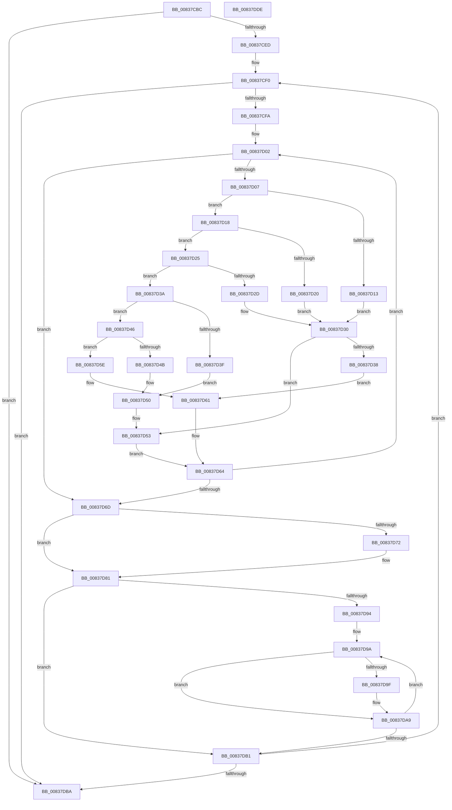

# I_Base64Decode

- RVA: `0x00837CBC`–`0x00837DDF` (길이 `291` bytes)
- VA: `0x0000000140837CBC`
- 실행 섹션: `PAGE`
- PDB 이름 있음: `예`; PDB Function 태그: `아니요`
- unwind 정보 RVA: `0x000A6CEC`
- 디코드: `96`개 명령, `291/291` bytes 표시
- 미해석 바이트: `0` (있으면 어셈블리에 `.byte`로 보존)

> 이 문서는 커널 이미지의 기계어와 PDB 기호를 분석해 생성했습니다. 4번과 5번은 함수 원형과 자료형을 바이너리 사용 방식에서 추정한 C 해석이며 원본 소스 복구 결과는 아닙니다.

## 1. Dependencies

- 직접 호출 지점: **0**; 고유 호출 대상: **0**
- 직접 호출자로 확인된 함수: **1**
- RIP 상대 이미지 참조: **0**

### Outgoing calls
- 직접 디코드된 call 명령이 없습니다.

### Direct callers
- [I_MinCryptGetPlatformManifestBinaryIDAttribute](I_MinCryptGetPlatformManifestBinaryIDAttribute_function_00837E9C.md) at `0x00837F11`

### Static image references
- 디코드된 RIP-relative 메모리 참조가 없습니다.

## 2. Other-region calls and transfers

- 다른 실행 섹션으로 향하는 call: **0**
- 별도 외부 분기/꼬리 이동을 확인하지 못했습니다.

## 3. Assembly (complete function range)

```asm
00837CBC  48 8B C4                        mov rax, rsp
00837CBF  48 89 58 08                     mov qword ptr [rax + 8], rbx
00837CC3  48 89 68 10                     mov qword ptr [rax + 0x10], rbp
00837CC7  48 89 70 18                     mov qword ptr [rax + 0x18], rsi
00837CCB  48 89 78 20                     mov qword ptr [rax + 0x20], rdi
00837CCF  41 56                           push r14
00837CD1  8B DA                           mov ebx, edx
00837CD3  33 FF                           xor edi, edi
00837CD5  48 03 D9                        add rbx, rcx
00837CD8  45 33 DB                        xor r11d, r11d
00837CDB  4D 8B F1                        mov r14, r9
00837CDE  49 8B F0                        mov rsi, r8
00837CE1  4C 8B D1                        mov r10, rcx
00837CE4  48 3B CB                        cmp rcx, rbx
00837CE7  0F 83 CD 00 00 00               jae 0x140837dba
00837CED  8D 6F 01                        lea ebp, [rdi + 1]
00837CF0  41 80 3A 00                     cmp byte ptr [r10], 0
00837CF4  0F 84 C0 00 00 00               je 0x140837dba
00837CFA  33 D2                           xor edx, edx
00837CFC  45 33 C0                        xor r8d, r8d
00837CFF  45 33 C9                        xor r9d, r9d
00837D02  4C 3B D3                        cmp r10, rbx
00837D05  73 66                           jae 0x140837d6d
00837D07  41 0F BE 0A                     movsx ecx, byte ptr [r10]
00837D0B  8D 41 BF                        lea eax, [rcx - 0x41]
00837D0E  83 F8 19                        cmp eax, 0x19
00837D11  77 05                           ja 0x140837d18
00837D13  83 C1 BF                        add ecx, -0x41
00837D16  EB 18                           jmp 0x140837d30
00837D18  8D 41 9F                        lea eax, [rcx - 0x61]
00837D1B  83 F8 19                        cmp eax, 0x19
00837D1E  77 05                           ja 0x140837d25
00837D20  83 C1 B9                        add ecx, -0x47
00837D23  EB 0B                           jmp 0x140837d30
00837D25  8D 41 D0                        lea eax, [rcx - 0x30]
00837D28  83 F8 09                        cmp eax, 9
00837D2B  77 0D                           ja 0x140837d3a
00837D2D  83 C1 04                        add ecx, 4
00837D30  4C 03 D5                        add r10, rbp
00837D33  83 F9 FF                        cmp ecx, -1
00837D36  75 1B                           jne 0x140837d53
00837D38  EB 27                           jmp 0x140837d61
00837D3A  83 F9 2B                        cmp ecx, 0x2b
00837D3D  75 07                           jne 0x140837d46
00837D3F  B9 3E 00 00 00                  mov ecx, 0x3e
00837D44  EB 0A                           jmp 0x140837d50
00837D46  83 F9 2F                        cmp ecx, 0x2f
00837D49  75 13                           jne 0x140837d5e
00837D4B  B9 3F 00 00 00                  mov ecx, 0x3f
00837D50  49 FF C2                        inc r10
00837D53  C1 E2 06                        shl edx, 6
00837D56  0B D1                           or edx, ecx
00837D58  41 83 C0 06                     add r8d, 6
00837D5C  EB 06                           jmp 0x140837d64
00837D5E  49 FF C2                        inc r10
00837D61  41 FF C9                        dec r9d
00837D64  44 03 CD                        add r9d, ebp
00837D67  41 83 F9 04                     cmp r9d, 4
00837D6B  72 95                           jb 0x140837d02
00837D6D  45 85 DB                        test r11d, r11d
00837D70  75 0F                           jne 0x140837d81
00837D72  41 8B C8                        mov ecx, r8d
00837D75  C1 E9 03                        shr ecx, 3
00837D78  03 CF                           add ecx, edi
00837D7A  41 3B 0E                        cmp ecx, dword ptr [r14]
00837D7D  44 0F 47 DD                     cmova r11d, ebp
00837D81  B9 18 00 00 00                  mov ecx, 0x18
00837D86  41 2B C8                        sub ecx, r8d
00837D89  41 C1 E8 03                     shr r8d, 3
00837D8D  D3 E2                           shl edx, cl
00837D8F  45 85 C0                        test r8d, r8d
00837D92  74 1D                           je 0x140837db1
00837D94  41 8B C8                        mov ecx, r8d
00837D97  41 03 F8                        add edi, r8d
00837D9A  45 85 DB                        test r11d, r11d
00837D9D  75 0A                           jne 0x140837da9
00837D9F  8B C2                           mov eax, edx
00837DA1  C1 E8 10                        shr eax, 0x10
00837DA4  88 06                           mov byte ptr [rsi], al
00837DA6  48 03 F5                        add rsi, rbp
00837DA9  C1 E2 08                        shl edx, 8
00837DAC  48 2B CD                        sub rcx, rbp
00837DAF  75 E9                           jne 0x140837d9a
00837DB1  4C 3B D3                        cmp r10, rbx
00837DB4  0F 82 36 FF FF FF               jb 0x140837cf0
00837DBA  48 8B 5C 24 10                  mov rbx, qword ptr [rsp + 0x10]
00837DBF  41 F7 DB                        neg r11d
00837DC2  48 8B 6C 24 18                  mov rbp, qword ptr [rsp + 0x18]
00837DC7  48 8B 74 24 20                  mov rsi, qword ptr [rsp + 0x20]
00837DCC  1B C0                           sbb eax, eax
00837DCE  41 89 3E                        mov dword ptr [r14], edi
00837DD1  25 0D 00 00 C0                  and eax, 0xc000000d
00837DD6  48 8B 7C 24 28                  mov rdi, qword ptr [rsp + 0x28]
00837DDB  41 5E                           pop r14
00837DDD  C3                              ret
00837DDE  CC                              int3
```

## 4. C-style interpretation (structured pseudocode)

```c
__int64 __fastcall I_Base64Decode(__int64 a1, int a2, __int64 a3, __int64 a4)
{
    __int64 result;
    __int64 v_r10;
    __int64 v_r11;
    __int64 v_rbx;
    __int64 v_rdi;
    __int64 v_rsi;
    unsigned __int64 v_stack_p10;
    unsigned __int64 v_stack_p18;
    unsigned __int64 v_stack_p20;
    unsigned __int64 v_stack_p8;

    *(unsigned __int64 *)(v_rsp + 8) = v_rbx;
    *(unsigned __int64 *)(v_rsp + 16) = v_rbp;
    *(unsigned __int64 *)(v_rsp + 24) = v_rsi;
    *(unsigned __int64 *)(v_rsp + 32) = v_rdi;
    v_rdi = 0;
    v_rbx = ((unsigned int)(a2)) + (a1);
    v_r11 = 0;
    if (a1 >= v_rbx) goto loc_00837DBA;
loc_00837CF0:
    if ((*(unsigned __int8 *)(a1)) == 0) goto loc_00837DBA;
    a2 = 0;
    a3 = 0;
    a4 = 0;
loc_00837D02:
    if (a1 >= v_rbx) goto loc_00837D6D;
    if (((unsigned int)((__int8)(*(unsigned __int8 *)(a1)) - 65)) > 25) goto loc_00837D18;
    a1 = (unsigned int)(((__int8)(*(unsigned __int8 *)(a1))) + (-65));
    goto loc_00837D30;
loc_00837D18:
    if (((unsigned int)(a1 - 97)) > 25) goto loc_00837D25;
    a1 = (unsigned int)((a1) + (-71));
    goto loc_00837D30;
loc_00837D25:
    if (((unsigned int)(a1 - 48)) > 9) goto loc_00837D3A;
    a1 = (unsigned int)((a1) + (4));
loc_00837D30:
    v_r10 = (a1) + (v_rdi + 1);
    if (((unsigned int)(a1)) != -1) goto loc_00837D53;
    goto loc_00837D61;
loc_00837D3A:
    if (((unsigned int)(a1)) != 43) goto loc_00837D46;
    goto loc_00837D50;
loc_00837D46:
    if (62 != 47) goto loc_00837D5E;
loc_00837D50:
    v_r10 = (v_r10) + 1;
loc_00837D53:
    a2 = (unsigned int)((a2) << (6));
    a2 = (unsigned int)((a2) | (63));
    a3 = (unsigned int)((a3) + (6));
    goto loc_00837D64;
loc_00837D5E:
    v_r10 = (v_r10) + 1;
loc_00837D61:
    a4 = (unsigned int)((a4) - 1);
loc_00837D64:
    a4 = (unsigned int)((a4) + ((unsigned int)(v_rdi + 1)));
    if (((unsigned int)(a4)) < 4) goto loc_00837D02;
loc_00837D6D:
    if (0 == 0) {
        a1 = (unsigned int)(a3);
        a1 = (unsigned int)((a1) >> (3));
        a1 = (unsigned int)((a1) + (0));
        if (((unsigned int)(a1)) > (*(unsigned int *)(a4))) { v_r11 = (unsigned int)(v_rdi + 1); }
    }
    a1 = (unsigned int)((24) - ((unsigned int)(a3)));
    a3 = (unsigned int)((a3) >> (3));
    a2 = (unsigned int)((a2) << ((unsigned __int8)(a1)));
    if ((unsigned int)(a3) == 0) goto loc_00837DB1;
    v_rdi = (unsigned int)((v_rdi) + ((unsigned int)(a3)));
loc_00837D9A:
    result = a1 - 48;
    v_rsi = a3;
    if ((unsigned int)(v_r11) == 0) {
        result = a2;
        result = (unsigned int)((result) >> (16));
        *(unsigned __int8 *)(a3) = (unsigned __int8)(result);
        v_rsi = (a3) + (v_rdi + 1);
    }
    a2 = (unsigned int)((a2) << (8));
    a1 = ((unsigned int)((unsigned int)(a3))) - (v_rdi + 1);
    if (condition_is_not_equal) goto loc_00837D9A;
loc_00837DB1:
    if (v_r10 < v_rbx) goto loc_00837CF0;
loc_00837DBA:
    v_r11 = (unsigned int)(-(v_r11));
    *(unsigned int *)(a4) = (unsigned int)(v_rdi);
    result = (unsigned int)((result) & (0xC000000DULL));
    return result;
}
```

## 5. (Beta) C Style

```c
int64_t I_Base64Decode(int64_t Arg1, int32_t Arg2, void *Arg3, void *Arg4)
{
    uint8_t *arg3 = (uint8_t *)Arg3;
    uint8_t *arg4 = (uint8_t *)Arg4;

    int64_t result;
    int64_t local_r10;
    int64_t local_r11;
    int64_t local_rbx;
    int64_t local_rdi;
    int64_t local_rsi;
    uint64_t v_stack_p10;
    uint64_t v_stack_p18;
    uint64_t v_stack_p20;
    uint64_t v_stack_p8;

    *(uint64_t *)(local_rsp + 0x8) = local_rbx;
    *(uint64_t *)(local_rsp + 0x10) = local_rbp;
    *(uint64_t *)(local_rsp + 0x18) = local_rsi;
    *(uint64_t *)(local_rsp + 0x20) = local_rdi;
    local_rdi = 0;
    local_rbx = ((uint32_t)(Arg2)) + (Arg1);
    local_r11 = 0;
    if (Arg1 >= local_rbx) goto loc_00837DBA;
loc_00837CF0:
    if ((*(uint8_t *)(Arg1)) == 0) goto loc_00837DBA;
    Arg2 = 0;
    Arg3 = 0;
    Arg4 = 0;
loc_00837D02:
    if (Arg1 >= local_rbx) goto loc_00837D6D;
    if (((uint32_t)((int8_t)(*(uint8_t *)(Arg1)) - 65)) > 25) goto loc_00837D18;
    Arg1 = (uint32_t)(((int8_t)(*(uint8_t *)(Arg1))) + (-65));
    goto loc_00837D30;
loc_00837D18:
    if (((uint32_t)(Arg1 - 97)) > 25) goto loc_00837D25;
    Arg1 = (uint32_t)((Arg1) + (-71));
    goto loc_00837D30;
loc_00837D25:
    if (((uint32_t)(Arg1 - 48)) > 9) goto loc_00837D3A;
    Arg1 = (uint32_t)((Arg1) + (4));
loc_00837D30:
    local_r10 = (Arg1) + (local_rdi + 1);
    if (((uint32_t)(Arg1)) != -1) goto loc_00837D53;
    goto loc_00837D61;
loc_00837D3A:
    if (((uint32_t)(Arg1)) != 43) goto loc_00837D46;
    goto loc_00837D50;
loc_00837D46:
    if (62 != 47) goto loc_00837D5E;
loc_00837D50:
    local_r10 = (local_r10) + 1;
loc_00837D53:
    Arg2 = (uint32_t)((Arg2) << (6));
    Arg2 = (uint32_t)((Arg2) | (63));
    Arg3 = (uint32_t)((Arg3) + (6));
    goto loc_00837D64;
loc_00837D5E:
    local_r10 = (local_r10) + 1;
loc_00837D61:
    Arg4 = (uint32_t)((Arg4) - 1);
loc_00837D64:
    Arg4 = (uint32_t)((Arg4) + ((uint32_t)(local_rdi + 1)));
    if (((uint32_t)(Arg4)) < 4) goto loc_00837D02;
loc_00837D6D:
    if (0 == 0) {
        Arg1 = (uint32_t)(Arg3);
        Arg1 = (uint32_t)((Arg1) >> (3));
        Arg1 = (uint32_t)((Arg1) + (0));
        if (((uint32_t)(Arg1)) > (*(uint32_t *)(arg4))) { local_r11 = (uint32_t)(local_rdi + 1); }
    }
    Arg1 = (uint32_t)((24) - ((uint32_t)(Arg3)));
    Arg3 = (uint32_t)((Arg3) >> (3));
    Arg2 = (uint32_t)((Arg2) << ((uint8_t)(Arg1)));
    if ((uint32_t)(Arg3) == 0) goto loc_00837DB1;
    local_rdi = (uint32_t)((local_rdi) + ((uint32_t)(Arg3)));
loc_00837D9A:
    result = Arg1 - 48;
    local_rsi = Arg3;
    if ((uint32_t)(local_r11) == 0) {
        result = Arg2;
        result = (uint32_t)((result) >> (16));
        *(uint8_t *)(arg3) = (uint8_t)(result);
        local_rsi = (Arg3) + (local_rdi + 1);
    }
    Arg2 = (uint32_t)((Arg2) << (8));
    Arg1 = ((uint32_t)((uint32_t)(Arg3))) - (local_rdi + 1);
    if (condition_is_not_equal) goto loc_00837D9A;
loc_00837DB1:
    if (local_r10 < local_rbx) goto loc_00837CF0;
loc_00837DBA:
    local_r11 = (uint32_t)(-(local_r11));
    *(uint32_t *)(arg4) = (uint32_t)(local_rdi);
    result = (uint32_t)((result) & (0xC000000DULL));
    return result;
}
```

### 관측된 메모리 오프셋

구조체 형식이 확인되지 않은 접근은 인자 기준의 오프셋으로만 기록했습니다.

| 기준 인자 | 오프셋 표현 | 폭 (bit) | 접근 |
|---|---:|---:|---|
| `Arg3` | `+ 0x0` | `8` | `W` |
| `Arg4` | `+ 0x0` | `32` | `R` |
| `Arg4` | `+ 0x0` | `32` | `W` |

## 6. Execution-region graph

[열기: 2D/3D 그래프와 함수 탐색 컨트롤 패널](../../../control-panel.html?section=page&rva=0x00837CBC&view=graph)

- 2D 그래프는 위에서 아래로 흐르고, 3D 그래프는 빈 공간을 드래그해 회전합니다. Shift+드래그는 이동, 휠은 확대·축소, 함수 노드 선택은 대상 보고서 이동입니다.

### Static fallback


