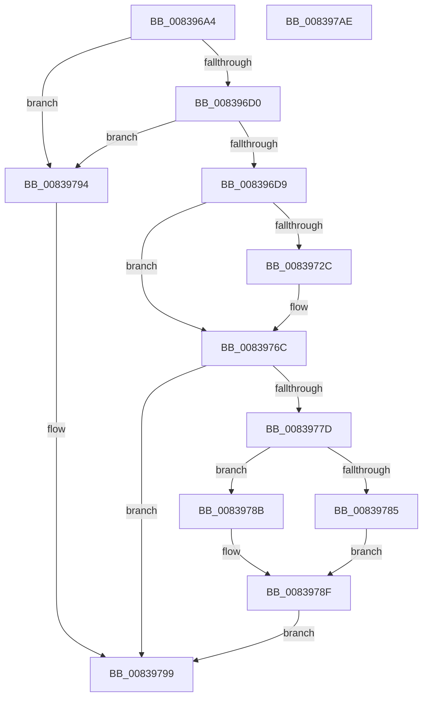

# I_MinAsn1AdjustFileTime

- RVA: `0x008396A4`–`0x008397AF` (길이 `267` bytes)
- VA: `0x00000001408396A4`
- 실행 섹션: `PAGE`
- PDB 이름 있음: `예`; PDB Function 태그: `예`
- unwind 정보 RVA: `0x000DAFE8`
- 디코드: `78`개 명령, `267/267` bytes 표시
- 미해석 바이트: `0` (있으면 어셈블리에 `.byte`로 보존)

> 이 문서는 커널 이미지의 기계어와 PDB 기호를 분석해 생성했습니다. 4번과 5번은 함수 원형과 자료형을 바이너리 사용 방식에서 추정한 C 해석이며 원본 소스 복구 결과는 아닙니다.

## 1. Dependencies

- 직접 호출 지점: **1**; 고유 호출 대상: **1**
- 직접 호출자로 확인된 함수: **1**
- RIP 상대 이미지 참조: **0**

### Outgoing calls
- `0x00839774` → [RtlTimeFieldsToTime](../../text/42/RtlTimeFieldsToTime_function_0042E6B0.md) (function, `0x0042E6B0`)

### Direct callers
- [I_MinAsn1ConvertTime](I_MinAsn1ConvertTime_function_008398A8.md) at `0x00839922`

### Static image references
- 디코드된 RIP-relative 메모리 참조가 없습니다.

## 2. Other-region calls and transfers

- 다른 실행 섹션으로 향하는 call: **1**
  - `0x00839774` → [RtlTimeFieldsToTime](../../text/42/RtlTimeFieldsToTime_function_0042E6B0.md) (`PAGE` → `.text`)
- 별도 외부 분기/꼬리 이동을 확인하지 못했습니다.

## 3. Assembly (complete function range)

```asm
008396A4  48 89 5C 24 08                  mov qword ptr [rsp + 8], rbx
008396A9  48 89 74 24 10                  mov qword ptr [rsp + 0x10], rsi
008396AE  48 89 7C 24 18                  mov qword ptr [rsp + 0x18], rdi
008396B3  55                              push rbp
008396B4  48 8B EC                        mov rbp, rsp
008396B7  48 83 EC 30                     sub rsp, 0x30
008396BB  33 F6                           xor esi, esi
008396BD  0F BF FA                        movsx edi, dx
008396C0  48 89 75 28                     mov qword ptr [rbp + 0x28], rsi
008396C4  48 8B D9                        mov rbx, rcx
008396C7  45 84 C0                        test r8b, r8b
008396CA  0F 85 C4 00 00 00               jne 0x140839794
008396D0  66 85 FF                        test di, di
008396D3  0F 84 BB 00 00 00               je 0x140839794
008396D9  8B CF                           mov ecx, edi
008396DB  44 8D 4E 01                     lea r9d, [rsi + 1]
008396DF  F7 D9                           neg ecx
008396E1  B8 89 88 88 88                  mov eax, 0x88888889
008396E6  0F 57 C0                        xorps xmm0, xmm0
008396E9  0F 48 CF                        cmovs ecx, edi
008396EC  0F 11 45 F0                     movups xmmword ptr [rbp - 0x10], xmm0
008396F0  44 0F BF C1                     movsx r8d, cx
008396F4  41 F7 E8                        imul r8d
008396F7  C7 45 F0 41 06 01 00            mov dword ptr [rbp - 0x10], 0x10641
008396FE  66 44 89 4D F4                  mov word ptr [rbp - 0xc], r9w
00839703  45 8D 14 10                     lea r10d, [r8 + rdx]
00839707  41 C1 FA 05                     sar r10d, 5
0083970B  41 8B C2                        mov eax, r10d
0083970E  C1 E8 1F                        shr eax, 0x1f
00839711  44 03 D0                        add r10d, eax
00839714  41 6B C2 3C                     imul eax, r10d, 0x3c
00839718  66 44 89 55 F6                  mov word ptr [rbp - 0xa], r10w
0083971D  44 2B C0                        sub r8d, eax
00839720  66 44 89 45 F8                  mov word ptr [rbp - 8], r8w
00839725  66 41 83 FA 18                  cmp r10w, 0x18
0083972A  7C 40                           jl 0x14083976c
0083972C  41 B8 AB AA AA 2A               mov r8d, 0x2aaaaaab
00839732  41 0F BF CA                     movsx ecx, r10w
00839736  41 8B C0                        mov eax, r8d
00839739  F7 E9                           imul ecx
0083973B  41 0F BF CA                     movsx ecx, r10w
0083973F  C1 FA 02                        sar edx, 2
00839742  8B C2                           mov eax, edx
00839744  C1 E8 1F                        shr eax, 0x1f
00839747  03 D0                           add edx, eax
00839749  41 8B C0                        mov eax, r8d
0083974C  66 41 03 D1                     add dx, r9w
00839750  66 89 55 F4                     mov word ptr [rbp - 0xc], dx
00839754  F7 E9                           imul ecx
00839756  C1 FA 02                        sar edx, 2
00839759  8B C2                           mov eax, edx
0083975B  C1 E8 1F                        shr eax, 0x1f
0083975E  03 D0                           add edx, eax
00839760  8D 04 52                        lea eax, [rdx + rdx*2]
00839763  C1 E0 03                        shl eax, 3
00839766  2B C8                           sub ecx, eax
00839768  66 89 4D F6                     mov word ptr [rbp - 0xa], cx
0083976C  48 8D 55 28                     lea rdx, [rbp + 0x28]
00839770  48 8D 4D F0                     lea rcx, [rbp - 0x10]
00839774  E8 37 4F BF FF                  call 0x14042e6b0
00839779  84 C0                           test al, al
0083977B  74 1C                           je 0x140839799
0083977D  48 8B 0B                        mov rcx, qword ptr [rbx]
00839780  66 85 FF                        test di, di
00839783  79 06                           jns 0x14083978b
00839785  48 03 4D 28                     add rcx, qword ptr [rbp + 0x28]
00839789  EB 04                           jmp 0x14083978f
0083978B  48 2B 4D 28                     sub rcx, qword ptr [rbp + 0x28]
0083978F  48 89 0B                        mov qword ptr [rbx], rcx
00839792  EB 05                           jmp 0x140839799
00839794  B8 01 00 00 00                  mov eax, 1
00839799  48 8B 5C 24 40                  mov rbx, qword ptr [rsp + 0x40]
0083979E  48 8B 74 24 48                  mov rsi, qword ptr [rsp + 0x48]
008397A3  48 8B 7C 24 50                  mov rdi, qword ptr [rsp + 0x50]
008397A8  48 83 C4 30                     add rsp, 0x30
008397AC  5D                              pop rbp
008397AD  C3                              ret
008397AE  CC                              int3
```

## 4. C-style interpretation (structured pseudocode)

```c
__int64 __fastcall I_MinAsn1AdjustFileTime(__int64 a1, __int64 a2, unsigned __int8 a3)
{
    __int64 result;
    __int64 v_r10;
    __int64 v_rsi;
    __int64 v_rsp;
    unsigned __int16 v_stack_m10;
    unsigned __int16 v_stack_m12;
    unsigned __int16 v_stack_m14;
    unsigned __int64 v_stack_m18;
    unsigned __int64 v_stack_p10;
    unsigned __int64 v_stack_p18;
    unsigned __int64 v_stack_p20;
    unsigned __int64 v_stack_p8;

    v_stack_p8 = v_rbx;
    v_stack_p10 = v_rsi;
    v_stack_p18 = v_rdi;
    v_rsp = (v_rsp) - (48);
    v_rsi = 0;
    v_stack_p20 = 0;
    if (a3 != 0) goto loc_00839794;
    if ((unsigned __int16)((__int16)((unsigned __int16)(a2))) == 0) goto loc_00839794;
    a1 = (unsigned int)(-((unsigned int)((unsigned int)((__int16)((unsigned __int16)(a2))))));
    if (sign_flag) { a1 = (unsigned int)((__int16)((unsigned __int16)(a2))); }
    v_stack_m18 = v_xmm0;
    v_stack_m18 = 0x10641ULL;
    v_stack_m14 = (unsigned __int16)(v_rsi + 1);
    v_r10 = (unsigned int)(((__int16)((unsigned __int16)(a1)) + a2 * 1) >> (5));
    result = (unsigned int)(((unsigned int)((unsigned int)(v_r10))) >> (31));
    v_r10 = (unsigned int)((v_r10) + ((unsigned int)(result)));
    result = (unsigned int)((result) * ((unsigned int)(v_r10)));
    v_stack_m12 = (unsigned __int16)(v_r10);
    a3 = (unsigned int)(((__int16)((unsigned __int16)(a1))) - ((unsigned int)(result)));
    v_stack_m10 = a3;
    if (((unsigned __int16)(v_r10)) >= 24) {
        a3 = 0x2AAAAAABULL;
        a1 = (__int16)((unsigned __int16)(v_r10));
        result = a3;
        a1 = (__int16)((unsigned __int16)(v_r10));
        a2 = (unsigned int)((a2) >> (2));
        result = (unsigned int)(a2);
        result = (unsigned int)((result) >> (31));
        a2 = (unsigned int)((a2) + ((unsigned int)(result)));
        result = a3;
        a2 = (unsigned __int16)((a2) + ((unsigned __int16)(v_rsi + 1)));
        v_stack_m14 = (unsigned __int16)(a2);
        a2 = (unsigned int)((a2) >> (2));
        result = (unsigned int)(a2);
        result = (unsigned int)((result) >> (31));
        a2 = (unsigned int)((a2) + ((unsigned int)(result)));
        result = a2 + a2 * 2;
        result = (unsigned int)((result) << (3));
        a1 = (unsigned int)((a1) - ((unsigned int)(result)));
        v_stack_m12 = (unsigned __int16)(a1);
    }
    result = RtlTimeFieldsToTime(v_stack_m18, v_stack_p20, a3, v_rsi + 1);
    if ((unsigned __int8)(result) == 0) goto loc_00839799;
    if (!sign_flag) goto loc_0083978B;
    a1 = (*(unsigned __int64 *)(a1)) + (v_stack_p20);
    goto loc_0083978F;
loc_0083978B:
    a1 = (a1) - (v_stack_p20);
loc_0083978F:
    *(unsigned __int64 *)(a1) = a1;
    goto loc_00839799;
loc_00839794:
loc_00839799:
    v_rsp = (v_rsp) + (48);
    return 1;
}
```

## 5. (Beta) C Style

```c
int64_t I_MinAsn1AdjustFileTime(void *Arg1, int64_t Arg2, uint8_t Arg3)
{
    uint8_t *arg1 = (uint8_t *)Arg1;

    int64_t result;
    int64_t local_r10;
    int64_t local_rsi;
    int64_t local_rsp;
    uint16_t v_stack_m10;
    uint16_t v_stack_m12;
    uint16_t v_stack_m14;
    uint64_t v_stack_m18;
    uint64_t v_stack_p10;
    uint64_t v_stack_p18;
    uint64_t v_stack_p20;
    uint64_t v_stack_p8;

    v_stack_p8 = local_rbx;
    v_stack_p10 = local_rsi;
    v_stack_p18 = local_rdi;
    local_rsp = (local_rsp) - (48);
    local_rsi = 0;
    v_stack_p20 = 0;
    if (Arg3 != 0) goto loc_00839794;
    if ((uint16_t)((int16_t)((uint16_t)(Arg2))) == 0) goto loc_00839794;
    Arg1 = (uint32_t)(-((uint32_t)((uint32_t)((int16_t)((uint16_t)(Arg2))))));
    if (sign_flag) { Arg1 = (uint32_t)((int16_t)((uint16_t)(Arg2))); }
    v_stack_m18 = v_xmm0;
    v_stack_m18 = 0x10641ULL;
    v_stack_m14 = (uint16_t)(local_rsi + 1);
    local_r10 = (uint32_t)(((int16_t)((uint16_t)(Arg1)) + Arg2 * 1) >> (5));
    result = (uint32_t)(((uint32_t)((uint32_t)(local_r10))) >> (31));
    local_r10 = (uint32_t)((local_r10) + ((uint32_t)(result)));
    result = (uint32_t)((result) * ((uint32_t)(local_r10)));
    v_stack_m12 = (uint16_t)(local_r10);
    Arg3 = (uint32_t)(((int16_t)((uint16_t)(Arg1))) - ((uint32_t)(result)));
    v_stack_m10 = Arg3;
    if (((uint16_t)(local_r10)) >= 24) {
        Arg3 = 0x2AAAAAABULL;
        Arg1 = (int16_t)((uint16_t)(local_r10));
        result = Arg3;
        Arg1 = (int16_t)((uint16_t)(local_r10));
        Arg2 = (uint32_t)((Arg2) >> (2));
        result = (uint32_t)(Arg2);
        result = (uint32_t)((result) >> (31));
        Arg2 = (uint32_t)((Arg2) + ((uint32_t)(result)));
        result = Arg3;
        Arg2 = (uint16_t)((Arg2) + ((uint16_t)(local_rsi + 1)));
        v_stack_m14 = (uint16_t)(Arg2);
        Arg2 = (uint32_t)((Arg2) >> (2));
        result = (uint32_t)(Arg2);
        result = (uint32_t)((result) >> (31));
        Arg2 = (uint32_t)((Arg2) + ((uint32_t)(result)));
        result = Arg2 + Arg2 * 2;
        result = (uint32_t)((result) << (3));
        Arg1 = (uint32_t)((Arg1) - ((uint32_t)(result)));
        v_stack_m12 = (uint16_t)(Arg1);
    }
    result = RtlTimeFieldsToTime(v_stack_m18, v_stack_p20, Arg3, local_rsi + 1);
    if ((uint8_t)(result) == 0) goto loc_00839799;
    if (!sign_flag) goto loc_0083978B;
    Arg1 = (*(uint64_t *)(arg1)) + (v_stack_p20);
    goto loc_0083978F;
loc_0083978B:
    Arg1 = (Arg1) - (v_stack_p20);
loc_0083978F:
    *(void **)(arg1) = Arg1;
    goto loc_00839799;
loc_00839794:
loc_00839799:
    local_rsp = (local_rsp) + (48);
    return 1;
}
```

### 관측된 메모리 오프셋

구조체 형식이 확인되지 않은 접근은 인자 기준의 오프셋으로만 기록했습니다.

| 기준 인자 | 오프셋 표현 | 폭 (bit) | 접근 |
|---|---:|---:|---|
| `Arg1` | `+ 0x0` | `64` | `R` |
| `Arg1` | `+ 0x0` | `64` | `W` |

## 6. Execution-region graph

[열기: 2D/3D 그래프와 함수 탐색 컨트롤 패널](../../../control-panel.html?section=page&rva=0x008396A4&view=graph)

- 2D 그래프는 위에서 아래로 흐르고, 3D 그래프는 빈 공간을 드래그해 회전합니다. Shift+드래그는 이동, 휠은 확대·축소, 함수 노드 선택은 대상 보고서 이동입니다.

### Static fallback


