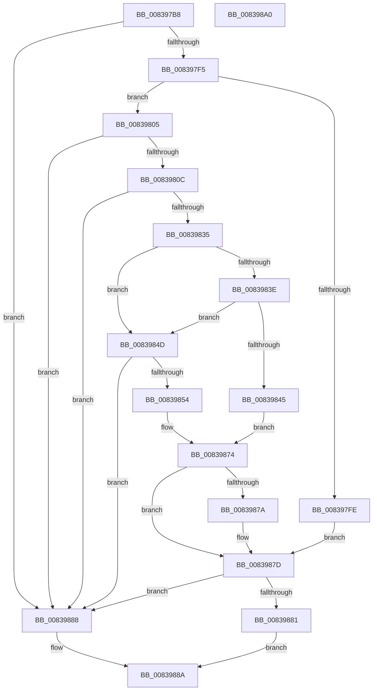

# I_MinAsn1CalculateTimeOffset

- RVA: `0x008397B8`–`0x008398A1` (길이 `233` bytes)
- VA: `0x00000001408397B8`
- 실행 섹션: `PAGE`
- PDB 이름 있음: `예`; PDB Function 태그: `예`
- unwind 정보 RVA: `0x000DAFD0`
- 디코드: `72`개 명령, `233/233` bytes 표시
- 미해석 바이트: `0` (있으면 어셈블리에 `.byte`로 보존)

> 이 문서는 커널 이미지의 기계어와 PDB 기호를 분석해 생성했습니다. 4번과 5번은 함수 원형과 자료형을 바이너리 사용 방식에서 추정한 C 해석이며 원본 소스 복구 결과는 아닙니다.

## 1. Dependencies

- 직접 호출 지점: **1**; 고유 호출 대상: **1**
- 직접 호출자로 확인된 함수: **2**
- RIP 상대 이미지 참조: **0**

### Outgoing calls
- `0x0083982C` → [I_MinAsn1ScanFrac](I_MinAsn1ScanFrac_function_00839B60.md) (function, `0x00839B60`)

### Direct callers
- [MinAsn1DecodeGeneralizedTime](MinAsn1DecodeGeneralizedTime_function_00839C20.md) at `0x00839D83`
- [MinAsn1DecodeUtcTime](MinAsn1DecodeUtcTime_function_00839ECC.md) at `0x00839FBE`

### Static image references
- 디코드된 RIP-relative 메모리 참조가 없습니다.

## 2. Other-region calls and transfers

- 다른 실행 섹션으로 향하는 call: **0**
- 별도 외부 분기/꼬리 이동을 확인하지 못했습니다.

## 3. Assembly (complete function range)

```asm
008397B8  48 8B C4                        mov rax, rsp
008397BB  48 89 58 08                     mov qword ptr [rax + 8], rbx
008397BF  48 89 70 18                     mov qword ptr [rax + 0x18], rsi
008397C3  48 89 78 20                     mov qword ptr [rax + 0x20], rdi
008397C7  41 56                           push r14
008397C9  48 83 EC 40                     sub rsp, 0x40
008397CD  45 33 D2                        xor r10d, r10d
008397D0  4D 8B F1                        mov r14, r9
008397D3  44 21 50 E8                     and dword ptr [rax - 0x18], r10d
008397D7  41 8A F0                        mov sil, r8b
008397DA  44 21 50 EC                     and dword ptr [rax - 0x14], r10d
008397DE  8B DA                           mov ebx, edx
008397E0  44 21 50 10                     and dword ptr [rax + 0x10], r10d
008397E4  48 8B 44 24 70                  mov rax, qword ptr [rsp + 0x70]
008397E9  44 88 10                        mov byte ptr [rax], r10b
008397EC  83 FA 01                        cmp edx, 1
008397EF  0F 82 93 00 00 00               jb 0x140839888
008397F5  40 8A 39                        mov dil, byte ptr [rcx]
008397F8  40 80 FF 5A                     cmp dil, 0x5a
008397FC  75 07                           jne 0x140839805
008397FE  C6 00 01                        mov byte ptr [rax], 1
00839801  FF CB                           dec ebx
00839803  EB 78                           jmp 0x14083987d
00839805  8D 47 D5                        lea eax, [rdi - 0x2b]
00839808  A8 FD                           test al, 0xfd
0083980A  75 7C                           jne 0x140839888
0083980C  48 8D 44 24 34                  lea rax, [rsp + 0x34]
00839811  FF CB                           dec ebx
00839813  48 89 44 24 28                  mov qword ptr [rsp + 0x28], rax
00839818  4C 8D 4C 24 30                  lea r9, [rsp + 0x30]
0083981D  48 8D 44 24 58                  lea rax, [rsp + 0x58]
00839822  48 FF C1                        inc rcx
00839825  8B D3                           mov edx, ebx
00839827  48 89 44 24 20                  mov qword ptr [rsp + 0x20], rax
0083982C  E8 2F 03 00 00                  call 0x140839b60
00839831  84 C0                           test al, al
00839833  74 53                           je 0x140839888
00839835  2B 5C 24 34                     sub ebx, dword ptr [rsp + 0x34]
00839839  40 84 F6                        test sil, sil
0083983C  74 0F                           je 0x14083984d
0083983E  83 7C 24 58 02                  cmp dword ptr [rsp + 0x58], 2
00839843  75 08                           jne 0x14083984d
00839845  44 6B 54 24 30 3C               imul r10d, dword ptr [rsp + 0x30], 0x3c
0083984B  EB 27                           jmp 0x140839874
0083984D  83 7C 24 58 04                  cmp dword ptr [rsp + 0x58], 4
00839852  75 34                           jne 0x140839888
00839854  44 8B 54 24 30                  mov r10d, dword ptr [rsp + 0x30]
00839859  B8 1F 85 EB 51                  mov eax, 0x51eb851f
0083985E  41 F7 EA                        imul r10d
00839861  C1 FA 05                        sar edx, 5
00839864  8B C2                           mov eax, edx
00839866  C1 E8 1F                        shr eax, 0x1f
00839869  03 D0                           add edx, eax
0083986B  8D 04 92                        lea eax, [rdx + rdx*4]
0083986E  C1 E0 03                        shl eax, 3
00839871  44 2B D0                        sub r10d, eax
00839874  40 80 FF 2D                     cmp dil, 0x2d
00839878  75 03                           jne 0x14083987d
0083987A  41 F7 DA                        neg r10d
0083987D  85 DB                           test ebx, ebx
0083987F  75 07                           jne 0x140839888
00839881  45 89 16                        mov dword ptr [r14], r10d
00839884  B0 01                           mov al, 1
00839886  EB 02                           jmp 0x14083988a
00839888  32 C0                           xor al, al
0083988A  48 8B 5C 24 50                  mov rbx, qword ptr [rsp + 0x50]
0083988F  48 8B 74 24 60                  mov rsi, qword ptr [rsp + 0x60]
00839894  48 8B 7C 24 68                  mov rdi, qword ptr [rsp + 0x68]
00839899  48 83 C4 40                     add rsp, 0x40
0083989D  41 5E                           pop r14
0083989F  C3                              ret
008398A0  CC                              int3
```

## 4. C-style interpretation (structured pseudocode)

```c
__int64 __fastcall I_MinAsn1CalculateTimeOffset(__int64 a1, int a2, unsigned __int8 a3, __int64 a4, __int64 a5)
{
    __int64 result;
    __int64 v_r10;
    __int64 v_rbx;
    __int64 v_rsp;
    unsigned __int64 v_stack_m14;
    unsigned __int64 v_stack_m18;
    unsigned __int64 v_stack_m20;
    unsigned __int64 v_stack_m28;
    unsigned __int64 v_stack_p10;
    unsigned __int64 v_stack_p18;
    unsigned __int64 v_stack_p20;
    unsigned __int64 v_stack_p8;

    *(unsigned __int64 *)(v_rsp + 8) = v_rbx;
    *(unsigned __int64 *)(v_rsp + 24) = v_rsi;
    *(unsigned __int64 *)(v_rsp + 32) = v_rdi;
    v_rsp = (v_rsp) - (64);
    v_r10 = 0;
    *(unsigned __int8 *)(a5) = 0;
    if (a2 < 1) goto loc_00839888;
    if (((unsigned __int8)(*(unsigned __int8 *)(a1))) != 90) goto loc_00839805;
    *(unsigned __int8 *)(a5) = 1;
    v_rbx = (unsigned int)(((unsigned int)(a2)) - 1);
    goto loc_0083987D;
loc_00839805:
    if ((((unsigned __int8)(*(unsigned __int8 *)(a1) - 43)) & (253)) != 0) goto loc_00839888;
    v_rbx = (unsigned int)((v_rbx) - 1);
    v_stack_m20 = v_stack_m14;
    a1 = (a1) + 1;
    v_stack_m28 = v_stack_p10;
    result = I_MinAsn1ScanFrac(a1, (unsigned int)((unsigned int)(v_rbx)), a3, v_stack_m18);
    if ((unsigned __int8)(result) == 0) goto loc_00839888;
    v_rbx = (unsigned int)((v_rbx) - (v_stack_m14));
    if (a3 == 0) goto loc_0083984D;
    if (v_stack_p10 != 2) goto loc_0083984D;
    v_r10 = (unsigned int)((v_r10) * (v_stack_m18));
    goto loc_00839874;
loc_0083984D:
    if (v_stack_p10 != 4) goto loc_00839888;
    a2 = (unsigned int)(((unsigned int)((unsigned int)(v_rbx))) >> (5));
    result = (unsigned int)(((unsigned int)(a2)) >> (31));
    a2 = (unsigned int)((a2) + ((unsigned int)(result)));
    result = (unsigned int)((a2 + a2 * 4) << (3));
    v_r10 = (unsigned int)(((unsigned int)(v_stack_m18)) - ((unsigned int)(result)));
loc_00839874:
    if (((unsigned __int8)(*(unsigned __int8 *)(a1))) == 45) {
        v_r10 = (unsigned int)(-(v_r10));
    }
    if ((unsigned int)(v_rbx) != 0) goto loc_00839888;
    *(unsigned int *)(a4) = (unsigned int)(v_r10);
    goto loc_0083988A;
loc_00839888:
    result = 0;
loc_0083988A:
    v_rsp = (v_rsp) + (64);
    return result;
}
```

## 5. (Beta) C Style

```c
int64_t I_MinAsn1CalculateTimeOffset(void *Arg1, int32_t Arg2, uint8_t Arg3, void *Arg4, void *Arg5)
{
    uint8_t *arg1 = (uint8_t *)Arg1;
    uint8_t *arg4 = (uint8_t *)Arg4;
    uint8_t *arg5 = (uint8_t *)Arg5;

    int64_t result;
    int64_t local_r10;
    int64_t local_rbx;
    int64_t local_rsp;
    uint64_t v_stack_m14;
    uint64_t v_stack_m18;
    uint64_t v_stack_m20;
    uint64_t v_stack_m28;
    uint64_t v_stack_p10;
    uint64_t v_stack_p18;
    uint64_t v_stack_p20;
    uint64_t v_stack_p8;

    *(uint64_t *)(local_rsp + 0x8) = local_rbx;
    *(uint64_t *)(local_rsp + 0x18) = local_rsi;
    *(uint64_t *)(local_rsp + 0x20) = local_rdi;
    local_rsp = (local_rsp) - (64);
    local_r10 = 0;
    *(uint8_t *)(arg5) = 0;
    if (Arg2 < 1) goto loc_00839888;
    if (((uint8_t)(*(uint8_t *)(arg1))) != 90) goto loc_00839805;
    *(uint8_t *)(arg5) = 1;
    local_rbx = (uint32_t)(((uint32_t)(Arg2)) - 1);
    goto loc_0083987D;
loc_00839805:
    if ((((uint8_t)(*(uint8_t *)(arg1) - 43)) & (253)) != 0) goto loc_00839888;
    local_rbx = (uint32_t)((local_rbx) - 1);
    v_stack_m20 = v_stack_m14;
    Arg1 = (Arg1) + 1;
    v_stack_m28 = v_stack_p10;
    result = I_MinAsn1ScanFrac(Arg1, (uint32_t)((uint32_t)(local_rbx)), Arg3, v_stack_m18);
    if ((uint8_t)(result) == 0) goto loc_00839888;
    local_rbx = (uint32_t)((local_rbx) - (v_stack_m14));
    if (Arg3 == 0) goto loc_0083984D;
    if (v_stack_p10 != 2) goto loc_0083984D;
    local_r10 = (uint32_t)((local_r10) * (v_stack_m18));
    goto loc_00839874;
loc_0083984D:
    if (v_stack_p10 != 4) goto loc_00839888;
    Arg2 = (uint32_t)(((uint32_t)((uint32_t)(local_rbx))) >> (5));
    result = (uint32_t)(((uint32_t)(Arg2)) >> (31));
    Arg2 = (uint32_t)((Arg2) + ((uint32_t)(result)));
    result = (uint32_t)((Arg2 + Arg2 * 4) << (3));
    local_r10 = (uint32_t)(((uint32_t)(v_stack_m18)) - ((uint32_t)(result)));
loc_00839874:
    if (((uint8_t)(*(uint8_t *)(arg1))) == 45) {
        local_r10 = (uint32_t)(-(local_r10));
    }
    if ((uint32_t)(local_rbx) != 0) goto loc_00839888;
    *(uint32_t *)(arg4) = (uint32_t)(local_r10);
    goto loc_0083988A;
loc_00839888:
    result = 0;
loc_0083988A:
    local_rsp = (local_rsp) + (64);
    return result;
}
```

### 관측된 메모리 오프셋

구조체 형식이 확인되지 않은 접근은 인자 기준의 오프셋으로만 기록했습니다.

| 기준 인자 | 오프셋 표현 | 폭 (bit) | 접근 |
|---|---:|---:|---|
| `Arg1` | `+ 0x0` | `8` | `R` |
| `Arg4` | `+ 0x0` | `32` | `W` |
| `Arg5` | `+ 0x0` | `8` | `W` |

## 6. Execution-region graph

[열기: 2D/3D 그래프와 함수 탐색 컨트롤 패널](../../../control-panel.html?section=page&rva=0x008397B8&view=graph)

- 2D 그래프는 위에서 아래로 흐르고, 3D 그래프는 빈 공간을 드래그해 회전합니다. Shift+드래그는 이동, 휠은 확대·축소, 함수 노드 선택은 대상 보고서 이동입니다.

### Static fallback


