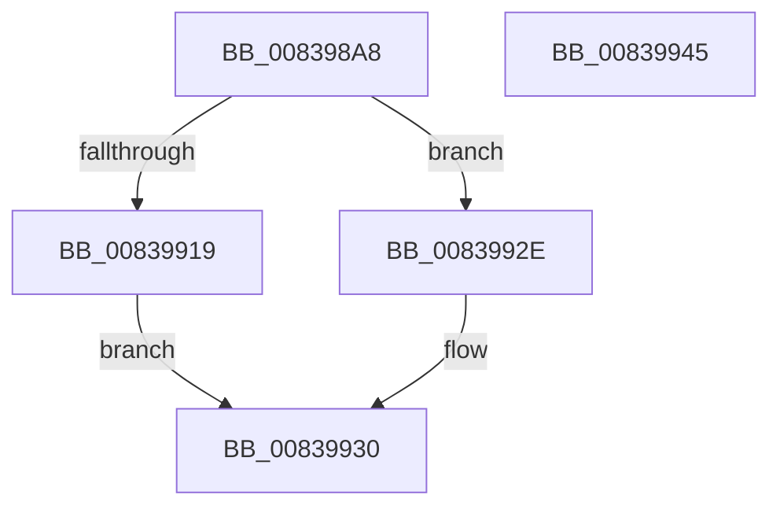

# I_MinAsn1ConvertTime

- RVA: `0x008398A8`–`0x00839946` (길이 `158` bytes)
- VA: `0x00000001408398A8`
- 실행 섹션: `PAGE`
- PDB 이름 있음: `예`; PDB Function 태그: `예`
- unwind 정보 RVA: `0x00066400`
- 디코드: `45`개 명령, `158/158` bytes 표시
- 미해석 바이트: `0` (있으면 어셈블리에 `.byte`로 보존)

> 이 문서는 커널 이미지의 기계어와 PDB 기호를 분석해 생성했습니다. 4번과 5번은 함수 원형과 자료형을 바이너리 사용 방식에서 추정한 C 해석이며 원본 소스 복구 결과는 아닙니다.

## 1. Dependencies

- 직접 호출 지점: **2**; 고유 호출 대상: **2**
- 직접 호출자로 확인된 함수: **2**
- RIP 상대 이미지 참조: **0**

### Outgoing calls
- `0x00839910` → [RtlTimeFieldsToTime](../../text/42/RtlTimeFieldsToTime_function_0042E6B0.md) (function, `0x0042E6B0`)
- `0x00839922` → [I_MinAsn1AdjustFileTime](I_MinAsn1AdjustFileTime_function_008396A4.md) (function, `0x008396A4`)

### Direct callers
- [MinAsn1DecodeGeneralizedTime](MinAsn1DecodeGeneralizedTime_function_00839C20.md) at `0x00839D9A`
- [MinAsn1DecodeUtcTime](MinAsn1DecodeUtcTime_function_00839ECC.md) at `0x00839FE9`

### Static image references
- 디코드된 RIP-relative 메모리 참조가 없습니다.

## 2. Other-region calls and transfers

- 다른 실행 섹션으로 향하는 call: **1**
  - `0x00839910` → [RtlTimeFieldsToTime](../../text/42/RtlTimeFieldsToTime_function_0042E6B0.md) (`PAGE` → `.text`)
- 별도 외부 분기/꼬리 이동을 확인하지 못했습니다.

## 3. Assembly (complete function range)

```asm
008398A8  48 8B C4                        mov rax, rsp
008398AB  48 89 58 08                     mov qword ptr [rax + 8], rbx
008398AF  48 89 68 10                     mov qword ptr [rax + 0x10], rbp
008398B3  48 89 70 18                     mov qword ptr [rax + 0x18], rsi
008398B7  57                              push rdi
008398B8  48 83 EC 30                     sub rsp, 0x30
008398BC  8B F2                           mov esi, edx
008398BE  33 ED                           xor ebp, ebp
008398C0  66 89 68 F6                     mov word ptr [rax - 0xa], bp
008398C4  49 8B D1                        mov rdx, r9
008398C7  0F B7 01                        movzx eax, word ptr [rcx]
008398CA  49 8B D9                        mov rbx, r9
008398CD  66 89 44 24 20                  mov word ptr [rsp + 0x20], ax
008398D2  41 8A F8                        mov dil, r8b
008398D5  0F B7 41 04                     movzx eax, word ptr [rcx + 4]
008398D9  66 89 44 24 22                  mov word ptr [rsp + 0x22], ax
008398DE  0F B7 41 08                     movzx eax, word ptr [rcx + 8]
008398E2  66 89 44 24 24                  mov word ptr [rsp + 0x24], ax
008398E7  0F B7 41 0C                     movzx eax, word ptr [rcx + 0xc]
008398EB  66 89 44 24 26                  mov word ptr [rsp + 0x26], ax
008398F0  0F B7 41 10                     movzx eax, word ptr [rcx + 0x10]
008398F4  66 89 44 24 28                  mov word ptr [rsp + 0x28], ax
008398F9  0F B7 41 14                     movzx eax, word ptr [rcx + 0x14]
008398FD  66 89 44 24 2A                  mov word ptr [rsp + 0x2a], ax
00839902  0F B7 41 18                     movzx eax, word ptr [rcx + 0x18]
00839906  48 8D 4C 24 20                  lea rcx, [rsp + 0x20]
0083990B  66 89 44 24 2C                  mov word ptr [rsp + 0x2c], ax
00839910  E8 9B 4D BF FF                  call 0x14042e6b0
00839915  84 C0                           test al, al
00839917  74 15                           je 0x14083992e
00839919  44 8A C7                        mov r8b, dil
0083991C  0F B7 D6                        movzx edx, si
0083991F  48 8B CB                        mov rcx, rbx
00839922  E8 7D FD FF FF                  call 0x1408396a4
00839927  84 C0                           test al, al
00839929  0F 95 C0                        setne al
0083992C  EB 02                           jmp 0x140839930
0083992E  32 C0                           xor al, al
00839930  48 8B 5C 24 40                  mov rbx, qword ptr [rsp + 0x40]
00839935  48 8B 6C 24 48                  mov rbp, qword ptr [rsp + 0x48]
0083993A  48 8B 74 24 50                  mov rsi, qword ptr [rsp + 0x50]
0083993F  48 83 C4 30                     add rsp, 0x30
00839943  5F                              pop rdi
00839944  C3                              ret
00839945  CC                              int3
```

## 4. C-style interpretation (structured pseudocode)

```c
__int64 __fastcall I_MinAsn1ConvertTime(__int64 a1, int a2, unsigned __int8 a3, __int64 a4)
{
    __int64 result;
    __int64 v_rbp;
    __int64 v_rsp;
    unsigned __int16 v_stack_m10;
    unsigned __int16 v_stack_m12;
    unsigned __int16 v_stack_m14;
    unsigned __int16 v_stack_m16;
    unsigned __int16 v_stack_m18;
    unsigned __int16 v_stack_mC;
    unsigned __int16 v_stack_mE;
    unsigned __int64 v_stack_p10;
    unsigned __int64 v_stack_p18;
    unsigned __int64 v_stack_p8;

    *(unsigned __int64 *)(v_rsp + 8) = v_rbx;
    *(unsigned __int64 *)(v_rsp + 16) = v_rbp;
    *(unsigned __int64 *)(v_rsp + 24) = v_rsi;
    v_rsp = (v_rsp) - (48);
    v_rbp = 0;
    *(unsigned __int16 *)(v_rsp - 10) = 0;
    v_stack_m18 = (unsigned __int16)(*(unsigned __int16 *)(a1));
    v_stack_m16 = (unsigned __int16)(*(unsigned __int16 *)(a1 + 4));
    v_stack_m14 = (unsigned __int16)(*(unsigned __int16 *)(a1 + 8));
    v_stack_m12 = (unsigned __int16)(*(unsigned __int16 *)(a1 + 12));
    v_stack_m10 = (unsigned __int16)(*(unsigned __int16 *)(a1 + 16));
    v_stack_mE = (unsigned __int16)(*(unsigned __int16 *)(a1 + 20));
    v_stack_mC = (unsigned __int16)(*(unsigned __int16 *)(a1 + 24));
    result = RtlTimeFieldsToTime(v_stack_m18, a4, a3, a4);
    if ((unsigned __int8)(result) == 0) goto loc_0083992E;
    result = I_MinAsn1AdjustFileTime(a4, (unsigned __int16)((unsigned int)(a2)), a3, a4);
    result = ((unsigned __int8)(result) != 0) ? 1 : 0;
    goto loc_00839930;
loc_0083992E:
    result = 0;
loc_00839930:
    v_rsp = (v_rsp) + (48);
    return result;
}
```

## 5. (Beta) C Style

```c
int64_t I_MinAsn1ConvertTime(void *Arg1, int32_t Arg2, uint8_t Arg3, int64_t Arg4)
{
    uint8_t *arg1 = (uint8_t *)Arg1;

    int64_t result;
    int64_t local_rbp;
    int64_t local_rsp;
    uint16_t v_stack_m10;
    uint16_t v_stack_m12;
    uint16_t v_stack_m14;
    uint16_t v_stack_m16;
    uint16_t v_stack_m18;
    uint16_t v_stack_mC;
    uint16_t v_stack_mE;
    uint64_t v_stack_p10;
    uint64_t v_stack_p18;
    uint64_t v_stack_p8;

    *(uint64_t *)(local_rsp + 0x8) = local_rbx;
    *(uint64_t *)(local_rsp + 0x10) = local_rbp;
    *(uint64_t *)(local_rsp + 0x18) = local_rsi;
    local_rsp = (local_rsp) - (48);
    local_rbp = 0;
    *(uint16_t *)(local_rsp - 0xA) = 0;
    v_stack_m18 = (uint16_t)(*(uint16_t *)(arg1));
    v_stack_m16 = (uint16_t)(*(uint16_t *)(arg1 + 0x4));
    v_stack_m14 = (uint16_t)(*(uint16_t *)(arg1 + 0x8));
    v_stack_m12 = (uint16_t)(*(uint16_t *)(arg1 + 0xC));
    v_stack_m10 = (uint16_t)(*(uint16_t *)(arg1 + 0x10));
    v_stack_mE = (uint16_t)(*(uint16_t *)(arg1 + 0x14));
    v_stack_mC = (uint16_t)(*(uint16_t *)(arg1 + 0x18));
    result = RtlTimeFieldsToTime(v_stack_m18, Arg4, Arg3, Arg4);
    if ((uint8_t)(result) == 0) goto loc_0083992E;
    result = I_MinAsn1AdjustFileTime(Arg4, (uint16_t)((uint32_t)(Arg2)), Arg3, Arg4);
    result = ((uint8_t)(result) != 0) ? 1 : 0;
    goto loc_00839930;
loc_0083992E:
    result = 0;
loc_00839930:
    local_rsp = (local_rsp) + (48);
    return result;
}
```

### 관측된 메모리 오프셋

구조체 형식이 확인되지 않은 접근은 인자 기준의 오프셋으로만 기록했습니다.

| 기준 인자 | 오프셋 표현 | 폭 (bit) | 접근 |
|---|---:|---:|---|
| `Arg1` | `+ 0x0` | `16` | `R` |
| `Arg1` | `+ 0x4` | `16` | `R` |
| `Arg1` | `+ 0x8` | `16` | `R` |
| `Arg1` | `+ 0xC` | `16` | `R` |
| `Arg1` | `+ 0x10` | `16` | `R` |
| `Arg1` | `+ 0x14` | `16` | `R` |
| `Arg1` | `+ 0x18` | `16` | `R` |

## 6. Execution-region graph

[열기: 2D/3D 그래프와 함수 탐색 컨트롤 패널](../../../control-panel.html?section=page&rva=0x008398A8&view=graph)

- 2D 그래프는 위에서 아래로 흐르고, 3D 그래프는 빈 공간을 드래그해 회전합니다. Shift+드래그는 이동, 휠은 확대·축소, 함수 노드 선택은 대상 보고서 이동입니다.

### Static fallback


