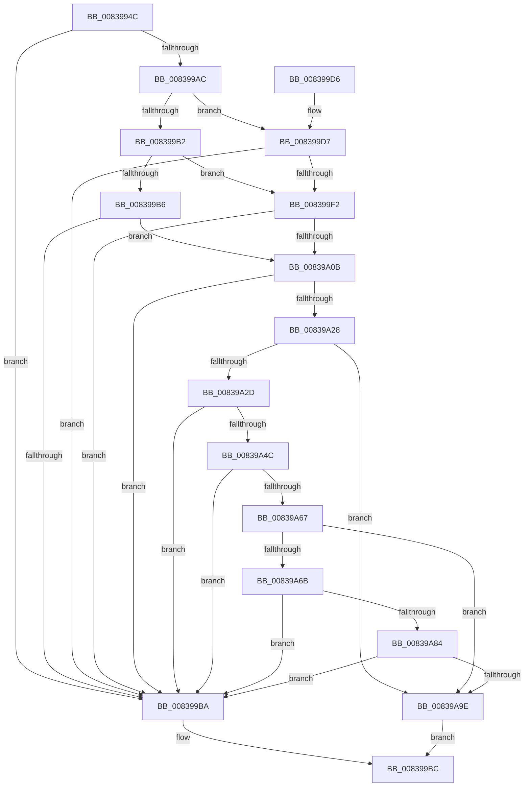

# I_MinAsn1DecodeGeneralizedTimeFraction

- RVA: `0x0083994C`–`0x00839AAE` (길이 `354` bytes)
- VA: `0x000000014083994C`
- 실행 섹션: `PAGE`
- PDB 이름 있음: `예`; PDB Function 태그: `예`
- unwind 정보 RVA: `0x000DAFA0`
- 디코드: `104`개 명령, `354/354` bytes 표시
- 미해석 바이트: `0` (있으면 어셈블리에 `.byte`로 보존)

> 이 문서는 커널 이미지의 기계어와 PDB 기호를 분석해 생성했습니다. 4번과 5번은 함수 원형과 자료형을 바이너리 사용 방식에서 추정한 C 해석이며 원본 소스 복구 결과는 아닙니다.

## 1. Dependencies

- 직접 호출 지점: **8**; 고유 호출 대상: **3**
- 직접 호출자로 확인된 함수: **1**
- RIP 상대 이미지 참조: **0**

### Outgoing calls
- `0x008399A3` → [I_MinAsn1ScanFrac](I_MinAsn1ScanFrac_function_00839B60.md) (function, `0x00839B60`)
- `0x008399E9` → [I_MinAsn1MultiplyAndDivide](I_MinAsn1MultiplyAndDivide_function_00839AB4.md) (function, `0x00839AB4`)
- `0x00839A02` → [I_MinAsn1MultiplyAndDivide](I_MinAsn1MultiplyAndDivide_function_00839AB4.md) (function, `0x00839AB4`)
- `0x00839A1F` → [I_MinAsn1MultiplyAndDivide](I_MinAsn1MultiplyAndDivide_function_00839AB4.md) (function, `0x00839AB4`)
- `0x00839A3F` → [RtlLongLongToInt](../../text/6A/RtlLongLongToInt_function_006A64B0.md) (function, `0x006A64B0`)
- `0x00839A5A` → [RtlLongLongToInt](../../text/6A/RtlLongLongToInt_function_006A64B0.md) (function, `0x006A64B0`)
- `0x00839A77` → [RtlLongLongToInt](../../text/6A/RtlLongLongToInt_function_006A64B0.md) (function, `0x006A64B0`)
- `0x00839A91` → [RtlLongLongToInt](../../text/6A/RtlLongLongToInt_function_006A64B0.md) (function, `0x006A64B0`)

### Direct callers
- [MinAsn1DecodeGeneralizedTime](MinAsn1DecodeGeneralizedTime_function_00839C20.md) at `0x00839D5C`

### Static image references
- 디코드된 RIP-relative 메모리 참조가 없습니다.

## 2. Other-region calls and transfers

- 다른 실행 섹션으로 향하는 call: **4**
  - `0x00839A3F` → [RtlLongLongToInt](../../text/6A/RtlLongLongToInt_function_006A64B0.md) (`PAGE` → `.text`)
  - `0x00839A5A` → [RtlLongLongToInt](../../text/6A/RtlLongLongToInt_function_006A64B0.md) (`PAGE` → `.text`)
  - `0x00839A77` → [RtlLongLongToInt](../../text/6A/RtlLongLongToInt_function_006A64B0.md) (`PAGE` → `.text`)
  - `0x00839A91` → [RtlLongLongToInt](../../text/6A/RtlLongLongToInt_function_006A64B0.md) (`PAGE` → `.text`)
- 별도 외부 분기/꼬리 이동을 확인하지 못했습니다.

## 3. Assembly (complete function range)

```asm
0083994C  4C 8B DC                        mov r11, rsp
0083994F  49 89 5B 08                     mov qword ptr [r11 + 8], rbx
00839953  49 89 73 10                     mov qword ptr [r11 + 0x10], rsi
00839957  49 89 7B 18                     mov qword ptr [r11 + 0x18], rdi
0083995B  4D 89 63 20                     mov qword ptr [r11 + 0x20], r12
0083995F  55                              push rbp
00839960  48 8B EC                        mov rbp, rsp
00839963  48 83 EC 40                     sub rsp, 0x40
00839967  83 65 F4 00                     and dword ptr [rbp - 0xc], 0
0083996B  8B D9                           mov ebx, ecx
0083996D  83 65 F0 00                     and dword ptr [rbp - 0x10], 0
00839971  48 8D 4D FC                     lea rcx, [rbp - 4]
00839975  83 65 F8 00                     and dword ptr [rbp - 8], 0
00839979  41 8B C0                        mov eax, r8d
0083997C  83 65 FC 00                     and dword ptr [rbp - 4], 0
00839980  4C 8B D2                        mov r10, rdx
00839983  49 89 4B E0                     mov qword ptr [r11 - 0x20], rcx
00839987  49 8B F1                        mov rsi, r9
0083998A  48 8D 4D F0                     lea rcx, [rbp - 0x10]
0083998E  45 33 C0                        xor r8d, r8d
00839991  49 89 4B D8                     mov qword ptr [r11 - 0x28], rcx
00839995  4C 8D 4D F4                     lea r9, [rbp - 0xc]
00839999  49 8B CA                        mov rcx, r10
0083999C  8B D0                           mov edx, eax
0083999E  BF 01 00 00 00                  mov edi, 1
008399A3  E8 B8 01 00 00                  call 0x140839b60
008399A8  84 C0                           test al, al
008399AA  74 0E                           je 0x1408399ba
008399AC  8B CB                           mov ecx, ebx
008399AE  85 DB                           test ebx, ebx
008399B0  74 25                           je 0x1408399d7
008399B2  2B CF                           sub ecx, edi
008399B4  74 3C                           je 0x1408399f2
008399B6  3B CF                           cmp ecx, edi
008399B8  74 51                           je 0x140839a0b
008399BA  32 C0                           xor al, al
008399BC  48 8B 5C 24 50                  mov rbx, qword ptr [rsp + 0x50]
008399C1  48 8B 74 24 58                  mov rsi, qword ptr [rsp + 0x58]
008399C6  48 8B 7C 24 60                  mov rdi, qword ptr [rsp + 0x60]
008399CB  4C 8B 64 24 68                  mov r12, qword ptr [rsp + 0x68]
008399D0  48 83 C4 40                     add rsp, 0x40
008399D4  5D                              pop rbp
008399D5  C3                              ret
008399D6  CC                              int3
008399D7  44 8B 45 F0                     mov r8d, dword ptr [rbp - 0x10]
008399DB  4C 8D 4E 10                     lea r9, [rsi + 0x10]
008399DF  8B 55 F4                        mov edx, dword ptr [rbp - 0xc]
008399E2  BF 3C 00 00 00                  mov edi, 0x3c
008399E7  8B CF                           mov ecx, edi
008399E9  E8 C6 00 00 00                  call 0x140839ab4
008399EE  84 C0                           test al, al
008399F0  74 C8                           je 0x1408399ba
008399F2  44 8B 45 F0                     mov r8d, dword ptr [rbp - 0x10]
008399F6  4C 8D 4E 14                     lea r9, [rsi + 0x14]
008399FA  8B 55 F4                        mov edx, dword ptr [rbp - 0xc]
008399FD  6B FF 3C                        imul edi, edi, 0x3c
00839A00  8B CF                           mov ecx, edi
00839A02  E8 AD 00 00 00                  call 0x140839ab4
00839A07  84 C0                           test al, al
00839A09  74 AF                           je 0x1408399ba
00839A0B  44 8B 45 F0                     mov r8d, dword ptr [rbp - 0x10]
00839A0F  4C 8D 66 18                     lea r12, [rsi + 0x18]
00839A13  8B 55 F4                        mov edx, dword ptr [rbp - 0xc]
00839A16  4D 8B CC                        mov r9, r12
00839A19  69 CF E8 03 00 00               imul ecx, edi, 0x3e8
00839A1F  E8 90 00 00 00                  call 0x140839ab4
00839A24  84 C0                           test al, al
00839A26  74 92                           je 0x1408399ba
00839A28  83 FB 01                        cmp ebx, 1
00839A2B  7F 71                           jg 0x140839a9e
00839A2D  4C 8D 4E 14                     lea r9, [rsi + 0x14]
00839A31  49 63 01                        movsxd rax, dword ptr [r9]
00839A34  48 8D 55 F8                     lea rdx, [rbp - 8]
00839A38  48 69 C8 E8 03 00 00            imul rcx, rax, 0x3e8
00839A3F  E8 6C CA E6 FF                  call 0x1406a64b0
00839A44  85 C0                           test eax, eax
00839A46  0F 88 6E FF FF FF               js 0x1408399ba
00839A4C  49 63 0C 24                     movsxd rcx, dword ptr [r12]
00839A50  49 8B D4                        mov rdx, r12
00839A53  48 63 45 F8                     movsxd rax, dword ptr [rbp - 8]
00839A57  48 2B C8                        sub rcx, rax
00839A5A  E8 51 CA E6 FF                  call 0x1406a64b0
00839A5F  85 C0                           test eax, eax
00839A61  0F 88 53 FF FF FF               js 0x1408399ba
00839A67  85 DB                           test ebx, ebx
00839A69  75 33                           jne 0x140839a9e
00839A6B  48 63 46 10                     movsxd rax, dword ptr [rsi + 0x10]
00839A6F  48 8D 55 F8                     lea rdx, [rbp - 8]
00839A73  48 6B C8 3C                     imul rcx, rax, 0x3c
00839A77  E8 34 CA E6 FF                  call 0x1406a64b0
00839A7C  85 C0                           test eax, eax
00839A7E  0F 88 36 FF FF FF               js 0x1408399ba
00839A84  49 63 09                        movsxd rcx, dword ptr [r9]
00839A87  49 8B D1                        mov rdx, r9
00839A8A  4C 63 45 F8                     movsxd r8, dword ptr [rbp - 8]
00839A8E  49 2B C8                        sub rcx, r8
00839A91  E8 1A CA E6 FF                  call 0x1406a64b0
00839A96  85 C0                           test eax, eax
00839A98  0F 88 1C FF FF FF               js 0x1408399ba
00839A9E  48 8B 55 30                     mov rdx, qword ptr [rbp + 0x30]
00839AA2  B0 01                           mov al, 1
00839AA4  8B 4D FC                        mov ecx, dword ptr [rbp - 4]
00839AA7  89 0A                           mov dword ptr [rdx], ecx
00839AA9  E9 0E FF FF FF                  jmp 0x1408399bc
```

## 4. C-style interpretation (structured pseudocode)

```c
__int64 __fastcall I_MinAsn1DecodeGeneralizedTimeFraction(int a1, __int64 a2, int a3, __int64 a4, __int64 a5)
{
    __int64 result;
    __int64 v_rdi;
    __int64 v_rsp;
    unsigned int v_stack_m10;
    unsigned int v_stack_m14;
    unsigned int v_stack_m18;
    unsigned __int64 v_stack_mC;
    unsigned __int64 v_stack_p10;
    unsigned __int64 v_stack_p18;
    unsigned __int64 v_stack_p20;
    unsigned __int64 v_stack_p8;

    *(unsigned __int64 *)(v_rsp + 8) = v_rbx;
    *(unsigned __int64 *)(v_rsp + 16) = v_rsi;
    *(unsigned __int64 *)(v_rsp + 24) = v_rdi;
    *(unsigned __int64 *)(v_rsp + 32) = v_r12;
    v_rsp = (v_rsp) - (64);
    *(unsigned __int64 *)(v_rsp - 32) = v_stack_mC;
    a3 = 0;
    *(unsigned __int64 *)(v_rsp - 40) = v_stack_m18;
    result = I_MinAsn1ScanFrac(a2, (unsigned int)((unsigned int)((unsigned int)(a3))), a3, v_stack_m14);
    if ((unsigned __int8)(result) == 0) goto loc_008399BA;
    if ((unsigned int)((unsigned int)(a1)) == 0) goto loc_008399D7;
    a1 = (unsigned int)(((unsigned int)((unsigned int)((unsigned int)(a1)))) - (1));
    if (condition_is_equal) goto loc_008399F2;
    if (a1 == 1) goto loc_00839A0B;
loc_008399BA:
    result = 0;
loc_008399BC:
    v_rsp = (v_rsp) + (64);
    return result;
loc_008399D7:
    result = I_MinAsn1MultiplyAndDivide(60, (unsigned int)(v_stack_m14), (unsigned int)(v_stack_m18), v_stack_p10 + 16);
    if ((unsigned __int8)(result) == 0) goto loc_008399BA;
loc_008399F2:
    v_rdi = (unsigned int)((60) * (60));
    result = I_MinAsn1MultiplyAndDivide((unsigned int)((unsigned int)(v_rdi)), (unsigned int)(v_stack_m14), (unsigned int)(v_stack_m18), v_stack_p10 + 20);
    if ((unsigned __int8)(result) == 0) goto loc_008399BA;
loc_00839A0B:
    a1 = (unsigned int)(((unsigned int)((unsigned int)(v_rdi))) * ((unsigned int)(v_rdi)));
    result = I_MinAsn1MultiplyAndDivide(a1, (unsigned int)(v_stack_m14), (unsigned int)(v_stack_m18), v_stack_p10 + 24);
    if ((unsigned __int8)(result) == 0) goto loc_008399BA;
    if (((unsigned int)(v_stack_p8)) > 1) goto loc_00839A9E;
    a1 = (a1) * ((int)(*(unsigned int *)(v_stack_p10 + 20)));
    result = RtlLongLongToInt(a1, v_stack_m10, (unsigned int)(v_stack_m18), v_stack_p10 + 20);
    if (sign_flag) goto loc_008399BA;
    a1 = ((int)(*(unsigned int *)(v_stack_p10 + 24))) - ((int)(v_stack_m10));
    result = RtlLongLongToInt(a1, v_stack_p10 + 24, (unsigned int)(v_stack_m18), v_stack_p10 + 20);
    if (sign_flag) goto loc_008399BA;
    if ((unsigned int)(v_stack_p8) != 0) goto loc_00839A9E;
    a1 = (a1) * ((int)(*(unsigned int *)(v_stack_p10 + 16)));
    result = RtlLongLongToInt(a1, v_stack_m10, (unsigned int)(v_stack_m18), v_stack_p10 + 20);
    if (sign_flag) goto loc_008399BA;
    a1 = ((int)(*(unsigned int *)(v_stack_p10 + 20))) - ((int)(v_stack_m10));
    result = RtlLongLongToInt(a1, v_stack_p10 + 20, (int)(v_stack_m10), v_stack_p10 + 20);
    if (sign_flag) goto loc_008399BA;
loc_00839A9E:
    *(unsigned int *)(a5) = (unsigned int)((unsigned int)(v_stack_mC));
    goto loc_008399BC;
}
```

## 5. (Beta) C Style

```c
int64_t I_MinAsn1DecodeGeneralizedTimeFraction(int32_t Arg1, int64_t Arg2, int32_t Arg3, void *Arg4, void *Arg5)
{
    uint8_t *arg4 = (uint8_t *)Arg4;
    uint8_t *arg5 = (uint8_t *)Arg5;

    int64_t result;
    int64_t local_rdi;
    int64_t local_rsp;
    uint32_t v_stack_m10;
    uint32_t v_stack_m14;
    uint32_t v_stack_m18;
    uint64_t v_stack_mC;
    uint64_t v_stack_p10;
    uint64_t v_stack_p18;
    uint64_t v_stack_p20;
    uint64_t v_stack_p8;

    *(uint64_t *)(local_rsp + 0x8) = local_rbx;
    *(uint64_t *)(local_rsp + 0x10) = local_rsi;
    *(uint64_t *)(local_rsp + 0x18) = local_rdi;
    *(uint64_t *)(local_rsp + 0x20) = local_r12;
    local_rsp = (local_rsp) - (64);
    *(uint64_t *)(local_rsp - 0x20) = v_stack_mC;
    Arg3 = 0;
    *(uint64_t *)(local_rsp - 0x28) = v_stack_m18;
    result = I_MinAsn1ScanFrac(Arg2, (uint32_t)((uint32_t)((uint32_t)(Arg3))), Arg3, v_stack_m14);
    if ((uint8_t)(result) == 0) goto loc_008399BA;
    if ((uint32_t)((uint32_t)(Arg1)) == 0) goto loc_008399D7;
    Arg1 = (uint32_t)(((uint32_t)((uint32_t)((uint32_t)(Arg1)))) - (1));
    if (condition_is_equal) goto loc_008399F2;
    if (Arg1 == 1) goto loc_00839A0B;
loc_008399BA:
    result = 0;
loc_008399BC:
    local_rsp = (local_rsp) + (64);
    return result;
loc_008399D7:
    result = I_MinAsn1MultiplyAndDivide(60, (uint32_t)(v_stack_m14), (uint32_t)(v_stack_m18), v_stack_p10 + 16);
    if ((uint8_t)(result) == 0) goto loc_008399BA;
loc_008399F2:
    local_rdi = (uint32_t)((60) * (60));
    result = I_MinAsn1MultiplyAndDivide((uint32_t)((uint32_t)(local_rdi)), (uint32_t)(v_stack_m14), (uint32_t)(v_stack_m18), v_stack_p10 + 20);
    if ((uint8_t)(result) == 0) goto loc_008399BA;
loc_00839A0B:
    Arg1 = (uint32_t)(((uint32_t)((uint32_t)(local_rdi))) * ((uint32_t)(local_rdi)));
    result = I_MinAsn1MultiplyAndDivide(Arg1, (uint32_t)(v_stack_m14), (uint32_t)(v_stack_m18), v_stack_p10 + 24);
    if ((uint8_t)(result) == 0) goto loc_008399BA;
    if (((uint32_t)(v_stack_p8)) > 1) goto loc_00839A9E;
    Arg1 = (Arg1) * ((int32_t)(*(uint32_t *)(v_stack_p10 + 0x14)));
    result = RtlLongLongToInt(Arg1, v_stack_m10, (uint32_t)(v_stack_m18), v_stack_p10 + 20);
    if (sign_flag) goto loc_008399BA;
    Arg1 = ((int32_t)(*(uint32_t *)(v_stack_p10 + 0x18))) - ((int32_t)(v_stack_m10));
    result = RtlLongLongToInt(Arg1, v_stack_p10 + 24, (uint32_t)(v_stack_m18), v_stack_p10 + 20);
    if (sign_flag) goto loc_008399BA;
    if ((uint32_t)(v_stack_p8) != 0) goto loc_00839A9E;
    Arg1 = (Arg1) * ((int32_t)(*(uint32_t *)(v_stack_p10 + 0x10)));
    result = RtlLongLongToInt(Arg1, v_stack_m10, (uint32_t)(v_stack_m18), v_stack_p10 + 20);
    if (sign_flag) goto loc_008399BA;
    Arg1 = ((int32_t)(*(uint32_t *)(v_stack_p10 + 0x14))) - ((int32_t)(v_stack_m10));
    result = RtlLongLongToInt(Arg1, v_stack_p10 + 20, (int32_t)(v_stack_m10), v_stack_p10 + 20);
    if (sign_flag) goto loc_008399BA;
loc_00839A9E:
    *(uint32_t *)(arg5) = (uint32_t)((uint32_t)(v_stack_mC));
    goto loc_008399BC;
}
```

### 관측된 메모리 오프셋

구조체 형식이 확인되지 않은 접근은 인자 기준의 오프셋으로만 기록했습니다.

| 기준 인자 | 오프셋 표현 | 폭 (bit) | 접근 |
|---|---:|---:|---|
| `Arg4` | `+ 0x0` | `32` | `R` |
| `Arg4` | `+ 0x10` | `32` | `R` |
| `Arg4` | `+ 0x10` | `64` | `R` |
| `Arg4` | `+ 0x14` | `64` | `R` |
| `Arg4` | `+ 0x18` | `64` | `R` |
| `Arg5` | `+ 0x0` | `32` | `W` |

## 6. Execution-region graph

[열기: 2D/3D 그래프와 함수 탐색 컨트롤 패널](../../../control-panel.html?section=page&rva=0x0083994C&view=graph)

- 2D 그래프는 위에서 아래로 흐르고, 3D 그래프는 빈 공간을 드래그해 회전합니다. Shift+드래그는 이동, 휠은 확대·축소, 함수 노드 선택은 대상 보고서 이동입니다.

### Static fallback


