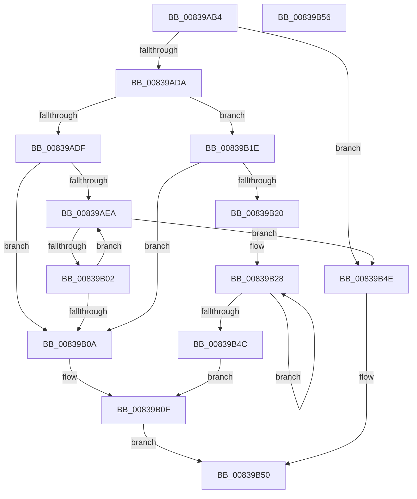

# I_MinAsn1MultiplyAndDivide

- RVA: `0x00839AB4`–`0x00839B57` (길이 `163` bytes)
- VA: `0x0000000140839AB4`
- 실행 섹션: `PAGE`
- PDB 이름 있음: `예`; PDB Function 태그: `예`
- unwind 정보 RVA: `0x00064C80`
- 디코드: `50`개 명령, `163/163` bytes 표시
- 미해석 바이트: `0` (있으면 어셈블리에 `.byte`로 보존)

> 이 문서는 커널 이미지의 기계어와 PDB 기호를 분석해 생성했습니다. 4번과 5번은 함수 원형과 자료형을 바이너리 사용 방식에서 추정한 C 해석이며 원본 소스 복구 결과는 아닙니다.

## 1. Dependencies

- 직접 호출 지점: **3**; 고유 호출 대상: **2**
- 직접 호출자로 확인된 함수: **1**
- RIP 상대 이미지 참조: **0**

### Outgoing calls
- `0x00839AD1` → [RtlLongLongMult](../../text/6A/RtlLongLongMult_function_006A647C.md) (function, `0x006A647C`)
- `0x00839AF9` → [RtlLongLongMult](../../text/6A/RtlLongLongMult_function_006A647C.md) (function, `0x006A647C`)
- `0x00839B12` → [RtlLongLongToInt](../../text/6A/RtlLongLongToInt_function_006A64B0.md) (function, `0x006A64B0`)

### Direct callers
- [I_MinAsn1DecodeGeneralizedTimeFraction](I_MinAsn1DecodeGeneralizedTimeFraction_function_0083994C.md) at `0x008399E9`
- [I_MinAsn1DecodeGeneralizedTimeFraction](I_MinAsn1DecodeGeneralizedTimeFraction_function_0083994C.md) at `0x00839A02`
- [I_MinAsn1DecodeGeneralizedTimeFraction](I_MinAsn1DecodeGeneralizedTimeFraction_function_0083994C.md) at `0x00839A1F`

### Static image references
- 디코드된 RIP-relative 메모리 참조가 없습니다.

## 2. Other-region calls and transfers

- 다른 실행 섹션으로 향하는 call: **3**
  - `0x00839AD1` → [RtlLongLongMult](../../text/6A/RtlLongLongMult_function_006A647C.md) (`PAGE` → `.text`)
  - `0x00839AF9` → [RtlLongLongMult](../../text/6A/RtlLongLongMult_function_006A647C.md) (`PAGE` → `.text`)
  - `0x00839B12` → [RtlLongLongToInt](../../text/6A/RtlLongLongToInt_function_006A64B0.md) (`PAGE` → `.text`)
- 별도 외부 분기/꼬리 이동을 확인하지 못했습니다.

## 3. Assembly (complete function range)

```asm
00839AB4  40 53                           push rbx
00839AB6  48 83 EC 30                     sub rsp, 0x30
00839ABA  48 83 64 24 20 00               and qword ptr [rsp + 0x20], 0
00839AC0  49 8B D9                        mov rbx, r9
00839AC3  45 8B D0                        mov r10d, r8d
00839AC6  4C 8D 44 24 20                  lea r8, [rsp + 0x20]
00839ACB  48 63 D2                        movsxd rdx, edx
00839ACE  48 63 C9                        movsxd rcx, ecx
00839AD1  E8 A6 C9 E6 FF                  call 0x1406a647c
00839AD6  85 C0                           test eax, eax
00839AD8  78 74                           js 0x140839b4e
00839ADA  45 85 D2                        test r10d, r10d
00839ADD  79 3F                           jns 0x140839b1e
00839ADF  41 F7 DA                        neg r10d
00839AE2  45 33 DB                        xor r11d, r11d
00839AE5  45 85 D2                        test r10d, r10d
00839AE8  7E 20                           jle 0x140839b0a
00839AEA  48 8B 4C 24 20                  mov rcx, qword ptr [rsp + 0x20]
00839AEF  4C 8D 44 24 20                  lea r8, [rsp + 0x20]
00839AF4  BA 0A 00 00 00                  mov edx, 0xa
00839AF9  E8 7E C9 E6 FF                  call 0x1406a647c
00839AFE  85 C0                           test eax, eax
00839B00  78 4C                           js 0x140839b4e
00839B02  41 FF C3                        inc r11d
00839B05  45 3B DA                        cmp r11d, r10d
00839B08  7C E0                           jl 0x140839aea
00839B0A  48 8B 4C 24 20                  mov rcx, qword ptr [rsp + 0x20]
00839B0F  48 8B D3                        mov rdx, rbx
00839B12  E8 99 C9 E6 FF                  call 0x1406a64b0
00839B17  85 C0                           test eax, eax
00839B19  0F 99 C0                        setns al
00839B1C  EB 32                           jmp 0x140839b50
00839B1E  7E EA                           jle 0x140839b0a
00839B20  48 8B 4C 24 20                  mov rcx, qword ptr [rsp + 0x20]
00839B25  4D 8B C2                        mov r8, r10
00839B28  48 B8 67 66 66 66 66 66 66 66   movabs rax, 0x6666666666666667
00839B32  48 F7 E9                        imul rcx
00839B35  48 8B CA                        mov rcx, rdx
00839B38  48 C1 F9 02                     sar rcx, 2
00839B3C  48 8B C1                        mov rax, rcx
00839B3F  48 C1 E8 3F                     shr rax, 0x3f
00839B43  48 03 C8                        add rcx, rax
00839B46  49 83 E8 01                     sub r8, 1
00839B4A  75 DC                           jne 0x140839b28
00839B4C  EB C1                           jmp 0x140839b0f
00839B4E  32 C0                           xor al, al
00839B50  48 83 C4 30                     add rsp, 0x30
00839B54  5B                              pop rbx
00839B55  C3                              ret
00839B56  CC                              int3
```

## 4. C-style interpretation (structured pseudocode)

```c
__int64 __fastcall I_MinAsn1MultiplyAndDivide(int a1, int a2, int a3, __int64 a4)
{
    __int64 result;
    __int64 v_r10;
    __int64 v_r11;
    __int64 v_rsp;
    unsigned __int64 v_stack_m18;

    v_rsp = (v_rsp) - (48);
    result = RtlLongLongMult((int)(a1), (int)(a2), v_stack_m18, a4);
    if (sign_flag) goto loc_00839B4E;
    if (!sign_flag) goto loc_00839B1E;
    v_r10 = (unsigned int)(-((unsigned int)(a3)));
    v_r11 = 0;
    if (condition_is_less_or_equal) goto loc_00839B0A;
loc_00839AEA:
    result = RtlLongLongMult(v_stack_m18, 10, v_stack_m18, a4);
    if (sign_flag) goto loc_00839B4E;
    v_r11 = (unsigned int)((v_r11) + 1);
    if (((unsigned int)(v_r11)) < ((unsigned int)(v_r10))) goto loc_00839AEA;
loc_00839B0A:
loc_00839B0F:
    result = RtlLongLongToInt(v_stack_m18, a4, v_stack_m18, a4);
    result = (!sign_flag) ? 1 : 0;
    goto loc_00839B50;
loc_00839B1E:
    if (condition_is_less_or_equal) goto loc_00839B0A;
loc_00839B28:
    a1 = (a4) >> (2);
    result = (a1) >> (63);
    a1 = (a1) + (result);
    a3 = (v_r10) - (1);
    if (condition_is_not_equal) goto loc_00839B28;
    goto loc_00839B0F;
loc_00839B4E:
    result = 0;
loc_00839B50:
    v_rsp = (v_rsp) + (48);
    return result;
}
```

## 5. (Beta) C Style

```c
int64_t I_MinAsn1MultiplyAndDivide(int32_t Arg1, int32_t Arg2, int32_t Arg3, int64_t Arg4)
{
    int64_t result;
    int64_t local_r10;
    int64_t local_r11;
    int64_t local_rsp;
    uint64_t v_stack_m18;

    local_rsp = (local_rsp) - (48);
    result = RtlLongLongMult((int32_t)(Arg1), (int32_t)(Arg2), v_stack_m18, Arg4);
    if (sign_flag) goto loc_00839B4E;
    if (!sign_flag) goto loc_00839B1E;
    local_r10 = (uint32_t)(-((uint32_t)(Arg3)));
    local_r11 = 0;
    if (condition_is_less_or_equal) goto loc_00839B0A;
loc_00839AEA:
    result = RtlLongLongMult(v_stack_m18, 10, v_stack_m18, Arg4);
    if (sign_flag) goto loc_00839B4E;
    local_r11 = (uint32_t)((local_r11) + 1);
    if (((uint32_t)(local_r11)) < ((uint32_t)(local_r10))) goto loc_00839AEA;
loc_00839B0A:
loc_00839B0F:
    result = RtlLongLongToInt(v_stack_m18, Arg4, v_stack_m18, Arg4);
    result = (!sign_flag) ? 1 : 0;
    goto loc_00839B50;
loc_00839B1E:
    if (condition_is_less_or_equal) goto loc_00839B0A;
loc_00839B28:
    Arg1 = (Arg4) >> (2);
    result = (Arg1) >> (63);
    Arg1 = (Arg1) + (result);
    Arg3 = (local_r10) - (1);
    if (condition_is_not_equal) goto loc_00839B28;
    goto loc_00839B0F;
loc_00839B4E:
    result = 0;
loc_00839B50:
    local_rsp = (local_rsp) + (48);
    return result;
}
```

## 6. Execution-region graph

[열기: 2D/3D 그래프와 함수 탐색 컨트롤 패널](../../../control-panel.html?section=page&rva=0x00839AB4&view=graph)

- 2D 그래프는 위에서 아래로 흐르고, 3D 그래프는 빈 공간을 드래그해 회전합니다. Shift+드래그는 이동, 휠은 확대·축소, 함수 노드 선택은 대상 보고서 이동입니다.

### Static fallback


