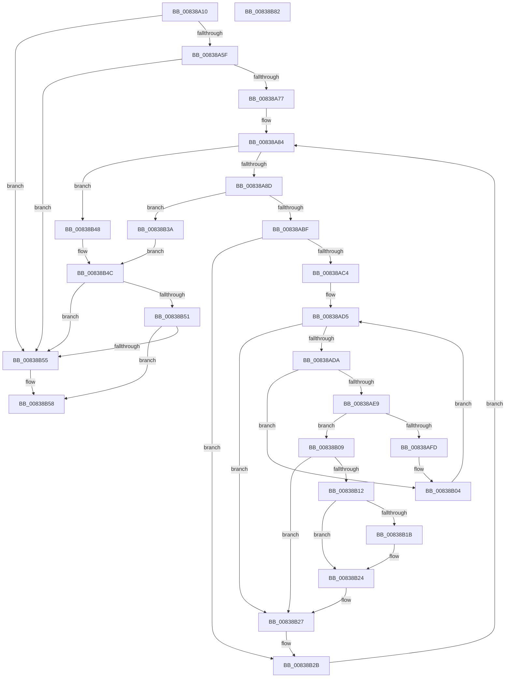

# I_MinAsn1ParseSingleAttribute

- RVA: `0x00838A10`–`0x00838B83` (길이 `371` bytes)
- VA: `0x0000000140838A10`
- 실행 섹션: `PAGE`
- PDB 이름 있음: `예`; PDB Function 태그: `아니요`
- unwind 정보 RVA: `0x000CB48C`
- 디코드: `110`개 명령, `371/371` bytes 표시
- 미해석 바이트: `0` (있으면 어셈블리에 `.byte`로 보존)

> 이 문서는 커널 이미지의 기계어와 PDB 기호를 분석해 생성했습니다. 4번과 5번은 함수 원형과 자료형을 바이너리 사용 방식에서 추정한 C 해석이며 원본 소스 복구 결과는 아닙니다.

## 1. Dependencies

- 직접 호출 지점: **4**; 고유 호출 대상: **4**
- 직접 호출자로 확인된 함수: **4**
- RIP 상대 이미지 참조: **2**

### Outgoing calls
- `0x00838A6A` → [MinAsn1ExtractContent](MinAsn1ExtractContent_function_0083A00C.md) (function, `0x0083A00C`)
- `0x00838AB6` → [MinAsn1ExtractValues](MinAsn1ExtractValues_function_0083A170.md) (function, `0x0083A170`)
- `0x00838AF4` → [memcmp](../../text/6C/memcmp_function_006C6B10.md) (function, `0x006C6B10`)
- `0x00838B62` → [_security_check_cookie](../../text/6A/_security_check_cookie_function_006AC640.md) (function, `0x006AC640`)

### Direct callers
- [I_MinCryptGetPlatformManifestBinaryIDAttribute](I_MinCryptGetPlatformManifestBinaryIDAttribute_function_00837E9C.md) at `0x00837ED6`
- [I_MinCryptGetSigningTime](I_MinCryptGetSigningTime_function_00837F2C.md) at `0x00837F99`
- [I_MinCryptGetSigningTime](I_MinCryptGetSigningTime_function_00837F2C.md) at `0x00838003`
- [I_MinCryptVerifyAuthenticodeTimeStamp](I_MinCryptVerifyAuthenticodeTimeStamp_function_00838090.md) at `0x0083824A`
- [I_MinCryptVerifySignerAuthenticatedAttributes](I_MinCryptVerifySignerAuthenticatedAttributes_function_00838430.md) at `0x00838477`

### Static image references
- `0x00838A2C` → RVA `0x00E0A740` (`.data`; read)
- `0x00838A9D` → RVA `0x0000CFC0` (`.rdata`; read)

## 2. Other-region calls and transfers

- 다른 실행 섹션으로 향하는 call: **2**
  - `0x00838AF4` → [memcmp](../../text/6C/memcmp_function_006C6B10.md) (`PAGE` → `.text`)
  - `0x00838B62` → [_security_check_cookie](../../text/6A/_security_check_cookie_function_006AC640.md) (`PAGE` → `.text`)
- 별도 외부 분기/꼬리 이동을 확인하지 못했습니다.

## 3. Assembly (complete function range)

```asm
00838A10  48 89 5C 24 08                  mov qword ptr [rsp + 8], rbx
00838A15  55                              push rbp
00838A16  56                              push rsi
00838A17  57                              push rdi
00838A18  41 54                           push r12
00838A1A  41 55                           push r13
00838A1C  41 56                           push r14
00838A1E  41 57                           push r15
00838A20  48 8D 6C 24 E1                  lea rbp, [rsp - 0x1f]
00838A25  48 81 EC B0 00 00 00            sub rsp, 0xb0
00838A2C  48 8B 05 0D 1D 5D 00            mov rax, qword ptr [rip + 0x5d1d0d]
00838A33  48 33 C4                        xor rax, rsp
00838A36  48 89 45 0F                     mov qword ptr [rbp + 0xf], rax
00838A3A  48 8B 5A 08                     mov rbx, qword ptr [rdx + 8]
00838A3E  45 32 ED                        xor r13b, r13b
00838A41  48 83 65 A7 00                  and qword ptr [rbp - 0x59], 0
00838A46  4C 8B F1                        mov r14, rcx
00838A49  83 65 9F 00                     and dword ptr [rbp - 0x61], 0
00838A4D  8B 12                           mov edx, dword ptr [rdx]
00838A4F  4C 89 4D B7                     mov qword ptr [rbp - 0x49], r9
00838A53  48 89 4D AF                     mov qword ptr [rbp - 0x51], rcx
00838A57  85 D2                           test edx, edx
00838A59  0F 84 F6 00 00 00               je 0x140838b55
00838A5F  4C 8D 4D A7                     lea r9, [rbp - 0x59]
00838A63  48 8B CB                        mov rcx, rbx
00838A66  4C 8D 45 9F                     lea r8, [rbp - 0x61]
00838A6A  E8 9D 15 00 00                  call 0x14083a00c
00838A6F  85 C0                           test eax, eax
00838A71  0F 8E DE 00 00 00               jle 0x140838b55
00838A77  48 8B 7D A7                     mov rdi, qword ptr [rbp - 0x59]
00838A7B  BE 01 00 00 00                  mov esi, 1
00838A80  44 8B 7D 9F                     mov r15d, dword ptr [rbp - 0x61]
00838A84  45 85 FF                        test r15d, r15d
00838A87  0F 84 BB 00 00 00               je 0x140838b48
00838A8D  48 8D 45 BF                     lea rax, [rbp - 0x41]
00838A91  C7 45 9F 04 00 00 00            mov dword ptr [rbp - 0x61], 4
00838A98  48 89 44 24 28                  mov qword ptr [rsp + 0x28], rax
00838A9D  4C 8D 0D 1C 45 7D FF            lea r9, [rip - 0x82bae4]
00838AA4  4C 8D 45 9F                     lea r8, [rbp - 0x61]
00838AA8  C7 44 24 20 05 00 00 00         mov dword ptr [rsp + 0x20], 5
00838AB0  41 8B D7                        mov edx, r15d
00838AB3  48 8B CF                        mov rcx, rdi
00838AB6  E8 B5 16 00 00                  call 0x14083a170
00838ABB  85 C0                           test eax, eax
00838ABD  7E 7B                           jle 0x140838b3a
00838ABF  45 84 ED                        test r13b, r13b
00838AC2  75 67                           jne 0x140838b2b
00838AC4  4D 8B 4E 08                     mov r9, qword ptr [r14 + 8]
00838AC8  41 8B 0E                        mov ecx, dword ptr [r14]
00838ACB  45 33 F6                        xor r14d, r14d
00838ACE  4C 89 4D A7                     mov qword ptr [rbp - 0x59], r9
00838AD2  89 4D 9F                        mov dword ptr [rbp - 0x61], ecx
00838AD5  44 3B F6                        cmp r14d, esi
00838AD8  73 4D                           jae 0x140838b27
00838ADA  4F 8D 24 B6                     lea r12, [r14 + r14*4]
00838ADE  49 C1 E4 04                     shl r12, 4
00838AE2  42 3B 4C 25 DF                  cmp ecx, dword ptr [rbp + r12 - 0x21]
00838AE7  75 1B                           jne 0x140838b04
00838AE9  4A 8B 54 25 E7                  mov rdx, qword ptr [rbp + r12 - 0x19]
00838AEE  44 8B C1                        mov r8d, ecx
00838AF1  49 8B C9                        mov rcx, r9
00838AF4  E8 17 E0 E8 FF                  call 0x1406c6b10
00838AF9  85 C0                           test eax, eax
00838AFB  74 0C                           je 0x140838b09
00838AFD  8B 4D 9F                        mov ecx, dword ptr [rbp - 0x61]
00838B00  4C 8B 4D A7                     mov r9, qword ptr [rbp - 0x59]
00838B04  44 03 F6                        add r14d, esi
00838B07  EB CC                           jmp 0x140838ad5
00838B09  48 8D 45 BF                     lea rax, [rbp - 0x41]
00838B0D  49 03 C4                        add rax, r12
00838B10  74 15                           je 0x140838b27
00838B12  4C 8B 75 B7                     mov r14, qword ptr [rbp - 0x49]
00838B16  4D 85 F6                        test r14, r14
00838B19  74 09                           je 0x140838b24
00838B1B  0F 28 45 FF                     movaps xmm0, xmmword ptr [rbp - 1]
00838B1F  F3 41 0F 7F 06                  movdqu xmmword ptr [r14], xmm0
00838B24  44 8A EE                        mov r13b, sil
00838B27  4C 8B 75 AF                     mov r14, qword ptr [rbp - 0x51]
00838B2B  8B 45 CF                        mov eax, dword ptr [rbp - 0x31]
00838B2E  48 03 F8                        add rdi, rax
00838B31  44 2B 7D CF                     sub r15d, dword ptr [rbp - 0x31]
00838B35  E9 4A FF FF FF                  jmp 0x140838a84
00838B3A  83 C9 FF                        or ecx, 0xffffffff
00838B3D  85 C0                           test eax, eax
00838B3F  0F 44 C1                        cmove eax, ecx
00838B42  2B DF                           sub ebx, edi
00838B44  03 D8                           add ebx, eax
00838B46  EB 04                           jmp 0x140838b4c
00838B48  2B FB                           sub edi, ebx
00838B4A  8B DF                           mov ebx, edi
00838B4C  45 84 ED                        test r13b, r13b
00838B4F  74 04                           je 0x140838b55
00838B51  85 DB                           test ebx, ebx
00838B53  79 03                           jns 0x140838b58
00838B55  40 32 F6                        xor sil, sil
00838B58  40 8A C6                        mov al, sil
00838B5B  48 8B 4D 0F                     mov rcx, qword ptr [rbp + 0xf]
00838B5F  48 33 CC                        xor rcx, rsp
00838B62  E8 D9 3A E7 FF                  call 0x1406ac640
00838B67  48 8B 9C 24 F0 00 00 00         mov rbx, qword ptr [rsp + 0xf0]
00838B6F  48 81 C4 B0 00 00 00            add rsp, 0xb0
00838B76  41 5F                           pop r15
00838B78  41 5E                           pop r14
00838B7A  41 5D                           pop r13
00838B7C  41 5C                           pop r12
00838B7E  5F                              pop rdi
00838B7F  5E                              pop rsi
00838B80  5D                              pop rbp
00838B81  C3                              ret
00838B82  CC                              int3
```

## 4. C-style interpretation (structured pseudocode)

```c
__int64 __fastcall I_MinAsn1ParseSingleAttribute(__int64 a1, __int64 a2, __int64 a3, __int64 a4)
{
    __int64 result;
    __int64 v_r12;
    __int64 v_r13;
    __int64 v_r14;
    __int64 v_r15;
    __int64 v_rbx;
    __int64 v_rdi;
    __int64 v_rsi;
    __int64 v_rsp;
    unsigned __int64 v_stack_m48;
    unsigned __int64 v_stack_m57;
    unsigned __int64 v_stack_m58;
    unsigned int v_stack_m88;
    unsigned __int64 v_stack_m98;
    unsigned __int64 v_stack_mA0;
    unsigned __int64 v_stack_mA8;
    unsigned __int64 v_stack_mB0;
    unsigned int v_stack_mB8;
    unsigned __int64 v_stack_mC0;
    unsigned int v_stack_mC8;
    unsigned __int64 v_stack_p8;

    v_stack_p8 = v_rbx;
    v_rsp = (v_rsp) - (176);
    result = (*(unsigned __int64 *)(v_rip + 6102285)) ^ (v_rsp);
    v_stack_m48 = result;
    v_r13 = 0;
    v_stack_mA0 = a4;
    v_stack_mA8 = a1;
    if ((unsigned int)((unsigned int)(*(unsigned int *)(a2))) == 0) goto loc_00838B55;
    result = MinAsn1ExtractContent(*(unsigned __int64 *)(a2 + 8), (unsigned int)(*(unsigned int *)(a2)), v_stack_mB8, v_stack_mB0);
    if (condition_is_less_or_equal) goto loc_00838B55;
loc_00838A84:
    if ((unsigned int)((unsigned int)(v_stack_mB8)) == 0) goto loc_00838B48;
    v_stack_mB8 = 4;
    v_stack_mC0 = v_stack_m98;
    v_stack_mC8 = 5;
    result = MinAsn1ExtractValues(v_stack_mB0, (unsigned int)((unsigned int)((unsigned int)(v_stack_mB8))), v_stack_mB8, v_rip - 8567524);
    if (condition_is_less_or_equal) goto loc_00838B3A;
    if (0 != 0) goto loc_00838B2B;
    v_r14 = 0;
    v_stack_mB0 = *(unsigned __int64 *)(a1 + 8);
    v_stack_mB8 = (unsigned int)((unsigned int)(*(unsigned int *)(a1)));
loc_00838AD5:
    if (0 >= 1) goto loc_00838B27;
    v_r12 = (v_r14 + v_r14 * 4) << (4);
    if (((unsigned int)((unsigned int)(*(unsigned int *)(a1)))) != (*(unsigned int *)(v_stack_m57 + v_r12 * 1 - 33))) goto loc_00838B04;
    result = memcmp(*(unsigned __int64 *)(a1 + 8), *(unsigned __int64 *)(v_stack_m57 + v_r12 * 1 - 25), (unsigned int)((unsigned int)((unsigned int)(*(unsigned int *)(a1)))), *(unsigned __int64 *)(a1 + 8));
    if ((unsigned int)(result) == 0) goto loc_00838B09;
loc_00838B04:
    v_r14 = (unsigned int)((v_r14) + (1));
    goto loc_00838AD5;
loc_00838B09:
    result = (v_stack_m98) + (v_r12);
    if (condition_is_equal) goto loc_00838B27;
    if (v_stack_mA0 != 0) {
        *(unsigned __int64 *)(v_stack_mA0) = v_xmm0;
    }
loc_00838B27:
loc_00838B2B:
    v_rdi = (v_stack_mB0) + ((unsigned int)(v_stack_m88));
    v_r15 = (unsigned int)(((unsigned int)(v_stack_mB8)) - (v_stack_m88));
    goto loc_00838A84;
loc_00838B3A:
    a1 = (unsigned int)(((unsigned int)(v_stack_mB8)) | (0xFFFFFFFFULL));
    result = (unsigned int)(v_stack_m88);
    if ((unsigned int)((unsigned int)(v_stack_m88)) == 0) { result = (unsigned int)(a1); }
    v_rbx = (unsigned int)((*(unsigned __int64 *)(a2 + 8)) - ((unsigned int)(v_rdi)));
    v_rbx = (unsigned int)((v_rbx) + ((unsigned int)(result)));
    goto loc_00838B4C;
loc_00838B48:
    v_rdi = (unsigned int)((v_rdi) - ((unsigned int)(v_rbx)));
loc_00838B4C:
    if (1 == 0) goto loc_00838B55;
    v_rsi = 1;
    if (sign_flag) {
        v_rsi = 0;
    }
    a1 = (v_stack_m48) ^ (v_rsp);
    result = _security_check_cookie(a1, *(unsigned __int64 *)(v_stack_m57 + v_r12 * 1 - 25), (unsigned int)((unsigned int)((unsigned int)(*(unsigned int *)(a1)))), v_stack_mB0);
    v_rsp = (v_rsp) + (176);
    return result;
}
```

## 5. (Beta) C Style

```c
int64_t I_MinAsn1ParseSingleAttribute(int64_t Arg1, void *Arg2, int64_t Arg3, int64_t Arg4)
{
    uint8_t *arg2 = (uint8_t *)Arg2;

    int64_t result;
    int64_t local_r12;
    int64_t local_r13;
    int64_t local_r14;
    int64_t local_r15;
    int64_t local_rbx;
    int64_t local_rdi;
    int64_t local_rsi;
    int64_t local_rsp;
    uint64_t v_stack_m48;
    uint64_t v_stack_m57;
    uint64_t v_stack_m58;
    uint32_t v_stack_m88;
    uint64_t v_stack_m98;
    uint64_t v_stack_mA0;
    uint64_t v_stack_mA8;
    uint64_t v_stack_mB0;
    uint32_t v_stack_mB8;
    uint64_t v_stack_mC0;
    uint32_t v_stack_mC8;
    uint64_t v_stack_p8;

    v_stack_p8 = local_rbx;
    local_rsp = (local_rsp) - (176);
    result = (*(uint64_t *)(v_rip + 0x5D1D0D)) ^ (local_rsp);
    v_stack_m48 = result;
    local_r13 = 0;
    v_stack_mA0 = Arg4;
    v_stack_mA8 = Arg1;
    if ((uint32_t)((uint32_t)(*(uint32_t *)(arg2))) == 0) goto loc_00838B55;
    result = MinAsn1ExtractContent(*(uint64_t *)(arg2 + 0x8), (uint32_t)(*(uint32_t *)(arg2)), v_stack_mB8, v_stack_mB0);
    if (condition_is_less_or_equal) goto loc_00838B55;
loc_00838A84:
    if ((uint32_t)((uint32_t)(v_stack_mB8)) == 0) goto loc_00838B48;
    v_stack_mB8 = 4;
    v_stack_mC0 = v_stack_m98;
    v_stack_mC8 = 5;
    result = MinAsn1ExtractValues(v_stack_mB0, (uint32_t)((uint32_t)((uint32_t)(v_stack_mB8))), v_stack_mB8, v_rip - 8567524);
    if (condition_is_less_or_equal) goto loc_00838B3A;
    if (0 != 0) goto loc_00838B2B;
    local_r14 = 0;
    v_stack_mB0 = *(uint64_t *)(Arg1 + 0x8);
    v_stack_mB8 = (uint32_t)((uint32_t)(*(uint32_t *)(Arg1)));
loc_00838AD5:
    if (0 >= 1) goto loc_00838B27;
    local_r12 = (local_r14 + local_r14 * 4) << (4);
    if (((uint32_t)((uint32_t)(*(uint32_t *)(Arg1)))) != (*(uint32_t *)(v_stack_m57 + local_r12 * 1 - 0x21))) goto loc_00838B04;
    result = memcmp(*(uint64_t *)(Arg1 + 0x8), *(uint64_t *)(v_stack_m57 + local_r12 * 1 - 0x19), (uint32_t)((uint32_t)((uint32_t)(*(uint32_t *)(Arg1)))), *(uint64_t *)(Arg1 + 0x8));
    if ((uint32_t)(result) == 0) goto loc_00838B09;
loc_00838B04:
    local_r14 = (uint32_t)((local_r14) + (1));
    goto loc_00838AD5;
loc_00838B09:
    result = (v_stack_m98) + (local_r12);
    if (condition_is_equal) goto loc_00838B27;
    if (v_stack_mA0 != 0) {
        *(uint64_t *)(v_stack_mA0) = v_xmm0;
    }
loc_00838B27:
loc_00838B2B:
    local_rdi = (v_stack_mB0) + ((uint32_t)(v_stack_m88));
    local_r15 = (uint32_t)(((uint32_t)(v_stack_mB8)) - (v_stack_m88));
    goto loc_00838A84;
loc_00838B3A:
    Arg1 = (uint32_t)(((uint32_t)(v_stack_mB8)) | (0xFFFFFFFFULL));
    result = (uint32_t)(v_stack_m88);
    if ((uint32_t)((uint32_t)(v_stack_m88)) == 0) { result = (uint32_t)(Arg1); }
    local_rbx = (uint32_t)((*(uint64_t *)(arg2 + 0x8)) - ((uint32_t)(local_rdi)));
    local_rbx = (uint32_t)((local_rbx) + ((uint32_t)(result)));
    goto loc_00838B4C;
loc_00838B48:
    local_rdi = (uint32_t)((local_rdi) - ((uint32_t)(local_rbx)));
loc_00838B4C:
    if (1 == 0) goto loc_00838B55;
    local_rsi = 1;
    if (sign_flag) {
        local_rsi = 0;
    }
    Arg1 = (v_stack_m48) ^ (local_rsp);
    result = _security_check_cookie(Arg1, *(uint64_t *)(v_stack_m57 + local_r12 * 1 - 0x19), (uint32_t)((uint32_t)((uint32_t)(*(uint32_t *)(Arg1)))), v_stack_mB0);
    local_rsp = (local_rsp) + (176);
    return result;
}
```

### 관측된 메모리 오프셋

구조체 형식이 확인되지 않은 접근은 인자 기준의 오프셋으로만 기록했습니다.

| 기준 인자 | 오프셋 표현 | 폭 (bit) | 접근 |
|---|---:|---:|---|
| `Arg2` | `+ 0x0` | `32` | `R` |
| `Arg2` | `+ 0x8` | `64` | `R` |

## 6. Execution-region graph

[열기: 2D/3D 그래프와 함수 탐색 컨트롤 패널](../../../control-panel.html?section=page&rva=0x00838A10&view=graph)

- 2D 그래프는 위에서 아래로 흐르고, 3D 그래프는 빈 공간을 드래그해 회전합니다. Shift+드래그는 이동, 휠은 확대·축소, 함수 노드 선택은 대상 보고서 이동입니다.

### Static fallback


