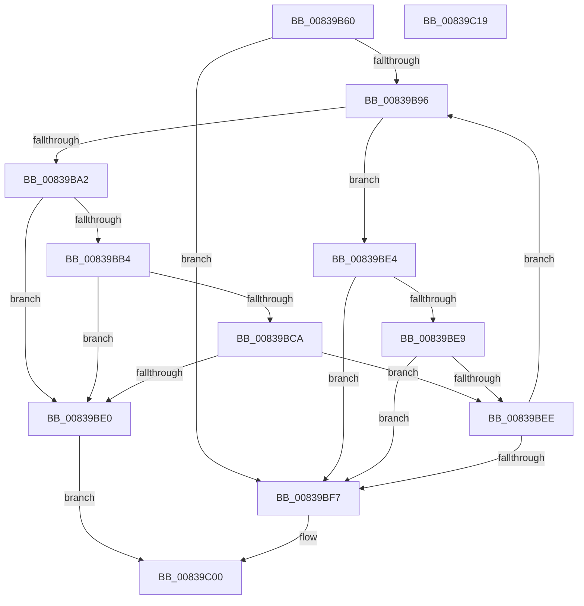

# I_MinAsn1ScanFrac

- RVA: `0x00839B60`–`0x00839C1A` (길이 `186` bytes)
- VA: `0x0000000140839B60`
- 실행 섹션: `PAGE`
- PDB 이름 있음: `예`; PDB Function 태그: `예`
- unwind 정보 RVA: `0x00060300`
- 디코드: `63`개 명령, `186/186` bytes 표시
- 미해석 바이트: `0` (있으면 어셈블리에 `.byte`로 보존)

> 이 문서는 커널 이미지의 기계어와 PDB 기호를 분석해 생성했습니다. 4번과 5번은 함수 원형과 자료형을 바이너리 사용 방식에서 추정한 C 해석이며 원본 소스 복구 결과는 아닙니다.

## 1. Dependencies

- 직접 호출 지점: **4**; 고유 호출 대상: **2**
- 직접 호출자로 확인된 함수: **2**
- RIP 상대 이미지 참조: **0**

### Outgoing calls
- `0x00839B99` → [isdigit](../../text/50/isdigit_function_00500680.md) (function, `0x00500680`)
- `0x00839BAB` → [RtlLongLongToInt](../../text/6A/RtlLongLongToInt_function_006A64B0.md) (function, `0x006A64B0`)
- `0x00839BC1` → [RtlLongLongToInt](../../text/6A/RtlLongLongToInt_function_006A64B0.md) (function, `0x006A64B0`)
- `0x00839BD7` → [RtlLongLongToInt](../../text/6A/RtlLongLongToInt_function_006A64B0.md) (function, `0x006A64B0`)

### Direct callers
- [I_MinAsn1CalculateTimeOffset](I_MinAsn1CalculateTimeOffset_function_008397B8.md) at `0x0083982C`
- [I_MinAsn1DecodeGeneralizedTimeFraction](I_MinAsn1DecodeGeneralizedTimeFraction_function_0083994C.md) at `0x008399A3`

### Static image references
- 디코드된 RIP-relative 메모리 참조가 없습니다.

## 2. Other-region calls and transfers

- 다른 실행 섹션으로 향하는 call: **4**
  - `0x00839B99` → [isdigit](../../text/50/isdigit_function_00500680.md) (`PAGE` → `.text`)
  - `0x00839BAB` → [RtlLongLongToInt](../../text/6A/RtlLongLongToInt_function_006A64B0.md) (`PAGE` → `.text`)
  - `0x00839BC1` → [RtlLongLongToInt](../../text/6A/RtlLongLongToInt_function_006A64B0.md) (`PAGE` → `.text`)
  - `0x00839BD7` → [RtlLongLongToInt](../../text/6A/RtlLongLongToInt_function_006A64B0.md) (`PAGE` → `.text`)
- 별도 외부 분기/꼬리 이동을 확인하지 못했습니다.

## 3. Assembly (complete function range)

```asm
00839B60  48 89 5C 24 08                  mov qword ptr [rsp + 8], rbx
00839B65  48 89 6C 24 10                  mov qword ptr [rsp + 0x10], rbp
00839B6A  48 89 74 24 18                  mov qword ptr [rsp + 0x18], rsi
00839B6F  57                              push rdi
00839B70  41 56                           push r14
00839B72  41 57                           push r15
00839B74  48 83 EC 20                     sub rsp, 0x20
00839B78  41 83 21 00                     and dword ptr [r9], 0
00839B7C  33 FF                           xor edi, edi
00839B7E  4C 8B 74 24 60                  mov r14, qword ptr [rsp + 0x60]
00839B83  49 8B F1                        mov rsi, r9
00839B86  45 8A F8                        mov r15b, r8b
00839B89  8B EA                           mov ebp, edx
00839B8B  48 8B D9                        mov rbx, rcx
00839B8E  41 83 26 00                     and dword ptr [r14], 0
00839B92  85 D2                           test edx, edx
00839B94  74 61                           je 0x140839bf7
00839B96  0F B6 0B                        movzx ecx, byte ptr [rbx]
00839B99  E8 E2 6A CC FF                  call 0x140500680
00839B9E  85 C0                           test eax, eax
00839BA0  74 42                           je 0x140839be4
00839BA2  49 63 0E                        movsxd rcx, dword ptr [r14]
00839BA5  49 8B D6                        mov rdx, r14
00839BA8  48 FF C1                        inc rcx
00839BAB  E8 00 C9 E6 FF                  call 0x1406a64b0
00839BB0  85 C0                           test eax, eax
00839BB2  78 2C                           js 0x140839be0
00839BB4  48 63 06                        movsxd rax, dword ptr [rsi]
00839BB7  48 8B D6                        mov rdx, rsi
00839BBA  48 8D 0C 80                     lea rcx, [rax + rax*4]
00839BBE  48 03 C9                        add rcx, rcx
00839BC1  E8 EA C8 E6 FF                  call 0x1406a64b0
00839BC6  85 C0                           test eax, eax
00839BC8  78 16                           js 0x140839be0
00839BCA  48 63 06                        movsxd rax, dword ptr [rsi]
00839BCD  0F B6 0B                        movzx ecx, byte ptr [rbx]
00839BD0  48 83 C0 D0                     add rax, -0x30
00839BD4  48 03 C8                        add rcx, rax
00839BD7  E8 D4 C8 E6 FF                  call 0x1406a64b0
00839BDC  85 C0                           test eax, eax
00839BDE  79 0E                           jns 0x140839bee
00839BE0  32 C0                           xor al, al
00839BE2  EB 1C                           jmp 0x140839c00
00839BE4  80 3B 3A                        cmp byte ptr [rbx], 0x3a
00839BE7  75 0E                           jne 0x140839bf7
00839BE9  45 84 FF                        test r15b, r15b
00839BEC  74 09                           je 0x140839bf7
00839BEE  FF C7                           inc edi
00839BF0  48 FF C3                        inc rbx
00839BF3  3B FD                           cmp edi, ebp
00839BF5  72 9F                           jb 0x140839b96
00839BF7  48 8B 4C 24 68                  mov rcx, qword ptr [rsp + 0x68]
00839BFC  B0 01                           mov al, 1
00839BFE  89 39                           mov dword ptr [rcx], edi
00839C00  48 8B 5C 24 40                  mov rbx, qword ptr [rsp + 0x40]
00839C05  48 8B 6C 24 48                  mov rbp, qword ptr [rsp + 0x48]
00839C0A  48 8B 74 24 50                  mov rsi, qword ptr [rsp + 0x50]
00839C0F  48 83 C4 20                     add rsp, 0x20
00839C13  41 5F                           pop r15
00839C15  41 5E                           pop r14
00839C17  5F                              pop rdi
00839C18  C3                              ret
00839C19  CC                              int3
```

## 4. C-style interpretation (structured pseudocode)

```c
__int64 __fastcall I_MinAsn1ScanFrac(__int64 a1, int a2, unsigned __int8 a3, __int64 a4, __int64 a5, __int64 a6)
{
    __int64 result;
    __int64 v_rbx;
    __int64 v_rdi;
    __int64 v_rsp;
    unsigned __int64 v_stack_p10;
    unsigned __int64 v_stack_p18;
    unsigned __int64 v_stack_p8;

    v_stack_p8 = v_rbx;
    v_stack_p10 = v_rbp;
    v_stack_p18 = v_rsi;
    v_rsp = (v_rsp) - (32);
    v_rdi = 0;
    if (a2 == 0) goto loc_00839BF7;
loc_00839B96:
    result = isdigit(*(unsigned __int8 *)(a1), a2, a3, a4);
    if ((unsigned int)(result) == 0) goto loc_00839BE4;
    a1 = ((int)(*(unsigned int *)(a5))) + 1;
    result = RtlLongLongToInt(a1, a5, a3, a4);
    if (sign_flag) goto loc_00839BE0;
    a1 = ((int)(*(unsigned int *)(a4)) + (int)(*(unsigned int *)(a4)) * 4) + ((int)(*(unsigned int *)(a4)) + (int)(*(unsigned int *)(a4)) * 4);
    result = RtlLongLongToInt(a1, a4, a3, a4);
    if (sign_flag) goto loc_00839BE0;
    result = ((int)(*(unsigned int *)(a4))) + (-48);
    a1 = (*(unsigned __int8 *)(a1)) + (result);
    result = RtlLongLongToInt(a1, a4, a3, a4);
    if (!sign_flag) goto loc_00839BEE;
loc_00839BE0:
    result = 0;
    goto loc_00839C00;
loc_00839BE4:
    if ((*(unsigned __int8 *)(a1)) != 58) goto loc_00839BF7;
    if (a3 == 0) goto loc_00839BF7;
loc_00839BEE:
    v_rdi = (unsigned int)((v_rdi) + 1);
    v_rbx = (a1) + 1;
    if (((unsigned int)(v_rdi)) < ((unsigned int)((unsigned int)(a2)))) goto loc_00839B96;
loc_00839BF7:
    *(unsigned int *)(a6) = (unsigned int)(v_rdi);
loc_00839C00:
    v_rsp = (v_rsp) + (32);
    return 1;
}
```

## 5. (Beta) C Style

```c
int64_t I_MinAsn1ScanFrac(int64_t Arg1, int32_t Arg2, uint8_t Arg3, void *Arg4, void *Arg5, void *Arg6)
{
    uint8_t *arg4 = (uint8_t *)Arg4;
    uint8_t *arg5 = (uint8_t *)Arg5;
    uint8_t *arg6 = (uint8_t *)Arg6;

    int64_t result;
    int64_t local_rbx;
    int64_t local_rdi;
    int64_t local_rsp;
    uint64_t v_stack_p10;
    uint64_t v_stack_p18;
    uint64_t v_stack_p8;

    v_stack_p8 = local_rbx;
    v_stack_p10 = local_rbp;
    v_stack_p18 = local_rsi;
    local_rsp = (local_rsp) - (32);
    local_rdi = 0;
    if (Arg2 == 0) goto loc_00839BF7;
loc_00839B96:
    result = isdigit(*(uint8_t *)(Arg1), Arg2, Arg3, Arg4);
    if ((uint32_t)(result) == 0) goto loc_00839BE4;
    Arg1 = ((int32_t)(*(uint32_t *)(arg5))) + 1;
    result = RtlLongLongToInt(Arg1, Arg5, Arg3, Arg4);
    if (sign_flag) goto loc_00839BE0;
    Arg1 = ((int32_t)(*(uint32_t *)(arg4)) + (int32_t)(*(uint32_t *)(arg4)) * 4) + ((int32_t)(*(uint32_t *)(arg4)) + (int32_t)(*(uint32_t *)(arg4)) * 4);
    result = RtlLongLongToInt(Arg1, Arg4, Arg3, Arg4);
    if (sign_flag) goto loc_00839BE0;
    result = ((int32_t)(*(uint32_t *)(arg4))) + (-48);
    Arg1 = (*(uint8_t *)(Arg1)) + (result);
    result = RtlLongLongToInt(Arg1, Arg4, Arg3, Arg4);
    if (!sign_flag) goto loc_00839BEE;
loc_00839BE0:
    result = 0;
    goto loc_00839C00;
loc_00839BE4:
    if ((*(uint8_t *)(Arg1)) != 58) goto loc_00839BF7;
    if (Arg3 == 0) goto loc_00839BF7;
loc_00839BEE:
    local_rdi = (uint32_t)((local_rdi) + 1);
    local_rbx = (Arg1) + 1;
    if (((uint32_t)(local_rdi)) < ((uint32_t)((uint32_t)(Arg2)))) goto loc_00839B96;
loc_00839BF7:
    *(uint32_t *)(arg6) = (uint32_t)(local_rdi);
loc_00839C00:
    local_rsp = (local_rsp) + (32);
    return 1;
}
```

### 관측된 메모리 오프셋

구조체 형식이 확인되지 않은 접근은 인자 기준의 오프셋으로만 기록했습니다.

| 기준 인자 | 오프셋 표현 | 폭 (bit) | 접근 |
|---|---:|---:|---|
| `Arg4` | `+ 0x0` | `32` | `R` |
| `Arg4` | `+ 0x0` | `32` | `R/W` |
| `Arg5` | `+ 0x0` | `32` | `R` |
| `Arg5` | `+ 0x0` | `32` | `R/W` |
| `Arg6` | `+ 0x0` | `32` | `W` |

## 6. Execution-region graph

[열기: 2D/3D 그래프와 함수 탐색 컨트롤 패널](../../../control-panel.html?section=page&rva=0x00839B60&view=graph)

- 2D 그래프는 위에서 아래로 흐르고, 3D 그래프는 빈 공간을 드래그해 회전합니다. Shift+드래그는 이동, 휠은 확대·축소, 함수 노드 선택은 대상 보고서 이동입니다.

### Static fallback


